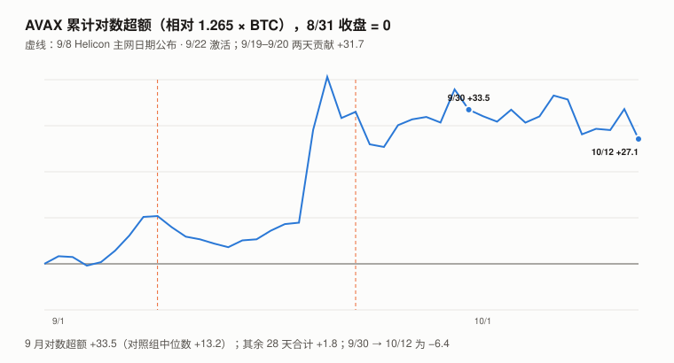
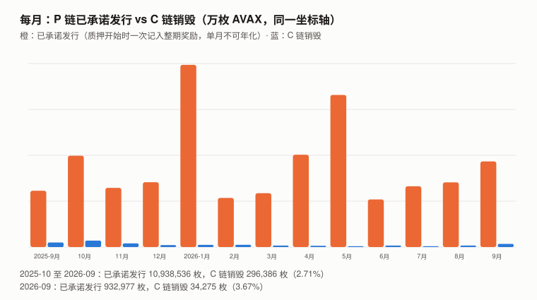
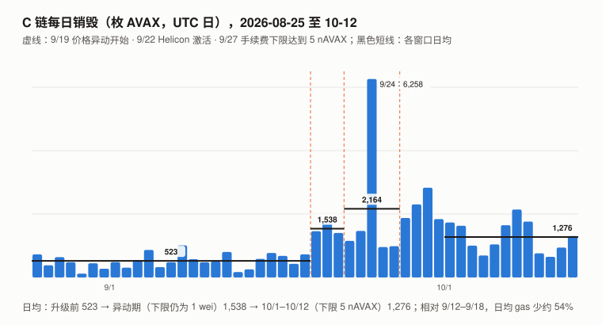

# AVAX / Avalanche 完整调研与分析报告（2026 年 9 月版，首期）

> **编写日期**：2026 年 10 月 13 日
> **数据截止**：2026 年 9 月 30 日；链上快照到 10/12–10/13
> **研究方法**：沿用本系列框架。价格用**币安现货 AVAXUSDT 日线 UTC 收盘**；超额收益用对数口径（ln 收益 − beta × ln BTC 收益，不扣截距）；对照组为本系列 9 个山寨（ZEC、UNI、ADA、SOL、BNB、ETH、TRX、CKB、DOT）。**链上数据全部自己读**：P 链用官方公共 RPC（`api.avax.network/ext/bc/P`）与官方数据接口（Data API，`data-api.avax.network`）；C 链用官方公共 RPC（存档节点，可读历史余额与区块头）。
> **本期为 AVAX 首期报告**，本系列第十九个对象。
>
> **接入新资产的第一步：三个默认还成立吗**（XIN 期教训）：
>
> | 检查 | 结果 | 依据 |
> |---|:---:|---|
> | **流通量已知吗** | ⚠️ **总量可以从协议字段推出，但三个口径相差最多约 470 万枚（约 1%），本报告没有完全勾稽** | P 链 `platform.getCurrentSupply` 10/13 为 **475,129,276 枚**——**但它不是实际供应**：AvalancheGo 源码在质押**开始时**就把「预计奖励」加进这个数（验证人没拿到奖励再扣回），**手续费销毁不改它**（4.1）。扣掉三条链的累计销毁与已承诺未发放的奖励后约 4.65–4.66 亿；官方数据接口给 **4.685 亿**，CoinGecko 给 4.700 亿。**上限 7.2 亿枚**（ACP-285 原文）；锁定中的约 2,794 万枚（数据接口字段）不在 CoinGecko 的流通量里 |
> | **价格是可用的测量吗** | ✅ | 币安 9 月现货日成交中位数约 $3,030 万、永续合约约 $1.15 亿；一年 beta 1.265、**R² 0.520** |
> | **代币持有人是剩余索取权人吗** | ❌ **没有找到赋权文件** | 手续费**全部烧掉**（C 链区块的 `miner` 字段就是销毁地址 `0x0100…0000`），不分给任何人；**质押奖励来自新发行，不来自收入**；AVAX 对 Ava Labs、Avalanche 基金会或任何公司没有请求权 |
>
> **本期核心发现**：
> 1. **9 月 +51.21%，但几乎全部来自两天**：9/19 +20.7%、9/20 +11.4%，同期 BTC 与对照组基本不动；这两天的对数超额合计 **+31.7**，**9 月其余 28 天合计只有 +1.8**。媒体普遍归因于 9/22 的 Helicon 升级（主网日期 9/8 已在发布说明里公开）；「临近激活抢跑、激活后兑现」这个版本与 9/21、9/23 的负超额相容，但涨幅摊在约 40 个小时里（单小时最多约 20%），合约持仓量这三天增加 27%，对照组同期不动（不像板块轮动）。**本报告判别不了原因，记为未识别**（3.2）。截至 10/12，两天跳涨的超额保留了约 85%。
> 2. **Helicon 让验证人第一次能投票决定 C 链手续费下限**：9/22 激活后，下限从 1 wei 持续上升，约 9/27 到 **5 nAVAX** 后停住——爬升速度约为协议允许最快速度的 36%，说明观察期内约三分之一以上的出块权重在净推动上调（其余弃权时即可做到，**推不出「过半」**）。下限生效后（10/1–10/12 对 9/12–9/18）：**日均销毁从约 517 枚升到约 1,276 枚**；区块头记的 gas 少了约 54%（Helicon 后区块头可能记的是计费量；按逐笔收据抽样折算，实际用量约少 73%）。**基础费在销毁中的占比从升级前的约 2.5%–4% 升到约 34%–75%**（因窗口与方法而异），这部分随下限浮动。⚠️ **这是构成，不是归因**：没有下限时 10 月会烧多少（热度退回则约 517 枚/天，热度仍在则约 1,500 枚/天）测不到，下限的净效应约在每天 −220 到 +760 枚之间，本报告收窄不了（5.3）。交易笔数在 9/12 就已从约 212 万/天断崖降到约 67 万，**不是下限生效造成的**。
> 3. **发行远大于销毁**：P 链「已承诺供应」一年（2025-10 至 2026-09）增加 **1,094 万枚**，同期 C 链销毁 **29.6 万枚**（约为前者的 2.7%）；按这个口径净增约 2.29%/年。⚠️ 已承诺口径没扣「未到期奖励池」的变化，**实际净增给不出点估计**；按「质押量 × 协议奖励率」的情景估算，近 12 个月的应计约 2.1%–2.85%（毛，**是情景，不是上下界**）。**往后看**，按 Helicon 后的新奖励率（4.0%–6.38%）× 质押占比 39.8%，约 **1.6%–2.5%/年**。官方数据接口「已发放奖励」字段给出的近 342 天 1,453 万枚（年化约 3.3%）**本报告不采用**：它隐含的未发放额（约 141 万）小于本报告实测的验证人未发放额（357 万），字段口径与本报告理解的不一致（4.1、4.2）。
> 4. **Helicon 还把短期质押的奖励下限从 10% 降到 7.5%**（ACP-285，90 天线性过渡，**12/21 完成**；已在进行中的质押不受影响）。ACP 作者自己估计的效果是**年通胀降 0.5–1 个百分点**（按他们的「流通」口径，分母不含质押量）。
> 5. **机构通道**：截至 6/30，三只美国现货 AVAX ETF 合计约 **491.5 万枚**（约占总供应 1.05%），两家上市财库公司合计约 **2,940 万枚**（约 6.3%）。**其中 Avalanche Treasury Co.（AVAT）约 70% 的 AVAX 已质押给贷款方作抵押**，贷款包括一笔 FalconX 的**可随时召回**的开放式贷款；维持保证金门槛未披露，**若维持线不高于初始抵押线，价格至少要比 9/30 跌约 43% 才会触发**（6.2）。
>
> **本期核心判断**：**AVAX 的手续费全部烧掉，但近 12 个月烧掉的只有新发行的约 2.7%（10 月前 12 天的运行速度约 4%）：持有人面对的是每年约 2%–3% 的净供应增长（Helicon 后的奖励率下前瞻约 1.6%–2.5%），质押者用约 4%–6.4% 的名义奖励抵消它，不质押的人承担它。** Helicon 的两项改动方向一致——少发、多烧：发行端降低短期质押的奖励下限，销毁端提高手续费下限——**但按 10 月前 12 天的运行速度，销毁一年约 47 万枚，仍只抵消约 4% 的发行**。9 月的价格表现与这些机制没有可证明的联系。
> **本报告不给目标价**：持有人没有请求权，手续费不归持有人，本报告没有可信的估值模型与参数。销毁相对于不销毁每年少增加约 0.06% 的供应——作用是真实的，但量级很小。**Standard Chartered 2025-04 给出的「2026 年 $100」目标**，9/30 的实际价格约为它的 11%（目标期限到年底，尚未到期；第 9 章）。
>
> **免责声明**：本报告不构成任何投资建议。所有分析仅供研究参考，投资决策请咨询专业顾问。

---

## 核心结论摘要（一页速览）

| 维度 | 核心判断 |
|------|----------|
| **AVAX 是什么** | Avalanche 主网（Primary Network）的原生代币：用于 P 链质押（验证人至少 2,000 枚、委托人至少 25 枚）、支付三条链的手续费（全部销毁）、支付 L1 验证人的持续费（也销毁） |
| **9/30 收盘** | **$10.937**（币安）；按 CoinGecko 流通量 4.434 亿枚，**市值约 $48.5 亿**（按总供应约 4.685 亿为 $51.2 亿） |
| **9 月 / Q3 / 近一年** | **+51.21% / +67.28% / −63.56%**（BTC +6.42% / +42.64% / −26.68%） |
| **beta / R² / 波动率** | **1.265 / 0.520 / 79.0%**（2025-09-30 至 2026-09-30，365 个日收益） |
| **对数超额** | 9 月 **+33.5**（对照组中位数 +13.2），**其中 9/19–9/20 两天 +31.7**；Q3 **+6.5**（对照组中位数 +2.8） |
| **供应** | 上限 7.2 亿；10/13 约 4.65–4.70 亿（口径见 4.1）；质押 **1.865 亿枚**（约占总供应的 39.8%） |
| **一年发行 / 销毁** | 已承诺发行 **+1,094 万** / C 链销毁 **29.6 万**（2025-10 至 2026-09）；已承诺口径净增 **2.29%/年**（情景估算约 2%–3%；前瞻约 1.6%–2.5%） |
| **9 月** | 已承诺发行 +93.3 万；C 链销毁 **34,275 枚**（约 $30 万） |
| **Helicon（9/22）** | 6 个 ACP；**C 链手续费下限 1 wei → 5 nAVAX**（验证人投票）；短期质押奖励下限 10% → 7.5%（过渡到 12/21）；最短质押 48 小时 + 自动续期 |
| **机构持有（6/30）** | ETF 约 491.5 万；财库公司约 2,940 万（AVAT 约 70% 已质押作抵押） |
| **持有人权益** | **无请求权**；手续费烧掉、不分配；质押奖励来自新发行 |
| **估值** | **不给目标价**（第 9 章） |

---

## 1. AVAX 是什么

### 1.1 三条链与代币的用途

| 链 | 作用 | AVAX 在这里做什么 |
|---|---|---|
| **P 链**（Platform Chain） | 质押、验证人管理、L1 注册 | 质押（验证人至少 2,000、委托人至少 25，ACP-285 原文）；L1 验证人按秒交持续费（**销毁**） |
| **C 链**（Contract Chain） | EVM 智能合约 | 付 gas；**基础费与优先费都给区块的 `miner`，而 `miner` 固定是销毁地址 `0x0100000000000000000000000000000000000000`**（本报告读 10/13 最新区块头确认） |
| **X 链**（Exchange Chain） | UTXO 转账 | 付手续费（销毁）；累计销毁很小（约 4.56 万枚） |

**L1**（原称 Subnet，子网）是挂在 Avalanche 上的独立区块链。2024-12-16 的 Etna 升级（ACP-77）之后，L1 的验证人不再需要在主网质押 2,000 AVAX，改为按秒向 P 链交持续费（这笔费用烧掉）。

### 1.2 供应规则

| 项 | 规则 | 来源 |
|---|---|---|
| 上限 | **7.2 亿枚** | ACP-285 原文（`SupplyCap`） |
| 创世 | 3.6 亿枚 | 官方数据接口 `genesisUnlock` 字段；P 链 1 号块的 `currentSupply` 为 3.6401 亿（含创世验证人的预计奖励） |
| 新发行 | **只有质押奖励一条路** | — |
| 奖励公式 | `ARR(d) = (剩余可发 ÷ 当前供应) × (下限 + (上限 − 下限) × d ÷ 365)`；下限 `MinConsumptionRate` 10%（Helicon 后 90 天降到 7.5%），上限 `MaxConsumptionRate` 12% | ACP-285 原文 |
| 当前奖励率 | 14 天质押约 5.36%，365 天约 6.38%（ACP-285 按供应 4.70 亿计算；新下限下 14 天为 4.08%） | ACP-285 原文 |

> **一个容易被忽略的乘数**：公式里的「剩余可发 ÷ 当前供应」会随供应增长自动变小——**供应越接近 7.2 亿，同样的名义利率发得越少**。这就是 ACP-285 说的「有限的安全预算」。

### 1.3 销毁

| 销毁类型 | 累计（10/13 官方数据接口） |
|---|---:|
| C 链（EVM 交易 + 跨链原子交易） | 5,104,141 |
| P 链（含 L1 验证人持续费 18,566） | 19,346 |
| X 链 | 45,621 |
| **合计** | **5,169,108** |

C 链的数字与销毁地址的链上余额（10/13 读 5,104,369）一致——**但这两个数大概率是同一个来源**：DefiLlama 的 Avalanche 费用适配器源码（`fees/avalanche.ts`）就是取这个地址的每日余额变化。**C 链销毁只有一个物理来源（销毁地址余额），三个读数（链上直读、官方数据接口、DefiLlama）不构成三次独立验证**（CKB 期规则）。

---

## 2. AVAX 的发展阶段划分

| 阶段 | 时间 | 事件 |
|---|---|---|
| 一 | 2020-09 | 创世（P 链 1 号块时间戳 2020-09-10）；三链架构 |
| 二 | 2021–2024 | 子网（Subnet）模式：L1 验证人需在主网质押 2,000 AVAX |
| 三 | **2024-12-16** | **Etna**（ACP-77）：L1 验证人改交持续费；**ACP-125 把 C 链最低基础费从 25 nAVAX 降到 1 nAVAX** |
| 四 | **2025-04-08** | **Fortuna**（ACP-176）：C 链动态费用，**最低 gas 价降到 1 wei** |
| 四 | 2025-11-19 | Granite（ACP-181/204/226）：动态最短出块时间等 |
| 五 | **2026-09-22 15:00 UTC** | **Helicon**（ACP-194/236/267/273/283/285）：C 链异步执行；质押自动续期；最短质押 48 小时；在线率门槛提高；**手续费下限改为验证人投票**；**短期质押奖励下限下调** |

> **C 链手续费下限的路径**：25 nAVAX（2024-12 前）→ 1 nAVAX（Etna）→ 1 wei（Fortuna，等于没有下限）→ **验证人投票决定，9/27 起为 5 nAVAX**（Helicon）。**现在的下限仍只有 2024 年前的五分之一。**

---

## 3. AVAX 当前现状

### 3.1 价格与市场

| 指标 | 数值 |
|---|---|
| 9/30 收盘 | **$10.937**（9 月最低收盘 $7.194 在 9/2，最高 $11.436 在 9/29） |
| 9 月 / Q3 / 近一年 | **+51.21% / +67.28% / −63.56%** |
| BTC 同期 | +6.42% / +42.64% / −26.68% |
| 一年 beta / R² / 波动率 | **1.265 / 0.520 / 79.0%** |
| 特质（残差）标准差 | 日 2.86%；按月约 15.7、按季约 27.5 个对数点 |
| 9 月对数超额 | **+33.5**（对照组中位数 +13.2） |
| Q3 对数拆分 | 对数收益 51.4 = beta × BTC 44.9 + 残差 6.5（**Q3 大部分是 beta**） |
| 10/1–10/12 | −7.23%（BTC −0.89%），超额 −6.4 |

> **口径**：9 月 = 8/31 收盘 → 9/30 收盘；Q3 = 6/30 → 9/30；近一年 = 2025-09-30 → 2026-09-30。对照组 9 个资产用同一口径。

### 3.2 9/19–9/20：两天的个币异动，原因未识别

| 日期 | AVAX | BTC | 对数超额 | 相对对照组中位数 | 币安现货成交 |
|---|---:|---:|---:|---:|---:|
| 9/18 | +7.5% | +5.7% | +0.3 | +1.0 | $4,710 万 |
| **9/19** | **+20.7%** | +0.5% | **+20.2** | **+20.6** | $8,500 万 |
| **9/20** | **+11.4%** | −0.1% | **+11.5** | **+10.7** | $1.514 亿 |
| 9/21 | −0.7% | +6.5% | −8.9 | −5.6 | $1.108 亿 |
| 9/22（Helicon 激活） | +0.7% | −0.5% | +1.3 | −0.3 | $6,100 万 |
| 9/23 | −9.7% | −2.1% | −7.0 | −5.5 | $6,290 万 |

（表中涨跌幅是简单收益，超额是对数口径。）

**9 月 +33.5 的超额里，这两天贡献 +31.7，其余 28 天合计 +1.8。** 两天合计约为单月特质标准差（15.7）的 2 倍。

**这两天发生了什么——本报告做的判别**：

| 假设 | 它会预测什么 | 实测 | 判别力 |
|---|---|---|---|
| **「Helicon 预期」**（媒体主流说法：CoinMarketCap、Bloomingbit、Blockchain.News） | 版本 A：消息公布时反应；版本 B：临近激活抢跑、激活后兑现 | 主网日期 9/8 已在 v1.15.0 发布说明里公开，9/8 当天超额 +0.2（不支持 A）；9/19–9/20 +31.7，激活前一天 9/21 −8.9、激活后 9/23 −7.0（与 B 相容） | ⚠️ **B 不排除**；但 B 解释不了为什么是 9/19 而不是更早（杠杆假设同样解释不了时点），且到 10/12 跳涨保留约 85%，「兑现」并不彻底 |
| 板块轮动 | 对照组同涨 | 对照组中位数当天 +0.1 / +0.7；AVAX 相对它 +20.6 / +10.7 | ❌ 不支持 |
| 单条消息冲击 | 涨幅集中在一两个小时 | 48 小时对数涨幅 32.2，**最大的一小时（9/20 11:00 UTC）+6.4，约占 20%**；最大三小时合计约占 48% | 不像单条消息 |
| 杠杆推动 | 合约持仓量上升、资金费率走高、主动买入占优 | 持仓量 9/18 → 9/21 从 895 万枚升到 1,140 万枚（**+27%**）；**资金费率 9/14–9/16 多数时段低于 0.0100%（9/15 有负值），9/17 末起回到 0.0100% 并停住，9/18–9/20 九个时段全部 0.0100%**——这是币安公式里溢价处在钳位区间时的取值（公式本报告未核实），有小幅上移，**但不是高位**；主动买入占比现货 0.486 / 0.489、永续 0.498 / 0.494（约一半） | 持仓量支持「有新杠杆进来」，费率与主动买入不支持「多头抢跑」——**日度数据判别不了** |
| 代币化股票资金流入（Cryptobriefing 9/28：截至 9/25 的一周 $1.312 亿） | 流入与价格同步 | 窗口覆盖异动，但该数字没有标明来源（同文的月度数字归给 Token Terminal），本报告未核实 | ❌ 不能用 |

**结论：原因未识别。** 「Helicon 抢跑」与「杠杆进场」都和数据相容，本报告找不到能在它们之间判别的证据；板块轮动不被对照组支持。**9/21 收盘（激活前）到 9/30 合计 +1.8；9/30 到 10/12 −6.4。**从 8/31 起累计，到 10/12 为 +27.1——两天跳涨的 +31.7 **保留了约 85%**；10/12 的 AVAX/BTC 比跳涨前（9/1–9/18）的均值高约 26%。

### 3.3 宏观环境

与 BTC 9 月版共用（美联储 9/16 加息 25bp 至 3.75–4.00%）。AVAX 对 BTC 的 R² 0.520、beta 1.265——**Q3 的 67% 大部分是「高 beta 的 BTC」**，9 月才出现明显的个币成分。

---

## 4. 供应：发行与销毁（本期核心章之一）

### 4.1 三个供应口径，以及它们为什么不同

AvalancheGo 源码（`vms/platformvm/txs/executor/`）里，`currentSupply` 只在三处被改：

1. **新质押开始时**：`newCurrentSupply = currentSupply + potentialReward`——**预计奖励在质押开始时就先加进去**（`standard_tx_executor.go`）；
2. **自动续期时**：同样先加下一期的预计奖励（`state_changes.go`）；
3. **质押结束但不合格**（在线率不够）：把先加的奖励扣回（`proposal_tx_executor.go`，注释原文：「Potential rewards are added optimistically to the current supply when the validator is added so they must be deducted on abort」）。

**手续费销毁不改 `currentSupply`。** 所以：

| 口径（10/13） | 枚数 | 说明 |
|---|---:|---|
| P 链 `getCurrentSupply` | **475,129,276** | 含已承诺、未发放的奖励；未扣销毁 |
| − 验证人未发放奖励 | −3,571,433 | 本报告用 `getCurrentValidators` 逐个加总 585 个验证人的 `potentialReward` |
| − 委托人未发放奖励 | **未测** | 公共接口已不返回委托明细（45,006 笔委托、4,137 万枚）；按验证人的比例粗估约 100 万 |
| − 三条链累计销毁 | −5,169,108 | 1.3 节 |
| **= 推算实际供应** | **约 4.654–4.664 亿** | 委托人部分取 0 至约 100 万 |
| 官方数据接口 `totalSupply` | 468,547,650 | = 3.6 亿 + `totalRewards`（113,716,758）− 累计销毁 |
| CoinGecko `total_supply` | 470,023,670 | 约等于 `getCurrentSupply` − 累计销毁（推测，含未发放奖励） |

**本报告的推算与官方数据接口差约 220–320 万枚（0.5%–0.7%），没有勾稽上。** 可能的原因是数据接口的 `totalRewards` 定义与本报告理解的不同（OpenAPI 文档只写「The total rewards AVAX」），**未核实**。本报告的市值与比率用 CoinGecko 流通量（4.434 亿）和数据接口的总供应（4.685 亿）两个口径并列。

> **CoinGecko 的流通量**（4.434 亿）比它自己的总供应少约 2,667 万，与数据接口的 `totalLocked`（2,794 万，「The total locked AVAX」）量级相近——**锁定部分的解锁时间表本报告没有核实**。数据接口文档的示例值（2025-11-05）为 3,616 万，**近 11 个月减少约 822 万枚**（示例值是否为真实快照未核实；它的各字段满足 `totalSupply = 3.6 亿 + totalRewards − 销毁` 的恒等式）。

### 4.2 月度：已承诺发行 vs C 链销毁

> **推导方法**：已承诺发行 = 官方数据接口逐块返回的 P 链 `currentSupply` 在每月 1 日 00:00 UTC 之后第一个块的差；C 链销毁 = 销毁地址在每月 1 日 00:00 UTC 之后第一个 C 链块的余额之差（公共 RPC 存档读取）；美元 = 枚数 × 当月币安日收盘均价。

| 月份 | 已承诺发行（枚） | C 链销毁（枚） | 销毁 ÷ 发行 | 当月均价 | 销毁（美元） | L1 验证人数（月初） |
|---|---:|---:|---:|---:|---:|---:|
| 2025-09 | 614,021 | 49,674 | 8.09% | $29.08 | $144 万 | 801 |
| 2025-10 | 995,099 | 69,864 | 7.02% | $23.15 | $162 万 | 795 |
| 2025-11 | 645,616 | 40,271 | 6.24% | $15.59 | $63 万 | 825 |
| 2025-12 | 707,003 | 21,886 | 3.10% | $12.88 | $28 万 | 827 |
| 2026-01 | 1,985,293 | 24,000 | 1.21% | $13.03 | $31 万 | 752 |
| 2026-02 | 535,147 | 24,898 | 4.65% | $9.14 | $23 万 | 743 |
| 2026-03 | 587,304 | 16,342 | 2.78% | $9.35 | $15 万 | 725 |
| 2026-04 | 1,006,116 | 14,163 | 1.41% | $9.26 | $13 万 | 710 |
| 2026-05 | 1,657,575 | 9,448 | 0.57% | $9.38 | $9 万 | 649 |
| 2026-06 | 519,038 | 16,442 | 3.17% | $6.76 | $11 万 | 639 |
| 2026-07 | 661,957 | 9,005 | 1.36% | $6.61 | $6 万 | 620 |
| 2026-08 | 705,412 | 15,792 | 2.24% | $6.83 | $11 万 | 593 |
| **2026-09** | **932,977** | **34,275** | **3.67%** | $8.87 | **$30 万** | 598 |
| **2025-10 至 2026-09 合计** | **10,938,536** | **296,386** | **2.71%** | — | — | 10/1：584 |

**读这张表要注意四件事**：

1. **单月的「已承诺发行」不能年化。** 它在质押**开始**时一次性记入整期奖励——一笔一年期的大额质押会让当月跳高（2026-01 的 198.5 万、2026-05 的 165.8 万），之后的月份就低。**只用 12 个月合计**：1,094 万枚 = 2025-10-01 的 4.639 亿的 **2.36%**；扣掉 C 链销毁后净增 1,064 万枚，**2.29%/年**。
2. **12 个月合计也不等于实际净增。** 实际供应 = 已承诺 − 未发放奖励池 − 累计销毁，所以**实际净增 = Δ已承诺 − Δ未发放池 − Δ销毁**；一年前的未发放池本报告没测，**2.29% 是已承诺口径的净增，不是实测的实际净增**。
3. **用机制做一个情景估算（不是上下界）。** 一年的应计奖励 ≈ 质押量 × 奖励率：低情景取现在的 1.865 亿 × 5.36%（Helicon 前的 14 天利率）≈ 1,000 万枚，÷ 4.685 亿 ≈ **2.13%**；高情景取 2025-11-05 的 1.996 亿（⚠️ 文档示例值，未核实，也不一定是一年里的最高质押量）× 6.62%（按一年前供应 4.64 亿算的 365 天利率）≈ 1,321 万枚，÷ 4.639 亿 ≈ **2.85%**。**奖励按质押开始时的供应和期限计**，更早开始的质押利率更高，不合格的质押拿不到奖励——所以这两个数是情景，不是上下界；已承诺口径的 2.36%（毛）落在里面，**不算验证**（区间本身很宽）。**往后看**：Helicon 后新开始的短期质押利率降到约 4.0%–4.08%（5.4 节），按 39.8% 的质押占比 × 4.0%–6.38%，**约 1.6%–2.5%/年**。
4. **官方数据接口的「已发放」口径，本报告不采用。** 它的 `totalRewards` 从文档示例值（2025-11-05，9,919 万）到 10/13（1.1372 亿）增加了 1,453 万枚（341.5 天，年化约 1,553 万）。**不采用的理由是存量矛盾**，不是它超出情景估算（兑付在未发放池缩小的年份本来就可以超过应计）：按它的字段，10/13 隐含的未发放额只有约 141 万（4.751 亿 − 3.6 亿 − 1.1372 亿），**小于本报告实测的验证人未发放额 357 万**——字段口径与本报告的理解不一致，原因未核实。**ACP-285 原文的「近一年通胀约 5.5%」**（分母是「已发行 − 已销毁 − 已质押」，约 2.82 亿）与它吻合（1,553 万 ÷ 2.82 亿 ≈ 5.5%）——**ACP 作者很可能用了同一数据接口，不构成独立验证**。

**销毁只有发行的约 2.7%**（12 个月），9 月 3.67%。**按 10 月前 12 天的运行速度（每天约 1,276 枚），一年约 47 万枚——约为一年已承诺发行的 4%。**

### 4.3 质押结构（10/13）

| 指标 | 数值 | 来源 |
|---|---|---|
| 主网总质押 | **186,477,737 枚** | P 链 `getTotalStake` |
| 占总供应 | 约 39.8%（÷ 4.685 亿） | 计算 |
| 验证人 | 585 个，自有质押 1.440 亿 | `getCurrentValidators` |
| 委托 | 45,006 笔，4,137 万枚 | 同上（`delegatorCount` / `delegatorWeight` 合计） |
| 验证人质押期（按金额加权中位数） | **159 天**；≤ 30 天的占 18.2%，≥ 300 天的占 16.5% | 同上（`endTime − startTime`） |
| 一年前的质押量 | 文档示例值（2025-11-05）1.996 亿 | ⚠️ 示例值，未核实是否真实快照 |

> **质押奖励与稀释是同一件事的两面**（DOT 期规则）：质押者拿到的约 4%–6.4% 奖励，就是 4.2 节那约 2%–3% 净供应增长的来源（39.8% 的质押占比 × 4%–6.4% ≈ 1.6%–2.5%，加上已开始的长期质押按旧利率计，近 12 个月约 2%–3%）。**它对质押者是收益，对不质押的持有者是稀释；对全体持有者合计，它不创造价值，只是转移份额。**

---

## 5. Helicon 与手续费下限（本期核心章之二）

### 5.1 六个 ACP

| ACP | 内容 | 与代币经济的关系 |
|---|---|---|
| 194 | C 链异步执行（Continuous Execution） | **收费的 gas 改为 `max(实际用量, gas 上限 ÷ 2)`**——上限设得很高的交易要多付 |
| 236 | 质押自动续期 | 续期时重新计算奖励并先记入供应（4.1 第 2 条） |
| 267 | 验证人在线率门槛提高到 90% | — |
| 273 | 最短质押从 14 天降到 48 小时 | — |
| **283** | **C 链最低 gas 价改为验证人投票** | **销毁端** |
| **285** | **短期质押奖励下限 10% → 7.5%** | **发行端** |

> ⚠️ **ACP 仓库里 283 与 285 的状态仍写「Proposed」**（10/13 读取），**但 v1.15.0 发布说明写明 Helicon 激活这六个 ACP**——仓库的状态字段没有更新，**以发布说明为准**。

### 5.2 手续费下限：1 wei → 5 nAVAX，用了约 4.6 天

ACP-283 的机制：每个出块的验证人在节点配置里写自己想要的下限（`min-price-target`，**默认是「沿用上一块」，即弃权**），每块最多把下限调高或调低一点，**连续 3,600 个块才能翻倍**；长期看会收敛到按质押加权的中位数偏好。下限存在 C 链区块头的 `minPriceExponent` 字段里，**下限 = e^(字段值 ÷ 415,828,534,307,635,077) wei**（ACP-283 原文的常数）。

本报告每 6 小时读一次区块头：

| 时间（UTC） | 下限（wei） |
|---|---:|
| 9/22 10:14 | 字段不存在（激活前） |
| 9/22 15:46 | 1.1 |
| 9/23 16:29 | 143 |
| 9/24 15:18 | 约 1.6 万 |
| 9/25 14:25 | 约 194 万 |
| 9/26 14:30 | 约 2.6 亿 |
| 9/27 03:19 | 约 29.1 亿 |
| **9/27 09:41 起** | **50 亿（= 5 nAVAX）**，至 10/13 未变 |

**它是一条持续上升的线，但不是协议允许的最快速度**：从 9/22 15:46（1.1 wei）到 9/27 03:19（约 29.1 亿 wei）共翻倍约 31.3 次，用了 311,304 个区块，平均每翻一倍约 9,950 块；最快速度是每 3,600 块翻一倍，**实际约为最快速度的 36%**。在 ACP-283 的规则下（不设目标的验证人默认沿用上一块，即弃权；向上票与向下票会互相抵消），这只能推出：**观察期内，按出块计约三分之一以上的权重在净推动上调**；推不出「过半」，也识别不了各节点的目标是激活时就设好的还是中途设的、有没有更高的目标被向下票抵消。平台停在 5 nAVAX，说明至少有节点以约 5 nAVAX 为目标（未核实）。是谁设的、是否有协调，本报告没有找到公开记录。

> ACP-283 原文举例说 0.01 nAVAX 的下限「对正常用户完全无感，却能让垃圾交易无利可图」——**但升级前的中位基础费（0.068 nAVAX）已经高于 0.01，垃圾交易仍在**，这个举例数字不是有效的参照（CKB 期规则：文档里的举例数字不是设计目标）。更有用的比较：**5 nAVAX 约为升级前用户实际单价（1.53 nAVAX）的 3.3 倍**。

### 5.3 交易量与销毁：测数量，不只看价格

ETH 期的教训：价格是供需共同的结果，要区分谁在变，就要测数量。本报告对 8/25–10/12 的每一天均匀抽 40 个 C 链区块，读 gas 用量、基础费与交易笔数，再按当天区块数放大；销毁用销毁地址的逐日余额差。

| 窗口 | 天数 | 日均销毁（枚） | 日均 gas（区块头） | 日均交易笔数 | 实际单价（销毁 ÷ 区块头 gas） | 中位基础费 |
|---|---:|---:|---:|---:|---:|---:|
| 8/25–9/11 | 18 | — | 3,560 亿 | **约 212 万** | — | — |
| **9/12–9/18（断崖之后、异动之前）** | 7 | **517** | 3,070 亿 | **约 67 万** | — | — |
| 8/25–9/18（合并） | 25 | 523 | 3,420 亿 | 约 172 万 | 1.53 nAVAX | 0.068 nAVAX |
| 9/19–9/21（异动，下限仍是 1 wei） | 3 | **1,538** | 3,040 亿 | 约 84 万 | 5.06 nAVAX | 约 0.06 nAVAX |
| 9/22–9/26（激活，下限爬升中） | 5 | 2,164 | 5,190 亿 | 约 63 万 | 4.17 nAVAX | — |
| **10/1–10/12（下限 5 nAVAX）** | 12 | **1,276** | 1,400 亿 | 约 30 万 | 9.14 nAVAX | 5.000 nAVAX |

**销毁的构成**：再对两个窗口每天均匀抽 20 个区块，用两种方法估基础费的份额——①「区块头法」：基础费 = 区块头 `gasUsed × baseFeePerGas`，按当天区块数放大；②「收据法」：逐笔读交易收据，基础费份额 = Σ（实际用量 × 基础费）÷ Σ（实际用量 × 实际单价）。

| 窗口 | 日均销毁（全量） | 基础费份额：区块头法 | 基础费份额：收据法 | 收据实际用量 ÷ 区块头 gas | 抽样外推的总销毁 ÷ 实际 | 出价低于 5 nAVAX 的交易占比（抽样） |
|---|---:|---:|---:|---:|---:|---:|
| 9/12–9/18 | 517 | 约 4% | **约 2.5%** | 1.00 | 1.65 | **92%**（1,170 笔） |
| 9/19–9/21 | 1,538 | 约 2% | — | — | — | 87%（525 笔） |
| 10/1–10/5 | 1,220 | 约 75%（粗算） | — | — | — | — |
| 10/6–10/12 | 1,316 | 约 41%–44% | **约 34%** | **0.59** | 0.69 | 0%（439 笔） |

**可以确认的**：
- **升级前，基础费只占销毁的约 2.5%–4%**；92% 的交易出价低于 5 nAVAX。**下限生效后，抽样里已没有出价低于 5 nAVAX 的交易**——这部分交易要么加价、要么离开。
- **下限生效后，基础费在销毁里的份额升到约 34%–75%**（因窗口与方法而异）。这部分的大小约等于「下限 × gas」，**下限一调低它就跟着缩**。
- 升级前出价 ≥ 5 nAVAX 的交易只占约 2.1% 的 gas 上限，而 10 月的 gas 远大于此——**10 月按 5 nAVAX 付基础费的，绝大部分是升级前出价更低的交易或新进来的需求**，不是升级前的高价交易换了标签。
- 异动期（9/19–9/21）的高销毁几乎全部不是基础费——**没有下限时，热度不会抬高基础费**。
- **Helicon 之后，区块头的 `gasUsed` 与逐笔收据的实际用量之和对不上**（抽样里收据合计只有区块头的约 59%；升级前两者完全相等），与 ACP-194「按 max(实际用量, 上限 ÷ 2) 计费」相容（**未核实区块头记的就是计费量**）。所以 Helicon 前后的「区块头 gas」不是同一个单位：区块头口径少了约 54%，按收据折算的实际用量约少 73%。

**不能确认的**：
- **下限的净效应。** 基础费和「其余部分」只是同一笔付款上的两个标签，拆出来的是会计构成，不是归因。真正的反事实是「没有下限时 10 月会烧多少」：热度退回则约 517 枚/天，热度仍在（像 9/19–9/21）则约 1,500 枚/天——**下限的净效应约在每天 −220 到 +760 枚之间，构成拆分收窄不了这个区间**。能判别的方法是追踪同一批发送方在升级前后的花费（本报告没做）。
- **「其余部分」不是干净的「优先费」**：它是全量销毁减去基础费估计的余数，里面混着 ACP-194 的计费附加与抽样误差；**抽样外推的总销毁与实际差 −31% 到 +65%**——少数高价交易让 20 块/天的抽样误差很大，**份额只能当量级看**。
- **交易笔数的下降有多少是下限造成的。** 9/12 就已从约 212 万/天断崖降到约 67 万（gas 与销毁几乎没变）——**不是下限生效造成的**（下限 9/22 才激活；主网日期 9/8 已公开，提前退出也有可能），原因未识别；之后下限生效又与异动退潮同时发生。
- **被挤出的是否垃圾交易。** 升级前抽样里最大的发送地址占 13.6% 的交易、第二大占 9.1%（高度集中，像机器人），升级后最大的只占 3.2%——与「挤掉集中的机器人流量」相容，但本报告没有按合约验证。
- **9/24 单日销毁 6,258 枚**（窗口内最高），当天下限还只有约 1.6 万 wei，不是下限造成的；ACP-194 的计费附加可能是原因之一，**未核实**。

### 5.4 发行端：ACP-285

| 质押期 | 原奖励率（下限 10%） | 新奖励率（下限 7.5%） | 自动续期复利（7.5%） |
|---|---:|---:|---:|
| 2 天 | — | 4.00% | 4.08% |
| 14 天 | 5.36% | 4.08% | 4.16% |
| 90 天 | 5.58% | 4.58% | 4.65% |
| 182 天 | 5.85% | 5.18% | 5.25% |
| 365 天 | 6.38% | 6.38% | 6.38% |

（ACP-285 原文，按供应 470,134,316 枚计算。）

- **新下限只对激活后开始的质押生效**，并按开始时刻在 90 天内线性下调（**到 12/21 15:00 UTC 才降满**）；已在进行中的质押按原利率走完。**所以它对 9 月、Q4 的发行影响很小，主要作用在 2027 年**。
- ACP 作者的估计：**按他们的口径年通胀降 0.5–1 个百分点**；这是作者模型的结果（模型在 X 上发布，本报告未读），**未验证**。
- **它与 ACP-273（48 小时最短质押）+ ACP-236（自动续期）是配套的**：原文写明，没有 285，「48 小时滚动质押」几乎能拿到长期质押的全部奖励（只差约 0.5 个百分点），等于让流动性和安全性的取舍消失。

---

## 6. 机构通道：ETF 与财库公司

### 6.1 持有量（截至 2026-06-30，SEC 文件原文）

| 主体 | AVAX 数量 | 备注 | 来源 |
|---|---:|---|---|
| **Bitwise Avalanche ETF（BAVA）** | 2,538,568 | 2026-04-14 开始运作；含已质押部分 | 10-Q |
| **VanEck Avalanche ETF（VAVX）** | 1,726,678 | 2026-01-26 开始运作；**上半年申购里 124.3 万枚是实物申购**（申购人直接交 AVAX，不是基金在市场上买） | 10-Q |
| **Grayscale Avalanche Staking ETF（GAVA）** | 649,891 | 净资产 $427 万 | 10-Q |
| **ETF 合计** | **4,915,137** | **约占总供应 1.05%** | |
| **Avalanche Treasury Co.（AVAT）** | 15,312,363 | 成本 $2.573 亿，6/30 公允价值 $1.000 亿 | 10-Q |
| **AVAX One（AVX）** | 约 1,405 万 | 直接持有 12,223,021；另约 83 万转为 Treehouse 的流动性质押代币 tAVAX、约 100 万处于限制状态；7/9 公告「约 1,400 万枚」 | 10-Q、8-K |
| **财库公司合计** | **约 2,940 万** | **约 6.3%** | |

> **9 月的变化本报告取不到**：Q3 的 10-Q 要到 11 月才披露；ETF 每日资金流（SoSoValue、Farside）本报告抓取返回 403。VanEck 官网显示 VAVX 9/28 净资产 $2,058 万（**仅搜索摘要，官网抓取失败**）。

### 6.2 AVAT：约 70% 的 AVAX 已押给贷款方

AVAT 的 6/30 季报（10-Q）原文：

| 项 | 内容 |
|---|---|
| 持有 | 15,312,363 枚；其中约 290 万为流动资产，**其余约 1,240 万「已作为抵押质押，或处于锁定状态」** |
| FalconX 贷款 | **$2,300 万，开放式（无到期日，贷方可随时召回）**，年息 7%，初始抵押率 200%；**截至提交日（8/19）已质押约 780 万枚** |
| Galaxy 贷款（7/2 签署） | $1,000 万，**2027-01-10 到期**，年费率 10.5%，质押约 290 万枚，初始抵押率 180%；资金用于偿还部分 FalconX 贷款 |
| 维持保证金 | 原文：「若质押 AVAX 的公允价值跌破**某些维持门槛**，公司可能须追加抵押或偿还部分本金」——**门槛数值未披露** |
| 来源 | 基金会在 2025-10 以「$2 亿（折扣前）」的 AVAX 换取 **$5,000 万现金 + $3,000 万股票（60% 折扣）** |
| 其他 | 2026-08-06 收到纳斯达克最低股价不达标通知 |

**量级怎么看**：约 1,070 万枚（780 万 + 290 万）押在两家贷款方手里，但**被强制卖出时，卖出量以债务为上限，不以抵押物为上限**。两笔贷款面值合计最多 $3,300 万（Galaxy 的资金已偿还部分 FalconX，偿还金额未披露，实际余额在 $2,300 万–$3,300 万之间），按 9/30 收盘约 **210 万–300 万枚，相当于 9 月币安现货日成交中位数（约 $3,030 万，约 280 万枚）的约 0.75–1.1 天**。

**触发价的下界**：维持门槛未披露；**若维持线不高于初始抵押线**，FalconX 约 $5.90（$2,300 万 ÷ 780 万枚 × 200%）、Galaxy 约 $6.21（$1,000 万 ÷ 290 万枚 × 180%），**都比 9/30 的 $10.937 低约 43%–46%**。若 FalconX 已部分偿还，它的触发价更低。⚠️ 这是在「维持线 ≤ 初始线」的假设下的推算，不是披露；6/30 的价格（$6.54）就在这个区间附近，过去一年 AVAX 下跌 63.56%——**跌 43% 并不遥远**。

**AVAX One**：Q3 偿还债务约 $740 万、9 月回购 33.35 万股（均价 $5.36）——**资金来自哪里（是否卖出 AVAX）本报告没有找到披露**。

---

## 7. 核心价值逻辑

### 7.1 多头逻辑

| # | 论据 | 强度 | 证据等级 |
|---|------|:---:|---|
| 1 | **Helicon 两头收紧：手续费下限 5 nAVAX + 短期质押奖励下限下调**；下限生效后日均销毁约为 9/12–9/18 的 2.5 倍，基础费份额升到约 34%–75% | ★★☆☆☆ | ✅ 区块头、收据抽样与 ACP 原文；⚠️ 份额是构成不是归因，下限的净效应约每天 −220 到 +760 枚；⚠️ 销毁仍只抵消约 4% 的发行；下限可在几小时内调回；奖励下调 12/21 才完成，作者估计的效果未验证 |
| 2 | 美国三只现货 ETF + 两家财库公司合计约 3,430 万枚（约 7.3%） | ★★☆☆☆ | ✅ SEC 文件；⚠️ 6/30 数据；VAVX 大部分是实物申购；财库公司持有的 AVAX 很大部分已押给贷款方（见空头 #3） |
| 3 | 代币化资产在 Avalanche 上增长（9 月媒体报道：代币化股票一周流入 $1.312 亿、Dinari、Progmat） | ★☆☆☆☆ | ❌ **全部来自媒体二手报道，本报告未取得一手数据**；增长不等于 AVAX 的价值捕获（手续费按 gas 计） |
| 4 | 发行有上限（7.2 亿），奖励率随供应接近上限自动下降 | ★★☆☆☆ | ✅ 协议原文；⚠️ 剩余可发 2.5 亿枚，按当前速度还要二十年以上 |

### 7.2 空头逻辑

| # | 论据 | 强度 | 证据等级 |
|---|------|:---:|---|
| 1 | **净供应每年增长约 2%–3%（前瞻约 1.6%–2.5%）；近 12 个月销毁只抵消发行的约 2.7%** | ★★★★☆ | ✅ 已承诺发行与销毁为链上自读；⚠️ 情景估算的高情景用了未核实的示例值；未发放奖励池的变化未测，实际净增给不出点估计 |
| 2 | **C 链 gas 在下限生效后比 9/12–9/18 少约 54%（区块头口径；按收据折算的实际用量约少 73%）**；L1 验证人数从 2025-12 的 827 降到 10/1 的 584（−29%） | ★★☆☆☆ | ✅ 链上；⚠️ gas 下降与异动退潮同时发生；被挤出的流量高度集中（像机器人），「少了垃圾交易」与「少了真实使用」未按合约验证；**验证人数不等于 L1 数量、运营者数量或使用量** |
| 3 | **AVAT 约 70% 的 AVAX 押给贷款方，其中一笔可随时召回，维持门槛未披露** | ★★☆☆☆ | ✅ 10-Q 原文；⚠️ 强制卖出以债务为上限（约 0.75–1.1 天现货成交）；若维持线 ≤ 初始线，需较 9/30 跌约 43% 才触发 |
| 4 | 近一年 −63.56%，跌幅约为 BTC 的 2.4 倍；高 beta（1.265） | ★★☆☆☆ | ✅ 计算 |

> **检查两条论据是否描述同一机制的两面**（DOT 期规则）：**多头 #1 与空头 #2 是同一个下限**——它让每单位 gas 烧得更多（多头），也让 gas 用量少了一半以上（空头）。合起来，**10 月前 12 天的日均销毁约为 9/12–9/18 的 2.5 倍**，但没有下限时 10 月会烧多少测不到，**下限的净效应约在每天 −220 到 +760 枚之间**（5.3）。**多头 #4 与空头 #1 也是同一机制**：「有上限」决定了发行最终会停，但在可见的未来，它每年仍在增加约 2%–3% 的供应。

---

## 8. 多空之间真正的分歧点

1. **5 nAVAX 下限是「挤掉垃圾」还是「挤掉用户」**：升级前 92% 的交易出价低于 5 nAVAX，且发送方高度集中（最大地址占 13.6%）；下限生效后 gas 少了约 54%–73%（取决于口径）。被挤出的里有多少是 XEN 这类低价值的链上挖矿、有多少是真实用户，本报告没有按合约拆分。**这决定了下限能否在不伤害使用的前提下维持更高的销毁**。
2. **9 月的跳涨会不会回吐**：「重新定价」预测跳涨后增量约为零，「一次性」预测回吐。到 10/12，两天跳涨的 +31.7 保留了约 85%，AVAX/BTC 比跳涨前（9/1–9/18）的均值高约 26%；激活前后的 −8.9、−7.0 与「抢跑后兑现」相容。**+1.8（9/21 收盘 → 9/30）与 −6.4（9/30 → 10/12）都在单月特质波动（15.7）以内，判别不了**。记分卡 A9-2 的门槛（9 月均值 × 0.9）只比跳涨前的均值高约 1.8%，**它实际在检验「跳涨是否几乎全部回吐」**。
3. **ACP-285 能否把通胀降下来**：作者估计 0.5–1 个百分点（按他们的口径），**取决于质押者是否改选更长的期限**——原文自己写了「流动性偏好可能压过 2.30 个百分点的期限溢价」。

---

## 9. 估值：不给目标价

### 9.1 为什么不给

- **充分条件**：持有人没有现金流请求权。手续费全部烧掉，没有归持有人的值流可以折现，本报告也没有可信的估值模型与参数。
- **销毁的作用是真实的，但很小**：销毁不需要大于发行才有作用——相对于不销毁，近 12 个月少增加了 29.6 万枚，**约为供应的 0.06%**。它的量级决定了它在估值里能占多少分量。
- **加重情节**：AVAX 的价格主要是「高 beta 的 BTC」（R² 0.520），本期最大的个币异动原因未识别。

### 9.2 比值与反推

> **推导方法**：市值 = 9/30 币安收盘 × CoinGecko 流通量（10/13 读数）；年化销毁 = 10/1–10/12 日均销毁 × 365 × 9/30 收盘价；不推导任何价格区间。

| 比值（9/30） | 数值 |
|---|---:|
| 市值（流通量口径） | 约 $48.5 亿 |
| 年化销毁（按 10 月前 12 天运行速度） | 约 46.6 万枚 ≈ $510 万 |
| 市值 ÷ 年化销毁 | 约 **950 倍** |
| 年化净增（已承诺口径，12 个月） | 1,064 万枚 ≈ $1.16 亿 |
| **销毁要追平发行需要的日销毁** | 约 **3 万枚/天**（一年发行 1,094 万 ÷ 365），**是 10 月前 12 天运行速度的约 23 倍**；按 5 nAVAX 的下限，相当于每天约 6 万亿 gas，**是 9/12–9/18 日均 gas（3,070 亿）的约 19.5 倍** |

### 9.3 一个传统机构的预测，以及它离现实多远

**Standard Chartered**（渣打银行）数字资产研究主管 Geoffrey Kendrick 在 2025-04-02（The Block 报道，本报告已打开原文）给出 AVAX 目标价：**2025 年底 $55、2026 年 $100**、2027 年 $150、2028 年 $200、2029 年 $250，理由是 Etna 让启动 L1 的成本「从最高 $45 万降到接近零」、开发者数量增加。

| 节点 | 目标 | 实际（币安收盘） | 差距 |
|---|---:|---:|---:|
| 2025-12-31 | $55 | $12.32 | 实际约为目标的 22% |
| 2026-09-30 | $100（2026 年目标） | $10.937 | 实际约为目标的 11% |

⚠️ **2026 年目标的期限到年底，9/30 只是进度，不是判卷**；要在年底达到 $100，Q4 需要上涨约 814%。

它的核心理由（L1 启动成本下降）本身是真的。到目前为止可以测到的是：**L1 验证人数在 2025-12 见顶（827）后降到 10/1 的 584**（验证人数不等于 L1 数量或使用量），**L1 验证人持续费累计只烧了 18,566 枚**——L1 对 AVAX 的直接销毁贡献很小。**本报告不拆分这个预测偏差的来源**：AVAX 的 beta 为 1.265，BTC 同期也大幅下跌，偏差里有多少来自 BTC、多少来自 AVAX 自身，本报告没有做（渣打同期对 BTC 的目标未核实）。

### 9.4 这套判断的弱点

1. **三个供应口径没有完全勾稽**（差 0.5%–1%）；委托人的未发放奖励没测；
2. **实际净增给不出点估计**：已承诺口径没扣未发放奖励池的变化；情景估算的高情景用了未核实的示例值；数据接口的已发放口径因存量矛盾未采用；
3. **C 链销毁只有一个物理来源**（销毁地址余额）；gas 与交易笔数是抽样估计；
4. 机构持有量是 6/30 的，**9 月的买卖本报告看不到**；
5. 「被挤出的交易是垃圾」没有按合约验证；
6. 基础费份额基于每天 20 个区块的抽样（误差大，只能当量级看）；Helicon 之后区块头 `gasUsed` 与逐笔收据的实际用量合计不一致，含义未核实。

---

## 10. 投资与风险启示

### 10.1 关键监控指标

| 指标 | 当前 | 变化信号 | 来源 |
|------|------|------|------|
| **C 链手续费下限** | 5 nAVAX | 下调到 1 nAVAX 以下（验证人改变主意）或继续上调 | C 链区块头 `minPriceExponent` |
| **C 链日销毁** | 10/1–10/12 日均约 1,276 枚 | 回落到 600 枚以下（回到升级前），或稳定在 1,500 枚以上 | 销毁地址余额 |
| **12 个月已承诺发行** | 1,094 万枚 | ACP-285 降满后（12/21 起）是否下降 | P 链 `currentSupply` |
| 主网总质押 | 1.865 亿枚 | 跌破 1.8 亿（短期质押奖励下调后流出） | `getTotalStake` |
| L1 验证人数 | 584（10/1） | 回升到 700 以上 | 官方数据接口 |
| AVAT 质押与贷款 | 约 1,070 万枚押出 | Q3 10-Q 的抵押数量、是否追加或被召回 | SEC |

### 10.2 风险提醒

1. **稀释**：不质押的持有人每年被稀释约 2%–3%（Helicon 后的奖励率下前瞻约 1.6%–2.5%）；
2. **财库公司的杠杆**：AVAT 的抵押物有一部分对应可随时召回的贷款，维持门槛未披露；若维持线不高于初始线，价格需较 9/30 跌约 43% 才触发，强制卖出量约为 0.75–1.1 天的现货成交；
3. **高 beta**：一年 beta 1.265，波动率 79.0%；
4. **手续费下限是可逆的**：它由验证人配置决定，**最快约 2–3 小时就能降到五分之一**（每 3,600 块最多减半，约 8,400 块降到 1/5）。

### 10.3 长期认知

**第一，「全部销毁」不等于「通缩」。** AVAX 的手续费 100% 烧掉，是本系列里最彻底的销毁设计之一；**但近 12 个月烧掉的只是新发行的约 2.7%**。判断一个销毁型代币，先算「销毁 ÷ 发行」，再谈销毁。

**第二，一个协议参数字段要先读源码，再读数字。** P 链的 `currentSupply` 叫「当前供应」，**实际是「当前供应 + 已承诺的未来奖励 − 0 销毁」**——直接拿它当实际供应会高估约 870–970 万枚（约 2%）。

**第三，手续费下限是一个用来对付垃圾交易的工具，但它的定价权交给了验证人。** 这次选的 5 nAVAX 约为升级前用户实际单价的 3.3 倍；下限生效后，基础费在销毁里的份额约 34%–75%（因窗口与方法而异），这部分随下限浮动。**它可以在几个小时内被调回去——这部分销毁不应当被当成永久性的。**

---

## 11. 附录

### 11.1 关键数据速查（截至 2026-09-30，快照到 10/13）

| 指标 | 数值 | 来源 |
|------|------|------|
| 9/30 收盘 | $10.937 | 币安 |
| 9 月 / Q3 / 近一年 | +51.21% / +67.28% / −63.56% | 币安 |
| beta / R² / 波动率 | 1.265 / 0.520 / 79.0% | 本报告计算 |
| P 链 `currentSupply`（10/13） | 475,129,276 | P 链 RPC |
| 官方数据接口总供应（10/13） | 468,547,650 | Data API |
| CoinGecko 流通 / 总供应（10/13） | 443,355,966 / 470,023,670 | CoinGecko |
| 主网总质押 | 186,477,737 | P 链 RPC |
| 12 个月已承诺发行 / C 链销毁 | 10,938,536 / 296,386 | P 链（Data API 逐块）/ C 链 RPC |
| 9 月已承诺发行 / C 链销毁 | 932,977 / 34,275 | 同上 |
| C 链手续费下限 | 5 nAVAX（9/27 起） | C 链区块头 |
| 10/13 00:00 UTC 销毁地址余额 | 5,103,978.78（区块 97,401,177） | C 链 RPC |
| ETF 合计（6/30） | 4,915,137 | SEC 10-Q |
| AVAT / AVAX One（6/30） | 15,312,363 / 约 1,405 万 | SEC 10-Q |

### 11.2 数据来源与核实状态

| 数据 | 来源 | 状态 |
|------|------|:---:|
| 价格、合约持仓量、资金费率、主动买入 | 币安现货与永续接口 | ✅ 一手 |
| P 链供应（逐月、10/13） | P 链 RPC `getCurrentSupply`；官方数据接口逐块 `currentSupply` | ✅ 一手；两者在 10/13 的读数一致 |
| `currentSupply` 的含义 | AvalancheGo 源码三处 `SetCurrentSupply` | ✅ 源码原文 |
| 验证人未发放奖励、质押期 | `getCurrentValidators` | ✅ 一手；⚠️ 委托明细接口不再返回 |
| 官方数据接口供应字段 | `/v1/avax/supply` + OpenAPI 定义 | ✅ 读数；⚠️ 与本报告推算差 0.5%–0.7%，原因未核实；**2025-11-05 的对照值来自文档示例，是否为真实快照未核实** |
| C 链销毁 | 销毁地址余额（公共 RPC 存档） | ✅ 一手；⚠️ 与数据接口、DefiLlama **同源**，不构成独立验证 |
| C 链 gas、基础费、交易笔数 | 每天 40 个区块抽样 | ⚠️ 估计值 |
| 基础费份额、出价分布、发送方集中度 | 每天 20 个区块的完整交易；两个窗口另读逐笔收据（共 1,609 笔） | ⚠️ 抽样估计，外推总销毁与实际差 −31% 到 +65%，只能当量级看；Helicon 后区块头 `gasUsed` 与收据合计不一致（约 0.59），含义未核实 |
| 手续费下限 | 区块头 `minPriceExponent` + ACP-283 常数 | ✅ 一手；最新块 `baseFeePerGas` 恰为 50 亿 wei，`eth_gasPrice` 吻合 |
| Helicon 内容与日期 | AvalancheGo v1.15.0 发布说明；ACP 原文 | ✅ 一手 |
| 过往升级日期 | v1.12.0 / v1.13.0 / v1.14.0 发布说明 | ✅ 一手 |
| ETF、财库公司持有 | SEC 10-Q / 8-K 原文（BAVA、VAVX、GAVA、AVAT、AVX） | ✅ 一手（6/30） |
| VAVX 9/28 净资产 | 搜索摘要（VanEck 官网） | ⚠️ 官网抓取失败 |
| ETF 每日资金流 | SoSoValue、Farside | ❌ 返回 403，未获取 |
| AVAX One 的 9/30 持有 | — | ❌ 未披露 |
| 代币化股票流入 | Cryptobriefing（已打开，数字无来源标注） | ⚠️ 二手 |
| Standard Chartered 预测 | The Block 2025-04-02 原文 | ✅ 已打开 |
| 9/19–9/20 的媒体归因 | CoinMarketCap、Bloomingbit、Blockchain.News | ⚠️ 搜索摘要 |
| TVL、稳定币 | DefiLlama：TVL 8/31 $4.68 亿 → 9/30 $6.40 亿；稳定币 $15.20 亿 → $15.25 亿 | ✅ 接口；⚠️ **TVL 以美元计，9 月的增长与币价同步**（折合成 AVAX 从约 6,470 万降到约 5,850 万），不代表资金流入 |

### 11.3 来源偏向声明

- 空头论据 #1–#3 全部来自链上自读与 SEC 文件原文；**多头论据 #3（代币化资产）只有媒体二手报道，已在星级中折为一星**；多头 #2 的 ETF 数据来自 SEC 文件，但 **VanEck、Bitwise、Grayscale 是发行方，不是独立研究**。
- **传统金融机构视角**：本期引用了 **Standard Chartered** 的 2025-04 预测（并与实际对照）、**美联储**政策；**BlackRock** 的 BUIDL 基金在 The Block 原文中作为 Avalanche 上的代币化资产出现。**未找到 Deutsche Bank、Citi、JPMorgan 对 AVAX 的当期研究覆盖。**
- Ava Labs 与 Avalanche 基金会是 ACP 作者，**ACP-285 的通胀估计与本报告的已发放口径很可能同源**（4.2）。

### 11.4 发布前审查记录

**第 1 层 自动核查**（`tools/verify_report.py`）：初稿 1 FAIL（记分卡缺失）→ 补齐后 0 FAIL / 0 WARN。图表渲染检查：两处标签重叠、一处标签被裁切，已改。

**第 2–3 层 Codex（第一轮）**：

| # | 意见 | 处理 |
|---|------|------|
| 1 | **「2.3%–3.3%」不是同一变量的上下界**：实际净增 = Δ已承诺 − Δ未发放池 − Δ销毁，12 个月合计不能消掉奖励池变化；3.3% 用的是文档示例值 | ✅ 改为已承诺口径 2.29% + 机制区间约 2.0%–2.8%；3.3% 因超出机制上限不采用（_bian 第 3 条同） |
| 2 | **「销毁只有超过发行才让每枚币更值钱」是经济推理错误** | ✅ 9.1 改写：销毁相对不销毁每年少增加约 0.06% 的供应，作用真实但很小；不给目标价的理由改为「没有可信的估值模型与参数」 |
| 3 | **交易笔数下降没有完成因果识别**：9/19–9/21 下限没变，笔数已近减半 | ✅ 复算发现 9/12 就已从约 212 万/天断崖降到约 67 万；改用 9/12–9/18 作基期、主要用 gas（−54%），笔数下降不归因于下限（_bian 第 1 条同） |
| 4 | **「大部分销毁来自钱包默认优先费」没测** | ✅ **补测**：三个窗口每天 20 个区块读完整交易，拆出基础费 / 优先费（升级前约 4% / 96%，10/6–10/12 约 41% / 59%）；删去「钱包默认值」 |
| 5 | **A9-3「需要十亿美元」误解了投票机制**：默认弃权时少数持续投票即可移动下限 | ✅ 门槛 11 改为「未证明」，写明弃权机制与运营者无需额外资本 |
| 6 | **「每块都按最大幅度、过半预设」证据过强** | ✅ 用区块高度复算：爬升速度约为最快的 36%，只能推出约三分之一以上的出块权重在净推动（_bian 第 4 条同） |
| 7 | **A9-1 的时间集中度排查挡不住操纵、又会误伤真实需求**；⚠️ 的含义不清 | ✅ 改为发送地址集中度排查；写明「不可判」记入 ⚠️ 列、不计为正确 |
| 8 | L1 验证人数不等于 L1 数量或使用量；渣打 2026 目标尚未到期 | ✅ 两处都已注明，并删去「传导失误」的归因 |
| 9 | A9-2 的 17.0% 是模型结果，应报敏感性 | ✅ 补 15%–21% 的敏感性 |

**第 2–3 层 Codex（第二轮，审修订稿）**：

| # | 意见 | 处理 |
|---|------|------|
| 1 | **费用拆分未成立**：Helicon 后区块头 `gasUsed` 不一定与该块基础费对应、可能是计费量；余数里混着抽样误差 | ✅ **补测逐笔收据**（1,609 笔）：升级前收据合计 = 区块头 gas，**升级后只有约 59%**；收据法基础费份额 2.5%（前）/ 34%（后）；抽样外推误差 −31% 到 +65%。改为报份额区间（约 34%–75%），删去「新增 64% / 36%」，「其余部分」不再叫优先费；gas 降幅补收据口径（约 −73%） |
| 2 | **机制区间是两个情景，不是上下界**，不能据此否定数据接口读数；核心判断写成确定区间超出证据 | ✅ 改称「情景估算」；不采用数据接口的理由改为存量矛盾；补 Helicon 后的前瞻（约 1.6%–2.5%）；核心判断改为「约 2%–3%」（_bian 第 3 条同） |
| 3 | A9-4 只检验已承诺口径，分母受未发放池变化影响；分母 ≤ 0 未定义 | ✅ 论点写明「已承诺口径、判对不等于实际口径也对」；补池子变动的敏感性（所需日销毁约 1,650 到 4,000 多枚）；分母 ≤ 0 判 ⊘ 并写落点（_bian 第 2 条同） |
| 4 | 发送地址排查拆地址即可绕过；`gas 上限 × 单价` 有偏 | ✅ 改用收据的实际费用；明写「只能挡住单地址刷量」、20% 线无基线 |
| 5 | A9-3 论点是路径、检验是时点 | ✅ 论点改为「年底的水平」，写明期间下调又恢复仍按年底判；「约 1.2 小时」改为理论最短 |
| 6 | 36% 爬升速度被过度解释为「激活时预设」 | ✅ 改为「观察期内的净推动」，识别不了最初目标 |

**第 2–3 层 _bian（第二轮，审修订稿）**：

| # | 意见 | 处理 |
|---|------|------|
| 1 | **64/36 是会计构成，不是归因**（_bian 更正了自己第一轮的说法）；换窗口结论就变；反事实区间约 −220 到 +760 枚/天，拆分收窄不了 | ✅ 5.3 改写为「构成，不是归因」，补窗口敏感性（10/1–5 约 75%）与反事实区间；核心判断删去作为「多烧」证据的括号 |
| 2 | A9-4 的分母在 Helicon 改动的窗口里；12 天已知；与 A9-1 同分子未声明相关；「门槛 7」栏写错 | ✅ 全部补上 |
| 3 | 用应计上限否定兑付测量的逻辑不对；上沿是未核实的示例值；回顾当前瞻 | ✅ 同 Codex #2 |
| 4 | 地址排查零成本可绕过、无基线；⚠️「不可判」的计分未定义 | ✅ 记分规则表加「⚠️（不可判）」一行：按「不正确」计 |
| 5 | A9-3 门槛 11「未证明」规则管不到，留下 ⊘ 出口 | ✅ 改为「不适用（统计量即治理结果），任何方向翻转都照常判定，不得判 ⊘」 |
| 6 | 「9/12 断崖与下限无关」过强；「大部分销毁来自少数高价交易」没测；B 的时点反驳只用在一边；窗口与基期混用（17.5 倍等） | ✅ 改为「不是下限生效造成的」；删去未测的说法；时点反驳对杠杆假设同样适用；9.2 改用 9/12–9/18 基期（约 19.5 倍） |

**第 2–3 层 _bian（第一轮）**：

| # | 意见 | 处理 |
|---|------|------|
| 1 | 交易笔数 −82% 被写成「可以确认」，而它大部分发生在下限之前（同一检查只用在了销毁一边） | ✅ 同 Codex #3 |
| 2 | **「下限对销毁的贡献分离不出来」不对**：两种解释的合计相同、构成不同，基础费与优先费可以拆 | ✅ 补测拆分：新增销毁约 64% 是基础费、约 36% 是优先费；结论改为「净效应只能给构成，不能给精确值」；10.3 与核心判断同步 |
| 3 | 3.3% 意味着全部质押平均年化约 8%，超过协议上限 | ✅ 同 Codex #1 |
| 4 | 「以最快速度」与 10.2 用的块速互相矛盾 | ✅ 同 Codex #6 |
| 5 | **8.2「不支持持续重新定价」用错了统计量**（重新定价预测增量约为零）；9/21 收盘在激活之前 | ✅ 改用保留比例（约 85%）；写明 A9-2 实际在检验「跳涨是否几乎全部回吐」 |
| 6 | 判别表只写了 Helicon 预期的最弱版本；缺板块轮动一行；资金费率 0.01% 是钳位区间值 | ✅ 补「抢跑后兑现」版本与轮动行；资金费率改写；卷首删去「但」 |
| 7 | AVAT 的量级用抵押物算放大了卖压；触发价有下界 | ✅ 改用债务（约 0.75–1.1 天现货成交）；补「若维持线 ≤ 初始线，需跌约 43%」；空头 #3 降为二星 |
| 8 | 核心判断以「是测量」为由没进记分卡 | ✅ 补登 A9-4（销毁 ÷ 已承诺发行 < 10%，6 个月窗口） |
| 9 | A9-1 排查与 ⚠️ 符号 | ✅ 同 Codex #7 |
| 10 | A9-3 有灰区（允许下调 80% 仍判对）；「74 倍」「500 倍」的锚不对；渣打偏差没扣 beta | ✅ A9-3 门槛提到 2.5 nAVAX 并写明构念；改用实际单价对比（约 3.3 倍）；渣打不再归因 |

---

> 配套速查请阅读 `avax_questions_summary_202609.md`。
> 论点检验记录见 `../thesis_scorecard.md`。
