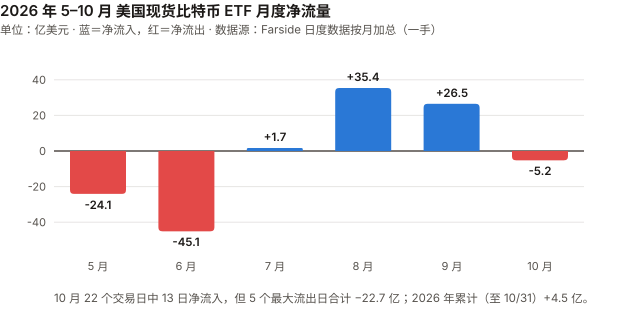
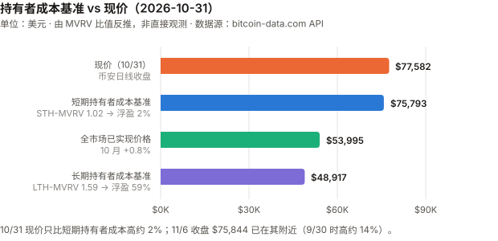
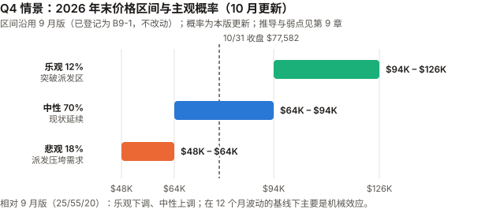

# BTC / Bitcoin 完整调研与分析报告

> **编写日期**：2026 年 11 月 7 日
> **数据截止**：2026 年 10 月 31 日（10 月完整数据已闭合）；11/1–11/6 的个别数据仅作参考，均已标注
> **版本**：2026 年 10 月版
> **研究方法**：基于 `anthropics/financial-services` 插件的行业概览（sector-overview）、投资论点追踪（thesis-tracker）、催化日历（catalyst-calendar）、竞争分析（competitive-analysis）四个框架。
>
> **本版更新要点**：
>
> 1. **10 月 −7.22%**，收于 $77,582.02（币安日线），月内高点 $87,220（10/2）、低点 $76,325.98（10/30）。2026 年至今 −11.48%，距 ATH 回撤 38.5%。
> 2. **本月与 9 月方向相反，但同样不支持「利率锚」**：9 月收益率上行、BTC 上涨；10 月 10 年期收益率**下行 35 基点**（5.29% → 4.94%），BTC 却**下跌 7.2%**。BTC 日收益与收益率日变化的相关系数从 9 月的 −0.40 翻到 10 月的 **+0.44**。
>    两个月的月度方向都与「收益率上升压制 BTC」相反——**但两次观测既不支持利率锚，也不支持「利率无关」**。
>    **与纳斯达克的同向关系更强**（不是更稳定）：10 月纳斯达克 −5.30%，日度相关 0.61；过去 12 个月逐月相关均值 0.48，对收益率约 −0.10（见 3.1）。
> 3. **10/28 FOMC 维持 3.75%–4.00%，10–2**——两位反对者（Cook、Hammack）主张加息。记分卡 B9-2「年内再加息一次」只剩 12 月一次机会。
> 4. **10/29 币安热钱包被盗约 $63.4 亿，其中 18,270 BTC**（币安 11/3 初步报告，FBI 归因朝鲜）。BTC 当日 −4.12%，**其中约 −3.5% 发生在 20:00 UTC 之后**；次日 ETF 流出 $6.43 亿。**但同一小时里还有 Strategy 的 Q3 财报与 CFO 辞职公告（SEC 受理 20:03 UTC），以及美股盘后时段**——跌幅集中在这个时段，归因分不开，见 3.6。
> 5. **Strategy 10 月回购 STRC 优先股 $8.72 亿、买币只有 1,662 枚（$1.38 亿）**；USD Cash（一般用途现金）从 9/27 的 $10.0 亿降到 11/1 的 **$1.33 亿**。STRC 回到面值附近（回购均价约 $99.5），公司称其「恢复健康」。
> 6. **ETF 10 月净流出 $5.16 亿**（Farside），2026 年累计从 +$9.7 亿缩到 +$4.5 亿；11 月前 5 个交易日又流出 $12.8 亿。
> 7. **记分卡**：8-5「算力下滑是趋势」**判 ⊘ 检验失效，论点撤回**——按登记条件未触发（最高 93.8% < 95%），但算力从峰值的 80% 回升到 92%，与论点方向相反；检验条件违反门槛 5，按 9 月版对 8-1 的既有处理记 ⊘（见 3.0）。累计正确率 **11%（1/9）**；若计为 ❌ 则 10%（1/10），若按字面判 ✅ 则 20%（2/10）。
>
> **本版方法论改进**：
> ⑧ 第一次把「BTC 与纳斯达克」和「BTC 与收益率」两组相关放在同一口径下逐月对照（12 个月 × 2），用来检验 9 月版撤回利率锚后留下的空白；
> ⑨ Strategy 的 mNAV 改为作者按 10-Q 股数自算（基本口径），不再只引第三方页面上口径不明的单一数字。
>
> **免责声明**：本报告不构成任何投资建议。所有分析仅供研究参考，投资决策请咨询专业顾问。

---

## 核心结论摘要（一页速览）

| 维度 | 核心判断 |
|------|----------|
| **BTC 是什么** | 数字黄金 + 去中心化结算网络 + 货币实验 + 宏观风险资产，四重属性并存 |
| **当前所处阶段** | 第四个减半周期第 30 个月。10/31 收于 **$77,582.02**，距 ATH $126,199.63（币安，2025-10-06 盘中）回撤 **38.5%** |
| **10 月发生了什么** | **−7.22%**。上半月在 $80K–$87K 震荡，10/22 与 10/29–30 两次下跌；10/29 −4.12%，约 −3.5% 集中在 20:00 UTC 之后——这一小时里有币安被盗转账（20:05 起）、Strategy 财报与 CFO 辞职公告（20:03）和美股盘后交易，**归因分不开**。ETF 净流出 $5.2 亿，5 个最大流出日合计 $22.7 亿 |
| **最重要的认知变化** | **和纳斯达克的同向关系比和利率的更强**：过去 12 个月 BTC 与纳斯达克的日度相关逐月均值 0.48、每月都为正；与 10 年期收益率变化的逐月均值约 −0.10、12 个月合计 −0.03。**两列的月度离散度都与抽样噪音相当，区别在强度不在稳定性**；纳斯达克相关接近零的两个月（4 月、8 月）恰是 BTC 年内涨幅最大的两个月（两个样本，原因未检验）。**这是相关，不是因果** |
| **核心多头逻辑** | 绝对稀缺；算力回到峰值的 92%；Strategy 仍在买币且 STRC 回到面值附近 |
| **核心空头逻辑** | **价格回到短期持有者的成本线**（10/31 STH-MVRV 1.02）；ETF 10 月转为净流出、11 月首周继续流出；Strategy 的一般用途现金降到 $1.33 亿；油价 +15%、9 月 CPI 3.7%，加息仍在桌上；**币安被盗的 18,270 BTC 去向未追踪**（币安称用户损失已补足 98%） |
| **短期催化剂** | 11/10 10 月 CPI；12/8–9 FOMC（含点阵图）；Strategy 每周 8-K 的 STRC 回购与 USD Cash |
| **估值立场** | MVRV 1.43，处于 2022-10 以来的 **34% 分位**。**作者对 Q4 末的判断：中性档（$64K–$94K）70%、悲观 18%、乐观 12%**——**在 12 个月波动（44%）的基线下**，相对 9 月版的变化几乎全是机械的；**若用 10 月的低波动（28.3%），作者明显比基线偏空**（悲观 +13pp），见 9.2 |
| **风险等级** | 极高——建议作为资产组合中 1–5% 的「非对称回报」配置 |

---

## 1. BTC 的起源与历史背景

### 1.1 密码朋克的思想遗产（1980s–2007）

比特币不是凭空出现的，而是**密码朋克运动（Cypherpunk Movement，1980 年代末兴起的密码学家与自由意志主义者社群）** 数十年积累的产物。

| 年份 | 里程碑 | 对比特币的影响 |
|------|--------|---------------|
| **1982** | David Chaum 发表"盲签名"论文 | 匿名数字现金的概念奠基 |
| **1997** | Adam Back 发明 Hashcash（工作量证明） | 直接成为比特币的挖矿机制 |
| **1998** | Wei Dai 提出 b-money | 匿名分布式电子现金的蓝图 |
| **1998** | Nick Szabo 提出 Bit Gold | 比特币最直接的概念前身 |
| **2004** | Hal Finney 创建 RPoW（可复用工作量证明） | 首次实现可复用的 PoW 系统 |

这些探索都卡在同一个难题上：**如何在没有可信第三方的条件下解决双重支付（Double-Spending）**——即防止同一笔钱被花两次。

### 1.2 2008 年金融危机：催化剂

2008 年 9 月 15 日雷曼兄弟破产。10 月 31 日，化名 **Satoshi Nakamoto（中本聪）** 的匿名作者在密码学邮件列表发表了 9 页白皮书《Bitcoin: A Peer-to-Peer Electronic Cash System》。

### 1.3 比特币网络的诞生（2009）

- **1 月 3 日**：创世区块诞生，Coinbase 字段嵌入当日《泰晤士报》头条 "The Times 03/Jan/2009 Chancellor on brink of second bailout for banks"（财政大臣濒临对银行的第二轮救助）
- **1 月 12 日**：中本聪向 Hal Finney 发送 10 BTC——人类第一笔比特币交易

### 1.4 最初要解决的四个问题

1. **信任**：无需信任中介即可转移价值
2. **通胀**：央行可无限印钞 vs 比特币硬顶 2100 万枚
3. **审查**：任何人无需许可即可收发
4. **双重支付**：通过 PoW + 最长链共识首次在去中心化网络中解决

### 1.5 与传统货币、银行、黄金的关系

| 维度 | 法定货币（美元） | 黄金 | 比特币 |
|------|-----------------|------|--------|
| **发行机制** | 央行酌情印钞 | 开采（年增 1–2%） | 算法固定，每 4 年减半 |
| **总供应量** | 无限 | 有限但总量未知 | 硬顶 2100 万枚 |
| **保管** | 银行存款 | 实物 / ETF | 自托管 / 托管 |
| **转移** | 银行系统（慢、可审查） | 物理运输 | 互联网（快、无需许可） |
| **对手方风险** | 银行破产、政府违约 | 低 | 自托管时为 0 |
| **历史** | 50 余年（后布雷顿森林） | 5000 年 | 17 年 |

---

## 2. BTC 的发展阶段划分

### 阶段一：诞生与极早期实验（2008–2012）

| 时间 | 事件 |
|------|------|
| 2008.10.31 | 白皮书发布 |
| 2009.1.3 | 创世区块 |
| 2010.5.22 | "比特币披萨日"——1 万 BTC 换两块披萨 |
| 2010.8.15 | 1840 亿 BTC 溢出漏洞被利用并紧急修复（史上唯一一次重大协议事故） |
| 2010.12 | 中本聪最后一次公开留言后消失 |
| 2011.6 | 首次泡沫破裂：$30 → $0.01（Mt. Gox 被黑） |
| 2012.11.28 | 第一次减半：50 → 25 BTC |

### 阶段二：交易所、矿业与投机市场成形（2013–2016）

| 时间 | 事件 |
|------|------|
| 2013.4 | 塞浦路斯银行危机，BTC 一个月内 $30 → $260 |
| 2013.11 | 首破 $1,000 |
| 2014.2 | **Mt. Gox 倒闭**，85 万 BTC 失踪 |
| 2015.7 | Ethereum 主网上线 |
| 2016.7.9 | 第二次减半：25 → 12.5 BTC |

### 阶段三：牛熊周期与扩容内战（2017–2020）

| 时间 | 事件 |
|------|------|
| 2017 | ICO 泡沫，12 月见顶 $19,783 |
| 2017.8 | **Bitcoin Cash 硬分叉**；SegWit（隔离见证）激活 |
| 2017.12 | CME、Cboe 推出比特币期货 |
| 2018 | 加密寒冬，跌至 $3,200 |
| 2020.3.12 | "黑色星期四"，单日腰斩至 $3,800 |
| 2020.5.11 | 第三次减半：12.5 → 6.25 BTC |

### 阶段四：机构入场与 ETF 推进（2020–2024）

| 时间 | 事件 |
|------|------|
| 2020.8–12 | MicroStrategy（现 Strategy）大规模购入，**上市公司储备时代开端** |
| 2021.5 | 中国全面禁止挖矿，算力"大迁移" |
| 2021.11 | ATH $69,000 |
| 2022.11 | **FTX 崩溃**——行业的"雷曼时刻" |
| 2024.1.10 | **美国 SEC 批准 11 支现货比特币 ETF** |
| 2024.4.20 | 第四次减半：6.25 → 3.125 BTC |

### 阶段五：ETF 后周期、主权叙事与 AI 冲击（2024–至今）

| 时间 | 事件 |
|------|------|
| 2025.3 | 特朗普签署行政令建立美国战略比特币储备（SBR） |
| 2025.7 | GENIUS 法案（稳定币框架）签署；CLARITY 法案众议院通过 294–134 |
| 2025.10.6 | **ATH**（币安盘中 $126,199.63）——减半后 18 个月，符合历史节奏 |
| 2025.Q4–2026.Q2 | 连续三个季度下跌（−23.1% / −22.1% / −14.1%） |
| 2026.5 | Kevin Warsh 就任美联储主席（鹰派） |
| 2026.6 | ETF 单月流出 $45.1 亿（Farside），BTC 6/30 收于 $58,624.71 |
| 2026.Q3 | **+42.64%**；9/15 CLARITY 参议院程序性投票失败；9/16 加息 25 基点至 3.75%–4.00% |
| **2026.10.19** | Strategy 把数字信用证券回购授权从 $20 亿提高到 **$30 亿** |
| **2026.10.28** | **FOMC 维持 3.75%–4.00%，10–2**（两票主张加息）；Strategy 股东特别会议通过优先股每日派息 |
| **2026.10.29** | **币安热钱包被盗约 $63.4 亿（含 18,270 BTC）**；BTC 当日 −4.12% |
| **2026.10** | **−7.22%**，ETF 净流出 $5.2 亿 |

---

## 3. BTC 当前现状分析

### 3.0 论点校验：上期登记的论点到了哪一步

> 本月只有一条论点到期（8-5）。9 月版登记的 B9-1 至 B9-5 都在 Q4 末核对，这里只报中期读数，**不判定**。完整记录见 `thesis_scorecard.md`。

| # | 论点 | 检验条件 | 10 月实际 | 判定 |
|---|---|---|---|---|
| 8-5 | 算力下滑是趋势而非噪音 | 9–10 月 7 日均算力回升至峰值 95%（1,094 EH/s）以上则错 | 最高 **1,080.2 EH/s（10/26，峰值的 93.8%）**；10/31 为 92.4%。8 月底是 80.2%；难度 10/16 +5.92%、10/29 +5.54% | ⊘ **检验失效，论点撤回**——按登记条件未触发（字面上应为 ✅），但两个月回升 12 个百分点，与论点方向相反。原条件在 80%–95% 之间留了灰区（违反门槛 5），按 9 月版对 8-1 的既有处理记 ⊘、不计入正确率；**研究判断本身撤回** |
| B9-1 | Q4 末落在 $64K–$94K | 12/25–12/31 七日均价 | 10/31 $77,582，在区间内 | ⏳ |
| B9-2 | 年内再加息一次 | 12/9 后上限仍 ≤ 4.00% 则错 | 10/28 维持（10–2，两票主张加息） | ⏳ 只剩 12 月 |
| B9-3 | Strategy Q4 STRC 回购 ≥ $10 亿 | 10/1–12/31 累计 < $10 亿则错 | **10/1–11/1 累计 $8.723 亿**；授权余额 $7.486 亿 | ⏳ 还差 $1.28 亿 |
| B9-4 | 已实现价格年末 < $57,000 | Coin Metrics 口径 | 10/31 **$54,032**；10 月没有单日已实现市值增幅 > 0.5% 的日子 | ⏳ |
| B9-5 | 下一次加息不会让 BTC 跌 ≥ 10% | 加息后第 10 日收盘 | 10 月未加息 | ⏳ 只剩 12 月 |

**8-5 的三种判法，本版取中间那种，理由需要说清楚**：

| 判法 | 依据 | 正确率 |
|---|---|:---:|
| ✅ | **严格按登记时的规则**：95% 线没被触及。8-5 登记于 8 月，门槛 5 与 ⊘ 都是之后（2026-10-03）才引入 BTC 记分卡的 | 20%（2/10） |
| **⊘ + 撤回（本版主口径）** | 检验条件违反门槛 5，与 9 月版对 8-1 的处理一致；**但这套规则是登记后引入的，引入时 9 月的算力回升（约 85%）已经看得见** | **11%（1/9）** |
| ❌ / 含撤回 | 论点自己的统计量（算力占峰值比例）80.2% → 92.4%，方向相反；作者也已撤回该论点 | **10%（1/10）**（第二口径） |

初稿判的是 ❌。**两位审查者给出了相反的理由**：Codex 指出，在看到结果之后新增「方向相反也算错」的规则，即使对作者更不利，也是事后改判据；`_bian` 同意 ❌ 这个结论，但指出初稿写的分界规则对 8-1 的描述与记分卡自己的文字矛盾。
**本版的处理**：8-5 记 ⊘，与 8-1 的先例一致；**记分卡把三件事分开记录**——原登记条件的执行结果（未触发）、检验设计的缺陷（违反门槛 5）、研究判断（撤回）。**11% 不是唯一成绩**：作者已经承认错了的论点不在分母里，所以同时报含撤回的第二口径 10%（1/10）；以后「⊘ + 撤回」的条目单独统计，不能悄悄消失。
「用论点自己的统计量的变化符号决定 ⊘ 还是 ❌」这条更机械的规则，**只对 2026-10 期及以后登记的论点生效**，不追溯。

### 3.1 资产属性：利率没有锚定作用，与纳斯达克的同向关系更强

9 月版撤回了「BTC 的定价锚是长端美债收益率」，并说「利率无关同样没有被证明」。10 月给了第二个方向相反的月份：

| 区间 | BTC | 10 年期收益率变化 | 纳斯达克 | 黄金 | WTI 原油 |
|------|------|------|------|------|------|
| 9 月（8/31→9/30） | **+6.42%** | **+54bp** | +1.86% | −6.58% | +5.43% |
| **10 月（9/30→10/31）** | **−7.22%** | **−35bp**（5.29%→4.94%） | **−5.30%** | −6.87% | **+15.15%** |

**两个月放在一起**：收益率上行时 BTC 涨，收益率下行时 BTC 跌——**与「收益率上升压制 BTC」的方向正好相反，但两次观测也构不成「收益率上升利好 BTC」**。
**「锚」是月度和季度层面的问题，能回答它的是这张月度表，不是下面的日度相关**——9 月 BTC 与收益率日度相关 −0.40，月度上两者却同向。

用同一口径（BTC 币安 UTC 收盘对数收益 vs 同日纳斯达克收盘对数收益 / 10 年期收益率日变化，只取两边都有数据的交易日）把过去 12 个月逐月排开：

| 月份 | BTC 与纳斯达克 日度相关 | BTC 与 10 年期收益率变化 日度相关 |
|------|:---:|:---:|
| 2025-11 | 0.65 | 0.31 |
| 2025-12 | 0.43 | −0.28 |
| 2026-01 | 0.56 | −0.29 |
| 2026-02 | 0.62 | 0.30 |
| 2026-03 | 0.61 | −0.18 |
| 2026-04 | 0.09 | −0.13 |
| 2026-05 | 0.46 | −0.25 |
| 2026-06 | 0.48 | −0.23 |
| 2026-07 | 0.43 | −0.34 |
| 2026-08 | 0.05 | −0.09 |
| 2026-09 | 0.72 | −0.40 |
| **2026-10** | **0.61** | **+0.44** |
| **12 个月合计** | **0.47**（250 日） | **−0.03**（249 日） |

> 口径：纳斯达克综合指数用 Yahoo Finance 日收盘，收益率用美国财政部每日收益率曲线（一手）。BTC 的 UTC 收盘与美股收盘相差约 4–5 小时，**会把日度相关压向零**（9 月版已说明）。两列受到的影响大致相同，但不完全相同：财政部收益率曲线的定盘时间约为美东 15:30，纳斯达克收盘为 16:00（**未核实**）。
> 9 月版报的 7 月 −0.40 与本表的 −0.34 不同，**原因是本版改为只取两边都有数据的交易日相减**；9 月 −0.40 与 9 月版的 −0.39 相差在四舍五入内。

**两列的离散度与抽样误差对照**（`_bian` 审查后新增；每月约 21 个交易日）：

| | 逐月均值 | 逐月标准差 | 单月抽样误差（按均值处的 ρ） | 离散度 ÷ 抽样误差 |
|---|:---:|:---:|:---:|:---:|
| BTC 与纳斯达克 | 0.48 | 0.21 | 约 0.17 | 约 1.2 |
| BTC 与 10 年期收益率变化 | −0.10 | 0.28 | 约 0.22 | 约 1.3 |

**能得出的结论**：

1. **两列的区别在强度，不在稳定性。** 两列的月度离散度都只比抽样噪音大约两到三成；收益率这一列均值接近零，**符号来回翻本来就是噪音会产生的样子**，不能读作「关系在切换」。
2. **纳斯达克这一列 12 个月全部为正**，但有两个例外：**4 月 0.09、8 月 0.05，比均值低 2 个多抽样误差，恰好是 BTC 2026 年涨幅最大的两个月**（+11.8%、+25.0%）。**只有两个样本，不构成规律**；而且 BTC 自身波动变大时，即使对纳斯达克的 beta 不变，相关系数也会被机械拉低——消失的可能只是相关，beta 有没有变，本报告没有检验。
3. **月度涨跌同向 8/12**（作者按月末收盘计算）。若月度相关也是 0.47，同向比例的期望约 0.5 + arcsin(0.47)/π ≈ 66%，即约 7.9/12——**8/12 与之相符**，12 个月的样本分辨不出月度关系更强还是更弱。
4. **收益率这一列**：12 个月里负 9 个、正 3 个，符号检验双侧 p 约 0.15，12 个月合计 −0.03——**不足以说明有关，也不足以说明无关**。
5. **这些都是相关，不是因果。** 两者同涨同跌可能是受同一类资金（风险偏好）驱动；本报告没有做任何能区分的检验。
6. **R² 要一起报**（XIN 期规则）：10 月 BTC 对纳斯达克 beta 0.79、R² 0.37；12 个月相关 0.47 对应 R² 约 0.22——**纳斯达克能解释的是 BTC 日波动的约五分之一。**

本版把第 2 条的可检验形式登记为 **B10-2**（11/9–12/31 与纳斯达克日度相关 ≥ 0.40），把第 4 条登记为 **B10-3**（同期与收益率变化的日度相关绝对值 < 0.30；**它的 ✅ 不构成「利率无关」的证据**，见记分卡）。

| 属性 | 本月证据 | 反证 |
|------|---------|------|
| **宏观流动性资产** | 9 月收益率上行时 BTC 涨 | **10 月收益率下行、美元持平，BTC 仍下跌**；日度相关均值接近零 |
| **数字黄金** | 10 月黄金 −6.87%、BTC −7.22%，同向 | 9 月两者反向；Q3 两者都涨 |
| **高 beta 科技股** | **12 个月每月日度相关为正**；10 月 beta 0.79、R² 0.37 | 4 月、8 月（BTC 自己的大行情月）相关接近零；R² 约 0.22 |
| **商品** | — | CLARITY 9/15 在参议院失败，10 月无新进展 |

### 3.2 市场结构：ETF

> 数据来源：Farside 日度一手数据（farside.co.uk 全量数据页，直接抓取并逐日加总）。9 月 +$26.48 亿复核无修订。

| 指标 | 数据 |
|------|------|
| **10 月净流量** | **−$5.16 亿**（22 个交易日中 13 日净流入） |
| 其中 IBIT / FBTC / GBTC | **+$9.32 亿** / −$7.55 亿 / −$1.84 亿 |
| 最大单日流入 | 10/19 +$5.27 亿（IBIT +$6.65 亿） |
| 最大单日流出 | **10/30 −$6.43 亿**（币安被盗次日）、10/22 −$6.36 亿、10/7 −$4.85 亿 |
| 5 个最大流出日合计 | −$22.69 亿 |
| **2026 年累计（至 10/31）** | **+$4.54 亿**（9/30 为 +$9.70 亿） |
| 自上市累计净流入 | $570.5 亿（9/30 为 $575.6 亿） |
| 11/2–11/6（期后，5 个交易日） | **−$12.82 亿**，只有 1 日净流入 |
| 总资产规模 | **未取得一手**，本版不报 |

**13 个流入日对 9 个流出日，月度仍为负**——流出集中在少数几天：10/7–8（−$7.29 亿，BTC 跌破 $82K）、10/22–23（−$7.74 亿）、10/30（−$6.43 亿）。
**IBIT 全月净流入 $9.32 亿，FBTC 净流出 $7.55 亿**——两只最大 ETF 方向相反，月度合计接近零。本报告无法判断这是不同类型投资者的分歧，还是个别机构在两只产品之间调仓。

按 9 月版写下的模式二：**ETF 流量是同步指标，不能用来预测下月方向**。11 月首周的 −$12.8 亿同样不能外推。

**市场参与者变化**：

| 参与者 | 10 月行为 | 来源 |
|--------|---------|------|
| **ETF** | 净流出 $5.2 亿 | Farside ✅ |
| **Strategy** | 买入 1,662 枚，回购 STRC $8.72 亿 | SEC 8-K ✅ |
| **其他上市公司** | 合计持仓 10/3 → 11/7 减少约 2.6 万枚（见第 4 章） | bitcointreasuries.net |
| **币安（被盗事件）** | 18,270 BTC 转入攻击者地址；币安称 10/31 前 98% 被盗资产已补足 | 币安初步报告（发行方自述） |
| **长期持有者 / 交易所余额 / 衍生品** | **本版未取得一手或可信二手数据，不报** | — |

### 3.3 链上数据

> 数据来源：Coin Metrics 社区版 API（MVRV、市值、供应、算力）与 bitcoin-data.com API（STH/LTH-MVRV、Z-Score、已实现价格；本月已更新到 10/31，不再有 7 天延迟）。

| 指标 | 6/30 | 9/30 | **10/31** | 来源 |
|------|------|------|------|------|
| **MVRV** | 1.10 | 1.56 | **1.43** | Coin Metrics |
| **已实现价格** | $53,070 | $53,612 | **$54,032** | Coin Metrics 推算（市值 ÷ MVRV ÷ 供应） |
| 已实现价格（对照） | — | $53,577 | $53,995 | bitcoin-data |
| **STH-MVRV** | 0.84 | 1.14 | **1.02** | bitcoin-data |
| **LTH-MVRV** | 1.19 | 1.72 | **1.59** | bitcoin-data |
| **MVRV Z-Score** | 0.25 | 0.98 | **0.76** | bitcoin-data |

**三个读数，按重要性排**：

1. **价格回到了短期持有者的成本线附近。** 10/31 STH-MVRV 1.02，对应短期持有者估算成本约 **$75,800**（$77,582 ÷ 1.0236）；11/6 收盘 $75,844 已在它附近。9/30 时现价比这条线高约 14%。
   **这条线是按币龄（155 天）划分的群组估算成本，不是止损线**（9 月版已说明）。它的意义只是：过去五个月进场的人整体上不再浮盈。
2. **MVRV 1.43 处于 2022-10 以来日度序列的 34% 分位**（1,498 天；中位数 1.69）。9/30 是 44% 分位。**已实现价格几乎不动时，MVRV 下降与价格下跌是同一件事**，不是独立的信号。
3. **已实现价格 10 月 +0.8%**（$53,612 → $54,032），过去 12 个月 −3.4%（2025-10-31 为 $55,906），仍在 $52,644–$56,463 的区间里。10 月没有单日已实现市值增幅超过 0.5% 的日子（B9-4 的排查线）。

> 上图的成本基准由 MVRV 比值反推（现价 ÷ MVRV），**不是链上直接观测值**。具体数值（均为 10/31）：
> 现价 **$77,582**；短期持有者成本 **$75,793**（÷1.0236）；全市场已实现价格 **$53,995**（bitcoin-data）；长期持有者成本 **$48,917**（÷1.586）。

### 3.4 宏观环境

| 因素 | 9/30 | 10/31 | 来源 |
|------|------|------|------|
| **联邦基金利率** | 3.75–4.00% | **3.75–4.00%**（10/28 维持，10–2） | federalreserve.gov ✅ |
| 2 年期美债 | 4.88% | **4.56%** | 美国财政部 ✅（10/30 读数） |
| **10 年期美债** | 5.29% | **4.94%** | 美国财政部 ✅ |
| 30 年期美债 | 5.64% | **5.31%** | 美国财政部 ✅ |
| 美元指数 DXY | 101.45 | 101.88（+0.42%） | Yahoo Finance |
| 黄金（期货） | $4,186.7 | **$3,898.9**（−6.87%） | Yahoo Finance |
| **WTI 原油** | $90.42 | **$104.12**（+15.15%） | Yahoo Finance；布伦特 $117.64 |
| 标普 500 | 7,652 | 7,580（−0.93%） | Yahoo Finance |
| 纳斯达克 | 26,861 | **25,437（−5.30%）** | Yahoo Finance |
| 9 月 CPI（10/14 公布） | — | 同比 **3.7%**，环比 0.6%；核心同比 2.6%、环比 0.3% | 搜索摘要转述，**bls.gov 返回 403，未打开原文** |

**10/28 FOMC 声明原文**（federalreserve.gov，一手）：委员会「决定将联邦基金利率目标区间维持在 3-3/4 至 4 厘」；「经济活动正以强劲的步伐扩张（Economic activity is expanding at a strong pace）」；「通胀仍然偏高」；「委员会将实现价格稳定」。
**投票 10–2，Lisa D. Cook 与 Beth M. Hammack 反对，主张本次加息 25 基点。** 10 月会议不发布点阵图。

**油价上涨的原因**：媒体报道集中在中东——胡塞武装袭击沙特设施、霍尔木兹海峡油轮起火、对美伊冲突重启的担忧（oilprice.com、tradersunion 等转述，**未核实**）。
**9 月 CPI 的 3.7% 里，汽油贡献超过一半的月度涨幅**（转述）。

**宏观对 BTC 的读法**：10 月的宏观组合是「收益率下行 + 油价急涨 + 两票主张加息 + 科技股下跌」。
**BTC 跟着科技股跌，没有跟着收益率涨**——和 3.1 的逐月表一致。本报告不把任何一项宏观变量写成 10 月下跌的原因。

### 3.5 技术与生态

**算力：回到峰值的 92%**

| 指标 | 数据 | 来源 |
|------|------|------|
| 7 日均算力（10/31） | **1,063.9 EH/s**，峰值的 **92.4%** | Coin Metrics |
| 10 月最高（7 日均） | 1,080.2 EH/s（10/26），峰值的 93.8% | Coin Metrics |
| 2026 年最低（7 日均） | 826.0 EH/s（1/30），峰值的 71.7% | Coin Metrics |
| 历史峰值（7 日均） | 1,151.5 EH/s（2025-10-18） | Coin Metrics |
| 难度 | **148.36T**（10/16 +5.92%，10/29 +5.54%） | mempool.space ✅ |
| 下次调整（11/7 估算） | 约 −4.1% | mempool.space ✅ |
| 近 30 天手续费占矿工收入 | **0.56%**（75.8 BTC / 13,576 BTC） | mempool.space ✅ |

**算力在价格下跌的月份继续上升**——难度两次各上调 5% 以上。这与 9 月版「算力回升与价格同步，不足以说明矿工回流」的说法不完全一致：10 月价格跌了 7%，算力仍在涨。
**可能的原因是矿机订单与电力合同的交付滞后**（上架决策在几个月前做出），本报告没有核实。下次调整预计 −4.1%，说明 11 月初算力已有回落。

**量子抗性：BIP-360 仍是草案**

GitHub `bitcoin/bips` 显示，10 月以来 BIP-360 的主文件没有新的合并提交；为它补充花费路径测试向量的 PR #2232 仍在开放（11/4 更新），另有一份新的 BIP-362 草案（输出公钥暴露分类）PR 开放中。**没有任何软分叉激活进程。**

**AI Agent 支付**：10 月未见比特币原生 Agent 支付的规模化落地新证据，维持 8 月版判断（见 5.2）。

---

## 3.6 币安被盗事件（本版新增）

**一手来源**：币安 11/3 发布的《29 October Binance Security Incident: Initial Findings and Response Update》（X 平台长文，本报告读取了全文）。

| 项 | 币安披露 |
|---|---|
| 时间 | 10/29 20:05 UTC 起，最后一笔未授权转账 23:56 UTC 上链 |
| 规模 | **约 $63.4 亿数字资产受影响**；截至报告日约 $28.5 亿已被冻结或拦截 |
| BTC | **一个热钱包向攻击者地址转出 18,270 BTC** |
| 其他 | 2.3346 亿 XRP、约 97.05 万 SOL、4,420 万 OP、ETH 等 |
| 手法 | 攻击者获得内部钱包签名服务的访问权限，并利用以太坊 EIP-7702 授权机制（一种让账户把部分执行权委托给智能合约的标准）在提现系统之外继续转移资产 |
| 入口 | 6 月一名工程师从搜索引擎下载了被篡改的 Homebrew 安装包来安装一个 AI 编程工具；9 月另一名工程师在假招聘面试中运行了恶意代码；**10/20 攻击者利用一个内部 AI 工具作为跳板**控制了其他工程师的设备 |
| 归因 | 「联邦调查局最新信息显示，朝鲜对此事件负责」 |
| 赔付 | 「币安承担被盗资金的财务影响，而不是用户」；**截至 10/31，98% 的受影响资产已补足**，可在储备证明页核验 |

**对 BTC 的读法**：

1. **规模**：18,270 BTC 约为 BTC 流通量的 0.09%，按 10/29 收盘约 $14.2 亿——**是 Strategy 10 月买币量的 11 倍，约为 ETF 10 月单日最大流出的 2.2 倍**。
2. **价格反应可以按小时拆开**（币安 BTCUSDT 1 小时 K 线，`_bian` 审查后补做）：

| 10/29（UTC） | 价格 | 变化 |
|---|---|---|
| 00:00 → 19:59 | $81,343.51 → $80,848.64 | **−0.61%** |
| 20:00 → 20:59（被盗转账 20:05 开始） | → $78,851.99 | **−2.47%** |
| 21:00 → 23:59 | → $77,991.89 | −1.09% |
| 全日 | | **−4.12%** |

   **能说的只是：跌幅集中在 20:00 UTC 之后**（美东 16:00，纳斯达克现货收盘）。这个小时里至少同时发生了三件事：

   | 时间（UTC） | 事件 | 来源 |
   |---|---|---|
   | 20:00 | 美股现货收盘，进入盘后交易；盘后也是财报集中发布的时段 | — |
   | **20:03** | **Strategy 的 Q3 财报 8-K 被 SEC 受理（16:03:24 美东），同一份 8-K 披露 CFO Andrew Kang 辞职**（11/5 生效） | SEC EDGAR ✅ |
   | 20:05 | 币安热钱包开始向攻击者地址转账 | 币安报告 ✅ |
   | 约 22:15–22:30 | 币安首次公开确认安全事件 | 媒体转述，**未核实** |

   纳斯达克 100 期货（NQ）20:00 → 22:00 约 −0.6%（Yahoo Finance 小时线，中间有缺失），同期 BTC 约 −2.3%。
   **所以这个时段排除了「盘中科技股下跌」这一个解释，但被盗事件、Strategy 公告与盘后行情之间分不开。** 初稿（第一轮审查前）写「分不开」，第一轮改成「分得开」——**第二轮复核后，改回「分不开」，但范围缩小到了这一个小时**。
   能真正分开的检验（分钟线、18,270 BTC 出账的链上时间戳、被盗币种与未被盗币种的同时段对比）本报告没有做。
   另：小时线的 20:00–20:05 也算在了 20:00 那一小时里，不全是被盗之后。
3. **币安称用户损失已补足 98%**；补足的 BTC 来自市场买入还是自有储备，币安没有披露。**被盗的 18,270 BTC 的去向（是否被卖出）本报告没有追踪**——币安报告没有给出攻击者地址。**这批币可能带来的卖压还没有被观测到，「冲击已被吸收」这个说法没有证据支持**（Codex 审查指出）。
4. **与第 5 章的关系**：入口有两处与 AI 工具有关（被篡改的 AI 编程工具安装包、被用作跳板的内部 AI 工具）。**但攻击手法本身是传统的供应链攻击与社会工程**，AI 工具在这里是诱饵或跳板。**问题出在交易所的运营安全，不在比特币协议**。

---

## 4. 上市公司比特币储备

### 4.1 整体规模

| 口径 | 10/3（9 月版） | **11/7（本版抓取）** | 来源 |
|------|------|------|------|
| 上市公司合计持仓 | 1,275,684 BTC（197 家） | **1,249,508 BTC（197 家）** | bitcointreasuries.net |
| Strategy 持仓 | 847,666 BTC（9/27） | **849,327 BTC（11/1）**，约占总供应 4.04% | SEC 8-K ✅ |
| Strategy 总成本 / 均价 | $639.5 亿 / $75,437 | **$640.8 亿 / $75,451** | SEC 8-K ✅ |

**10/3 → 11/7 合计减少约 26,176 枚（窗口延伸到数据截止日之后），而 Strategy 增加了 1,661 枚**（8-K 逐周买入合计 1,662 枚，差 1 枚为 8-K 的取整）——其余公司合计减少约 2.78 万枚。
本报告**没有逐家拆分**这个变化：网站新闻栏标题显示 Riot Platforms 把持仓削减了 79% 至 2,418 枚（11/4），Strive 从 27,462 枚增至 43,124 枚；**其余的变化来自哪些公司、有多少是统计口径调整（公司进出名单），未核实**。

### 4.2 Strategy：一般用途现金几乎用完，回购没停

**全部来自 Strategy 向 SEC 提交的每周 8-K（一手）：**

| 期间 | 买入 BTC | 金额 | 买币资金 | 回购 STRC | 回购资金 | USD Cash 期末 |
|------|------|------|------|------|------|------|
| 9/28–10/4 | 334（全部在 10/1–10/4；9/28–9/30 为 0） | $2,870 万 | ATM $1,570 万 + 现金 $1,300 万 | $1.763 亿（其中 10/1–10/4 $7,370 万） | USD Cash（及现金利息） | $8.334 亿 |
| 10/5–10/11 | 250 | $2,150 万 | MSTR ATM（另 $50 万现金） | $1.924 亿 | 8-K 未写明来源 | $6.405 亿 |
| 10/12–10/18 | 267 | $2,210 万 | MSTR ATM | $1.931 亿 | USD Cash | $4.473 亿 |
| 10/19–10/25 | **0** | — | — | $2.049 亿 | USD Cash | $2.424 亿 |
| 10/26–11/1 | 811 | $6,550 万 | MSTR ATM | $2.082 亿 | USD Cash | **$1.327 亿** |
| **10/1–11/1 合计** | **1,662** | **$1.378 亿** | | **$8.723 亿**（回购只计 10/1 起） | | |

| | 9/27 | 10/18 | 11/1 |
|---|---|---|---|
| USD Reserve（用于优先股股息与债息） | $50.2 亿 | $48.3 亿 | **$47.9 亿** |
| USD Cash（一般用途） | $10.0 亿 | $4.47 亿 | **$1.33 亿** |

> 10/5–10/11 那周的 USD Cash 减少 $1.93 亿，与当周回购金额一致；8-K 只写了「$0.5 million of USD Cash to fund bitcoin purchases」，没有写明回购的资金来源。

**这张表说明了什么**：

1. **回购是买币的 6.3 倍**（$8.72 亿 ÷ $1.38 亿）。9 月版报的是 2.9 倍（9 月窗口）或 1.09 倍（8/24–9/27 窗口）——**本月无论取哪个窗口，钱都主要流向了回购**。
2. **9 月版删掉了「约 7 周用完 USD Cash」的说法，理由是外推太机械**（Codex 审查）。**事后看，USD Cash 5 周内从 $10.0 亿降到 $1.33 亿，方向上那句话是对的。** 但 9 月版删它的理由也成立：公司当时确实在用发股补充（本月最后一周 MSTR ATM 募资 $1.64 亿，其中 $9,850 万划入 USD Cash）。**一个对了的外推，不能事后证明它当时的方法是对的。**
3. **STRC 回到面值附近**：10 月各周回购均价约 $99.5（金额 ÷ 股数，作者计算），Yahoo Finance 收盘 10/30 $99.13、11/6 $99.84。公司在 Q3 财报（10/29）称「Returned STRC to health」（使 STRC 恢复健康）。**9 月版推断「STRC 交易在面值以下」成立，但折价只有约 0.5%–0.7%。**
4. **10/28 股东特别会议通过每日派息**（赞成 3.81 亿票、反对 224 万票），STRC 11/1 起每日派息，STRF/STRK/STRD 2027-01-01 起。
5. **回购授权从 $20 亿提高到 $30 亿**（10/19），11/1 剩余 $7.486 亿。

**判断**：B9-3（Q4 回购 ≥ $10 亿）还差 $1.28 亿，按 10 月的速度一周就能达到。**更有信息量的问题是回购会不会大幅放缓**。

- **支持放缓**：STRC 已回到面值附近（11/6 $99.84；公司称「恢复健康」），回购的目的基本达到；一般用途现金只剩 $1.33 亿。
- **反对放缓**：**10 月每周回购金额是单调上升的**（$1.763 亿 → $1.924 亿 → $1.931 亿 → $2.049 亿 → $2.082 亿），STRC 接近面值的过程中回购没有减速；10/19 还把授权扩大到 $30 亿；最后一周卖普通股所得的 $9,850 万划入了 USD Cash，**看起来是在为继续回购补充现金**。
- **工具箱**（模式三）：除了 MSTR 普通股 ATM（剩余 $186.2 亿），还有 STRF、STRC、STRK、STRD 四种优先股的 ATM 额度（剩余合计约 $252 亿）、发行可转债或其他债务，以及 USD Reserve（$47.9 亿，用途是股息与债息）。

- **授权约束**：11/1 剩余授权 $7.486 亿（数字信用证券整体额度，回购其他优先股也会占用）；若 11/2–11/8 那周按 10 月周均回购约 $2 亿，11/9 时只剩约 $5.4 亿——**继续按 10 月速度回购到年底，需要第三次扩大授权**。

两边都有分量，作者给放缓 50%。本版把它登记为 **B10-1**（11/9–12/27 七周回购合计 < $3 亿，即周均比 10 月低约 79%）。门槛设在 $3 亿而不是更高，是为了让「判错」那一侧在不扩授权时也够得着（`_bian` 指出 $5 亿的门槛实际上要靠再扩授权才能判错）。它只在 B9-3 判 ✅ 时计分，见记分卡。

### 4.3 mNAV：本版改为自算基本口径

| 口径 | 9/30 | 10/30 | 方法 |
|------|------|------|------|
| **基本（MSTR 市值 ÷ BTC 市值）** | **0.91×** | **0.84×** | 作者计算：股数取 10-Q 封面（10/25 A 类 402,714,357 + B 类 19,640,250 股），9/30 扣除 10 月 ATM 已披露发行的 358,949 股、10/30 加上 10/26–11/1 发行的 1,178,552 股；MSTR 收盘 $153.09 / $130.51；BTC 收盘 $83,623.60 / $77,368.77 |
| bitcointreasuries.net 显示值 | 1.15×（EV 口径，10/3） | 1.07×（11/7，页面未标明口径） | 直接抓取 |

> 9 月版引用的「基本 0.94×」是网站在 10/3 的读数；本版按同一方法自算的 9/30 是 0.91×，差异来自日期与股数口径。**两期之间的比较请用本版自算的两列**。

**MSTR 10 月 −14.75%**（$153.09 → $130.51），跌幅是 BTC 的两倍，基本 mNAV 从 0.91 降到 0.84。
**这个比值不能读作「普通股折价 16%」**（Codex 审查指出）：它拿普通股市值和公司全部 BTC 比，**没有扣除债务与优先股这些排在普通股前面的索偿权，也没有计入现金**。扣除之后，普通股对应的净资产低于 BTC 总市值，普通股相对净资产是折价还是溢价，本报告没有算。
能说的只是：**基本 mNAV 低于 1 时，卖普通股买币会降低每股对应的 BTC**；而卖普通股回购优先股，同时消除了一部分优先索偿，**不能只看每股 BTC 来判断它的经济效果**。

### 4.4 其他头部公司

| 排名 | 公司 | 持有 BTC（11/7） | 页面显示 mNAV | 本月动向 |
|------|------|------|------|------|
| 2 | Metaplanet | 44,000 | 0.71× | **Q3 曾卖出 10,000 枚（约 $7.9 亿，低于成本）再买回 11,000 枚**，公司称是为了「demonstrate liquidity」（证明流动性），为申请信用评级做准备（The Block 10/5，**公司原文未读**） |
| 3 | Twenty One Capital（XXI） | 43,514 | 0.68× | — |
| 4 | Strive（ASST） | 43,124 | 0.92× | 较 10/3 的 27,462 枚增加 15,662 枚（原因未核实） |
| 5 | MARA Holdings | 35,577 | — | — |

**头部储备公司的页面 mNAV 都在 1.07 以下**（页面未标明口径；Strategy 按作者自算的基本口径是 0.84）。
Metaplanet 的「卖了再买回」值得记下：**这是本系列第一次看到头部储备公司在季度内真实卖出过万枚 BTC**，哪怕净额为正、且发生在 Q3（上一期）——它说明「储备公司不会卖」不是一个可以默认的假设（9 月版模式三：先列出当事人的完整工具箱）。

---

## 5. AI 科技对 BTC 的多维影响

### 5.1 矿业迁移：算力创年内新高，难度连涨

| 指标 | 数据 | 来源 |
|------|------|------|
| 算力 | 7 日均 1,063.9 EH/s（10/31），峰值的 92.4%（8 月底 80.2%） | Coin Metrics |
| 难度 | 148.36T，10 月两次上调合计约 +11.8% | mempool.space |

**8 月版的 8-5「算力下滑是趋势」本月记 ⊘、论点撤回**（见 3.0）。矿企转向 AI/HPC 的合同仍在签（9 月版引用的「超过 $700 亿」为媒体转述），**但它没有表现为全网算力的持续下降**——至少在 2026 年 8–10 月没有。
**可以说的只是**：「矿企转 AI」与「全网算力下降」是两件事，前者不必然导致后者（转产的矿场空出的份额可以被其他矿工填上）。

### 5.2 AI Agent 支付：维持下调

10 月没有新证据。维持 8 月版判断：方向成立、兑现遥远，主导协议 x402 结算的是稳定币而非比特币。记分卡 8-4 年底核。

### 5.3 AI 与安全：币安事件是一个大型实例

币安被盗事件的入口有两处与 AI 工具有关（见 3.6）：一是工程师在搜索引擎上找到被篡改的 AI 编程工具安装包，二是攻击者利用公司内部 AI 工具作为跳板控制了其他工程师的设备。
**这不是 AI 攻破了密码学，而是 AI 工具扩大了攻击面**（更多需要安装的工具、更多拥有内部权限的自动化系统）。对 BTC 的直接影响在交易所与托管层，不在协议层。

### 5.4 AI 影响汇总

| 维度 | 方向 | 强度 | 相比 9 月版 |
|------|------|------|-----------|
| 矿业转 AI / 算力 | 负 | ★★☆☆☆ | **↓ 下调**（算力回到峰值 92%，8-5 论点撤回） |
| AI Agent 支付 | 正 | ★★☆☆☆ | 不变 |
| 能源竞争 | 负 | ★★★☆☆ | 不变 |
| 加速量子威胁 | 负（尾部） | ★★★☆☆ | 不变（BIP-360 仍为草案） |
| AI 诈骗 / 运营安全 | 负（用户与托管层） | ★★★☆☆ | 不变。币安 $63.4 亿事件的入口与 AI 工具有关，但手法是传统的供应链攻击与社会工程，且只有一次观测，**不据此上调** |

---

## 6. BTC 的核心价值逻辑

### 6.1 多头逻辑

| # | 逻辑 | 强度 | 说明 |
|---|------|------|------|
| 1 | **绝对稀缺** | ★★★★★ | 2100 万硬顶，年通胀约 0.85%，低于黄金 |
| 2 | **网络效应** | ★★★★★ | 最大、最安全的区块链，品牌不可复制 |
| 3 | **去中心化与抗审查** | ★★★★☆ | 17 年不间断运行；**币安事件发生在交易所层，协议层没有受到影响** |
| 4 | **算力创年内新高** | ★★★☆☆ | **本月上调**（从两星）。价格下跌的月份难度仍连涨两次；8-5 论点撤回 |
| 5 | **对抗法币贬值** | ★★★☆☆ | **本月下调**（从四星）。10 月 CPI 压力上升（油价 +15%），黄金与 BTC 却同时下跌——这条叙事在 10 月没有得到价格支持 |
| 6 | **储备公司仍在买** | ★★☆☆☆ | **本月下调**（从三星）。依据是 8-K：Strategy 买了 1,662 枚，回购是买币的 6.3 倍。（其他上市公司合计减少约 2.8 万枚，来源与口径未核实；Metaplanet 卖出是上期事件——**这两条不作为降星依据**） |
| — | ~~ETF 在利空落地后立刻回流~~ | — | **原论据失效，删除**（9 月版四星）。10 月净流出 $5.2 亿、11 月首周再流出 $12.8 亿。初稿曾改写为「存量没有大规模撤离」，但净流出 ÷ 累计净流入这个比值几乎不可能大（6 月创纪录流出时也只有约 8%），且本报告没有 AUM（总资产）数据——**改写后的论据几乎不可能出错，等于不可证伪**（Codex、`_bian` 审查指出） |

### 6.2 空头逻辑

| # | 逻辑 | 强度 | 说明 |
|---|------|------|------|
| 1 | **价格回到短期持有者成本线** | ★★★☆☆ | **本月新增**。10/31 STH-MVRV 1.02，11/6 价格在估算成本附近。**它是币龄群组的估算成本，不是止损线**；跌破后会不会引发抛售，本报告没有可用的历史检验，故三星 |
| 2 | **与纳斯达克同跌** | ★★★☆☆ | **本月新增**。12 个月每月相关为正，10 月纳斯达克 −5.3%。**科技股若继续调整，BTC 大概率跟随**——但这是一个双向的关系（与多头无对应条目，故单列） |
| 3 | **Strategy 的一般用途现金接近用完** | ★★★☆☆ | **本月上调**（从两星）。USD Cash $1.33 亿；基本 mNAV 0.84。9 月版说「可能是理性配置」，本月仍然成立。**继续买币或回购需要新的融资**（普通股或优先股 ATM、发债，或动用股息储备）；在基本 mNAV 低于 1 时卖普通股买币会降低每股 BTC |
| 4 | **年内仍可能再加息** | ★★★☆☆ | 不变。10 月两票主张加息；9 月 CPI 3.7%、油价 +15%。**但 9 月加息后 BTC 涨了**（9 月版已据此降星） |
| 5 | **CLARITY 年内无望** | ★★★☆☆ | **本月下调**（从四星）。没有新进展——这是已发生的利空，不是新的利空（按 9 月版同源规则降星） |
| 6 | **ETF 转为净流出** | ★★★☆☆ | **本月新增**。10 月 −$5.2 亿、11 月首周 −$12.8 亿。**按模式二，它是同步指标**，不用于预测，故不给四星 |
| 7 | **交易所与托管层的安全风险** | ★★★☆☆ | **本月新增**。币安 $63.4 亿事件；被盗的 18,270 BTC 去向未追踪；只有一次观测 |
| 8 | **手续费只占矿工收入 0.56%** | ★★☆☆☆ | 长期安全预算问题，与本月价格无关 |
| 9 | **高波动** | ★★☆☆☆ | **本月下调**。10 月年化波动 **28.3%**（币安日线），是本系列记录的最低月份之一；12 个月 44.0% |

> **多空同源检查（DOT 期规则）**：
> ① 多头 6「储备公司仍在买」与空头 3「Strategy 一般用途现金接近用完」是同一组 8-K 的两面——**本版把多头 6 降到两星、空头 3 定为三星**，因为 8-K 的数字（回购 6.3 倍于买币）更支持后者。
> ② 初稿的多头「交易所层冲击被快速吸收」与空头 7 同源，且只有币安的自述、被盗 BTC 去向未追踪——**删除多头一侧**，空头 7 保留三星并注明一次观测。
> ③ 9 月版的多头「ETF 利空后立刻回流」已失效删除；空头 6「ETF 转为净流出」按模式二只给三星（同步指标，不用于预测）。

### 6.3 机构观点分布

> 本节固定纳入传统金融机构的判断作为配平。**本月所有机构观点均经媒体转述，本报告未取得任何一份原报告。**

| 机构 | 立场 / 动作 | 日期 | 来源与状态 |
|------|-----------|------|------|
| **Citi** | **12 个月目标从 $82,000 上调至 $113,000**；理由是理财顾问与券商逐步扩大加密配置；风险是美元走强与美债收益率进一步上行 | 9/30 | investinglive、cryptobriefing 转述 ⚠️ |
| **Standard Chartered** | 2026 年末目标约 $100,000；认为会先跌到 $50,000 再回升 | 2 月 | Decrypt 转述 ⚠️ |
| **JPMorgan** | **10 月未找到新报告**；9 月版引用的「挖矿成本约 $84,948 是软地板」——10 月价格跌破了这条线 | 9/23 | — |
| **Deutsche Bank / Morgan Stanley / Goldman** | 本月未找到新观点 | — | — |

**配平说明**：10 月可用的传统机构观点只有 Citi 一条（且日期在 9/30），**样本不足以判断机构观点的重心有没有移动**。
值得注意的两点：① **Citi 列出的两个风险（美元走强、收益率上行）在 10 月都没有发生**（DXY +0.4%、10 年期 −35bp），BTC 仍然下跌——这与 3.1 的结论一致；② JPMorgan 的「挖矿成本软地板」在 10 月被跌破，**而同期算力在上升**——如果挖矿成本确实是地板，矿工应当在成本以下减产，10 月的数据不支持这一点（但成本本身也会随难度变化，本报告未取得原报告的计算方法）。

---

## 7. BTC 与其他资产的比较

### 7.1 横向对比

> 口径：统一按月末收盘（9/30→10/31；年初至今为 2025-12-31→10/31）。BTC 用币安日线；其余用 Yahoo Finance 日收盘（美股与期货的 10 月最后一个交易日为 10/30）；收益率用美国财政部数据。

| 资产 | 10 月 | 2026 年至今 | 主要风险 |
|------|------|------|---------|
| **BTC** | **−7.22%** | **−11.48%** | 短期持有者成本线、ETF 流出 |
| **黄金（期货）** | −6.87% | −10.19% | 实际利率、美元 |
| **标普 500** | −0.93% | +10.73% | 估值、油价 |
| **纳斯达克** | **−5.30%** | +9.44% | 科技股估值 |
| **美元指数** | +0.42% | +3.66% | — |
| **10 年期美债** | 收益率 **−35bp**（价格上涨） | 收益率 +76bp（4.18% → 4.94%） | 通胀、供给 |
| **WTI 原油** | **+15.15%** | +81.33% | 中东地缘冲突 |

### 7.2 BTC vs 黄金

**10 月两者同跌（BTC −7.22%、黄金 −6.87%），9 月两者反向（BTC +6.42%、黄金 −6.58%）。**
9 月版写过「一个月的反向运动是一次观测，不是一个属性」——10 月的同向运动同样只是一次观测。**两个月放在一起，只能说明 BTC 与黄金之间没有稳定的月度关系。**

值得记下的是**油价 +15%、CPI 3.7% 的通胀压力下，两种「抗通胀资产」都跌了**。这对多头 6「对抗法币贬值」不利（已降星），但一个月不足以否定它。

### 7.3 资产组合建议

| 投资者类型 | 建议配置 | 理由 |
|-----------|---------|------|
| **保守型** | 0–1% | 波动仍然过大 |
| **平衡型** | 1–3% | 法币体系尾部对冲 |
| **成长型** | 3–5% | 非对称回报 |
| **激进型** | ≤10% | 需要严格纪律 |

---

## 8. BTC 未来 1–5 年的关键变量（催化剂日历）

| 时间 | 催化剂 | 影响 | 方向 | 置信度 |
|------|--------|------|------|--------|
| **2026.11.10** | **10 月 CPI** | 油价 10 月 +15%，汽油对 9 月 CPI 贡献超过一半；决定 12 月加息概率 | ↓（但见 3.1：利率与 BTC 的日度相关均值接近零） | 高（日程已定） |
| **每周一** | **Strategy 8-K：STRC 回购金额与 USD Cash** | 回购是否放缓（B10-1）；USD Cash 补充是否依赖卖普通股 | 关键变量 | 高（每周可观测） |
| **持续** | **价格与短期持有者成本线（约 $75.8K）的关系** | 11/6 已在附近 | 关键变量 | 中（成本线为估算） |
| **持续** | **纳斯达克走势** | 12 个月每月正相关（B10-2） | ↑/↓ | 中 |
| **2026.12.8–9** | **FOMC + 点阵图** | B9-2、B9-5 的最后一次机会 | 关键变量 | 高 |
| **2026 年底** | Deutsche Bank 托管上线 | 欧洲机构通道 | ↑ | 中（需监管审查） |
| **2027.1.1** | Strategy 其余三种优先股改为每日派息 | 优先股融资工具的吸引力 | ↑/↓ | 高（股东会已通过） |
| **2027** | CLARITY 是否在新一届国会重启 | 9/15 失败后需重新走程序 | ↑ | 低 |
| **2028** | 第五次减半 | 补贴再减半，而手续费只占矿工收入 0.56% | ↑（供给）/ ↓（安全预算） | 低 |
| **2028–2033** | 量子威胁时间窗 | BIP-360 仍为草案 | ↓ | 中 |

---

## 9. BTC 未来的情景推演

### 9.1 本版不改区间，只更新概率

9 月版新增的 Q4 区间（$48K–$64K / $64K–$94K / $94K–$126K）已经登记为 B9-1，**本版不改区间**——改区间等于换一个更容易对的论点。
年末已实现价格的假设 $53,500 与 10/31 实测 $54,032 相差 1%，在区间分辨率之内。

### 9.2 Q4 情景：更新后的概率

**推导方式：价格 = 年末已实现价格（$53,500）× 年末 MVRV 档位**，MVRV 三档以 2022-10 以来的日度分布定标（9 月版 9.2）。（这不是预测模型，只是把价格区间翻译成 MVRV 区间，方便和历史分布对照；9 月版已说明）。

| 情景 | 年末 MVRV | 推出价格 | 9 月版概率 | **本版概率** |
|------|:---:|------|:---:|:---:|
| **悲观：派发压垮需求** | 0.90–1.20（低于 0.90 的尾部并入本档） | $48K–$64K（即 < $64K） | 20% | **18%** |
| **中性：现状延续 / 区间震荡** | 1.20–1.75 | $64K–$94K | 55% | **70%** |
| **乐观：突破派发区** | 1.75–2.35（高于 2.35 的尾部并入本档） | $94K–$126K（即 > $94K） | 25% | **12%** |

**先给机械基线**（与 9 月版同一方法：无漂移随机游走，三档按 < $64K / $64K–$94K / > $94K 计，尾部并入相邻档）。从 10/31 的 $77,582 出发 61 天：

| 年化波动假设 | 悲观（< $64K） | 中性（$64K–$94K） | 乐观（> $94K） |
|------|:---:|:---:|:---:|
| **44.0%（过去 12 个月，本版主基线）** | **16.4%** | **71.3%** | **12.4%** |
| 28.3%（10 月实测） | 5.4% | 90.3% | 4.3% |
| 60% | 25.4% | 56.3% | 18.3% |
| **本版主观概率** | **18%** | **70%** | **12%** |

> **基线波动率的选择**（`_bian` 审查后统一）：初稿把「41%（9 月实测）」与 44% 并列为基线，两期的取法不一致。本版改为**每期都用当时可得的过去 12 个月波动做主基线**（本期 44.0%），理由是两个月的预测窗口里，12 个月的波动比单月实测更稳；28.3% 与 60% 作为敏感性列出。
> **这个选择决定了结论**：在 44% 基线下，作者几乎没有偏离；**若用 10 月的 28.3%，作者的悲观档比基线高约 13 个百分点、中性档低约 20 个百分点**——那就是一个明显偏空的判断。

**相对 9 月版的变化（乐观 −13、中性 +15、悲观 −2）几乎全部是机械的**：两期各用自己当时可得的 12 个月波动（9 月版 45.0%，截至 9/30；本版 44.0%，截至 10/31——**没有把预测期内的信息带回上期**），9 月版的起点给出 14.2% / 59.4% / 26.4%，本版的起点给出 16.4% / 71.3% / 12.4%——机械变化是悲观 +2、中性 +12、乐观 −14。

**悲观档的偏离从 9 月版的约 +6 个百分点缩小到约 +2 个百分点**，逐项交代：

| 9 月版的悲观理由 | 10 月状态 |
|---|---|
| 价格处在 LTH 派发区（$81K–$86K，转述） | **已失效**：价格跌到派发区下方，它现在压的是乐观档 |
| CLARITY 年内无望 | **已降星**：已发生的利空，不是新的利空 |
| 点阵图指向再加息一次 | **仍在**：10 月两票主张加息，9 月 CPI 3.7%、油价 +15% |

10 月新出现的「价格在短期持有者成本线附近」是估算成本、不是止损线，判别力弱；**ETF 11 月首周流出按模式二是同步指标，不作为理由**（初稿曾把它列为理由，Codex 指出这是一边说不能预测、一边拿来预测）。
所以只保留约 2 个百分点的悲观倾斜。**作者的基准预期仍在中性档。** 截至本期记分卡正确率 11%（1/9），**本版没有据此再做系统性折扣，这是已知缺陷**（与 9 月版相同）。

**每一档需要什么条件**：

- **中性 70%**：不需要新事件。价格在短期持有者成本（约 $76K）上下来回，年末在 $64K–$94K 之间。
- **悲观 18%**：需要从 10/31 再跌约 18%（至 $64K 以下），即 MVRV 回到 6 月的 1.10–1.20 附近。
- **乐观 12%**：需要从 10/31 上涨约 21%（至 $94K 以上），越过 9 月下旬的高点 $87.4K 与 LTH 派发区（9 月版转述 Glassnode 的 $81K–$86K）。

### 9.3 长期情景（2030）：不变

9 月版的 2030 区间（乐观 $250K–$450K / 中性 $140K–$230K / 悲观 $40K–$90K）、敏感性表与弱点说明**本版不改**，理由是本月没有新的长期证据：
已实现价格 10 月 +0.8%、12 个月 −3.4%，仍处于见顶后一年横盘的历史常态之内（9 月版 9.3：2017 周期 +1.7%、2021 周期 −12.2%）。
**2030 区间几乎完全由已实现价格增速假设决定，而增速只有两个周期的样本**——这一点仍是它最大的弱点，详见 9 月版 9.3–9.4。

### 9.4 这套方法的弱点

1. **MVRV 的分布只有约 4 年（2022-10 起）**，只有一个 ETF 时代的周期。
2. **10 月实测波动 28.3% 远低于 12 个月的 44.0%**——用哪个波动做基线，中性档的机械概率在 71% 到 90% 之间变化。**本版用 44%**，这个选择本身决定了「作者偏离基线多少」（见 9.2）。
3. **Q4 只剩两个月，三档的边界离现价分别约 −18% 与 +21%**；BTC 2026 年内单月最大跌幅是 −20.43%（6 月）。
4. **完全没有考虑外生冲击**——监管、量子、交易所安全事件（10 月已经发生了一次）。
5. **主观概率几乎等于机械基线**，作者的增量判断很小。

---

## 10. 投资与风险启示

### 10.1 当前周期位置

第四个减半周期第 30 个月。MVRV 从 9 月末的 1.56（44% 分位）回落到 1.43（34% 分位）；**价格回到短期持有者的成本线**，距长期持有者成本（约 $48.9K）还有约 37%。

### 10.2 策略建议

| 策略 | 适合人群 | 说明 |
|------|---------|------|
| **定投（DCA）** | 普通投资者 | 估值处于中位以下，分批优于择时 |
| **长期持有** | 能承受 50%+ 回撤者 | 历史上持有 4 年以上未有亏损记录 |
| **战略配置** | 机构 / 高净值 | 1–5%，作为非对称回报敞口 |

**当前阶段的具体提醒**：**不要把「收益率下行」当成买入理由**——它在 10 月与 BTC 下跌同时出现。
**币安被盗的影响还没有结束观测**：币安称用户损失已补足 98%，但被盗的 18,270 BTC 去向未追踪，本报告无法判断它是否会形成卖压。
**本月同向关系最强的是纳斯达克**——持有 BTC 的人应当知道，在日度波动上自己同时承担了一部分科技股风险。

### 10.3 关键监控指标

**周期位置**：
- **MVRV**（10/31 1.43；三档边界 1.20 / 1.75）
- **STH-MVRV**（10/31 1.02；跌破 1.0 意味着短期持有者整体浮亏）
- 已实现价格（10/31 $54,032；B9-4 门槛 $57,000）

**本月重点监控**：
- **Strategy 每周 8-K**：STRC 回购金额（B9-3 还差 $1.28 亿；B10-1 赌 11/9–12/27 < $3 亿）、USD Cash（11/1 $1.33 亿）、MSTR ATM 募资去向
- **BTC 与纳斯达克、与收益率的日度相关**（B10-2：11/9–12/31 与纳斯达克 ≥ 0.40；B10-3：与收益率变化 |ρ| < 0.30）
- **11/10 CPI 与 12/9 FOMC**（B9-2、B9-5）
- ETF 日度流量（Farside）

### 10.4 风险提醒

1. **两个方向相反的月份都不支持「利率锚」**，但也不支持「BTC 与利率无关」——12 个月里 9 个月日度相关为负，符号检验 p 约 0.15，不足以说明有关。
2. **纳斯达克是本系列找到的同向关系最强的变量，但它只能解释约五分之一的日波动**（R² 约 0.22），不能用来预测 BTC；4 月、8 月 BTC 大涨时日度相关接近零（两个样本，原因未检验）。
3. **Strategy 的回购能力受限，不等于它会卖币**（模式三：它还有 USD Reserve $47.9 亿、MSTR ATM 额度 $186.2 亿）。本版不把它写成「被迫卖出」的前兆（模式一）。
4. **本系列记分卡正确率 11%（1/9）**；8-5 若计为 ❌ 则为 10%。

### 10.5 长期认知

1. **BTC 是对法币体系尾部风险的非对称赌注。** 法币体系运转良好时它表现平庸甚至糟糕。
2. **持有周期决定结果。** 4 年以上历史无亏损，但中途需承受 50–80% 的账面回撤。
3. **仓位管理重于方向判断。** 1–5% 才是可持续的配置。
4. **BTC 的季度方向，本系列目前没有找到一个可靠的单一锚**（9 月版）。**10 月补充：日度上同向关系最强的是纳斯达克（12 个月每月为正、均值 0.48），利率的日度相关均值接近零。这是相关，不是锚（R² 约 0.22）。**
5. **已实现价格是比 MVRV 更慢、也更重要的变量**（9 月版）。10 月 +0.8%，仍在一年的横盘区间里。

---

## 11. 附录

### 11.1 关键阶段速查

| 阶段 | 时间 | 起点 | 高点 | 核心叙事 |
|------|------|------|------|---------|
| 极早期 | 2008–2012 | $0 | $30 | 密码朋克实验 |
| 市场形成 | 2013–2016 | $13 | $1,100 | 数字黄金雏形 |
| 主流冲击 | 2017–2020 | $1,000 | $19,783 | 投机 + 扩容内战 |
| 机构化 | 2020–2024 | $7,200 | $73,000 | 机构 + 宏观资产 |
| ETF 时代 | 2024–至今 | $45,000 | $126,200 | ETF + 主权 + AI |

### 11.2 减半周期对比

| 减半年份 | 减半时价格 | 周期顶部 | 顶部涨幅 | 见顶后最大回撤 |
|----------|----------|---------|---------|--------------|
| 2012 | $12.35 | $1,100 | ~8,900% | −85% |
| 2016 | $650 | $19,783 | ~2,950% | −84% |
| 2020 | $8,800 | $69,000 | ~680% | −77% |
| 2024 | $63,000 | $126,200 | ~100% | −54%（币安 2026 年 6 月日线低点，以盘中高点计） |

### 11.3 2026 年月度回顾

> 口径：BTC 月末收盘（币安日线，UTC）；ETF 净流量为 Farside 日度数据按月加总。

| 月份 | BTC 月末收盘 | 月涨跌 | ETF 净流（Farside） | 关键事件 |
|------|------|------|------|---------|
| 1 月 | $78,741.09 | −10.16% | −$16.0 亿 | — |
| 2 月 | $66,973.26 | −14.94% | −$2.1 亿 | — |
| 3 月 | $68,284.48 | +1.96% | +$13.2 亿 | — |
| 4 月 | $76,346.57 | +11.81% | +$20.2 亿 | — |
| 5 月 | $73,674.39 | −3.50% | −$24.1 亿 | Warsh 就任 |
| 6 月 | $58,624.71 | −20.43% | −$45.1 亿 | 史上最大单月流出 |
| 7 月 | $62,887.88 | +7.27% | +$1.7 亿 | FOMC 三票主张加息 |
| 8 月 | $78,581.29 | +24.95% | +$35.4 亿 | 空头强平；Strategy 买入 4,603 枚 |
| 9 月 | $83,623.60 | +6.42% | +$26.5 亿 | 加息 25bp；CLARITY 失败 |
| **10 月** | **$77,582.02** | **−7.22%** | **−$5.2 亿** | **FOMC 维持（10–2）；币安被盗 18,270 BTC；Strategy 回购 STRC $8.72 亿** |

### 11.4 数据来源与核实状态

| 数据 | 来源 | 核实方式 |
|------|------|---------|
| BTC 价格、月涨跌、波动率、相关系数、10/29 小时线 | 币安 API `klines`（BTCUSDT 日线 / 1 小时线） | ✅ **一手 API** |
| ETF 日度净流量 | farside.co.uk 全量数据页 | ✅ **一手抓取，逐日加总** |
| ETF 总资产规模 | — | ❌ 未取得 |
| FOMC 10/28 声明与投票 | federalreserve.gov | ✅ **已直接抓取原文** |
| 美债收益率 | 美国财政部每日收益率曲线 CSV（2025、2026） | ✅ **一手** |
| 美元指数、黄金、股指、原油、MSTR、STRC | Yahoo Finance chart API | ✅ API（非官方发布方） |
| 9 月 CPI | 搜索摘要（usinflationcalculator 等）转述 | ⚠️ **bls.gov 返回 403，未打开原文** |
| 油价上涨的原因 | oilprice.com、tradersunion 等 | ⚠️ 搜索摘要 |
| MVRV、市值、供应、算力、已实现价格 | Coin Metrics 社区 API | ✅ **一手 API** |
| STH/LTH-MVRV、Z-Score、已实现价格（对照） | bitcoin-data.com API | ✅ API |
| 难度、手续费、矿工收入 | mempool.space API | ✅ **一手 API** |
| Strategy 持仓、买入、回购、USD Reserve / Cash、股东会投票、Q3 财报、10-Q 股数 | SEC EDGAR（10/1–11/2 共 9 份 8-K、1 份 10-Q 及附件） | ✅ **一手** |
| 上市公司合计、页面 mNAV、Riot 新闻标题 | bitcointreasuries.net | ✅ 直接抓取（Riot 为页面新闻标题，**未读原文**） |
| Metaplanet Q3 卖出与买回 | The Block（10/5） | ⚠️ **二手**，公司原文未读 |
| 币安被盗事件 | 币安 11/3 初步报告（X 长文，经 api.fxtwitter.com 读取全文） | ✅ **发行方一手**（经第三方镜像读取；攻击者地址与 BTC 去向未追踪） |
| 10/29 科技股走弱的盘中描述；币安首次公开确认时间（约 22:15–22:30 UTC） | cryptoticker、winbuzzer 等转述 | ⚠️ 搜索摘要，**未核实** |
| CLARITY 状态 | Orrick 10/2 法律评论 | ⚠️ 律所评论（非国会原文） |
| BIP-360 状态 | GitHub `bitcoin/bips` API | ✅ **一手** |
| 机构观点（Citi、Standard Chartered、JPMorgan） | investinglive、cryptobriefing、Decrypt 等转述 | ⚠️ **未取得任何原报告** |
| LTH 派发、交易所余额、衍生品 | — | ❌ 本版未取得，不报 |

> **关于来源偏向的说明**：本版的价格、ETF、宏观、链上与 Strategy 数据均为一手；**仍为二手的集中在三处：通胀数据（CPI）、事件归因（油价、10/29 盘中）、机构观点**。
> 传统金融来源方面，本版直接取得的只有美联储与美国财政部（官方数据，不是观点）；**传统机构的观点只有 Citi 一条且为转述**，配平不足，已在 6.3 说明。

### 11.5 本版对 9 月版的更正

| # | 9 月版写法 | 更正 | 发现方式 |
|------|------|------|------|
| 1 | 7 月 BTC 与 10 年期收益率日度相关 −0.40 | **−0.34**（本版改为只取两边都有数据的交易日相减）；9 月 −0.39 → −0.40 | 重算 |
| 2 | Strategy 基本 mNAV 0.94×（网站 10/3） | 作者按 10-Q 股数自算 9/30 为 **0.91×**；两者日期与股数口径不同 | 10-Q 封面 |
| 3 | 「STRC 目前交易在面值以下」（推断） | **成立**：9/30 收盘 $99.35；但折价只有约 0.65% | Yahoo Finance |

### 11.6 发布前审查记录

本期走了四层审查中的三层：**第 1 层脚本**（`verify_report.py`，0 FAIL / 0 WARN；初稿 2 FAIL——情景图的 $77.6K 与 $120K 刻度在正文找不到、9.2 缺「推导方式」字样，已修）、**第 2 层 `_bian`（推理审查）**、**第 3 层 Codex（领域审查）**，各两轮。
每条发现都由作者复核后才采纳。**下表分开记录出处**。

**第一轮**

| # | 发现 | 出处 | 作者复核 | 处理 |
|---|------|------|------|------|
| 1 | **8-5 判 ❌ 是在看到结果后新增判据**，即使方向不利于作者也是移动门槛；应把「检验条件是否触发」与「研究判断是否撤回」分开记 | Codex（第 3 条） | ✅ 成立 | 8-5 改记 ⊘ + 论点撤回；三种判法与对应正确率并列（3.0、记分卡） |
| 2 | **「⊘ 与 ❌ 的分界」规则首例自相矛盾**：记分卡把 8-1 写成「方向相反」，正文写成「中性」；「方向」可以事后两边解释 | `_bian`（第 1 条） | ✅ 成立 | 规则改为按论点统计量的变化符号机械执行，**只对 2026-10 期及以后登记的论点生效**；8-1 的说明改为「无可测统计量」 |
| 3 | **B9-3 与 B10-1 是一对不可能同时判错的论点**；B10-1 标签「显著放缓」与门槛（−81%）不对齐；窗口含登记前已发生的交易；未正视 10 月每周回购单调上升 | `_bian`（第 2 条）、Codex（第 4 条） | ✅ 成立 | B10-1 改为 11/9–12/27 七周 < $5 亿（−65%）、先验 50%；声明与 B9-3 按一组计分；4.2 补上反方证据 |
| 4 | **币安「冲击被吸收」超出证据**：只证明币安这样说过；被盗 BTC 去向未追踪 | Codex（第 1 条）、`_bian`（第 7 条） | ✅ 成立 | 删除多头「冲击被快速吸收」；摘要、10.2 改写 |
| 5 | **「分不开被盗与科技股的贡献」其实分得开**：被盗始于 20:05 UTC，纳斯达克已收盘 | `_bian`（第 7 条） | ⚠️ **部分成立，且第二轮复核后收回一半**：小时线显示 20:00 前 −0.61%、20:00 后约 −3.5%，可以排除盘中科技股；**但审查原意见「纳斯达克已收盘所以分得开」说过头了**（见第二轮 #3） | 3.6 新增小时拆分表 |
| 6 | **基本 mNAV 0.84 不能读作「普通股折价 16%」**：没扣债务、优先股，没计现金；回购优先股的经济效果不能只看每股 BTC | Codex（第 2 条） | ✅ 成立 | 4.3 改写；空头 3 改名为「一般用途现金接近用完」 |
| 7 | **3.1 比较的是相关的强度，不是稳定性**；收益率列均值接近零，符号翻转本是噪音；纳斯达克列的两个例外月恰是 BTC 大涨月；日度相关回答不了月度的「锚」 | `_bian`（第 3 条） | ✅ **成立，作者复算**：逐月标准差 0.21 / 0.28，与抽样误差之比约 1.2 / 1.3；**月度同向只有 8/12**（作者补算） | 3.1 改题、加离散度表与月度同向计数；10.4、10.5、摘要、速查同步 |
| 8 | **拒绝登记「利率相关 < 0.3」的理由若成立会推翻主结论**；正文指向 B10-2 的指针错 | `_bian`（第 4 条） | ✅ 成立 | 改为登记 B10-3；指针改正 |
| 9 | **悲观倾斜沿用上期数字、换了一批理由**；ETF 流出一边说不能预测、一边拿来预测 | `_bian`（第 5 条）、Codex（第 5 条） | ✅ 成立 | 9.2 逐项交代 9 月三条理由的状态；删除 ETF 理由；悲观 20% → 18%、中性 68% → 70% |
| 10 | **基线波动率取法与上期不一致**（9 月用当月实测，10 月不用）；「几乎全是机械的」只在特定区间成立 | `_bian`（第 6 条） | ✅ 成立 | 主基线统一为 12 个月 44%；摘要与速查写明「若用 10 月低波动，作者明显偏空」 |
| 11 | **ETF「存量没有大规模撤离」把累计净流入当存量**，且几乎不可能出错 | Codex（第 5 条）、`_bian`（第 12 条） | ✅ 成立 | 删除该多头；注明原论据失效 |
| 12 | **情景三档的尾部去向没交代** | Codex（第 5 条） | ✅ 成立 | 9.2 表注明尾部并入相邻档 |
| 13 | **同源检查 ③ 算术不成立**（2+3 > 4）；5.4 对同一单次事件给四星 | `_bian`（第 8 条） | ✅ 成立 | ③ 改写；5.4 维持三星 |
| 14 | **Strategy 工具箱漏了优先股 ATM 与发债**；速查标题「现金见底」丢了限定 | `_bian`（第 9 条） | ✅ 成立 | 4.2、6.2、速查补上 |
| 15 | **B10-2 的分辨率**：ρ 保持 0.47 时仍有约 31% 判错；「需要系统性移动 35 天收益」没有依据 | `_bian`（第 10 条）、Codex（第 4 条） | ✅ 成立 | 先验 75% → 70%，登记时声明分辨率；删除无依据的说法；引入规则 ① |
| 16 | 多头 6 的降星依据混入未核实与上期事件；4.3/4.4 对 1.07× 口径说法不一；9.2 公式里「$53,500」丢失；属性表一行证据与反证放反 | `_bian`（第 11、12 条） | ✅ 成立 | 逐处修正 |

**第二轮**

| # | 发现 | 出处 | 作者复核 | 处理 |
|---|------|------|------|------|
| 1 | **「按一组计分」规则事后改动了 B9-3**：在 B9-3 判错的那种结果下，合并后只看 B10-1，而 B10-1 必然 ✅——B9-3 的 ❌ 被记成 ✅；违反本期 8-5 刚采纳的「不许事后改判据」 | `_bian`（第 1 条）、Codex（第 2 条） | ✅ 成立 | **B9-3 完全按登记规则单独计分；B10-1 只在 B9-3 判 ✅ 时计分**（B9-3 判 ❌ 时 B10-1 的 ✅ 是机械得来的，不计） |
| 2 | **B10-1 判错一侧要靠再扩授权才够得着**：11/9 时剩余授权约 $5.4 亿，而 $5 亿门槛需要用掉九成以上 | `_bian`（第 2 条） | ✅ 成立 | 门槛改为 $3 亿（−79%）；4.2 补上授权约束 |
| 3 | **3.6「分得开」说过头**：盘后交易、期货仍在进行，收盘前的信息也可能延迟传导；20:00–20:05 被算进了被盗后的窗口 | Codex（第 1 条）、`_bian`（第 5 条，并承认是自己第一轮的错） | ✅ **成立，且作者补查到一个更直接的替代解释**：**Strategy Q3 财报与 CFO 辞职的 8-K 由 SEC 在 20:03 UTC 受理**；NQ 期货 20:00 → 22:00 约 −0.6% | 3.6 改为三件事并列的时间表，结论改回「分不开」但范围缩小到一小时；卷首、摘要、速查同步 |
| 4 | **8-5 的 ⊘ 也是登记后引入的规则**，结果引入时已部分可见；⊘ + 撤回让作者承认的错误不进分母 | `_bian`（第 3 条）、Codex（第 5 条） | ✅ 成立 | 3.0 写明「严格按登记时规则应为 ✅」；记分卡分三项记录，**新增「撤回」列与含撤回的第二口径 10%**；新规则补上「符号相同按字面条件」 |
| 5 | **B10-3 测不了「利率不是锚」**：正文自己说日度相关回答不了「锚」；✅ 的似然比只有约 1.3 | `_bian`（第 4 条）、Codex（第 3 条） | ✅ 成立 | 论点收窄为「11–12 月不会出现相关系数绝对值 ≥ 0.30 的日度关系」，**明写 ✅ 不构成利率无关的证据**；声明与 B10-2 的弱相关 |
| 6 | **9.2 的「统一 44%」把 9 月版 45% 的数字贴错了标签**，并可能被读成用后来的信息重算上期 | Codex（第 4 条）、`_bian`（第 7 条） | ✅ 成立：9 月版那组数用的是它当时可得的 45.0%，**没有泄漏**，只是标签错 | 改为「两期各用当时可得的 12 个月波动」 |
| 7 | **3.1「大行情时关系会消失」只有两个样本**，且可能是波动稀释相关而非 beta 变化；**「月度同向只有 8/12」恰是相关 0.47 的期望值（约 66%）** | `_bian`（第 6 条） | ✅ 成立（期望值作者复算一致） | 3.1 第 2、3 条改写；10.4、10.5、速查删除「只有」「消失」 |
| 8 | 第 8 章「关系不稳定」、3.2 表「98% 已补足 ✅」、累计战绩未注明 B10-1 的计分口径 | `_bian`（第 7 条） | ✅ 成立 | 逐处修正 |

---

> **最后提醒**：本报告尽力呈现多角度分析，不构成投资建议。加密资产投资风险极高，请基于独立研究和自身风险承受能力做出决策。
