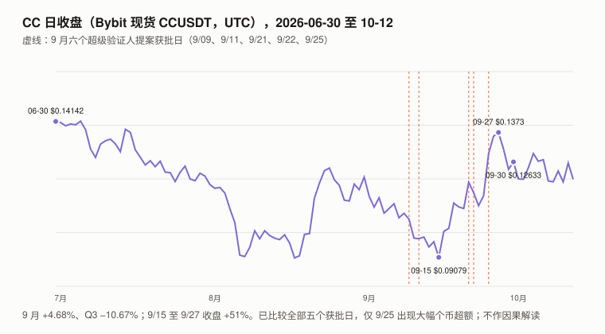
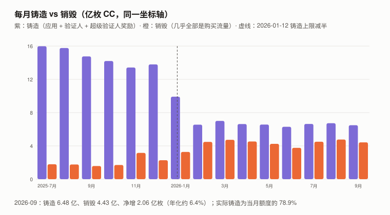
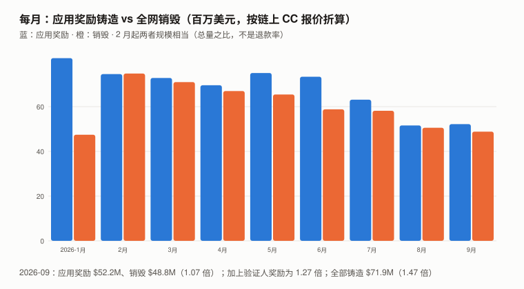

# CC / Canton Network 完整调研与分析报告（2026 年 9 月版，首期）

> **编写日期**：2026 年 10 月 13 日
> **数据截止**：2026 年 9 月 30 日；链上与聚合器快照到 10/12
> **研究方法**：沿用本系列框架。价格用 **Bybit 现货 CCUSDT 日线 UTC 收盘**（CC 不在币安上市；Bybit 是 CoinGecko 上成交最大的场所；与 OKX 重叠期的日收盘中位差 0.03%）；超额收益用对数口径（ln 收益 − beta × ln BTC 收益，不扣截距）。
> **本期为 CC 首期报告**，本系列第十八个对象。
>
> **接入新资产的第一步：三个默认还成立吗**（XIN 期教训）：
>
> | 检查 | 结果 | 依据 |
> |---|:---:|---|
> | **流通量已知吗** | ⚠️ **总量来自 CantonScan，与它自己的铸造 − 销毁有约 20 亿枚序列外差额；持有人分布本报告取不到** | **官方 Scan 接口对外部 IP 返回 403**（只对验证人开放）；本报告用 **CantonScan 的逐日铸造 / 销毁序列**（DefiLlama 适配器只在 2025-11-12 之前从 CantonScan 取价格；**它的数量来自 Allium，独立于 CantonScan**），9/30 累计供应 **395.68 亿枚**；CoinGecko 10/12 为 398.29 亿，CantonScan 为 396.54 亿（差 0.44%，未核实原因）。⚠️ **CantonScan 的供应 ≠ 它自己的「铸造 − 销毁」累计**：差 20.17 亿枚，主要是 2025-11-05 一天的 16.29 亿（与 CIP-0067「历史未领取奖励一次性拨给基金会，预计 16–17 亿」吻合），**2026-03 起浮点级相等，可能是派生字段**（4.1）。**无启动前预分配**；但有 **CIP-0105 超级验证人锁定框架**（2026-03 获批，实际锁定余额本期未取得）——**本报告的「供应」是总供应，不是扣除锁定后的可交易流通量**。累计发行的约 56% 给了超级验证人 |
> | **价格是可用的测量吗** | ⚠️ 可用，**但 BTC 单因子模型解释度很低** | Bybit 9 月日成交中位数约 $406 万；**R² 只有 0.078**，beta 0.597 |
> | **代币持有人是剩余索取权人吗** | ❌ **没有找到赋权文件** | 官方文档：CC 是 Global Synchronizer 的**原生实用代币**，用于支付流量、奖励基础设施与应用、通过超级验证人参与治理；**不对 Digital Asset 或任何公司有请求权** |
>
> **本期核心发现**：
> 1. **CC 的费用以美元计价、以 CC 支付并销毁**：流量单价在链上数据中稳定在 **约 $60/MB**（本报告由销毁额 ÷ 流量字节反算，逐月 59.9–62.4；参数原文未读；**CIP-0084 允许代币经济委员会建议调整单价，它不是永久参数**）。**在单价不变时，购买流量的销毁美元额只取决于购买的流量，不取决于币价**——本系列第一个**收入不以标的计价**的「销毁型」资产，**TRX 期的退化陷阱在销毁这一侧不出现**。9 月的销毁 100% 来自购买流量。
> 2. **但铸造大于销毁，净供应在增长**：9 月铸造 **6.48 亿**、销毁 **4.43 亿**，**净增 2.06 亿枚（年化约 6.4%；年化口径 = 月净增 × 365/30 ÷ 月初供应，单利，全文同）**；Q3 三个月净增 6.16 亿。**当月实际铸造是当月新增额度的 78.9%**（当前阶段上限每年 100 亿枚；2026-01-12 减半生效，日铸造从约 4,480 万降到约 2,460 万）——⚠️ **未领取的部分进入「未领取池」，可经治理补铸**（CIP-0066；CIP-0067 已在 2025-11 一次性补铸约 16.3 亿给基金会），**不是永久不发行**。
> 3. **激励发行的规模与销毁相当或更大**：2026-02 起，**每月应用奖励的实际铸造（按链上报价折美元）约为全网销毁的 1.00–1.25 倍**（9 月 1.07 倍）；加上验证人奖励是 **1.27 倍**；全部铸造是 **1.47 倍**。⚠️ **这是总量之比，表示激励发行的规模——不是用户退款率，也不是任何参与者的利润率**：付费者与领奖者不一定是同一实体，奖励还受池额度、权重与领取时点影响。
> 4. **流量字节在下降**：CantonScan 的月流量字节从 2026-02 的 **1.247 TB** 降到 9 月的 **0.813 TB（−35%）**；销毁的美元额相应从 $7,481 万降到 **$4,883 万**。⚠️ **该字段测的是购买还是消耗，本报告没有核实**；下降的原因（需求减弱、免费确认响应等协议优化、预购节奏、测试结束）**未识别**。
> 5. **9 月治理**：**六项里程碑式超级验证人参与方案获批**——TreasurySpring（9/09）、新韩资管（9/11）、a16z crypto（9/21）、伦敦证券交易所集团 LSEG（9/22）、Paxos（9/22）、Marex（9/25），最大可赚取权重合计 52（**不等于已生效权重**）；奖励在里程碑达成前进入未领取池、**达标后才授权铸造**。
> 6. **价格**：9 月 **+4.68%**、Q3 **−10.67%**（BTC +6.42% / +42.64%）；9/15 至 9/27 收盘 +51%。**9/16 与 9/25 两天是个币异动**（相对 9 个山寨中位数 +8.8 / +10.1 个百分点；9 月日超额标准差 3.6）。**五个提案获批日里只有 9/25 出现大幅个币超额，当日获批权重合计最高的 9/22（LSEG + Paxos）是 −4.3**；9/16 没有对应事件——**原因未识别**。
>
> **本期核心判断**：**CC 有本系列少见的「美元计价、与币价无关」的销毁（9 月约 $4,883 万，年化约 $5.9 亿，约为市值的 12%）；但同月的铸造按链上报价折算约为销毁的 1.47 倍，供应净增。** ⚠️ **净增的大小与正负取决于币价**：应用与超级验证人奖励的枚数基本固定，流量不变时**价格越高、烧掉的枚数越少、净增越多**——按 9 月流量与 9/30 收盘价，年化约 7.7%；**价格低于约 $0.070 时转为净减**。 「销毁 = 持有人收入」这个读法要和同期发行一起看：**按 9 月单月外推，供应年化增速约 6.4%（固定枚数持有者的占比每年约降 6.0%）**；这不是可以直接确认的财富损失，价格如何反应是另一回事。
> **本报告不给目标价**：持有人没有请求权；没有可折现的、归持有人的值流；流量里有多少是真实需求、多少与奖励激励有关，本报告分离不出来。
>
> **免责声明**：本报告不构成任何投资建议。所有分析仅供研究参考，投资决策请咨询专业顾问。

---

## 核心结论摘要（一页速览）

| 维度 | 核心判断 |
|------|----------|
| **CC 是什么** | Canton Network 的公共同步层（Global Synchronizer）的**原生实用代币**；在 Splice 开源代码中叫「Amulet」 |
| **9/30 收盘** | **$0.12633**（Bybit）；按 395.68 亿枚，**市值约 $50.0 亿** |
| **9 月 / Q3** | **+4.68% / −10.67%**（BTC +6.42% / +42.64%）；上市（2025-11-10 收 $0.11819）以来 +6.9% |
| **beta / R² / 波动率** | **0.597 / 0.078 / 96.3%**（2025-11-11 至 2026-09-30，323 个日收益） |
| **对数超额** | 9 月 **+0.9**（对照组中位数 +13.2）；Q3 **−32.5**（对照组中位数 +2.8） |
| **供应** | **无上限**；铸造上限每年 100 亿枚（当前阶段），9 月实际铸造为当月新增额度的 78.9%；未领取部分可补铸 |
| **9 月铸造 / 销毁 / 净增** | **6.48 亿 / 4.43 亿 / +2.06 亿枚**（单月外推年化约 +6.4%） |
| **9 月销毁（美元）** | **$4,883 万**（CantonScan）；DefiLlama 9/1–9/29 为 $4,710 万（同窗口差 0.06%） |
| **铸造 ÷ 销毁（美元）** | 应用 1.07 倍；应用 + 验证人 1.27 倍；全部铸造 1.47 倍（激励发行规模，不是退款率） |
| **持有人权益** | **无请求权**；无质押收益（奖励给运营者与应用，不给被动持有人）；超级验证人有锁定框架（CIP-0105） |
| **估值** | **不给目标价**（第 9 章） |

---

## 1. CC 是什么

### 1.1 代币的三个用途（官方文档原文）

| 用途 | 内容 |
|---|---|
| **支付网络使用（流量）** | 验证人燃烧 CC 购买流量额度；**流量额度不可转让**，只能用于提交交易 |
| **奖励** | 奖励基础设施运营者（超级验证人、验证人）与**精选应用**的提供方 |
| **治理** | 通过超级验证人参与网络治理 |

> CIP-0078 之后，转账费与锁定费已取消；**现行的费用只有流量费与持有费**（持有费按每个 UTXO 计，只在过期清理时收取）。

### 1.2 铸造上限曲线（白皮书原文）

| 网络运行年数 | 每年上限 | 期间合计 | 应用 | 验证人 | 超级验证人 |
|---|---:|---:|---:|---:|---:|
| 0–0.5 | 400 亿 | 200 亿 | 15% | 5% | 80% |
| 0.5–1.5 | 200 亿 | 200 亿 | 40% | 12% | 48% |
| **1.5–5（当前）** | **100 亿** | 350 亿 | **62%** | **18%** | **20%** |
| 5–10 | 50 亿 | 250 亿 | 69% | 21% | 10% |
| 10 年以后 | 25 亿 / 年 | — | 75% | 20% | 5% |

- 前 10 年**最多** 1,000 亿枚，之后每年最多 25 亿；**上限是「最多可铸」**；没人领取的部分进入未领取池，**可经治理投票补铸**（CIP-0066）——CIP-0067 已把截至生效日的历史未领取验证人奖励一次性拨给 Global Synchronizer 基金会（提案预计 16–17 亿枚；CantonScan 供应在 2025-11-05 跳增 16.29 亿）；
- **开发基金（CIP-0082，2025-10-01 获批）**：从所有发行流按比例抽 5% 给基金会管理的开发基金，**不提高总发行计划**；实施细节由后续 CIP 规定，**CantonScan 的三类奖励里是否已包含它，本报告未核实**；
- 链上数据始于 2024-06-26；**日铸造在 2026-01-12 从约 4,480 万降到约 2,460 万**（与 1.5 年的减半一致）。

### 1.3 奖励怎么发（官方文档）

| 对象 | 规则 |
|---|---|
| 超级验证人 | 按运行同步器节点获得铸造权，**按权重分配**；**CIP-0105（2026-03-02 获批，Active）**：超级验证人可锁定历史与未来奖励的一定比例以维持权重（启动时三档门槛 70% / 45% / 35%，逐年收紧），解锁按每日 1/365.25 释放——**实际锁定余额本期未取得** |
| 验证人 | **按其燃烧的费用比例**获得铸造权；活跃度奖励已于 2026-04-30 取消（CIP-0096） |
| 应用 | **只有「精选应用」有奖励**（由 Canton 基金会的代币经济委员会审批）；CIP-0104 改为按应用实际消耗的流量计算——**它规定分阶段上线（部分阶段至少间隔 30 天），主网各阶段的生效日期本报告未核实** |

---

## 2. CC 的发展阶段划分

| 阶段 | 时间 | 特征 |
|------|------|------|
| 主网与公平启动 | 2024-06 起 | **无预挖、无私募分配**；前半年超级验证人拿 80% |
| 减费 | 2025-09 | CIP-0078 取消转账费 |
| 上市交易 | 2025-11 | Bybit 等上线；CoinGecko 收录 2025-11-12 |
| **减半与机构加入** | 2026-01 起 | 铸造减半；2026-02 流量见顶；9 月六家机构申请超级验证人 |

---

## 3. CC 当前现状

### 3.1 价格与市场

| 指标 | 数值 |
|------|------|
| 6/30 / 8/31 / 9/30 收盘 | **$0.14142 / $0.12068 / $0.12633** |
| 9 月区间（收盘） | **$0.09079（9/15）– $0.1373（9/27）** |
| 9 月 / Q3 | **+4.68% / −10.67%** |
| 历史最高 / 最低（CoinGecko，含盘中） | $0.194152（2026-02-03）/ $0.059024（2025-12-06） |
| beta / R² | **0.597 / 0.078** |
| 年化波动率 | **96.3%**（同窗口 BTC 45.1%） |
| 单日涨跌超过 20% 的天数 | 4 天（323 天中） |
| 特质波动（月 / 季） | 约 26.5 / 46.4 个对数点 |

**对数超额收益**（对照组为本系列 9 个山寨：ZEC / UNI / ADA / SOL / BNB / ETH / TRX / CKB / DOT）：

| | 7 月 | 8 月 | 9 月 | Q3 |
|---|---:|---:|---:|---:|
| CC | −22.4 | −10.9 | +0.9 | **−32.5** |
| 对照组中位数 | +1.7 | −3.3 | +13.2 | +2.8 |
| CC − 对照组中位数 | −24.1 | −7.6 | −12.4 | −35.3 |

> **R² 只有 0.078**——BTC 单因子线性模型只解释 CC 约 8% 的日方差（XIN 期规则：beta 必须和 R² 一起报）。**0.597 的 beta 估计很不稳定**，不能读成「低风险」；**R² 低不等于价格是噪声**，只说明这个模型解释不了。
> Q3 的 −32.5 约为 0.7 个季度特质标准差（46.4）——粗略量级比较（独立日残差假设），**不足以称为显著**。

### 3.2 9 月的个币异动与提案获批日

（个币超额 = CC 日涨跌 − 9 个山寨对照组中位数，与 3.1 同一对照组；9 月日超额标准差 3.6 个百分点）

| 日期 | CC | 个币超额 | 同日事件 |
|---|---:|---:|---|
| 9/09 | −2.1% | −0.3 | TreasurySpring 获批 |
| 9/11 | −0.2% | −1.2 | 新韩资管获批 |
| 9/16 | +10.6% | **+8.8** | **无对应的提案或公告** |
| 9/21 | +9.0% | +4.0 | a16z crypto 获批 |
| 9/22 | −3.3% | **−4.3** | **LSEG、Paxos 获批**（当日获批最大权重合计 18，五天中最高） |
| 9/25 | +13.8% | **+10.1** | Marex 获批（GitHub 合并日；合并的 UTC 时刻未核实） |

> **判别性的看法是看全部获批日**：五个获批日里只有 9/25 出现大幅个币超额，**当日获批权重合计最高的 9/22 是 −4.3**；9 月超额 ≥ 8.8 的两天里，一天有获批、一天没有。**这组数据不支持「获批推动价格」，本报告不作因果判断。**
> LSEG 的官方新闻稿日期是 9/28，**晚于** 9/25–9/27 的上涨。

### 3.3 宏观环境

与 BTC 9 月版共用（美联储 9/16 加息 25bp 至 3.75–4.00%）。**CC 对 BTC 的 R² 为 0.078；宏观因子本报告没有单独检验。**

---

## 4. 供应：铸造 − 销毁（本期核心章之一）

### 4.1 数据来源与交叉检验

| 来源 | 测什么 | 9/1–9/29 销毁（美元） |
|---|---|---:|
| **CantonScan**（`/api/mining-rounds/timeseries`） | 逐日铸造、销毁（枚）、链上 CC 价格、流量字节 | **$47,130,720** |
| **DefiLlama**（Allium 数据，`summary/fees/canton`） | 逐类销毁（枚）× 价格 | **$47,101,787** |

> **两条管线的数量来自不同处理方（CantonScan 自己 vs Allium），价格口径也不同（链上价格 vs CoinGecko），同一窗口相差 0.06%**——这是本期最强的一次交叉检验。
> ⚠️ DefiLlama 的序列到 9/29 为止（9/30 缺），**它的「9 月」少一天**，这是它和 CantonScan 全月 $4,883 万的主要差距。
> ⚠️ **CantonScan 是第三方浏览器**，官方 Scan 接口本报告访问不到（403）——**本报告没有独立读取链上状态**，铸造的数字只有 CantonScan 一个来源；**两条管线的一致只检验了销毁的计价，不检验铸造与流量**。
> ⚠️ 美元换算用的是「每日销毁量 × 当日链上均价」，不是逐轮按当轮报价折算，存在小幅误差。

**供应勾稽**（期初供应 + 铸造 − 销毁 = 期末供应）：

| 月份 | CantonScan 供应变化 − (铸造 − 销毁)（百万枚） | 说明 |
|---|---:|---|
| 2025-10 | +36.6 | 未识别 |
| 2025-11 | **+1,633.6**（其中 11/05 一天 +1,628.6） | **与 CIP-0067 一次性拨给基金会（预计 16–17 亿）吻合** |
| 2025-12 | +83.1 | 未识别（可能是其他未领取池补铸，CIP-0066） |
| 2026-01 | +132.1 | 同上 |
| 2026-02 | +19.4 | 同上 |
| **2026-03 至 10/12** | **0.0** | **浮点级相等**（可能是派生字段，见下） |
| 合计 | **+2,016.6** | 铸造序列不含这些「序列外发行」 |

> ⚠️ **2026-03 起的「吻合」不是独立验证**：此前 612 个日差中有 607 个残差绝对值超过 10⁻⁵ 枚，3 月起残差最大只有 7.4×10⁻⁶ 枚（浮点精度级）——**最可能是 CantonScan 从 3 月起用「铸造 − 销毁」累加出供应字段**。若如此，3 月以后再发生治理补铸，供应与流量两边都不会显示，勾稽照样「吻合」。**唯一独立的比对**（CoinGecko 398.29 亿 vs CantonScan 396.54 亿，差 1.75 亿枚，约 0.85 个月的净增）**对不上，原因未核实**。CIP 仓库 2026-03 至 09 的提交标题中没有补铸相关提案（只查了标题）。
> **对本期结论的影响**：9 月的铸造与销毁是 CantonScan 的流量数据本身，不受供应字段影响；**但 9 月净增 2.06 亿枚（年化约 6.4%）只是「序列内净增」，是总供应增速的下限**——序列外的补铸若存在，不在其中；受影响的是**累计口径**——累计铸造 432.6 亿之外还有约 20.2 亿序列外发行，下面的累计占比已按 452.8 亿重算。

### 4.2 月度铸造与销毁（CantonScan）

| 月份 | 铸造（亿枚） | 销毁（亿枚） | 净增（亿枚） | 应用 % | 验证人 % | 超级验证人 % | 月末供应（亿枚） |
|---|---:|---:|---:|---:|---:|---:|---:|
| 2025-09 | 14.75 | 1.58 | 13.17 | 43.4 | 13.0 | 43.6 | 318.27 |
| 2025-12 | 13.80 | 2.28 | 11.52 | 47.4 | 14.3 | 38.3 | 370.08 |
| 2026-01 | 9.91 | 3.28 | 6.63 | 57.1 | 16.4 | 26.6 | 378.04 |
| 2026-02 | 6.56 | 4.48 | 2.08 | 68.0 | 18.4 | 13.6 | 380.31 |
| 2026-06 | 6.29 | 3.77 | 2.53 | 74.8 | 11.8 | 13.4 | 389.52 |
| 2026-07 | 6.64 | 4.50 | 2.14 | 73.3 | 13.5 | 13.2 | 391.66 |
| 2026-08 | 6.73 | 4.76 | 1.96 | 72.2 | 13.9 | 13.8 | 393.63 |
| **2026-09** | **6.48** | **4.43** | **2.06** | **72.6** | **13.5** | **13.9** | **395.68** |

- **9 月净增 2.06 亿枚 ≈ 月初供应的 0.52%，年化约 6.4%**；
- **9 月实际铸造是当月新增额度（每年 100 亿 → 30 天 8.22 亿）的 78.9%**；未领取部分进入未领取池，可经治理补铸；
- **各池额度利用率**（9 月实际铸造 ÷ 白皮书额度）：应用 4.71 亿 ÷ 5.10 亿 ≈ **92%**；验证人 0.88 亿 ÷ 1.48 亿 ≈ **59%**；超级验证人 0.90 亿 ÷ 1.64 亿 ≈ **55%**。⚠️ 72.6% 是应用占**实际铸造**的比例、62% 是占**额度**的比例，两者不能直接比较（初稿据此推断「池间再分配」，已撤回）；
- 累计（2024-06 至 10/12）：铸造序列 432.6 亿 + 序列外发行约 20.2 亿 ≈ 452.8 亿；**超级验证人 252.7 亿（约 55.8%）**、应用 143.6 亿（约 31.7%）、验证人 36.3 亿（约 8.0%），序列外约 4.5%；销毁 56.2 亿。

### 4.3 谁拿到了新币

**累计发行的约 55.8% 发给了超级验证人**（Digital Asset 与创始成员为主），另有约 16.3 亿一次性拨给了基金会——这是「公平启动、无预挖」的另一面：**早期的大部分供应集中在少数运营机构手里**。
**它们持有多少、锁定多少（CIP-0105）、卖了多少，本报告取不到**（官方 Scan 不对外开放；第三方浏览器 ccview / cantonscan 网页均有 Cloudflare 拦截）。

---

## 5. 价值捕获：销毁与激励发行（本期核心章之二）

### 5.1 流量费以美元计价

| 月份 | 流量（TB） | 链上 CC 均价 | 销毁（百万美元） | 美元 / MB（反算） |
|---|---:|---:|---:|---:|
| 2025-09 | 0.164 | $0.0675 | 10.19 | 62.0 |
| 2026-02 | **1.247** | $0.1671 | **74.81** | 60.0 |
| 2026-06 | 0.980 | $0.1559 | 58.81 | 60.0 |
| 2026-09 | **0.813** | $0.1109 | **48.83** | 60.0 |

> **每 MB 的美元价格几乎恒定在 $60**（反算值，本报告没有读到 `AmuletRules` 里的参数原文；CIP-0084 允许委员会建议调价）——**在单价不变时，购买流量的销毁美元额 = 购买字节 × $60**，与 CC 币价无关；币价跌时烧掉的 CC 枚数自动增加。
> ⚠️ CC 在**购买**流量额度时销毁，购买与实际消耗可以跨期；CantonScan 的字节字段是购买量还是消耗量，**本报告未核实**——若是消耗量，上表的 $/MB 只是近似。
> **链上 CC 价格（超级验证人报告）9 月均值 $0.1109，与 Bybit 9 月收盘均值 $0.1110 一致。**
> **退化检验**（TRX 期规则）：**分子（销毁美元）不含 CC 价格**——「市值 ÷ 年化销毁」不会在等式两边约掉价格。

### 5.2 奖励 ÷ 销毁

| 月份 | 应用奖励 | 验证人奖励 | 超级验证人奖励 | 销毁 | 全部铸造 | 应用 ÷ 销毁 | (应用 + 验证人) ÷ 销毁 |
|---|---:|---:|---:|---:|---:|---:|---:|
| 2025-09 | 43.3 | 13.0 | 43.4 | 10.2 | 99.6 | 4.25 | 5.52 |
| 2026-01 | 81.7 | 23.4 | 37.9 | 47.4 | 143.0 | 1.72 | 2.22 |
| 2026-02 | 74.6 | 20.1 | 14.9 | 74.8 | 109.6 | **1.00** | 1.27 |
| 2026-06 | 73.4 | 11.6 | 13.1 | 58.8 | 98.1 | 1.25 | 1.45 |
| 2026-08 | 51.6 | 10.0 | 9.9 | 50.6 | 71.4 | 1.02 | 1.22 |
| **2026-09** | **52.2** | **9.7** | **10.0** | **48.8** | **71.9** | **1.07** | **1.27** |

（单位：百万美元，按 CantonScan 每日链上 CC 价格计。）

> **能说的**：**2026-02 起，每月应用奖励实际铸造的计价金额约等于全网销毁的计价金额**（1.00–1.25 倍）；加上验证人奖励约 1.22–1.45 倍。**激励发行的规模与销毁相当或更大。**
> **不能说的**：**这不是退款率，也不是任何参与者的利润率**——付费的一方和领奖的一方不一定是同一个实体，奖励还受池额度、权重、上限与领取时点影响；**总量比值推不出「新增一单位流量能领回多少」**。**「有人为领奖而刷流量」本报告没有证据。** 官方 CIP-0120 写到的「脱节」，指的是**燃烧 CC 购买流量的用户与实际处理流量的验证人可能不同**——它是关于奖励归属的问题，不是刷量的证据（截至 10/12 状态仍为 Proposed）。

### 5.3 DefiLlama 的「HoldersRevenue」

DefiLlama 把 Canton 的全部销毁同时列为 **Revenue 与 HoldersRevenue**（方法说明：「所有收取的费用都被销毁」）。
**这个指标只记了毛销毁，没有扣同期发行**：9 月销毁 $4,883 万的同时铸造了约 $7,186 万的新币——**按每日链上报价折算的净发行金额约 $2,303 万**（约市值的 0.46%/月）。⚠️ 这是发行规模的折算，**不是从持有人账户扣除的同额财富**。
> 这是本系列第八个口径坑（LINK 期的「Chainlink Staking」是第七个）：**「HoldersRevenue」是毛销毁；在增发大于销毁的链上，持有人面对的是净发行，读这个指标时要把发行一起看。**

### 5.4 固定发行假设下的净发行归零参考价（算术，不是均衡）

**模型**：应用与超级验证人奖励的枚数按 9 月固定（2 月至 9 月应用奖励枚数 4.46 亿 → 4.71 亿，未随流量下降；应用池额度利用率约 92%），验证人奖励约为销毁枚数的 0.2 倍（按燃烧比例获得铸造权）。在 9 月流量（销毁 $4,883 万）下，**净发行归零的价格约 $0.070**。
> ⚠️ **这只是固定部分发行后的算术平衡点**：实际发行还受奖励上限、领取与补铸影响，真实的平衡可能有多个、也可能分段存在。**不作为价格判断。**（初稿用「冻结全部铸造枚数」得到 $0.075，忽略了验证人奖励随销毁增加，已改。）

---

## 6. 治理：9 月六个超级验证人提案

| CIP | 申请方 | 最大权重 | 创建 | 获批 |
|---|---|---:|---|---|
| 0122 | TreasurySpring Management (Jersey) | 4 | 2026-06-16 | 2026-09-09 |
| 0121 | 新韩资产管理（Shinhan Asset Management） | 10 | 2026-08-14 | 2026-09-11 |
| 0123 | a16z crypto | 10 | 2026-09-14 | 2026-09-21 |
| 0124 | **伦敦证券交易所集团（LSEG）** | 10 | 2026-09-02 | 2026-09-22 |
| 0125 | Paxos | 8 | 2026-09-14 | 2026-09-22 |
| 0126 | Marex | 10 | 2026-09-14 | 2026-09-25 |

（来源：`canton-foundation/cips` 仓库原文与提交记录；CIP-0123 文件头仍写「Proposed」，README 索引与提交记录为「Approved」。）

- **里程碑达成前，代表节点暂不为它铸造，奖励进入未领取池，达标后才授权铸造**（CIP-0124 原文；CIP-0121、0126 写「Accrual Destination: Escrow」）——**不是「已发行的币在托管里解锁」**；
- **最大可赚取权重 ≠ 已生效权重**；部分里程碑保密；Paxos 的主要期限是获批后 6、9、12、24 个月；
- **对供应的影响本报告没有核实**：新增权重首先改变超级验证人池内的份额；超级验证人池 9 月的额度利用率约 55%，**用实际占比不能判断这个池是否「没用满」到可以被新权重填满**——取决于池额度的计算规则。
- **待决**：CIP-0120（按实际流量发验证人奖励、30% 分给确认验证人）2026-06-29 创建，状态 Proposed。

---

## 7. 核心价值逻辑

### 7.1 多头逻辑

| # | 论据 | 强度 | 证据等级 |
|---|------|:---:|---|
| 1 | **销毁以美元计价**，年化约 $5.9 亿，约为市值的 12%，单价不变时与币价无关 | ★★★☆☆ | ✅ 两条管线交叉一致；⚠️ 见空头 #1；单价可调（CIP-0084） |
| 2 | **传统金融机构的里程碑式超级验证人参与方案获批**（LSEG、Paxos、Marex、新韩资管；另有 a16z crypto） | ★★★☆☆ | ✅ CIP 原文；⚠️ 奖励按里程碑，参与 ≠ 付费流量；最大权重 ≠ 生效权重 |
| 3 | 9 月实际铸造为新增额度的 79%；减半已发生，下一次在运行第 5 年（2029 年中） | ★★☆☆☆ | ✅ 白皮书 + 链上；⚠️ 未领取部分可补铸 |

### 7.2 空头逻辑

| # | 论据 | 强度 | 证据等级 |
|---|------|:---:|---|
| 1 | **铸造是销毁的 1.47 倍（计价；其中应用 + 验证人奖励 1.27 倍），供应按 9 月外推年化增速约 6.4%（序列内，下限）** | ★★★★☆ | ✅ 链上（单一来源 CantonScan）；⚠️ 单月外推；**大小与正负随币价变**（价格低于约 $0.070 转为净减） |
| 2 | **流量字节自 2 月见顶下降 35%** | ★★☆☆☆ | ✅ 链上；⚠️ 字段定义未核实，原因未识别（可能含协议优化） |
| 3 | 累计发行约 56% 发给超级验证人，持有分布不透明 | ★★★☆☆ | ✅ 累计数链上；⚠️ 持有、锁定（CIP-0105）与卖出取不到 |
| 4 | R² 0.078、波动率 96%：BTC 单因子解释不了它的价格 | ★★☆☆☆ | ✅ 计算 |

> **检查两条论据是否描述同一机制的两面**（DOT 期规则）：**多头 #1 与空头 #1 是同一组数字**（初稿把「应用 + 验证人 1.27 倍」单列为空头 #2，它是 #1 的子集，审查后并入）——销毁 $4,883 万是真的，**但同一个月里铸造了约 $7,186 万的新币，其中约 $6,190 万是应用与验证人奖励**。**多头 #1 必须和同期发行一起读**，单独读销毁会漏掉净发行。本报告的核心判断按净发行写。

---

## 8. 多空之间真正的分歧点

1. **流量是真实需求还是与奖励激励有关**：流量字节 2 月见顶后降了 35%——这与「激励驱动的流量减少」相容，也与「测试流量结束」「免费确认响应等协议优化减少了付费字节」「预购节奏」相容，**本报告不能判别**。
2. **机构超级验证人会不会带来付费流量**：它们的奖励按里程碑，里程碑多与把业务搬上 Canton 有关；**期限多在获批后 6–24 个月（Paxos），时点不确定，不支持「Q4 必然上升」**。
3. **CIP-0120 是否通过**：它会改变验证人奖励与「燃烧」的挂钩方式。

---

## 9. 估值：不给目标价

### 9.1 为什么不给

- **充分条件**：持有人没有现金流请求权——没有归持有人的值流可以折现；
- **加重情节**：流量里有多少是奖励驱动，分离不出来；持有分布取不到。

### 9.2 比值与反推

> **推导方法**：市值 = 9/30 Bybit 收盘 × CantonScan 9/30 累计供应；年化 = 9 月 × 12；不推导任何价格区间。

| 比值（9/30） | 数值 |
|---|---:|
| 市值 ÷ 年化销毁（美元） | 约 **8.5 倍** |
| 年化净发行（铸造 − 销毁，按链上报价折算） | 约 $2.76 亿/年 |
| 净发行归零需要的流量（应用 + 超级验证人奖励枚数按 9 月固定、验证人奖励约为销毁枚数的 0.2 倍） | 按 9 月链上均价约 **1.29 TB/月**（9 月的 1.59 倍，**高于 2 月历史峰值 1.247 TB**）；按 9/30 收盘价约 1.47 TB |
| 按 9 月流量，净发行归零的价格 | 约 **$0.070**（9/30 收盘价 $0.12633 的约 55%） |

### 9.3 这套判断的弱点

1. **铸造数字只有 CantonScan 一个来源**（销毁有两个）；
2. **$60/MB 是反算值**，没有读到参数原文；
3. 「奖励 ÷ 销毁」是网络总量，**不能推出任何实体在刷量**；
4. 未领取池补铸、开发基金（CIP-0082）与超级验证人锁定（CIP-0105）的实际执行状态本报告没有核实；
5. **2025-10 至 2026-02 约 3.9 亿枚的序列外发行未识别来源**（2025-11 的 16.29 亿已对应 CIP-0067）。

---

## 10. 投资与风险启示

### 10.1 关键监控指标

| 指标 | 当前 | 变化信号 | 来源 |
|------|------|------|------|
| **月净增（铸造 − 销毁）** | +2.06 亿枚（9 月） | 转负（销毁 > 铸造） | CantonScan |
| **月流量** | 0.813 TB | 回到 1.0 TB 以上，或跌破 0.6 TB | CantonScan |
| **净发行归零价**（按当月流量） | 约 $0.070 | 市价接近它（净发行接近零）；⚠️ 「奖励 ÷ 销毁」这类比值约等于「价格 ÷ 流量」，不单独监控 | CantonScan + 价格 |
| 月销毁（美元） | $4,883 万 | 任一月 ≥ $6,000 万 | DefiLlama / CantonScan |
| CIP-0120 | Proposed | 获批 | GitHub |

### 10.2 风险提醒

1. **净发行**：按 9 月单月外推，供应年化增速约 6.4%；未领取池还可补铸；
2. **数据可得性**：官方 Scan 不对外开放，本报告依赖第三方浏览器；
3. **价格解释度低**：对 BTC 的 R² 0.078，单日 ±20% 一年 4 次；
4. **超级验证人集中**：累计约 56% 的新币发给了它们（锁定情况未知）。

### 10.3 长期认知

**第一，「销毁」要和「铸造」放在同一张表里读。** 一个以美元计价、与币价无关的销毁流是难得的好结构；**但如果同一个月按计价铸造了 1.47 倍的新币，持有人面对的是净发行——而且由于发行枚数基本固定、销毁枚数随币价反向变化，价格越高，净发行越多。** DefiLlama 的「HoldersRevenue」只记了毛销毁。

**第二（审查后新增），一个第三方序列的「累计供应」要先和它自己的流量勾稽。** 初稿直接用了 CantonScan 的累计供应和累计铸造，**两者差约 20.2 亿枚**——其中约 16.3 亿与 CIP-0067 的一次治理补铸金额相符（交易归属未直接核实），另约 3.9 亿来源未识别。**发行不只在「每轮铸造」里，也在治理投票里。**

**第三，「公平启动」不等于「分散持有」。** 没有预挖、没有私募，但累计约 56% 的新币按设计发给了少数运营机构——**分配方式公平与持有结构分散是两个问题**。

---

## 11. 附录

### 11.1 关键数据速查（截至 2026-09-30，快照到 10/12）

| 指标 | 数值 | 来源 |
|------|------|------|
| 9/30 收盘 | $0.12633 | Bybit |
| 9 月 / Q3 | +4.68% / −10.67% | Bybit |
| beta / R² / 波动率 | 0.597 / 0.078 / 96.3% | 本报告计算 |
| 9/30 累计供应（总供应，未扣锁定） | 39,568,418,435 | CantonScan（2026-03 起与铸造 − 销毁浮点级相等，可能是派生字段） |
| 9/30 市值（按总供应） | 约 $50.0 亿 | 计算 |
| 9 月铸造 / 销毁 / 净增 | 6.48 亿 / 4.43 亿 / 2.06 亿 | CantonScan |
| 9 月销毁（美元） | $4,883 万 | CantonScan；DefiLlama 交叉 |
| 9 月流量 | 0.813 TB | CantonScan |
| 9 月应用 / 验证人 / 超级验证人奖励 | $5,220 万 / $970 万 / $1,000 万 | CantonScan |

### 11.2 数据来源与核实状态

| 数据 | 来源 | 状态 |
|------|------|:---:|
| 价格 | Bybit 日线；OKX 交叉（中位差 0.03%） | ✅ |
| 铸造 / 销毁 / 流量 | CantonScan 逐日序列 | ✅ 第三方浏览器；⚠️ 铸造单一来源；字节字段定义未核实 |
| 供应勾稽 | CantonScan 供应 vs 铸造 − 销毁 | ⚠️ 2026-03 起浮点级相等（可能是派生字段，不构成独立验证）；此前序列外发行 20.2 亿（16.3 亿对应 CIP-0067，3.9 亿未识别）；CoinGecko 差 1.75 亿未核实 |
| 销毁交叉 | DefiLlama（Allium） | ✅ 同窗口差 0.06% |
| 官方 Scan 接口 | — | ❌ 403，未能直读 |
| 铸造曲线 | Canton Coin 白皮书原文 | ✅ 一手 |
| 费用与奖励规则 | 官方文档 `docs.canton.network` | ✅ 一手 |
| 超级验证人提案；CIP-0066/0067/0082/0084/0104/0105 | `canton-foundation/cips` 原文 | ✅ 一手（状态以 10/12 的 README 为准；主网执行状态未核实） |
| LSEG 新闻稿 | Canton 官方新闻页（9/28） | ✅ 标题与日期 |
| $60/MB | 反算 | ⚠️ 参数原文未读 |
| 持有人分布 | — | ❌ 取不到 |

### 11.3 来源偏向声明

- 空头论据全部来自链上数据（CantonScan）与官方 CIP 原文；多头论据 #2（机构加入）来自 CIP 原文，**参与不等于付费，已在星级中折扣**。
- **传统金融机构视角**：本期引用了**美联储**政策；LSEG、Paxos、Marex 是作为超级验证人申请方出现，**不是对 CC 的研究覆盖**。未找到传统金融机构对 CC 的当期研究。

### 11.4 发布前审查记录

**第 1 层 自动核查**（`tools/verify_report.py`）：初稿 2 FAIL（图表坐标刻度数字不在正文）→ 修正后 0 FAIL。

**第 2–3 层 Codex（第一轮）**：

| # | 意见 | 处理 |
|---|------|------|
| 1 | **CantonScan 累计供应 ≠ 它自己的累计铸造 − 累计销毁，差约 20 亿枚** | ✅ **逐日勾稽**：2025-11-05 一天 +16.29 亿（对应 CIP-0067 基金会补铸），2025-10 至 2026-02 另有约 3.9 亿未识别；**2026-03 起逐日吻合，9 月与 Q3 数字不受影响**（后经 _bian 第一轮第 2 条修正：3 月起的吻合是浮点级相等、可能是派生字段，6.4% 改称序列内下限）；累计占比按 452.8 亿重算（58.4% → 约 55.8%） |
| 2 | 「没有锁仓」漏了 CIP-0105 超级验证人锁定框架；总供应 ≠ 流通量 | ✅ 原文核实后补入；市值注明「按总供应」 |
| 3 | 未领取奖励可经治理补铸（CIP-0066/0067），里程碑奖励是「达标后授权铸造」而非已发行币的解锁 | ✅ 原文核实后改写 1.2、6 |
| 4 | **「奖励 ÷ 销毁」只能比较总量**，「返还给产生流量的一方」暗示了对应关系 | ✅ 改为「激励发行规模，不是退款率或利润率」；空头 #2 降为三星；CIP-0120 的「脱节」改为准确转述 |
| 5 | 「持有人净值流 −$2,303 万」「净稀释」把发行折算写成财富损失；「方向是反的」混淆毛销毁与净发行 | ✅ 改为「净发行折算」「供应年化增速」 |
| 6 | 购买流量与消耗流量混用；字节字段定义未核实；$60/MB 可经 CIP-0084 调整 | ✅ 全文补注 |
| 7 | 72.6%（占实际铸造）与 62%（占额度）不可比，「池间再分配」推断不成立；漏了 CIP-0082 开发基金 | ✅ 改报各池额度利用率；补开发基金 |
| 8 | CIP-0104 分阶段上线，获批 ≠ 9 月已生效；「真实需求则流量不应下降」不成立 | ✅ 删除，补协议优化等替代解释 |
| 9 | 「均衡价格」只是冻结发行的算术点 | ✅ 改名并降为算术参考 |
| 10 | 记分卡：C9-1 名称与统计量不同构、门槛 10 未满足、制造成本用了全网平均；C9-3 判定方式与门槛 11 | ✅ 记分卡已改 |
| 11 | 换算方法、跨源检验的范围、模拟设定未说明 | ✅ 已补 |
| 12 | 「获批成为超级验证人」过强；最大权重 ≠ 生效权重；Q4 流量预期过强 | ✅ 改为「里程碑式参与方案获批」 |
| 13 | 「R² 低 = 噪声」「宏观解释力弱」 | ✅ 改为「BTC 单因子模型解释度低」 |

**第 2–3 层 _bian（第一轮，审修订稿）**：

| # | 意见 | 处理 |
|---|------|------|
| 1 | **「应用奖励随流量上升」被报告自己的数据否定**：应用奖励枚数 2 月 4.46 亿 → 9 月 4.71 亿，流量却跌 35%；只有验证人奖励约与销毁枚数同比例（约 0.2 倍） | ✅ **复算核实**；9.2 改用「应用 + 超级验证人固定、验证人 0.2 倍」重算：归零流量约 1.29 TB（高于历史峰值）、归零价约 $0.070；记分卡拒登理由同步改 |
| 2 | **2026-03 起的「逐日吻合」是浮点级相等，更像派生字段，不是独立验证** | ✅ **复算核实**（612 个日差中 607 个残差绝对值超过 10⁻⁵ 枚 → 3 月起最大 7.4×10⁻⁶）；6.4% 改称「序列内净增，下限」 |
| 3 | 1.47 倍与 6.4% 随币价变（价格越高净发行越多），核心判断写得像结构性质；监控项「奖励 ÷ 销毁」约等于价格 ÷ 流量 | ✅ 核心判断补价格条件（9/30 价约 7.7%，低于 $0.070 转负）；监控项改为「归零价」 |
| 4 | 空头 #2（1.27 倍）是空头 #1 的子集 | ✅ 并入 #1 |
| 5 | **3.2 只挑了大涨日**；全部获批日里只有 9/25 有大幅超额，9/22（LSEG + Paxos）为 −4.3 | ✅ 复算后重写 3.2（统一为 9 个山寨对照组）；卷首、速查删「恰为」 |
| 6 | C9-1「不可回收」与 1.3 的验证人规则冲突：约 20% 按规则以验证人奖励返还 | ✅ 记分卡改 |
| 7 | C9-2 应从登记日已知值起算 | ✅ 从 10/12 重算为 33.8%，登记 34% |
| 8 | 卷首「DefiLlama 引用同一数据源」与 4.1 矛盾 | ✅ 改为「数量来自 Allium，独立」 |

**第二轮复审（Codex + _bian）**：

| # | 意见 | 出处 | 处理 |
|---|------|:---:|------|
| 1 | 5.4 仍是「冻结全部铸造」的旧模型（$0.075），与 9.2 的 $0.070 并存 | _bian | ✅ 5.4 改用同一模型 |
| 2 | 卷首、10.3 残留「总量可由铸造 − 销毁累计」「差额正好对应一次补铸」；607 天缺容差定义 | 两者 | ✅ 已改；注明「|残差| > 10⁻⁵ 枚」 |
| 3 | **C9-1 改为照常计分后，PONS 期「押可制造方向须预先写排查」的规则没有执行** | _bian | ✅ 补逐日集中度排查，排查不了判 ⚠️ |
| 4 | C9-2 门槛栏同时写「从 9/30」与「从 10/12」 | 两者 | ✅ 删去旧句；Codex 复算 33.79% |
| 5 | 6.4% 与 7.7% 的年化方法未写明 | Codex | ✅ 补公式：两者都是单利（月净增 × 365/30 ÷ 月初供应） |
| 6 | 「分量最重的两项」无依据；获批日 CC 涨跌栏未填 | _bian | ✅ 改为「当日获批最大权重合计 18」，补齐涨跌 |
| 7 | 拒登理由门槛号引错（9 → 4）；9–13% 未复算 | _bian | ✅ 改正；本报告复算约 8% |
| 8 | 价格图说明「未作判别检验」已过时；7.2 编号跳号；速查第 4 节缺「下限」 | 两者 | ✅ 已改 |

两位复审者的结论均为「改后发布，不需要再完整审一轮」（_bian），Codex 复算新增数字全部通过（归零流量 1.2926 TB、归零价 $0.06982、获批日超额、C9-2 33.79%）。

**第 4 层 _dalin**：待审。
