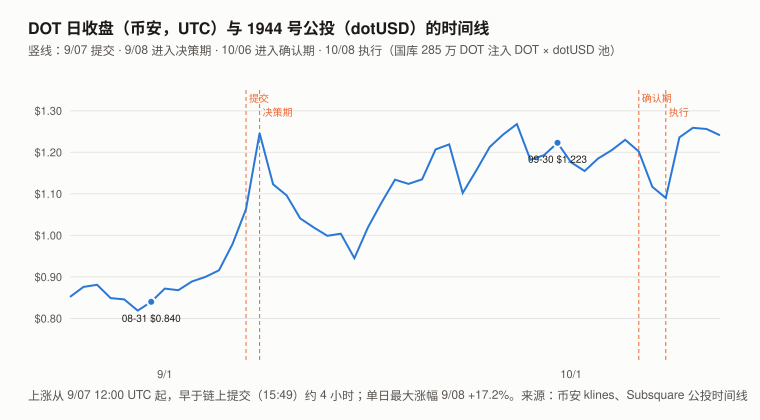
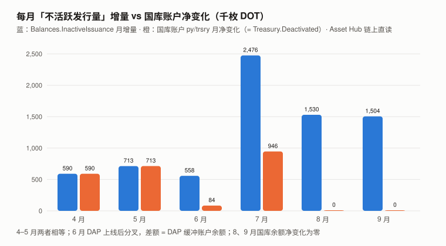
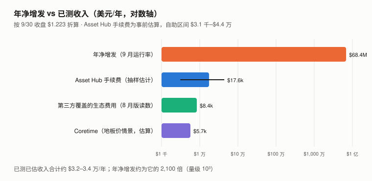

# DOT / Polkadot 完整调研与分析报告（2026 年 9 月版兼 Q3 回顾）

> **编写日期**：2026 年 10 月 13 日
> **数据截止**：2026 年 9 月 30 日（9 月完整月度数据已闭合）；**链上快照到 10/12**
> **研究方法**：沿用 8 月首期框架。**本期所有供应、国库、质押、DAP、Coretime 数据均为 Asset Hub / Coretime 链公共 RPC 直读**；
> 价格统一改用**币安日线 UTC 收盘**（8 月版用的是 CoinGecko 00:00 时点价，见 12.4）；**超额收益统一用对数口径**（ln 收益 − beta × ln BTC 收益）。
>
> **本期核心发现**：
> 1. **新增发不再进国库，而是进 DAP（动态分配池），再按链上预算表三分：DAP 缓冲 32.2%、质押奖励 45.2%、验证人激励 22.6%——国库不在表里。**
>    这是 Polkadot 运行时 v2.3.0 引入的机制（运行时发布记录与源码一手），**2026 年 6 月在链上生效**（DAP 缓冲账户 5/31 余额 0.11 DOT，6/30 为 473,387）。
>    **8 月版没看到它**：8 月版把「国库近 31 天零变化」解释成「阶梯式更新」，并按「约两成进国库、其余归质押者」推算质押者份额——**这两处都建在已经失效的机制上**。
> 2. **对持有人的直接含义**：运行时源码（`pallet-staking-async` 0.13.0 / 0.15.0）显示**验证人激励只转给验证人本人**，普通提名人只分 45.2% 的质押奖励——
>    **平均名义收益约 2.79%（未扣佣金）**。它能不能抵消稀释，取决于 DAP 缓冲算不算稀释：**计入则实际份额约 −0.49%/年，不计入（缓冲暂不流通）则约 +0.55%/年**。
>    **按与 8 月版相同的总发行量口径，8 月版「质押者 +1.60%」不成立**（全部质押者合计也只有 +0.86%）。⚠️ 这些都是平均化估算：单个提名人随验证人、佣金和领取情况不同。
> 3. **9 月 DOT +45.60%（BTC +6.42%）；对数超额 +29.8 个点（约 1.5 个特质标准差）**，主升段集中在 9/07 12–16 时与 9/08 14–16 时（UTC）。
>    **横截面检验**：这两个窗口里 DOT 分别 +10.1%、+11.5%，**同时段 BTC 与另外 8 个山寨在 −3.9% 到 +4.9% 之间**——**削弱了「板块行情」的解释，是 DOT 个币层面的异动**。
>    与 1944 号公投「dotUSD：Polkadot 原生稳定币」（9/07 15:49 提交、10/08 执行）落在同一个 48 小时窗口，**但第一个窗口约九成、9/05–9/08 三天对数涨幅约一半，发生在公投上链之前**；
>    若是公投驱动，需要论坛预讨论已提前公开——**这个时间本报告没查到**。**原因未识别。**
> 4. **10/08 国库余额减少 2,853,231 DOT——按调用内容是注入 DOT × dotUSD 流动性池，不是花掉。** 1944 号公投的链上调用写明 `addLiquidity` **2,853,229.86 DOT + 250 万 dotUSD**（LP 份额铸给 `13UVJyLnbVp9…`，与调用来源账户相同），与测到的减少只差约 1 DOT。⚠️ 实际执行结果与 LP 到账本期未逐笔核对。
> 5. **Asset Hub 手续费第一次实测**（D8-4 的前提）：随机抽 400 个 9 月区块，逐笔取链上事前手续费估算，**9 月约 1,179 DOT，年化约 $1.76 万**——D8-4 判错线 $150 万，**差约两个数量级**。
>    **年净增发约 $6,836 万，约为已测、已估收入合计的 2,100 倍（量级 10³）**。
>
> **本期核心判断**：**8 月版的结构性结论（增发与收入差三个数量级）不变，收入侧最大一项已改为自己测量。**
> **本期真正改变认识的是分配侧**：DAP 让新增发的三分之一进了一个协议储备池，国库不再自动分到增发，**普通提名人平均只分到增发的 45.2%——质押能不能抵消稀释，从 8 月版的「能，且有余」变成了「取决于 DAP 缓冲将来怎么用」**。
>
> ⚠️ **本期初稿把 DAP 带来的分叉写成「去向未定位」、把 10/08 的注资写成「拨出 / 一次性成本」**——两位审查者分别用运行时源码和公投链上调用指出，**答案就在本报告自己缓存的一手源里**。已改，见 12.5。
>
> **免责声明**：本报告不构成任何投资建议。所有分析仅供研究参考，投资决策请咨询专业顾问。

---

## 核心结论摘要（一页速览）

| 维度 | 核心判断 |
|------|----------|
| **9/30 收盘** | **$1.223**（币安）；市值约 **$20.86 亿**（链上总量 × 收盘价） |
| **9 月 / Q3** | **+45.60% / +48.78%**（BTC +6.42% / +42.64%） |
| **对数超额（ln − beta × ln BTC）** | 9 月 **+29.8**；Q3 **−4.6**；相对对照组中位数 9 月 +20.5、Q3 **−7.5** |
| **一年 beta / R² / 波动率** | 1.247 / **0.412** / 87.6% |
| **净供应增长（9 月）** | **+4,594,023 DOT，年化 3.287%**；4–9 月逐月 3.29%–3.45% |
| **新增发的分配（DAP 预算表，6 月起）** | **DAP 缓冲 32.2% / 质押奖励 45.2% / 验证人激励 22.6%；国库 0** |
| **普通提名人实际份额（年，平均、未扣佣金）** | **−0.49%**（缓冲计入稀释）**至 +0.55%**（缓冲不计）；8 月版 +1.60% 按同口径不成立 |
| **国库账户** | 7/31–9/30 **余额净变化为零**；10/08 减少 2,853,231（按调用内容为**注入 DOT × dotUSD 池**） |
| **DAP 缓冲账户** | 9/30 **5,037,110**、10/12 5,615,286（被计入「不活跃发行量」） |
| **Asset Hub 手续费（9 月，事前估算）** | **约 1,179 DOT**（条件于样本的自助区间 207–2,968） |
| **增发 / 已测已估收入** | **约 2,100 : 1**（量级 10³） |
| **dotUSD** | 资产 7873；第一阶段 **USDT 1:1 铸造**、上限 1,000 万；铸币费 0、赎回费 0.01%；第二阶段才引入 DOT 抵押 |
| **估值** | **仍不给目标价**。市值 ÷ 年净增发 = **30.5 倍** |

---

## 1. Polkadot 是什么（与 8 月版相同，从略）

一个出租区块空间的网络：中继链提供共享安全，平行链通过购买 **coretime** 获得执行资源。
**2025-11-04 起，余额、质押、治理整体迁到 Asset Hub**（8 月版第 4 章）。供应政策：**21 亿上限**（运行时 `EraPayout` 常量 `HARD_CAP_TARGET`，注释写明来自 Ref 1710——运行时一手；提案原文未打开），2026-03 前后发行率腰斩（一手实测）。
**本期补充：2026-06 起，新增发经 DAP（Dynamic Allocation Pool，动态分配池）按预算表分配**（第 5 章）。

---

## 2. DOT 的发展阶段划分

阶段一至四与 8 月版相同（创世与插槽拍卖 / 锁仓退潮 / Polkadot 2.0 改造 / Asset Hub 迁移）。

### 阶段五：低价区间、供应上限与 DAP（2025.11 – 2026.08）

- 价格从 2025-09 的约 $4 跌到 **2026-08-18 的历史低点 $0.727**（CoinGecko）
- 2026-03 起发行率腰斩至约 3.3%
- **2026-06 DAP 上线：新增发不再直接分给质押者与国库，而是进入 DAP 后按预算表分配**（8 月版未记录）

### 阶段六（本期新增）：dotUSD（2026.09 – ）

- **9/07** 1944 号公投「dotUSD」提交；**9 月 DOT +45.60%**
- **10/08** 执行：建资产 7873、开 PSM、**国库 285 万 DOT + 250 万 dotUSD 注入 DOT × dotUSD 池**

---

## 3. DOT 当前现状

### 3.0 论点校验：8 月版登记的 5 条（待 2026-12-31 起核）

| # | 论点 | 证伪条件（摘要） | 9 月读数 | 判定 |
|---|------|------|------|------|
| D8-1 | 净供应增长率维持在 3.30% 附近 | 2026-12-31 互不重叠区间年化 > 3.8% 或 < 2.8% 则错 | **9 月 3.287%**（4–9 月 3.29%–3.45%） | ⏳ |
| D8-2 | Coretime 需求不会实质改善 | 2026-12-31 前任一轮 `cores_sold` ≥ 50 则错 | 9/20 结束一轮 **36**；当前一轮截至 10/12 **36** | ⏳ |
| D8-3 | ⚑ 国库会继续净积累（45%） | 2026-12-31 `Treasury.Deactivated` < 25,500,000 则错 | **10/12 为 21,456,795**；需 80 天内 +4,043,205（+18.8%）；**国库已不在 DAP 预算表里** | ⏳ |
| D8-4 | ⚑ Asset Hub 费用收入不会改变第 6 章结论（40%） | 2026-12-31 前测得年化 > $150 万则错 | **本期事前估算年化约 $1.76 万** | ⏳ |
| D8-5 | 主流数据源不会在四个月内跟上 | 2026-12-31 前 DefiLlama 链列表收录 Asset Hub 则错 | 10/12 **未收录** | ⏳ |

> **D8-3**：判定在 12-31，本期不判。**国库要在 80 天内增加 404 万，需要治理从 DAP 缓冲或别处转入**——DAP 预算表里没有国库这一项，增发不会自动流入。
> **登记时（9/09）DAP 已经运行了约三个月**，8 月版手里同时有「国库近 31 天零变化」和「`InactiveIssuance` 与国库的差额 61 天 +300 万」两行数据，**没有把它们放在一起读**（见 11.3 第一条）。这是一条反向登记的论点（自评 45%）。
>
> **D8-4**：8 月版写「需要下期真的去测，否则按门槛 9 撤销」。**本期测了**，保持登记、继续待验。⚠️ 测的是**事前手续费估算**，不是实际扣费（6.2）。

> **本期新登记两条论点（D9-1 DOT/BTC 12 月均值较 9 月下降超过 10%、D9-2 DAP 预算表年内不变），拒绝登记两条，见 `../thesis_scorecard.md`。**

### 3.1 价格与市场

| 指标 | 数值 | 口径 |
|------|------|------|
| 9/30 收盘 | **$1.223** | 币安 DOTUSDT 日线，UTC |
| 8/31 / 6/30 收盘 | $0.840 / $0.822 | 同上 |
| **9 月 / Q3** | **+45.60% / +48.78%** | 同上 |
| 9 月收盘区间 | $0.868 – $1.268 | 同上 |
| 近一年（2025-09-30 → 2026-09-30） | **−68.71%** | 同上 |
| 9 月日成交中位数 | 约 $1,269 万 | 币安，单一交易所 |
| 市值（9/30） | **约 $20.86 亿** | 链上总量 1,705,251,033 × $1.223 |
| ATH / 距 ATH | $54.98（2021-11-04）/ **−97.78%** | CoinGecko |
| 一年 beta / R² / 年化波动率 | **1.247 / 0.412 / 87.6%** | 365 天日对数收益，本报告计算 |

**对数超额收益**（ln 收益 − beta × ln BTC 收益；对照组为本系列 8 个山寨：ZEC / UNI / ADA / SOL / BNB / ETH / TRX / CKB，同口径）：

| | 7 月 | 8 月 | **9 月** | **Q3** |
|---|---:|---:|---:|---:|
| DOT 对数超额（×100） | −16.7 | −17.6 | **+29.8** | −4.6 |
| 对照组中位数 | +2.3 | −3.3 | +9.4 | +3.0 |
| **DOT − 对照组中位数** | **−19.0** | **−14.3** | **+20.5** | **−7.5** |

> **读法**：DOT 单月特质波动（对数）的标准差约 19.3 个点，**9 月 +29.8 约 1.5 个标准差**。
> 相对对照组的差值是**描述性的**——对照组中位数不是一个模型，**它不能证明剩下的部分全由 DOT 自身事件造成**（第 4 章用小时级横截面排除了板块行情，但没有识别个币原因）。
> 7、8 月相对对照组合计 −33.3 个点，9 月 +20.5——**数字上抵掉了约六成**；这只是算术，**不是均值回归的证据**。

### 3.2 生态规模

| 平行链 | TVL（10/01，DefiLlama） | 占比 |
|------|---:|:---:|
| Hydration | $5,825 万 | 90.6% |
| Bifrost | $449 万 | 7.0% |
| Astar | $120 万 | 1.9% |
| Acala | $35 万 | 0.5% |
| **合计（以上四条）** | **约 $6,430 万** | 100% |

> 8 月版 $6,314 万（Hydration 92.8%）。**量级不变。** Moonbeam、Interlay 本期 DefiLlama 无 10/01 读数，未计入。

### 3.3 宏观环境

> 与 BTC 9 月版共用（美联储 9/16 加息 25bp 至 3.75–4.00%）。**DOT 的 R² 为 0.412，宏观通过 BTC 的传导能解释它约四成的日波动。**

---

## 4. 9 月的大涨与 dotUSD 公投（本期核心章之一）

> 图中数字：纵轴 $0.80 / $0.90 / $1.00 / $1.10 / $1.20 / $1.30；标注点 08-31 $0.840、09-30 $1.223；竖线为公投提交（9/07）、决策期（9/08）、确认期（10/06）、执行（10/08）。

### 4.1 公投本身

| 项目 | 内容 | 来源 |
|------|------|------|
| 编号 / 标题 | **1944**，「dotUSD: A Native Stablecoin for Polkadot」 | Subsquare 公投索引 |
| 轨道 | **Root（0 号）** | 同上 |
| 时间线（UTC） | 9/07 15:49 提交 → 9/08 07:35 决策期 → 10/06 07:26 确认期 → 10/07 07:28 确认 → **10/08 07:31 执行** | 同上 |
| 最终状态 | **Approved** | ✅ Asset Hub `Referenda.ReferendumInfoFor(1944)` 直读 |
| 计票 | 赞成 **4,631,111**、反对 **70,810**（**均为含信念乘数的加权票**）；support **1,871,269 DOT**（不含乘数的支持资本，占可投票总量约 16.77 亿的 0.11%） | Subsquare |
| 链上调用（预映像） | `assets.forceCreate`（资产 **7873**，6 位小数）→ `psm.createPsm`（**最大债务 1,000 万 dotUSD**、最小兑换 1 dotUSD）→ `psm.setMintingFee`（**0**）/ `setRedemptionFee`（**100 ppm = 0.01%**）→ `psm.mint` → `assetConversion.createPool` / **`addLiquidity`（2,853,229.86 DOT + 2,500,000 dotUSD）** | 公投预映像，Subsquare 缓存 |
| 分阶段 | **第一阶段：只开放 USDT 1:1 铸造 dotUSD、有上限**，无需预言机；**第二阶段**才引入 DOT 抵押金库、预言机、清算 | 提案原文 |

> ⚠️ **媒体写的「97.5% 赞成、239 万 DOT」是投票中途的快照**——本报告只用最终状态（ADA 期教训）。
> **support 是支持资本口径，不是参与人数**；0.11% 只说明投进来的资本占比，不能据此推断「社区是否一致」。

### 4.2 是不是 dotUSD 推动的

**日线**：9/06 +6.9%、9/07 +8.6%、**9/08 +17.2%**；9/07、9/08 成交额 $2,840 万、$3,060 万，是 9 月前五天（约 $700 万）的 4 倍以上。

**横截面检验（小时线，币安）**——同一时段，DOT 和其他资产有没有一起动：

| 窗口（UTC） | **DOT** | BTC | ETH | SOL | ADA | UNI | ZEC | BNB | TRX | CKB |
|------|---:|---:|---:|---:|---:|---:|---:|---:|---:|---:|
| 9/07 12:00–16:00 | **+10.11%** | −0.75% | −0.75% | −1.59% | −1.00% | −3.54% | −3.90% | −1.39% | −0.74% | +0.62% |
| 9/08 14:00–16:00 | **+11.46%** | +1.21% | +1.60% | +1.59% | +4.89% | +0.29% | +2.53% | +1.25% | +0.18% | +1.77% |

> **这一步能回答的是「板块还是个币」**：两个窗口里 DOT 独涨约 10%，**BTC 与另外 8 个山寨都没有同步**——**削弱了「共同板块行情」的解释**。
> ⚠️ **它不能回答「个币里是什么原因」**，而且窗口是按 DOT 自己的涨幅挑出来的，「DOT 独有」有一部分是挑选方式带来的。
>
> **时间关系（量化）**：
> - **第一个窗口的 +10.11% 里约 9.2 个点（约九成）在 9/07 15:00 之前完成，早于链上提交（15:49）**；
> - **9/05 收盘到 9/08 收盘的三天对数涨幅里，约一半在提交之前**（含 9/06 当天 +6.9%）；
> - 第二个窗口比决策期开始（9/08 07:35）晚约 6.5 小时。
>
> **因此**：「dotUSD 驱动」要解释前一半涨幅，**需要论坛预讨论已提前公开**——提案写明由生态贡献者共同起草，这在 OpenGov 里常见，**但本报告没有查到可定时的首次公开时间（12.2 标 ❌）**。
> **竞争解释**：媒体提到 9/05 的空头挤压（约 $61 万清算，约占 9/05 当日币安成交 $651 万的 9%），**可能与 9/06 的 +6.9% 有关**；本报告没有衍生品一手数据。
> **判断：原因未识别。** dotUSD 是候选之一，**其成立依赖一个未核实的辅助假设（预讨论的公开时间）**。这一条不登记为论点。

### 4.3 dotUSD 对代币经济意味着什么（机制，不是预测）

- **对国库**：10/08 国库 2,853,231 DOT 注入 DOT × dotUSD 池（与预映像 `addLiquidity` 2,853,229.86 DOT 差约 1 DOT；预映像另有 0.5 DOT 跨链转账）。
  **这是资产换形态（DOT → 池份额），不是支出**；提案写「$250 万 DOT」，起草时按约 $0.876/DOT 固定了数量，**执行日按 10/07 收盘折合约 $319 万——差额来自价格上涨，不是多拨了钱**。
  ⚠️ 池份额（LP）归哪个账户、是否计入国库，本期未核实。**它的风险是无常损失与脱锚，不是这笔钱本身**。
- **对 DOT 需求（第一阶段）**：dotUSD 由 **USDT 1:1 铸造**，**不需要 DOT 抵押**——第一阶段对 DOT 的直接需求只有池子里那一侧。**DOT 抵押是第二阶段的事**，时间表本期未知。
- **对收入**：PSM **赎回收 0.01%**、铸币免费，费用去向为预映像指定的账户；稳定币转账本身产生 Asset Hub 手续费。**这是第 6 章那个「$1.76 万/年」可能改变的已知通道**；按 1,000 万上限全额周转一次，赎回费也只有约 $1,000——**第一阶段的量级不足以改变第 6 章结论**。

---

## 5. 净供应、DAP 与国库（本期核心章之二）

### 5.1 净供应增长：逐月互不重叠区间

**Asset Hub `Balances.TotalIssuance`，每月最后一秒（UTC）之前的最后一个区块：**

| 区间 | 天数 | 净增（DOT） | 年化 |
|------|:---:|---:|:---:|
| 3/31 → 4/30 | 30 | 4,576,819 | 3.320% |
| 4/30 → 5/31 | 31 | 4,742,783 | 3.321% |
| 5/31 → 6/30 | 30 | 4,780,187 | 3.449% |
| 6/30 → 7/31 | 31 | 4,747,009 | 3.305% |
| 7/31 → 8/31 | 31 | 4,747,217 | 3.296% |
| **8/31 → 9/30** | **30** | **4,594,023** | **3.287%** |

> **独立性检验（8 月版承诺的下期动作）**：在 **Parity 官方节点**与 **stakeworld 节点**两个独立的公共 RPC 上复读 8/31（区块 20,119,207）与 9/30（区块 21,284,909），
> **区块哈希与 `TotalIssuance` 读数逐位一致**（17,006,570,108,253,926,026 与 17,052,510,334,911,175,219，单位 1e-10 DOT）。
> **中继链 `TotalIssuance` 10/12 为 238,516 DOT**（8 月版 241,430），teleport 污染上界仍封在总供应的 0.014% 以内。

**当前口径**：年净增约 **5,589 万枚 ≈ $6,836 万**（按 9/30 收盘）。若 21 亿上限成立，**剩余可增发 394,748,967 枚 = 当前供应的 23.1%**。

### 5.2 DAP：新增发怎么分（运行时一手）

**机制**（Polkadot 运行时 v2.3.0 发布记录、`pallet-dap` 源码与 Asset Hub 运行时配置，一手）：
质押模块改为「不铸币」模式；**DAP 按时间连续铸造新增发，并按链上的预算表 `Dap.BudgetAllocation` 分给各接收方**；手续费、罚没、未领取的奖励也转入 DAP；
**进入 DAP 缓冲账户（`modl` + `dap/buff`）的资金被「停用」（deactivate），计入 `InactiveIssuance`**。

**预算表（`Dap.BudgetAllocation`，6/30 至 10/12 各月末读数相同，本报告解码）**：

| 接收方 | 比例 |
|------|---:|
| `buffer`（DAP 缓冲，协议储备） | **32.2%** |
| `staker_rewards`（质押奖励） | **45.2%** |
| `validator_incentive`（验证人激励） | **22.6%** |
| 国库 | **不在表中** |

**链上对账**——DAP 缓冲账户余额 = `InactiveIssuance` − 国库：

> 图中数字（千枚 DOT，纵轴刻度 0 / 500 / 1,000 / 1,500 / 2,000 / 2,500；蓝 / 橙）：4 月 590 / 590；5 月 713 / 713；6 月 558 / 84；7 月 2,476 / 946；8 月 1,530 / 0；9 月 1,504 / 0。

| 月末 | 国库账户（`py/trsry`） | `InactiveIssuance` | 差额 | **DAP 缓冲账户** |
|------|---:|---:|---:|---:|
| 3/31 | 21,976,398 | 21,976,620 | 222 | 0.01 |
| 4/30 | 22,566,710 | 22,566,932 | 222 | 0.01 |
| 5/31 | 23,279,898 | 23,279,898 | 0 | 0.11 |
| **6/30** | 23,364,128 | 23,837,515 | 473,387 | **473,387** |
| 7/31 | 24,310,026 | 26,313,143 | 2,003,117 | **2,003,117** |
| 8/31 | 24,310,026 | 27,842,707 | 3,532,682 | **3,532,681** |
| 9/30 | 24,310,026 | 29,347,138 | 5,037,112 | **5,037,110** |
| 10/12 | 21,456,795 | — | — | 5,615,286 |

> **三个事实**：
> ① **6–9 月各采样月末，DAP 缓冲余额与「`InactiveIssuance` − 国库」近似对账（残差 ≤ 2 DOT）**——初稿写的「新增不活跃发行量去向未定位」，**答案就是 DAP 缓冲账户**。（3、4 月的 222 DOT 残差是别的停用项，不是 DAP；`InactiveIssuance` 是全局停用记账，不是这两个账户之和的定义。）
> ② **DAP 6 月开始运行**：链上运行时版本 5/31 为 2002001、6/30 为 **2003001（v2.3.1，引入 DAP 的版本）**，缓冲账户 5/31 只有 0.11 DOT。精确激活区块未定位。
>    6、7 月国库仍有流入（8.4 万、94.6 万）——**7 月那笔约占当月净增发的 19.9%，正好是旧机制一整月的份额，加上缓冲的 32.2% 与质押者的 67.8% 当月合计超过 100%，账没有闭合**；本报告不对它做归因。**8、9 月国库余额净变化为零**。
> ③ **预算表只作用于新铸造的发行量**；手续费、罚没、未领取奖励进 DAP 暂存账户后**直接转入缓冲**，不按预算表再分（`pallet-dap` 源码）。9 月缓冲净增 1,504,429 DOT，比「32.2% × 净增发」多约 25,000 DOT——**同月实测手续费只有约 1,179 DOT，首要候选是未领取的质押奖励**（运行时 `UnclaimedRewardHandler = Dap`），未逐笔核实。
>
> ⚠️ **口径**：本表只能说明月末余额，**不能排除月内「流入与支出相抵」**；「国库零流入」应读作「国库余额两个月净变化为零」。
> **DAP 缓冲不是销毁**：它是被停用、不计入流通的协议储备，**治理可以动用**。⚠️ 月末余额持续增加**不证明从未拨付**（拨付可与流入同时发生）。提案原文说 DAP 的预算「以美元计价分配给质押与国库运营」——**国库今后的资金来源是治理从 DAP 拨付，而不是自动分成**。

**10/08 的国库变动**：逐日采样定位到 10/07 12:48 至 10/08 11:04（UTC）之间，国库从 24,310,026 降到 21,456,795（**−2,853,231**），
**与 1944 号公投预映像中的 `addLiquidity` 2,853,229.86 DOT 差约 1 DOT**（见 4.3）。⚠️ 本报告没有逐笔读取该区块的事件，归属依据是「执行时间 + 金额逐位对上」。

### 5.3 对持有人的实际处境（按 DAP 重算）

| 项目 | 值 |
|------|:---:|
| 年化净供应增长（9 月） | **3.287%** |
| **不质押者的年度份额变化** | **−3.18%**（= 1 − 1/1.03287） |
**验证人激励给谁**：运行时依赖的 `pallet-staking-async`（8 月运行时 v2.3.x 为 0.13.0，9/30 运行时 v2.5.0 为 0.15.0）源码里，验证人激励「从独立的激励池」**转给验证人本人的账户**，不进入提名人的分配循环。
**所以普通提名人只分 `staker_rewards`（45.2%）**，且是先按验证人的奖励点、再扣佣金、再按该验证人的质押分到提名人。

**平均化估算**（固定 9/30 总质押 906,851,198、奖励全部领取、**未扣佣金**；单个提名人因验证人、佣金、是否入选而不同）：

| 年化，平均 | 名义收益 | 实际份额（DAP 缓冲**计入**稀释，总发行量口径） | 实际份额（DAP 缓冲**不计**，按进入流通的约 2.23%） |
|------|:---:|:---:|:---:|
| **普通提名人**（`staker_rewards` 45.2%） | **约 2.79%** | **约 −0.49%** | **约 +0.55%** |
| 全部质押者合计（含验证人激励，67.8%） | 约 4.18% | 约 +0.86% | 约 +1.91% |
| 不质押者 | 0 | −3.18% | 约 −2.18% |

> **两个未知量**：① 佣金（只会让提名人的数更低）；② **DAP 缓冲将来怎么用**——它若被支出到流通中，就是稀释（左列）；若长期不动或用于回购，则更接近右列。**本报告不知道是哪一个，所以两列都给。**
> **这改变了 8 月版的一条结论**：8 月版写「质押者实际份额约 +1.60%」，那是按「国库约两成、其余归质押者」、总发行量口径推的。
> **按同一口径，DAP 下全部质押者合计也只有 +0.86%，普通提名人约 −0.49%——8 月版写作时 DAP 已运行约三个月，+1.60% 在当时就不成立。**按「缓冲不计」口径，提名人约 +0.55%，仍远低于 +1.60%。

---

## 6. 收入：Coretime 与 Asset Hub 手续费（本期核心章之三）

> 图中数字（美元/年，对数轴刻度 $1,000 / $1 万 / $10 万 / $100 万 / $1,000 万 / $1 亿）：年净增发 $68.4M；Asset Hub 手续费 $17.6k（自助区间 $3.1 千–$4.4 万）；第三方覆盖的生态费用 $8.4k；Coretime $5.7k（地板价情景）；已测已估收入合计约 $3.2–3.4 万/年。

### 6.1 Coretime（Coretime 链 `Broker.SaleInfo` 直读）

| 轮次 | 区间（timeslice） | 报价 / 售出 | 地板价 | 售罄价字段 |
|------|------|:---:|:---:|:---:|
| 8 月版那一轮（9/20 16:38 UTC 结束） | 413,565 → 418,605 | **89 / 36** | 10 DOT | 10 DOT |
| 当前一轮（9/20 起，截至 10/12） | 418,605 → 423,645 | **89 / 36** | 10 DOT | 10 DOT |

> 8 月版写「售出 35」（9/08 中途读数）；**该轮最终售出 36**（9/20 轮换前最后一块）。
> **收入没有可靠区间**：地板价情景 36 × 10 = **360 DOT/轮**；8 月版记录官方界面显示同一轮（售出 35 时，**中途**）累计收入已有 **472.43 DOT**——这是该轮最终收入的**下界参考**，不是上界。
> 下表用两者作**参考**（年化约 4,680–6,142 DOT ≈ $5,700–$7,500），**不是区间估计**。⚠️ 最终累计收入或逐笔付款本期未读取。

### 6.2 Asset Hub 手续费：第一次实测

**推导方法**：在 9 月区间（区块 20,119,208 – 21,284,909，共 1,165,702 个区块）**随机抽 400 个区块**（Python `random.seed(20260930)`，可复现）；
对每个区块里**带签名的交易**（版本字节 0x84 或 0x45），在父区块状态上调用 `TransactionPaymentApi_query_info`，读出 `partial_fee`。
区间为对 400 个区块费用做 4,000 次有放回重抽（`random.seed(1)`）的 2.5% / 97.5% 分位数。

| 统计量 | 值 |
|------|---:|
| 抽样区块 | 400（错误 0） |
| 含带签名交易的区块 | 54（13.5%） |
| 带签名交易 | 101 笔，**平均每块 0.25 笔** |
| 每块平均手续费 | **0.00101 DOT**（中位数 0） |
| **9 月合计（× 1,165,702 区块）** | **约 1,179 DOT** |
| 自助法区间 | **207 – 2,968 DOT** |
| **年化（按 9/30 收盘）** | **约 $1.76 万**（区间 $0.31 万 – $4.42 万） |

> ⚠️ **这是「抽样交易的事前 DOT 计价手续费估算」**：`partial_fee` 按交易声明的权重和长度计，**不含小费、不含执行后的权重退款与免费交易**（实际扣费按执行后权重）——退款与免费会使它**高估**，小费会使它**低估**；用其他资产付费的交易按 DOT 等值计。
> ⚠️ **分布极度偏斜**：单个区块 0.287 DOT，占样本总额（0.405 DOT）的 71%；约 37% 的重抽样本根本不含这个区块。**自助区间是条件于这 400 个样本的，不覆盖测量偏差，也不覆盖没抽到的稀有大额交易。**
> ⚠️ **手续费去向**：按运行时配置，手续费进入 DAP，**不是销毁**；它与增发一样进入同一个分配池。

**同一个抽样顺带更新了 8 月版的活动量**：

| 指标 | 8 月版 | 本期（9 月） |
|------|---:|---:|
| 出块间隔 | 1.92 秒（8 月读数） | **2.22 秒**（1,165,702 块 / 30 天） |
| 每块交易数 | 3.25（60 块） | 2.25（400 块），**其中 2 条是每块固定的系统交易（inherent）** |
| 「每日交易」 | **约 146,250 笔** | **带签名的用户交易约 9,800 笔/天** |

> **8 月版的 146,250 把每块 2 条系统交易（时间戳、平行链校验数据）也算了进去**——那部分不是用户活动。出块间隔的差异可能来自不同月份，**本期只更新运行率，不断言 8 月版测错**。

### 6.3 量级对照

| 项目 | 年化（美元） | 证据等级 |
|------|---:|------|
| Asset Hub 手续费 | 约 $17,600（$3,100 – $44,200） | 本期测量（事前估算口径） |
| 第三方覆盖的生态费用 | 约 $8,400 | 8 月版 DefiLlama 读数，本期未更新 |
| Coretime | 参考 $5,700 / $7,500 | 地板价情景 / 中途累计读数，**不是区间** |
| **合计** | **约 $31,700 – $33,500**（按两个参考值） | — |
| **年净增发** | **约 $6,836 万** | 一手测量 |
| **比值** | **约 2,100 : 1**（量级 10³） | — |

> **8 月版的写法是「未测的 Asset Hub 费用需为已测总和的约 4,000 倍，结论才会翻转」**。本期把收入侧最大的一项测了：它约是 8 月版「已测总和」（$15,065）的 1.2 倍。**结论不变。**
> ⚠️ **对仍未测的项（中继链与其他系统链的费用、Coretime 逐笔付款），论证形式仍然是盈亏平衡**：它们合计要达到当前已测已估收入的约 2,000 倍才会翻转结论。

---

## 7. 质押与治理

| 指标 | 8/31（era 2279） | 9/30（era 2309） | 10/12（era 2321） |
|------|---:|---:|---:|
| 总质押 | 912,354,206 | **906,851,198** | 912,750,356 |
| 质押率 | 53.65% | **53.18%** | 53.47% |
| 验证人 | 600 | 600 | 600 |
| 提名人 | 28,863 | **28,469** | 28,334 |
| 最低有效质押 | 238.42 | 213.83 | 200.00 |

> **9 月质押率 −0.47pp，但 10/12 总质押已回到 8/31 水平以上**；质押率 53.65% → 53.47% 的差里，约 0.2pp 是分母（总发行量）增长的机械效应。**单月波动，不据此改变判断。**
> 提名人数连续下降（−394、−135），方向值得跟踪。⚠️ 提名人有可能适用 2 个 era 的快速解押（运行时配置 `NominatorFastUnbondDuration`，取决于治理设置），**本报告没有拆解押队列，不推断「有人解押卖出」**。

**治理**：1944 号公投 9/07 提交、10/08 执行，31 天——**8 月版多头 #2「治理能改动代币经济并执行到位」的又一个样本**。
**DAP 本身也是这条的样本：它改变了新增发的分配，8 月版没看到。**同一个机制，对持有人是双向的（5.3）。

---

## 8. DOT 与其他资产的比较

> **口径**：9 月 = 8/31 → 9/30，Q3 = 6/30 → 9/30，币安 UTC 收盘；beta / R² 为 365 天日对数收益；对数超额 = ln 收益 − beta × ln BTC 收益（×100）。

| 资产 | 9 月 | Q3 | beta | R² | 9 月对数超额 |
|------|---:|---:|---:|---:|---:|
| UNI | +69.76% | +219.73% | 1.403 | 0.401 | +44.2 |
| ZEC | +69.60% | +260.05% | 1.523 | 0.193 | +43.4 |
| **DOT** | **+45.60%** | **+48.78%** | **1.247** | **0.412** | **+29.8** |
| CKB | +27.49% | +51.21% | 1.226 | 0.469 | +16.7 |
| ADA | +24.67% | +70.78% | 1.419 | 0.649 | +13.2 |
| SOL | +14.61% | +60.34% | 1.311 | 0.755 | +5.5 |
| BNB | +11.26% | +40.76% | 0.884 | 0.594 | +5.2 |
| ETH | +8.85% | +70.86% | 1.283 | 0.823 | +0.5 |
| TRX | +1.44% | +7.01% | 0.238 | 0.193 | 0.0 |
| BTC | +6.42% | +42.64% | 1.000 | 1.000 | — |

> **DOT 9 月涨幅排第 3（9 个山寨里），Q3 排倒数第 3**（只高于 BNB、TRX）。

---

## 9. 核心价值逻辑

**星级编码证据等级**：完全建立在二手转述上的论据不得给到五星。

### 9.1 多头逻辑

| # | 论据 | 强度 | 说明与证据等级 |
|---|------|:---:|------|
| 1 | **发行率腰斩后稳定在约 3.3%，且可独立复现** | ★★★★★ | ✅ 4–9 月逐月 3.29%–3.45%；**两个独立节点读数逐位一致** |
| 2 | **治理能改动代币经济并执行到位** | ★★★★☆ | ✅ DAP 上线、1944 号公投 31 天执行。⚠️ 它是能力，不是方向（5.3） |
| 3 | 质押率 53% | ★★★★☆ | ✅ 链上一手。9 月单月 −0.47pp，10/12 总质押已回到 8/31 以上 |
| 4 | dotUSD 可能带来新的 DOT 需求与费用 | ★★☆☆☆ | ⚠️ **新增**。公投已执行、参数一手；**第一阶段由 USDT 铸造、不需要 DOT 抵押**，采用没有任何读数，是期权不是现状 |
| 5 | DAP 缓冲是一个持续积累的协议储备（9/30 约 504 万），**暂不进入流通** | ★★★☆☆ | ✅ 余额一手。⚠️ **用途由治理决定**——它决定质押者实际份额落在 5.3 表的左列还是右列；**与空头 #3 是同一个未知数的两面** |
| 6 | 价格行为是正常的价格发现 | ★★★☆☆ | ✅ R² 0.412 |
| — | ~~国库在积累而非消耗~~ | **撤下** | **国库已不在 DAP 预算表里，增发不再自动流入**（5.2）；10/08 的余额下降是注资入池，不是撤下的理由 |

### 9.2 空头逻辑

| # | 论据 | 强度 | 说明与证据等级 |
|---|------|:---:|------|
| 1 | **净增发约为已测已估收入的 2,100 倍（量级 10³）** | ★★★★☆ | ✅ 增发一手、Asset Hub 手续费本期测了。⚠️ **维持四星**：手续费为事前估算、尾部（一块占样本 71%）未核实；Coretime 为参考值；生态费用是 8 月读数且未证明由 DOT 捕获 |
| 2 | 不质押者每年被稀释 3.18% | ★★★★☆ | ✅ 只依赖实测净供应增长。⚠️ 若 21 亿上限成立，总量封顶在 23.1% |
| 3 | **普通提名人平均只分到增发的 45.2%**，实际份额约 −0.49%（缓冲计入稀释）至 +0.55%（缓冲不计） | ★★★☆☆ | ✅ **预算表与分配源码一手**。⚠️ **正负号取决于 DAP 缓冲将来怎么用——与多头 #5 是同一个未知数**，星级对齐；平均化估算、未扣佣金 |
| 4 | 生态 TVL 约 $6,430 万，Hydration 占 90.6% | ★★★☆☆ | ✅ DefiLlama。⚠️ TVL 不是衡量 Polkadot 的合适尺子 |
| 5 | Q3 仍落后对照组 7.5 个对数点 | ★★☆☆☆ | ✅ 一手。**它是结果不是原因** |

> **多空同源检查**：
> - 多头 #1（发行率稳定）与空头 #2（稀释）是同一个机制——已用 21 亿上限约束后者的总量（8 月版教训）。
> - **多头 #5（DAP 储备积累）与空头 #3（提名人分得少）是同一张预算表、同一个未知数的两面**：32.2% 进缓冲，提名人就少分；**缓冲若长期不动，它减少的是流通稀释；若被支出，它就是稀释**。两条星级对齐为三星。
> - 多头 #2（治理执行力）对两者都是放大器。

### 9.3 多空之间真正的分歧点

> **8 月版的分歧点是「Asset Hub 费用是多少」——本期事前估算约 $1.76 万/年，量级不足以改变结论；实际扣费与尾部核实后才能完全关闭这个问题。**
> **本期的分歧点是 DAP 缓冲怎么用**：它每月吸收约 150 万 DOT（约 $180 万）。若用于回购或稳定 dotUSD，它是对持有人的价值回流；若用于支出，它就是一个更大的国库。**治理还没有对它做过任何拨付**（缓冲余额 6 月以来只增不减）。

---

## 10. 估值：仍不给目标价

| 项目 | 值 |
|------|---:|
| 年净增发（美元，9 月运行率） | **$6,836 万** |
| 市值（9/30） | $20.86 亿 |
| **年净增发 / 市值** | **3.28%** |
| **市值 / 年净增发** | **30.5 倍** |

> **读法与 8 月版相同**：市场每年要吸收相当于市值约 3.3% 的新供应，**累计封顶在 23.1%**（若上限成立）。
> ⚠️ **DAP 带来一处修正**：新增发里 32.2% 进了被停用的缓冲，**暂时不进入流通**——在缓冲被动用之前，**进入流通的年新增约为净增发的 67.8%**（约 2.2%）。但缓冲随时可以被治理释放，**本报告不把它当作永久减少**。
> **不给目标价的理由不变**：业务经济性可观测，但小到无法支撑任何倍数法。
> 「市值 / 年净增发」从 8 月版的 30.4 倍变为 30.5 倍——**这个比值对价格不敏感**（美元计的增发与市值同比例变化），它只说明「吸收压力占市值的比例」，不说明贵还是便宜。

### 10.1 这套判断的弱点

1. **Asset Hub 手续费是事前估算口径**，且 400 块抽样分布极度偏斜——**点估计与自助区间都条件于样本**。
2. **质押者实际份额是平均化估算**（未扣佣金、假定奖励全部领取），且正负号取决于 DAP 缓冲将来怎么用。
3. **9 月大涨的原因未识别**——横截面只排除了板块行情；约一半涨幅早于公投上链。
4. **dotUSD 第一阶段由 USDT 铸造**，它对 DOT 的作用本期只有池子一侧可读。
5. **21 亿上限是运行时现行常量**（一手），但运行时可以被治理升级改掉；Ref 1710 原文未打开。

---

## 11. 投资与风险启示

### 11.1 关键监控指标

| 指标 | 当前值 | 触发关注的阈值 | 查询方式 |
|------|---:|------|------|
| 年化净供应增长 | 3.287%（9 月） | 偏离 ±0.5pp | Asset Hub `Balances.TotalIssuance` 月末差分 |
| **DAP 预算表** | **32.2 / 45.2 / 22.6** | **任何变动**（D9-2） | `Dap.BudgetAllocation` |
| **DAP 缓冲出账** | 余额 5,037,110（9/30），出账未核实 | **任何从缓冲转出的事件**（月末净值不能证明从未动用） | 缓冲账户转账事件 |
| 国库账户余额 | 21,456,795（10/12） | 任何增加（意味着治理从别处拨付） | `System.Account(py/trsry)` |
| dotUSD 供应 | 第一阶段上限 1,000 万 | 接近上限 / 第二阶段上线 | Asset Hub 资产 7873 |
| Coretime 售出 / 报价 | 36 / 89 | ≥ 50（D8-2），或跌破 20 | Coretime 链 `Broker.SaleInfo` |
| Asset Hub 手续费 | 约 1,179 DOT/月（事前估算） | 月 ≥ 1 万 DOT | 随机抽块 + `TransactionPaymentApi_query_info` |
| 质押率 / 提名人 | 53.18% / 28,469 | 跌破 50% / 提名人跌破 27,000 | `Staking.ErasTotalStake`、`CounterForNominators` |
| DefiLlama 是否收录 Asset Hub | 未收录 | 收录 | `api.llama.fi/v2/chains` |

> 8 月版监控表里「国库（InactiveIssuance）2,822 万」一行用的是 8 月版 7.1 已撤回的字段——**而那个字段本期弄清楚了：它是国库 + DAP 缓冲之和**。本期把三者分开列。

### 11.2 风险提醒

1. **稀释是首要风险，但它是有限的**：当前 3.287%，若上限成立累计 23.1%。
2. **质押不一定能抵消稀释**：按 DAP 预算表，普通提名人平均每年份额约 −0.49%（缓冲计入稀释、未扣佣金）至 +0.55%（缓冲不计）（5.3）。
3. **DAP 缓冲的用途不确定**：每月约 150 万 DOT 进入一个由治理支配的储备。
4. **dotUSD 池的风险**：国库注入的约 285 万 DOT 面临无常损失；dotUSD 若脱锚，池子会吸收损失。**第一阶段由 USDT 1:1 支撑，脱锚风险主要来自 USDT 本身**。
5. **本报告自身**：DOT 第二期；8 月版的五条论点尚无一条到期；**本期初稿两处核心解读被审查推翻**（12.5）。

### 11.3 长期认知

**第一，链上账目出现结构性分叉时，先查运行时升级记录。**
「`InactiveIssuance` 与国库从 6 月起分叉」这个现象，8 月版手里有（差额 61 天 +300 万），本期初稿也有（差额逐月表）——**两次都被读成了「去向不明」**。
**答案在 Polkadot 运行时 v2.3.0 的发布记录里：DAP。** DOT 期 8 月版的教训是「先确认数据源在测哪条链」；本期是它的下一层：**先确认链的会计规则在你测量的这段时间里有没有被改过**。

**第二，盈亏平衡陈述的作用，是告诉你下期该测什么。**
8 月版用「需 4,000 倍才翻转」封住了 Asset Hub 费用，本期测出来是 1.2 倍。**测出来之后，仍未测的那几项依然要用盈亏平衡封住**——测量替代的是一个未知项，不是整个论证形式。

**第三，归因分两步：先分「共同因子还是个币」，再分「个币里是哪件事」。**
第一步用同时段横截面（同一个小时，别的资产有没有一起动）——这一步只需要几次 API 调用，初稿没做。
**第二步横截面帮不上**：要靠事件首次公开的时点，并量化价格走势有多少发生在它之前。本期第二步没完成（预讨论的公开时间没查到），所以结论是「原因未识别」。

---

## 12. 附录

### 12.1 关键数据速查（截至 2026-09-30，链上快照到 10/12）

| 类别 | 指标 | 数值 |
|------|------|---:|
| **市场** | 9/30 收盘（币安） | $1.223 |
| | 9 月 / Q3 / 近一年 | +45.60% / +48.78% / −68.71% |
| | 市值（9/30） | 约 $20.86 亿 |
| | beta / R² / 波动率 | 1.247 / 0.412 / 87.6% |
| **供应** | 总发行量（9/30，Asset Hub） | 1,705,251,033 |
| | 9 月净增 / 年化 | 4,594,023 / 3.287% |
| | 剩余可增发（若上限成立） | 394,748,967（23.1%） |
| **DAP** | 预算表 | 缓冲 32.2% / 质押奖励 45.2% / 验证人激励 22.6% |
| | 缓冲余额（9/30 / 10/12） | 5,037,110 / 5,615,286 |
| **国库** | 9/30 / 10/12 | 24,310,026 / 21,456,795 |
| **质押** | 9/30 质押率 / 提名人 | 53.18% / 28,469 |
| | 普通提名人实际份额（年，平均、未扣佣金） | −0.49%（缓冲计入）/ +0.55%（不计） |
| **收入** | Asset Hub 手续费（9 月，事前估算） | 约 1,179 DOT（207–2,968） |
| | Coretime 售出 / 报价 | 36 / 89 |
| **估值** | 市值 / 年净增发 | 30.5 倍 |

### 12.2 数据来源与核实状态

| 数据 | 来源 | 核实状态 |
|------|------|:---:|
| `TotalIssuance` / `InactiveIssuance` / `Treasury.Deactivated` | Asset Hub 公共 RPC（Parity、stakeworld） | ✅ 直读；**两节点逐位一致** |
| 国库账户与 DAP 缓冲账户余额 | `System.Account` | ✅ 直读；**两者之和与 `InactiveIssuance` 逐月一致** |
| DAP 预算表 | `Dap.BudgetAllocation` | ✅ 直读并解码 |
| DAP 机制 | polkadot-fellows/runtimes v2.3.0 发布记录、v2.5.0 Asset Hub 运行时配置、`pallet-dap` 源码 | ✅ 一手源码 |
| 质押（era / 总质押 / 验证人 / 提名人） | Asset Hub RPC | ✅ 直读 |
| Coretime `Broker.SaleInfo` | Coretime 链 RPC | ✅ 直读并手工解码 |
| 1944 号公投最终状态 | Asset Hub `Referenda.ReferendumInfoFor` | ✅ 直读（Approved） |
| 1944 号公投时间线、计票、预映像、正文 | Subsquare 公投索引 API | ⚠️ 第三方索引；**状态与链上一致**；`addLiquidity` 金额与国库变动逐位对上 |
| Asset Hub 手续费 | 400 块随机抽样 + `TransactionPaymentApi_query_info` | ✅ 本报告测量；⚠️ **事前估算口径、未读扣费事件** |
| 价格 / 成交额（日线、小时线） | 币安 | ✅ 直接调用 |
| 平行链 TVL | DefiLlama API | ✅ 直接调用 |
| 验证人激励的分配规则 | — | ❌ **未核实** |
| dotUSD 池 LP 份额归属 | — | ❌ **未核实** |
| 1944 号公投首次公开（论坛）时间 | — | ❌ **未查到** |
| 21 亿上限 | 运行时 `EraPayout` 常量 `HARD_CAP_TARGET`（注释：Ref 1710） | ✅ **运行时一手**；⚠️ 提案原文未打开 |

### 12.3 来源偏向声明

| 侧 | 主要论据 | 证据等级 |
|---|------|:---:|
| **多头** | 发行率稳定、治理执行力、dotUSD 期权、DAP 储备 | 前两条一手；后两条的**方向**未知 |
| **空头** | 增发 / 收入量级差、稀释、质押者分得少 | ✅ 一手；⚠️ 质押者区间依赖未核实的分配规则 |

> **8 月版的不对称（「分母一手、分子靠第三方」）本期部分消除**：收入侧最大的一项改为自己测量。
> **DAP 这张预算表同时给了多头（储备）和空头（提名人分得少）一条论据，两条的方向取决于同一个未发生的治理决定（缓冲怎么用）**——星级对齐为三星。（初稿写「空头方向可测、多头未知」，第二轮推理审查指出两条是同一个未知数，已改。）

### 12.4 本版对 8 月版的更正

| # | 8 月版 | 更正 | 依据 |
|---|------|------|------|
| 1 | 8 月涨幅 **+8.07%**（8/1→8/31，CoinGecko） | **+10.67%**（7/31→8/31 币安收盘）。两处差异：CoinGecko 00:00 时点价约等于前一日收盘（窗口相当于 7/31→8/30），且换了交易所价格源 | 币安 klines；本系列 XIN、CKB、GRAM、HYPE 9 月版同一更正 |
| 2 | 5.6「质押者实际份额约 **+1.60%**」（国库约两成、其余归质押者） | **按 6 月起生效的 DAP 预算表：−0.49% 至 +0.86%** | 5.2–5.3 |
| 3 | 7.1「国库阶梯式更新、近 31 天为零变化」 | **不是阶梯式更新：国库已不在 DAP 预算表里**，增发不再自动流入 | 5.2 |
| 4 | 7.1「`InactiveIssuance` 与国库的差额，本报告未能确定是什么」 | **是 DAP 缓冲账户余额**（逐月差 ≤ 2 DOT） | 5.2 |
| 5 | 6.3「Asset Hub 每日约 146,250 笔 extrinsic」 | 其中每块 2 条是系统交易（inherent）；**9 月带签名的用户交易约 9,800 笔/天** | 6.2（9 月抽样，运行率更新） |
| 6 | 9.4 第 1 条、10.4 第 2 条、10.5 第三、11.4 Coretime 行：「100 倍分歧未解 / 未调和」 | **8 月版 6.2 已在发布前解决了该分歧**——**撤回没有同步到下游** | 8 月版 6.2、11.6 |
| 7 | 10.3 监控表与 11.2 速查「国库（InactiveIssuance）2,822 万、近 61 天 +16.3%」 | **8 月版 7.1 已撤回该字段**；正确值为国库 2,431 万（另有 DAP 缓冲） | 8 月版 7.1 |
| 8 | 10.5 第二「去链上量了四次——3.29%，四次一致」 | **8 月版 5.2 已撤回「四窗口一致」**（嵌套窗口） | 8 月版 5.2 |
| 9 | 9.4 第 3 条「国库分析只有 61 天窗口」 | 8 月版 7.1 已改为 267 天 | 8 月版 7.1 |
| 10 | 6.2「售出 35」 | 该轮**最终售出 36**（9/08 为中途读数） | Coretime 链，9/20 轮换前最后一块 |

> **第 6–9 条是同一类错误：正文撤回了，下游的摘要、监控表、长期认知没同步。** 这正是 ZEC 期写进技能文件的「撤回 ≠ 让撤回生效」。
> **第 2–4 条是另一类：机制变了，测量还在用旧机制解读。**

### 12.5 发布前审查记录

**第 1 层 `verify_report.py`**：初稿 3 FAIL（两张图的坐标刻度未在正文出现；缺「推导 / 弱点」说明），补图注与 10.1 后 0 FAIL / 1 WARN（来源偏向，各资产共有）。

**第 2 层 _bian（推理）与第 3 层 Codex（领域，读本地原始数据缓存与运行时源码复算）——第一轮：**

| # | 意见 | 出处 | 处理 |
|---|------|:---:|------|
| 1 | **「新增发去向未定位」漏了 DAP**：运行时 v2.3.0 起增发经 DAP 按预算分配；提案原文自己就写了 DAP | 两者 | ✅ **链上核实**：DAP 缓冲余额与「`InactiveIssuance` − 国库」逐月一致；解码预算表 32.2 / 45.2 / 22.6。**第 5 章重写** |
| 2 | **10/08 流出不是「拨出 / 一次性成本」**：预映像 `addLiquidity` 2,853,229.86 DOT，与流出差约 1 DOT；是注入协议自有流动性池；「差额 $69 万」是起草时固定数量、执行时价格上涨 | 两者 | ✅ 全文改为「注入 DOT × dotUSD 池」；删去差额谜题；LP 归属列为未核实 |
| 3 | **质押者只报上界 +2.80%**，而表里的数指向更低 | _bian | ✅ 按 DAP 预算表重算为区间 −0.49% 至 +0.86%；**比 8 月版更差，方向写明** |
| 4 | **dotUSD 参数就在缓存里**（资产 7873、上限 1,000 万、费率、第一阶段 USDT 铸造），初稿写「未读到」并假设 DOT 抵押 | Codex | ✅ 补入 4.1、4.3；删去「DOT 抵押反馈」风险，改为第二阶段 |
| 5 | **第 4 章三条理由没有判别力**；建议做同时段横截面检验 | _bian | ✅ **做了**：两个窗口 DOT +10.1%、+11.5%，BTC 与 8 个山寨 −3.9% 至 +4.9%——主升段是 DOT 特有。结论改为「倾向于与 dotUSD 相关，未形式化识别」；长期认知第三条重写 |
| 6 | **对数 beta 与算术涨幅混用** | Codex | ✅ 全文改为对数超额；「自身部分」改为「相对对照组的描述性差值」 |
| 7 | **「国库零流入」应为「余额净变化为零」** | Codex | ✅ 已改 |
| 8 | **手续费是事前估算**，不能升级为「收入全部测清」；自助区间是条件于样本的 | 两者 | ✅ 改称「事前估算」；删「全部 / 不再依赖盈亏平衡」；区间注明条件；补随机种子 |
| 9 | Coretime 用地板价乘销量，低于 8 月版官方读数 | Codex | ✅ 改为区间 360–472 DOT/轮，标为估算 |
| 10 | **D9-2 应改设计**（净额 vs 流入不同构、10 月被错误排除、先验不成立） | 两者 | ✅ **撤回原 D9-2**，改登「DAP 预算表年内不变」（见记分卡） |
| 11 | D9-1 标题与门槛不同构（门槛实际是「较 9 月均值降超过 10%」） | 两者 | ✅ 改标题；补门槛 11 的粗估 |
| 12 | 多头 #3 用 30 天读数降星，而 10/12 已回升 | _bian | ✅ 维持四星 |
| 13 | 提名人可能适用快速解押，「28 天后才能卖」过度 | Codex | ✅ 删除该推断 |
| 14 | 空头 #3（国库流向）与撤下多头 #4 是同一事实用两次 | _bian | ✅ 空头 #3 改为「质押者分得少」（预算表一手），与撤下的多头不是同一事实 |
| 15 | 长期认知第一条事实写反（零流入早于登记约 40 天） | _bian | ✅ 重写为「链上账目分叉时先查运行时升级记录」 |
| 16 | support 不是参与人数；12.4 第 1、5 条措辞 | Codex | ✅ 已改 |

**第 2 层 _bian 与第 3 层 Codex——第二轮（复审第一轮修订稿，Codex 另读运行时依赖源码）：**

| # | 意见 | 出处 | 处理 |
|---|------|:---:|------|
| 1 | **验证人激励只转给验证人**（`pallet-staking-async` 0.13.0 / 0.15.0 源码），「+0.86% 是提名人上界」不成立 | Codex | ✅ **亲自核对两个版本源码与链上运行时版本**（6/30 为 2003001、9/30 为 2005000）；提名人只分 45.2% |
| 2 | −0.49% 是平均化估算，不是个人下沿；「最坏情况」措辞越过证据 | 两者 | ✅ 改为「平均、未扣佣金」；删「最坏」 |
| 3 | **区间只扫了一个未知量**：DAP 缓冲算不算稀释是第二个未知量 | _bian | ✅ 5.3 改为两维表：提名人 −0.49%（计入）/ +0.55%（不计） |
| 4 | 「空头方向可测、多头未知」不成立：空头 #3 与多头 #5 是同一个未知数 | _bian | ✅ 两条星级对齐为三星，12.3 改写 |
| 5 | 「8 月版 +1.60% 不成立 / 作废」需写明口径 | _bian | ✅ 改为「按与 8 月版相同的总发行量口径不成立」 |
| 6 | 预算表只作用于新铸造量；手续费、罚没、未领取奖励直接进缓冲 | Codex | ✅ 5.2 ③ 重写；缓冲比 32.2% 多出的约 2.5 万 DOT 首要候选改为未领取奖励（_bian 指出手续费只占约 5%） |
| 7 | **时间关系要量化**：第一个窗口约九成、三天涨幅约一半在上链之前 | _bian | ✅ 已量化，卷首同步；结论从「倾向于与 dotUSD 相关」收回为「原因未识别，dotUSD 是候选、依赖未核实的辅助假设」 |
| 8 | 横截面只能回答「板块还是个币」；长期认知第三条推广过度 | 两者 | ✅ 第三条重写为「归因分两步」 |
| 9 | 空头挤压的分母用错（应为 9/05 当日成交） | _bian | ✅ 改为约占 9/05 成交 $651 万的 9% |
| 10 | **21 亿上限就在运行时源码里**（`HARD_CAP_TARGET`，注释 Ref 1710），不该标二手 | _bian | ✅ 改为运行时一手，移出弱点与下期清单 |
| 11 | D9-2「年内不变」用年底终点检验过程论点，违反门槛 3/5；「11 月下旬前须提交」不成立 | Codex | ✅ 检验条件改为「登记后至年底任何变动即判错」；删硬性期限；补「白名单调用轨道也可能到达 Root」待核 |
| 12 | 缓冲「从未动用」不能由月末净值证明 | Codex | ✅ 改为「余额持续增加，不证明未拨付」；监控改为出账事件 |
| 13 | LP 份额接收账户在调用里写着 | Codex | ✅ 补 `mintTo`；实际执行结果仍列未核 |
| 14 | 「7 月国库流入是旧机制尾款」未检验，当月账不闭合 | 两者 | ✅ 删除归因，写明账不闭合 |
| 15 | 收入侧五星仍越过证据；Coretime「区间」没有上界 | Codex | ✅ 空头 #1 维持四星；Coretime 改为两个参考值 |
| 16 | 对账表述限定为 6–9 月采样点 | Codex | ✅ 已改 |
| 17 | D9-1 是纯基率条目，不检验报告判断 | _bian | ✅ 记分卡注明「校准对照」，单独记 |

**第 4 层 _dalin**：待审。

---

> **配套文件**：`dot_questions_summary_202609.md`（简明速查）、`../thesis_scorecard.md`（论点滚动记分卡）。
> 本报告不构成投资建议。
