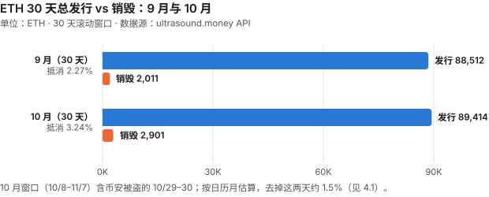
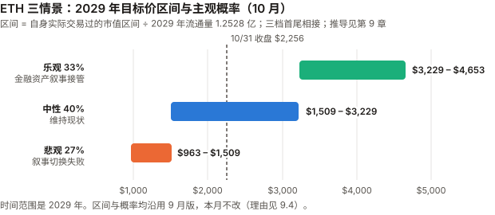

# ETH / Ethereum 完整调研与分析报告

> **编写日期**：2026 年 11 月 7 日
> **数据截止**：2026 年 10 月 31 日（10 月完整数据已闭合）；链上 30 天滚动窗口取到 11/7，期后数据已标注
> **版本**：2026 年 10 月版（第三期）
> **研究方法**：沿用 8 月首期框架。本期第一次有论点到期判定（E8-4、E8-6）。
>
> **本版更新要点**：
>
> 1. **10 月 −16.02%**，收于 $2,255.66（币安日线），**是 BTC（−7.22%）的两倍多**；ETH/BTC 比价 −9.46%（0.03212 → 0.02908）。按 10 月对 BTC 的 beta（1.20，R² 0.90），beta 预期只有 −8.6%——**约 −7.4 个百分点是 ETH 自身的**。按 10 月自身的残差波动约 2.5 个标准差；**按过去 12 个月的月度残差分布约 1.5 个标准差**——是 12 个月里最大的一次，但 4 月、5 月也有 −7pp 量级，**不能排除噪声**。ETH 相对 BTC 的走弱集中在 10/1–10/14（两周 −7.7%）。
> 2. **ETF 10 月净流出 $16.07 亿**（Farside），22 个交易日只有 3 天净流入；2026 年累计由正转负（−$0.31 亿）。9 月是 +$8.31 亿。
> 3. **E8-4 判 ❌**：10 月 L1 费用 **$2,290 万**，越过登记的 $2,000 万门槛。其中 $1,115 万发生在 10/29–30 两天，**与币安热钱包被盗同日**（10/29 当日 base fee 均值 7.40 gwei，平时约 0.1–0.3；这两天的 gas 需求来自谁，本报告没有逐笔拆分）。**按登记条件判 ❌**，见 3.0。
> 4. **E8-6 的 mNAV 那一支作废，其余两支继续检验**：SharpLink 的两份 10-Q 第一次让本报告取得一手持仓——8/3 为 888,938 ETH、11/2 为 895,117 ETH；按股价算的基本 mNAV（只计 ETH）**8 月 0.77–0.86、10 月 0.73–0.87**。字面上「mNAV 连续一月低于 1」已满足，**但它在 8 月登记时就已经成立**，不是预测。E8-6 是「三支任一成立即成立」的条件，**本版只作废「SharpLink × mNAV」这一个子支**，其余分支（两家的减持与被迫融资，以及 BitMine 的 mNAV）照常检验到 12/31（目前都未发生或无法判断）。
> 5. **Glamsterdam 推迟**：Sepolia 10/6 激活；原定 10/26 的 Hoodi 测试网激活在 10/22 被取消，原因是 EIP-8037 与主网现有合约的交互问题；11/6 以太坊基金会公告「在问题解决前不分叉 Hoodi」。**主网日期仍未定**，E9-2（年内上主网，55%）大概率判错。
> 6. **币安被盗与以太坊**：攻击者利用以太坊的 **EIP-7702** 授权机制，在币安的提现系统之外继续转移资产（币安 11/3 初步报告）。**问题出在币安的签名服务被入侵，不是 EIP-7702 本身的漏洞**，但它是这个 2025 年上线的标准第一次出现在大型盗窃的攻击链里。
> 7. **BitMine 增持放缓**：10 月增持 5.92 万枚（9 月 10.0 万枚，约降四成），每周增量从 1.5 万枚降到 0.86 万枚；11/1 持有 6,060,506 ETH（约 4.96%），**并开始大额回购自家股票**（10/19–25 一周 204 万股）。
>
> **免责声明**：本报告不构成任何投资建议。所有分析仅供研究参考，投资决策请咨询专业顾问。

---

## 核心结论摘要（一页速览）

| 维度 | 核心判断 |
|------|----------|
| **ETH 是什么** | 一条**可编程结算层**：把执行外包给 L2，自己保留结算与数据可用性 |
| **当前价格位置** | $2,255.66（10/31 币安收盘），市值约 **$2,756 亿**。距 ATH（$4,956.78，币安 2025-08-24 盘中）**−54.5%**；2026 年至今 −24.09% |
| **10 月表现** | **−16.02%**，BTC −7.22%。beta 预期约 −8.6%，**自身成分约 −7.4pp**——12 个月里最大的一次，但按全年月度残差分布只约 1.5 个标准差，不能排除噪声。原因没有确定；**ETF 全月持续流出，而 ETH/BTC 的走弱集中在前两周，两者的周度分布并不对应** |
| **本月最重要的变化** | **机构通道反向**：ETF 由 9 月 +$8.31 亿变为 10 月 −$16.07 亿（5、6 月也曾净流出）；BitMine 增持约降四成并开始回购股票。**本期新取得的数据**：SharpLink 的 mNAV 8–10 月有同期数据、均低于 1（1–7 月为近似，也低于 1）——这是持续状态，不是 10 月的变化 |
| **发行与销毁** | 30 天（10/8–11/7）销毁 2,901 ETH vs 总发行 89,414 ETH，**抵消 3.24%**；年通胀 **+0.861%**。销毁上升集中在 10/29–30 两天（与币安被盗同日）；日历 10 月去掉这两天约 1.5% |
| **L1 费用** | 10 月 **$2,290 万**（E8-4 门槛 $2,000 万被越过），**其中 49% 在 10/29–30 两天**。**日中位数 10 月 $38.1 万、9 月 $39.3 万、8 月 $23.2 万**：去掉事件后没有继续回升，但仍高于 E8-4 登记时的 8 月 |
| **blob** | 10 月每块 4.90 个（9 月 5.56），目标 14；blob ÷ 执行层 base fee 月均 0.060，仍贴着 EIP-7918 的 1/16 下限。**11 月前 7 天为 0.103**，越过了 E9-1 的 0.10 线（月度未结束，不判定） |
| **核心多头逻辑** | 抵押品层地位（L1 TVL $435 亿，第二名 Base 的 7.5 倍）；质押率升到 36.4%、进入队列 98 万 ETH；BitMine 86% 持仓已质押、仍每周增持 |
| **核心空头逻辑** | ETF 全月几乎每天流出；10 月自身成分约 −7.4pp（不能排除噪声）；**SharpLink 股价低于所持 ETH**（8–10 月有同期数据；BitMine 只知 mNAV ≥ 约 0.78，无法判断）；Glamsterdam 推迟 |
| **估值立场** | 2029 年情景框架与概率（33/40/27）**本月不改**；当前市值 $2,756 亿仍在中性区间。**作者的基准预期是中性情景** |
| **风险等级** | 低于 SOL 与 ADA，高于 BTC。年化波动 10 月 36.0%、过去一年 60.7% |

---

## 1. Ethereum 的起源与设计取舍

> 本章与 8 月首期相同，此处只保留理解本期内容必需的部分。完整内容见 `eth_research_report_202608.md` 第 1 章。

| | Bitcoin | Ethereum |
|---|---|---|
| 目标 | 点对点电子现金 | **可编程的世界状态机** |
| 代币角色 | 就是资产本身 | **是资产，也是使用网络的燃料** |
| 供应规则 | 硬编码 2,100 万 | **没有硬上限**，发行规则随共识升级变化 |

**改变 ETH 资产性质的升级**：

| 升级 | 时间 | 改变了什么 |
|------|------|-----------|
| EIP-1559 | 2021-08-05 | base fee 销毁——「ETH 可能通缩」叙事的起点 |
| The Merge | 2022-09-15 | PoW → PoS，发行降约 90%，ETH 成为有收益的资产 |
| EIP-4844（Dencun） | 2024-03 | blob——给 L2 的廉价数据通道 |
| **Fusaka** | **2025-12-03** | gas limit 默认 60M（EIP-7935）、PeerDAS（EIP-7594）、**blob 价格下限（EIP-7918）**、BPO 分叉机制（EIP-7892，单独上调 blob 容量） |

> **本期新增的一行理解**：Fusaka 不只是扩容。它的 **EIP-7918 改变了 blob 的定价规则**——
> 在需求不足时，blob 价格不再跌到 1 wei，而是停在执行层 base fee 的 1/16。**第 5 章会说明这对价值捕获意味着什么。**
> （Fusaka 包含的 EIP 清单取自 GitHub `ethereum/EIPs` 的元 EIP-7607 原文。）

---

## 2. ETH 的发展阶段划分

> 阶段一至四见 8 月首期。阶段五追加本期事件。

### 阶段五：叙事切换与机构接管（2025.12– 至今）

| 时点 | 事件 |
|------|------|
| 2025-12-03 | **Fusaka 激活**：gas limit 60M、PeerDAS、blob 价格下限（EIP-7918） |
| 2026-03 | **BlackRock ETHB（质押型 ETF）上线** |
| 2026-06 | 年内最低月均市值 **$2,055 亿** |
| 2026-Q3 | **+70.86%**；ETF 净流入 $30.5 亿；ETH/BTC +19.8% |
| **2026-10-06** | **Glamsterdam 在 Sepolia 测试网激活**；ETF 单日流出 $2.02 亿（10 月最大） |
| **2026-10-16** | 以太坊基金会公告 Glamsterdam 将于 10/26 在 Hoodi 测试网激活，同时把 Hoodi 的 gas limit 提到 200M |
| **2026-10-22** | **Hoodi 激活被取消**（ACDE #248，因 EIP-8037 与主网合约的交互需要进一步研究） |
| **2026-10-29** | **币安热钱包被盗约 $63.4 亿**，攻击者利用 EIP-7702 授权继续转移资产；当日 L1 费用 $658 万、月均 base fee 7.40 gwei |
| **2026-10** | **−16.02%**；ETH/BTC −9.46%；ETF 净流出 $16.07 亿 |
| 2026-11-06 | 以太坊基金会：在 EIP-8037/8038 的问题解决前不分叉 Hoodi，委托 Chainsecurity 与 Dedaub 审计 |

---

## 3. ETH 当前现状分析

### 3.0 论点校验：两条到期，其余中期读数

> 8 月首期登记的 E8-1 至 E8-6、9 月登记的 E9-1 至 E9-4。**E8-4 与 E8-6 的触发条件本月已经出现**，其余未到窗口。完整记录见记分卡。

| # | 论点 | 检验条件（摘要） | 10 月读数 | 判定 |
|---|------|------|------|------|
| **E8-4** | L1 费用下行是结构性的，不会在四个月内逆转 | 9–12 月任一月 L1 费用 >$2,000 万则错 | **10 月 $2,290 万**（DefiLlama）；其中 10/29 $658 万、10/30 $457 万 | **❌ 错误**（见下） |
| **E8-6** | 企业储备集中度会在 12 个月内以可观测方式兑现风险 | BitMine 或 SharpLink 单次减持 >5%、mNAV 连续一月 <1、或被迫融资，任一发生则成立 | **SharpLink 基本 mNAV 8 月 0.77–0.86、10 月 0.73–0.87**（按两份 10-Q 计算）；两家都未减持、未披露被迫融资 | **SharpLink × mNAV 子支作废（登记时已成立）；其余分支 ⏳ 到 12/31**（见下）；字面为 ✅ |
| E8-1 | 销毁不再能有意义地抵消发行 | 年底前任一自然月 销毁 ÷ 总发行 >15% 则错 | 日历 10 月约 **3.45%**（估算，见 4.1） | ⏳ |
| E8-2 | Glamsterdam 会压低 L1 单位费用 | 上线后满一月月均 base fee 高于上线前一月则错 | 主网未上线，Hoodi 推迟 | ⏳ 未到窗口 |
| E8-3 | blob 销毁塌陷不会自行恢复 | 2027-03-31 前任一 30 天 blob 销毁 >80 ETH 则错 | 10 月约 4 ETH（估算，见 5.1） | ⏳ |
| E8-5 | 中性情景是最可能的单一结果 | 12 月月均市值在 $2,055 亿–$3,727 亿之外则错 | 10 月月均 **$3,025 亿**；11 月前 8 天 $2,778 亿 | ⏳ 在区间内 |
| E9-1 | blob 价格在 Q4 仍贴着 EIP-7918 下限 | 10–12 月任一月 blob ÷ 执行层 base fee 月均 >0.10 则错 | **10 月 0.060**；**11 月前 7 天 0.103** | ⏳ 11 月月度未结束 |
| E9-2 | Glamsterdam 年内主网激活 | 12/31 前未激活则错 | **Hoodi 激活被取消、无新日期** | ⏳ 大概率 ❌ |
| E9-3 | BitMine 年内达到 5% | 12/31 前无 8-K 宣布 ≥5% 则错 | 11/1 为 6,060,506 ÷ 1.222 亿 ≈ **4.96%**，还差约 5 万枚 | ⏳ |
| E9-4 | BitMine 达到 5% 后明显放慢买入 | 达到后 4 周中有 2 周增量 ≥1 万枚则错 | 尚未达到 5% | ⏳ |

**E8-4 为什么判 ❌，又为什么要单独说明**

| 10 月 L1 费用 | 金额 |
|---|---|
| 全月（DefiLlama `dailyFees` 按日加总） | **$22,898,898** |
| 10/29（币安被盗当日） | $6,580,000（约） |
| 10/30 | $4,570,000（约） |
| **去掉这两天** | **$11,750,000（约）**（9 月同样去掉最高两天为 $1,309 万） |
| 日中位数 | $38 万 |

- **按登记条件，10 月 $2,290 万 > $2,000 万，判 ❌。** 本报告不改登记时的判据。**本期起 ETH 记分卡写明一条规则**（与 BTC 10 月版处理 8-5 的方式一致）：按登记条件字面执行；只有当字面结果对作者有利、而检验有登记后才发现的缺陷时，才作废有缺陷的部分，并另报字面口径。这里的字面结果对作者不利，所以照判。
- **10/29–30 的费用峰值是不是「单一事件」，本报告没有证明**：两天与币安被盗同日，但 gas 需求来自谁没有逐笔拆分，清算、套利等其他需求都没有排除（Codex 指出）。
- **这条论点在登记时就有两个没声明的缺陷**（第二轮审查后更正诊断）：
  ① **门槛 4（统计量不同构）**：论点讲的是「结构性」趋势，检验用的却是单月总量——一个月里两天的冲高就能决定结果，而它说明不了趋势；
  ② **门槛 11 的单向问题**：单月费用可以被低成本地推高（10/29–30 两天约 $1,115 万，远低于市值 1% 的 $27.6 亿），而推高的方向正是本条的证伪方向。
  初稿第一轮把它推广成「任何以 L1 费用为统计量的论点都过不了门槛 11」，**那是说过头了**（Codex、`_bian` 第二轮指出）：E9-1 早已以「付费推离下限就是真的离开下限」通过门槛 11，同一推理对费用同样成立——被盗那两天付的是真费用。**问题在于检验什么统计量、赌哪一个方向，不在于「费用」这一类**。
- **对仍在检验中的费用类论点，现在就声明处理方式**（事前声明，不是事后）：E8-1（销毁 ÷ 发行 >15% 则错）、E8-2（Glamsterdam 后月均 base fee 更高则错）、E8-3（任一 30 天 blob 销毁 >80 ETH 则错）都赌「低」，**证伪方向都能被单一事件低成本推高**（E8-3 的 80 ETH 约 $18 万）。**若被触发，照判 ❌**（字面结果对作者不利），**同时报告当期日中位数，说明是否由单一事件驱动**——只作说明，不改判定。
- **事件之外的费用读数**（不计分，只是描述）：

| 口径 | 8 月（E8-4 登记月） | 9 月 | 10 月 |
|---|---|---|---|
| 全月合计 | $1,038 万 | $1,591 万 | $2,290 万 |
| 去掉当月最高两天 | $838 万 | $1,309 万 | $1,175 万 |
| **日中位数** | **$23.2 万** | **$39.3 万** | **$38.1 万** |

  **两个月用同样的剔除，10 月比 9 月低约 10%；用中位数，9、10 月基本持平，都比登记时的 8 月高约 64%**。所以能说的只是：**去掉事件后费用没有继续回升，但也没有回到登记时的水平**——「结构性下行」这个结论在 10 月没有得到支持，记分卡判 ❌ 与这个读法一致。

**E8-6 为什么只作废一支**

- E8-6 是「三支任一发生即成立；都不发生则判错」的条件：① 单次减持 >5%；② mNAV 连续一个月低于 1；③ 公开披露被迫融资。
- **第 ② 支里 SharpLink 那一半在登记时就已经成立**：SharpLink 二季度 10-Q（8/7 提交）写明 8/3 持有 888,938 ETH、流通股 217,223,604；按这组同期数据，**8 月每个交易日的基本 mNAV 都在 0.77–0.86**。6/30、8/3、9/30、11/2 四个时点的持仓都在约 88.9 万–89.5 万枚、股数都约 2.17 亿股，**路径平稳**（6/30 直接持有 632,784，9/30 为 602,361，差额转成了流动性质押代币）。**这一半登记时已成立**，违反门槛 2（必须是预测）与门槛 10（前提事实须一手核实——8、9 月版都没取得 SharpLink 数据）。
- **第 ② 支里 BitMine 那一半是真正的预测**：9 月版给出的下界是 ≥0.97，现在只知 ≥ 约 0.78，缺的是股数——**保留，等 BitMine 10-K（预计 11 月下旬）再核**；若 12/31 前仍取不到股数，按门槛 9（数据取不到）处理并写明（`_bian` 第二轮指出初稿把它一起作废了）。
- **字面上 E8-6 应判 ✅**，结果对作者有利、缺陷是登记后发现的——按规则作废有缺陷的部分。**初稿把整条记 ⊘，`_bian` 指出这漏掉了第三个选项：只作废有缺陷的部分，其余照常检验**。其余分支目前都没有发生或无法判断（两家都没有减持、都没有披露被迫融资；BitMine 的 mNAV 缺股数），**若到 12/31 仍未发生，E8-6 判 ❌**。整条 ⊘ 会把这个可能的 ❌ 一并抹掉，所以本版不采用。
- **规则据此补充**：「或」条件中只有一支有缺陷时，只作废那一支，其余分支继续检验；**作废还要以「缺陷能产生这个结果」为前提**（`_bian` 第二轮）——SharpLink 的 mNAV 在登记时已低于 1，正是这个缺陷产生了字面 ✅。

| 口径 | ETH 记分卡正确率 |
|---|:---:|
| **主口径**（E8-4 ❌；E8-6 ⏳，其余分支到 12/31）——**这是下界**：作废只会去掉通往 ✅ 的路 | **0%（0/1）** |
| 字面口径（E8-4 ❌，E8-6 ✅） | 50%（1/2） |

### 3.1 价格与市场

| 指标 | 数值 | 口径 |
|------|------|------|
| **10/31 收盘** | **$2,255.66** | 币安 ETHUSDT 日线 |
| 市值 | **约 $2,756 亿** | 收盘价 × 供应 1.2218 亿（ultrasound.money） |
| **距 ATH** | **−54.5%** | 币安，ATH $4,956.78（2025-08-24 盘中） |
| 10 月区间 | 高 **$2,777.33**（10/2）/ 低 **$2,174.08**（10/30） | 币安日线盘中 |

| 区间 | ETH | BTC | ETH/BTC 比价 |
|------|------|------|------|
| **10 月**（9/30→10/31） | **−16.02%** | −7.22% | 0.03212 → 0.02908（**−9.46%**） |
| 2026 年至今 | −24.09% | −11.48% | −14.22% |
| 近 1 年（2025-10-31 起） | −41.38% | −29.22% | −17.17% |
| 11/1–11/6（期后） | −0.75% | −2.24% | +1.55% |

**beta 与 R² 一起读**（XIN 期规则），以及 beta 残差（CKB 期规则）：

| 窗口 | 年化波动 | 对 BTC 的 beta | R² | beta 预期涨跌 | 实际 | **自身成分** |
|------|------|------|------|------|------|------|
| **10 月** | 36.0% | 1.20 | **0.90** | −8.64% | −16.02% | **−7.4pp** |
| 近 1 年 | 60.7% | 1.25 | 0.83 | −35.16% | −41.38% | −6.2pp |

> **10 月的自身成分有多大把握——两种分母给出不同答案**（`_bian` 审查后补充）：
>
> | 分母 | 1 个标准差 | 10 月自身成分 |
> |---|---|---|
> | 10 月自身的残差波动（36.0% × √(1 − 0.90) ≈ 年化 11.5%） | 约 3.35pp | 约 2.2–2.5σ |
> | **过去 12 个月逐月残差的标准差**（作者按全年 beta 1.25 计算） | **约 5.3pp** | **约 1.5σ** |
>
> 12 个月逐月残差（对数口径，pp）：2025-11 −1.0、12 月 +3.2、2026-01 −5.8、02 −1.9、03 +4.5、**04 −7.0、05 −7.3**、06 +4.1、07 +8.2、08 +0.3、09 +0.7、**10 月 −8.1**。
> **10 月是 12 个月里绝对值最大的一次，但 4、5 月与它只差约 1pp**。问「10 月在 ETH 平常的特异波动里算不算异常」，后一种分母才对——**答案是不能排除噪声**。初稿只用了前一种，写成「不太像噪声」，已撤回。

**10 月下跌的时间分布**（ETH/BTC 比价，币安日线）：

| 区间 | ETH/BTC | 同期 ETF 净流量（Farside） |
|---|:---:|:---:|
| 9/30 → 10/7 | **−3.80%** | −$5.06 亿（10/1–10/7） |
| 10/7 → 10/14 | **−4.05%** | −$3.19 亿 |
| 10/14 → 10/21 | −0.78% | −$2.45 亿 |
| 10/21 → 10/28 | −1.39% | −$2.76 亿 |
| 10/28 → 10/31 | +0.24% | −$2.61 亿 |

**ETH 相对 BTC 的走弱集中在前两周**（−7.7%），早于 Glamsterdam 推迟（10/22）与币安被盗（10/29）。币安被盗当天 ETH −4.52%、BTC −4.12%，**相对强弱几乎不变**——被盗事件不是 ETH 跑输的原因。
**ETF 的周度分布与 ETH/BTC 并不对应**：前两周流出 $8.25 亿占全月 51%、对应 22 个交易日里的 10 个；第三、四周流出（$2.45 亿、$2.76 亿）与第二周（$3.19 亿）相近，ETH/BTC 却只跌了 0.8% 和 1.4%；最后 3 天日均流出最高，ETH/BTC 反而 +0.24%（`_bian` 指出）。**按 BTC 记分卡模式二，ETF 流量本来也只是同步指标**，不能当作原因。媒体给出的解释（机构从 ETH 轮动到 BTC、ETH 对宏观更敏感、L2 分流费用）**都是转述，本报告没有能区分它们的数据**。

### 3.2 L1 活动与费用

**L1 月度费用序列**（DefiLlama API 日度数据按月聚合，一手）：

| 月份 | L1 费用 | 其中销毁（`dailyRevenue`） |
|------|---|---|
| 2025-10 | $41,181,773 | $18,625,571 |
| 2026-04 | $24,425,831 | $8,732,023 |
| 2026-07 | $8,314,396 | $2,052,236 |
| 2026-08 | $10,382,162 | $2,507,802 |
| 2026-09 | $15,905,378 | $4,878,723 |
| **2026-10** | **$22,898,898** | **$7,665,274** |

| 比较 | 结果 |
|------|---|
| **真年同比（2026-10 vs 2025-10）** | **−44.4%** |
| 环比（vs 2026-09） | +44.0% |
| **去掉 10/29–30 后的 10 月** | **约 $1,175 万**（9 月同样去掉最高两天为 $1,309 万，环比约 −10%） |
| 过去 12 个月合计（2025-11 至 2026-10） | $1.839 亿 |

**月均 base fee**（ultrasound.money 日度序列取月均，一手）：

| 月份 | 月均 | 日中位数 |
|------|------|------|
| 2025-10 | 0.939 gwei | — |
| 2026-08 | 0.173 gwei | — |
| 2026-09 | 0.289 gwei | 0.159 gwei |
| **2026-10** | **0.480 gwei** | **0.140 gwei** |
| 2026-10（去掉 10/29–30） | **0.219 gwei**（仍高于 8 月的 0.173） | — |

> 10/29 当日均值 **7.398 gwei**，10/30 1.116 gwei；10/27–28 只有 0.115–0.118 gwei。

**10 月的读法**：10 月的费用回升集中在 10/29–30 两天。那两天发生了币安被盗（攻击者在提现系统之外持续转出资产，币安需要额外交易撤销链上授权），同期市场剧烈波动。**两天的 gas 需求来自谁，本报告没有逐笔拆分**——只能说时间上重合，清算、套利等需求都没有排除。
**用对 9 月同样的处理（去掉当月最高两天）比，10 月低约 10%；用日中位数比，9、10 月基本持平（$39.3 万、$38.1 万），都比 8 月（$23.2 万）高约 64%**。⚠️ 这是**美元**日费用，同时受 ETH 价格、gas 用量、base fee 与优先费影响；**base fee 的日中位数 9 → 10 月是下降的**（0.159 → 0.140 gwei，Codex 第二轮指出），所以只能说「美元日费用维持」，不能据此判断费用机制是否逆转。9 月版写「9 月回升需要至少再一个月才能说明什么」——**10 月的答案是：中位数口径上维持在 9 月的水平，没有继续上升，也没有回落**。

**gas 使用率**：10 月抽样 240 个区块（见 5.1），gas limit 仍是 60M，平均使用率 51.7%——略高于 EIP-1559 的 50% 目标。

### 3.3 质押

| 指标 | 9 月版（10/3） | **本期（11/7）** | 来源 |
|------|------|------|------|
| 质押总量 | 4,370 万 ETH | **4,440 万 ETH** | validatorqueue.com（本期标注数据来自 pectrified.com） |
| **质押率** | 35.78% | **36.37%** | 同上 |
| 年化 APR | 2.63% | **2.44%** | 同上 |
| **进入队列** | 154.5 万 ETH | **98.0 万 ETH**，约 17 天 | 同上 |
| **退出队列** | 80.5 万 ETH | **0.42 万 ETH**，约 1 天 | 同上 |

**质押在继续增加，退出几乎消失**：退出队列从 80.5 万 ETH 降到 4,183 ETH。**这与 ETF 流出、价格下跌同时发生**——留在链上的持有者没有撤出质押。
**质押越多，发行越多、单位 APR 越低**：APR 从 2.63% 降到 2.44%，与 9 月版 4.3 的负反馈判断一致。

> 9 月版的数据源标注为 beaconcha.in，本期页面改为 pectrified.com，**两期之间的变化可能含有数据源差异**，本报告未核实。

### 3.4 生态数据：TVL 与 L2

**TVL**（DefiLlama API，一手）：

| 链 | TVL（11/7 快照） |
|------|---|
| **Ethereum（L1）** | **$435.0 亿**（10/31 $435.3 亿；9/30 $501.7 亿） |
| **Base** | **$58.2 亿** |
| Solana | $52.4 亿 |
| BSC | $50.8 亿 |
| Tron | $50.4 亿 |

- **L1 TVL 10 月 −13.2%**，低于 ETH 价格的 −16.0%——TVL 以美元计，主要随价格变动（9 月版已说明）。
- **Base 的 TVL 超过了 Solana**，成为第二名；L1 是第二名的 **7.5 倍**（9 月版对 Solana 为 8.0 倍）。
- ⚠️ **数据源修订**：9 月版写 9/30 L1 TVL $532.9 亿（当时的快照），DefiLlama 现在的历史序列给出 9/30 为 $501.7 亿——**历史值被下修了约 6%**。本期的环比用同一条现行序列计算。

**主要 L2 的 10 月费用**（DefiLlama API）：Base **$256 万**（9 月 $470 万）、Arbitrum $62 万（9 月 $61 万）。

### 3.5 宏观环境

> ETH 与 BTC 共享宏观驱动，详细数据见 BTC 10 月版 3.4。

| 因素 | 10 月末 | 对 ETH 的含义 | 来源 |
|------|------|------|------|
| 联邦基金利率 | **3.75–4.00%**（10/28 维持，10–2，两票主张加息） | — | federalreserve.gov ✅ |
| **10 年期美债** | **4.94%**（9 月末 5.29%） | 仍是 ETH 质押 APR 2.44% 的约 2 倍 | 美国财政部 ✅ |
| 纳斯达克 | −5.30%（10 月） | BTC 10 月版：BTC 与纳斯达克日度相关 12 个月每月为正 | Yahoo Finance |

> **与 BTC 10 月版同一个观察**：10 月收益率下行 35 基点，ETH 仍然大跌——**不支持「利率下行利好 ETH」**，但一个月也不证明利率无关。

---

## 4. 发行与销毁

> 本章数据来自 ultrasound.money 公开 API（一手直接调用）；日历月的销毁量为估算，方法见表注。

### 4.1 10 月的供应变化

**30 天滚动窗口**（与 9 月版同一方法）：

| 30 天窗口（10/8 12:00 → 11/7 12:51 UTC） | ETH |
|------|---:|
| 起点供应 | 122,110,665.30 |
| 终点供应 | 122,197,178.81 |
| **净增** | **+86,513.51** |
| 销毁（ultrasound.money `burn-sums`） | **2,900.83** |
| **推算总发行（= 净增 + 销毁）** | **89,414.33** |
| **销毁 ÷ 总发行** | **3.24%**（9 月 2.27%） |
| **年通胀率** | **+0.861%**（9 月 +0.862%） |

> 图中数字（ETH，取整）：9 月总发行 88,512、销毁 2,011（取自 9 月版）；10 月窗口总发行 89,414、销毁 2,901。

**日历 10 月**（E8-1 用的是自然月）：

| 项 | ETH | 方法 |
|---|---:|---|
| 供应 10/1 → 11/1 | 122,088,798.44 → 122,177,903.20 | ultrasound.money `supply-over-time` 日度点 |
| 净增 | +89,104.76 | 相减 |
| **销毁（估算）** | **约 3,184** | DefiLlama `dailyRevenue`（销毁的美元值）逐日除以币安当日均价 |
| 其中 10/29、10/30 | 约 1,570、约 242 | 同上 |
| **销毁 ÷ 总发行** | **约 3.45%**；去掉 10/29–30 约 **1.49%** | |

> ⚠️ 日历月销毁是**两个数据源拼起来的估算**（DefiLlama 的美元值 ÷ 币安均价），不是 ultrasound.money 的直接读数；它与 30 天窗口的 3.24% 量级一致，**但两者不是独立验证**。

**交叉核对**：ultrasound.money 的 `issuance-estimate` 给出当前每个 slot 发行 0.41514 ETH，折合 30 天约 89,670 ETH，与上表的 89,414 ETH 相差 0.3%。**同一数据源，不构成独立验证**（CKB 期规则）。

> **「超声波货币」仍然失效**：销毁抵消发行的比例从 2.27% 升到 3.24%——**上升集中在 10/29–30 两天**。不计这两天，日历 10 月约 1.5%。

### 4.2 质押收益的来源

| 步骤 | 计算 | 结果 |
|------|------|------|
| 年化总发行 | 0.41514 ETH/slot × 7,200 × 365 | **约 1,091,000 ETH** |
| 质押总量 | validatorqueue.com | 4,440 万 ETH |
| **仅由发行贡献的收益率** | 1,091,000 ÷ 44,400,000 | **约 2.46%** |
| 报告的实际 APR | validatorqueue.com（7 日） | **2.44%** |
| 差额（隐含执行层收益） | 2.44% − 2.46% | **约 −0.02pp** |

> **差额为负，说明两个输入口径不一致**（发行估计是当前每 slot 值，APR 是 7 日均值，质押量是快照），**不说明执行层收益为负**。
> 9 月版的结论（质押收益的绝大部分来自新发行）不变；**这一期的分解精度比 9 月版更差，本报告不据此给出执行层收益的数字**。

**对不质押的持有者**：每年被稀释约 **0.861%**，无补偿（含所有非质押型 ETF 的持有人）。

---

## 5. L2 与价值捕获

### 5.1 blob：用量回落，价格仍贴下限

**每块 blob 用量**（以太坊公共 RPC 节点 `publicnode.com`，10/1–10/31 共 222,451 个区块中均匀抽样 240 个，读 `blobGasUsed ÷ 131,072`，一手）：

| 月份 | 每块平均 blob 数 | 中位数 | 当时的目标 | **用量 ÷ 目标** |
|------|------|------|------|------|
| 2025-04（Pectra 前） | 2.73 | 3 | 3 | 91% |
| 2026-02（BPO2 后） | 4.52 | 4 | 14 | 32% |
| 2026-09 | 5.56 | 5 | 14 | 40% |
| **2026-10** | **4.90** | 4 | 14 | **35%** |

> 抽样中出现过 21 个 blob 的区块（上限 21），与目标 14 / 上限 21 的参数一致。**抽样估计，不是全量**；4.90 与 5.56 的差（−12%）在 240 块的抽样误差范围附近，**不足以说明用量趋势反转**。

**blob 价格 ÷ 执行层 base fee**（ultrasound.money `base-fee-over-time` 日度序列，两个月均相除——与 9 月版、E9-1 同一算法）：

| 月份 | blob base fee 月均 | 执行层 base fee 月均 | 比值 |
|---|---|---|:---:|
| 2026-08 | 1,144 万 wei | 0.173 gwei | 0.066 |
| 2026-09 | 1,812 万 wei | 0.289 gwei | 0.063 |
| **2026-10** | **2,892 万 wei** | **0.480 gwei** | **0.060** |
| **2026-11（前 7 天）** | 1,931 万 wei | 0.188 gwei | **0.103** |

- **10 月仍贴着 1/16（0.0625）**：用量只有目标的 35%，价格由下限决定（9 月版 5.1 的机制）。
- **11 月前 7 天的比值 0.103 越过了 E9-1 的 0.10 线**，主要来自 11/5 一天（当日 blob 8,395 万 wei、比值 0.138）。**月度未结束，不判定**；7 天的月均对单日极值很敏感。若 11 月整月 > 0.10，E9-1 判 ❌。
- 本报告没有查到 11/5 blob 价格跳升的原因。

**10 月 blob 销毁（估算）**：月均 blob 价 × 131,072 × 每块 4.90 个 × 222,451 块 ≈ **4 ETH**（9 月版 30 天为 2.98 ETH）。⚠️ 这是「均值相乘」的近似：**漏掉了价格与用量的协方差**（用量高时价格也高，真实值会更大），且混合了日度与区块权重（Codex 指出）；ultrasound.money 本期 `fees/all` 接口返回空，未取得直接读数。

**对 E8-3（2027-03 前任一 30 天 blob 销毁 >80 ETH）**：按这个近似距门槛约 20 倍；**近似值不能证明「任一滚动 30 天」都远离 80 ETH**——11/5 那样的单日跳升会让短窗口偏高，本报告没有逐个窗口计算。

### 5.2 Glamsterdam：推迟

**以太坊基金会博客（一手）**：

| 日期 | 公告 |
|---|---|
| 10/6 | Sepolia 测试网激活（9 月版已记录） |
| **10/16** | 宣布 Glamsterdam 将于 **10/26 17:42:48 UTC** 在 Hoodi 测试网激活，「同一 epoch，Hoodi 的 gas limit 将提高到 200M」；**「主网激活日期尚未决定」** |
| **10/22** | **Hoodi 激活取消**：核心开发者在 ACDE #248 决定推迟，「以便进一步研究 EIP-8037 与主网智能合约的交互」；**「没有替代的激活 epoch 或时间戳」** |
| **11/6** | Chainsecurity 发现一些项目在 Glamsterdam 之后会变得易受攻击，因为它们依赖的某些不变量会被 EIP-8037 与 EIP-8038（重写 gas 计费与状态计费）打破；**「ACD 决定推迟硬分叉流程，在问题解决前不分叉 Hoodi」**；委托 Chainsecurity 与 Dedaub 审计，并呼吁合约开发者自查 |

**对记分卡的含义**：
- **E9-2（年内主网激活，55%）**：主网之前还需要 Hoodi，而 Hoodi 没有新日期。**上一次升级 Fusaka 的主网公告发布于 2025-11-06、主网激活于 12-03，相隔 27 天**（以太坊基金会公告，一手）；从 Sepolia 到主网约 50 天仍是转述。**本报告认为 E9-2 大概率判错**，但按登记条件要到 12/31 才能判。
- **E8-2（Glamsterdam 压低 L1 单位费用）**：继续未到窗口。
- **新登记 E10-1**：Glamsterdam 不会在 2027-03-31 前上主网（55%）。

> **推迟的原因与 ETH 的价值捕获有直接关系**：EIP-8037/8038 改的正是 gas 怎么计费。9 月版 5.3 指出，执行层 base fee 若被压低，blob 下限也会同比例降低。**Glamsterdam 推迟意味着这条联动的检验也推迟了。**

### 5.3 EIP-7702 第一次出现在大型盗窃的攻击链里

币安 11/3 初步报告（一手，经 X 平台长文读取）：攻击者获得币安内部钱包签名服务的访问权限后，「利用以太坊的 EIP-7702 授权机制，让攻击者控制的智能合约获得了对币安一个热钱包的部分执行权」；**因为这些授权在链上，暂停提现不能自动使其失效**；币安的热钱包使用多方计算（MPC），没有单一私钥可以立即撤销授权，「需要额外时间」开发专门流程，**直到 10/30 00:10 UTC 才清除委托代码**。

- **EIP-7702**（2025 年 Pectra 升级引入）：允许普通账户把部分执行权委托给一个智能合约，而不暴露私钥。
- **问题出在签名服务被入侵**——攻击者用的是合法签名，EIP-7702 按设计执行。**它不是协议漏洞**。
- **它暴露的是运营层的一个新风险面**：一旦签出 EIP-7702 授权，**撤销它需要在链上发新交易**，而 MPC 钱包签新交易比较慢。这对所有用 MPC 托管、又在以太坊上持有资产的机构都适用。
- 10/29–30 的 L1 费用与 base fee 峰值与这次事件同时发生（见 3.2）。

---

## 6. 机构通道与持有者结构

### 6.1 ETF：转为大额净流出

> 数据来源：Farside 日度一手数据（farside.co.uk 全量数据页，直接抓取并逐日加总）。

| 月份 | 净流量 | 净流入天数 | 其中 ETHB（质押型） |
|------|------|------|------|
| 2026-05 | −$5.41 亿 | 5/20 | — |
| 2026-06 | −$5.30 亿 | 4/21 | −$0.10 亿 |
| 2026-07 | +$3.67 亿 | 17/22 | +$0.24 亿 |
| 2026-08 | +$18.52 亿 | 17/21 | +$1.49 亿 |
| 2026-09 | +$8.31 亿 | 13/21 | +$1.91 亿 |
| **2026-10** | **−$16.07 亿** | **3/22** | **−$0.52 亿** |

| 指标 | 数值 |
|------|------|
| 10 月分项 | **ETHA −$14.21 亿**、ETHE −$1.19 亿、ETHB −$0.52 亿、ETH（迷你）−$0.24 亿、**FETH +$0.36 亿** |
| 最大单日流出 | 10/6 −$2.02 亿、10/7 −$1.61 亿、10/30 −$1.56 亿 |
| 2026 年累计（至 10/31） | **−$0.31 亿**（9/30 为 +$15.76 亿） |
| 自上市累计净流入 | $123.2 亿（9/30 为 $139.2 亿） |
| ETHB 自上市累计 | $8.33 亿（9 月版至 10/2 为 $8.85 亿） |
| 11/1–11/6（期后） | −$3.65 亿 |

**10 月读法**：
1. **方向反转且很集中**：22 个交易日只有 3 天净流入，**ETHA 一只就占了全月流出的 88%**。同月 BTC ETF 只流出 $5.16 亿，且 IBIT 净流入（BTC 10 月版 3.2）。
2. **质押型 ETF 没有逆势流入**：ETHB −$0.52 亿。9 月版写的「质押型 ETF 有迁移迹象」**在 10 月没有延续**。
3. **一个月的反转是一个月**：按 BTC 记分卡模式二，ETF 流量是同步指标。9 月版记分卡也写明「单一大型配置者就能决定一个季度的符号」——**$16 亿只占 ETH 市值的约 0.6%**，不能直接读成「广泛的机构撤离」。

### 6.2 企业储备：BitMine 放缓，SharpLink 持续折价

**BitMine**（SEC 8-K 附件，即公司新闻稿；⚠️ 公司自述，SEC 不核验其内容）：

| 截至 | ETH 持仓 | 周增量 | 已质押 |
|------|------|------|------|
| 9/28 | 6,001,302 | — | 5,067,309 |
| 10/4 | 6,016,414 | +15,112 | 5,067,309 |
| 10/11 | 6,028,946 | +12,532 | 5,067,309 |
| 10/18 | 6,041,481 | +12,535 | 5,067,309 |
| 10/25 | 6,051,933 | +10,452 | **5,227,037** |
| **11/1** | **6,060,506** | **+8,573** | 5,227,037（**86.2%**） |
| **10 月合计** | | **+59,204**（9 月 +100,190） | |

| 指标 | 数值 |
|------|------|
| 占 ETH 供应量 | 6,060,506 ÷ 1.222 亿 ≈ **4.96%**（公司 11/2 写「4.9%」、10/26 写「4.95%」） |
| 距 5% | 约 **4.9 万枚**；按最近一周 8,573 枚的速度约 6 周 |
| 现金与有价证券 | **$4.98 亿**（11/1） |
| 加密 + 现金 + 有价证券 + 「moonshots」合计 | **$145 亿**（11/1，ETH 按 $2,261） |
| **股票回购** | 10/19–25 一周回购 **204 万股，均价 $22.48**；公司称 2026 年累计回购 **2,290 万股**，「当管理层认为股价相对低估时」回购 |
| 股价 | $26.43（9/30）→ **$20.18（10/30，−23.6%）** |

**mNAV 现在连下限都给不出一个有用的数**：9 月版用「股数只会比 7/9 更多」给出了下限 ≥0.97。**但 BitMine 已开始回购，股数可能减少**——这个下限不再成立。
能做的只是一个更宽的界：7/9 的 603,226,394 股减去 2026 年累计回购的 2,290 万股（**最多这么多发生在 7/9 之后**）≈ 5.80 亿股，按 10/30 股价市值 ≥ $117 亿，对 $145–150 亿的资产，**mNAV ≥ 约 0.78**。上限取决于 7/9 之后的 ATM 发行量，本报告未取得。
**公司自己在「股价相对低估时」回购——这是管理层认为 mNAV 偏低的信号，但不是测量**。

**SharpLink**（SEC 10-Q，2026-11-06 提交，一手；本系列第一次取得）：

| 指标 | 数值 |
|------|------|
| **总 ETH 持仓（11/2）** | **895,117**：直接持有 603,953 + LsETH 折算 135,868 + weETH 折算 73,601 + wstETH 折算 81,695 |
| 9/30 直接持有的 ETH | 602,361（12/31/2025 为 640,026） |
| 流通股 | **217,346,200**（11/3） |
| 负债合计（9/30） | 约 $610 万（资产负债表：负债和权益合计 $21.72 亿 − 权益 $21.66 亿） |
| 股价 | $9.28（9/30）→ **$6.74（10/30）** |

**SharpLink 的基本 mNAV**（作者计算：股价 × 2.173 亿股 ÷ 〔89.4 万 ETH × 币安 ETH 收盘价〕；只计 ETH、不计现金）：

| 月份 | 最低 | 最高 |
|---|:---:|:---:|
| 2026-01 | 0.75 | 0.82 |
| 2026-04 | 0.68 | 0.82 |
| 2026-08（E8-6 登记时） | 0.76 | 0.86 |
| 2026-09 | 0.80 | 0.90 |
| **2026-10** | **0.73** | **0.87** |

> ⚠️ **近似与它的三个偏差**：股数与持仓都按 10–11 月的值固定。① SharpLink 年初股数更少（12/31/2025 为 1.967 亿股）→ 早期真实 mNAV 更低；② 不计现金 → 计入后更低；③ **持仓路径**（Codex、`_bian` 指出初稿漏了这一项）：若早期持仓少于 89.4 万，真实 mNAV 会更高。**对 E8-6 登记的 8 月，用 8/3 的同期一手数据（888,938 ETH、217,223,604 股）重算为 0.77–0.86**，与近似几乎相同；要让 8 月 mNAV 超过 1，持仓需低于约 77 万枚。**其他月份仍是近似**，「每个月都低于 1」只对 8、9、10 月有同期数据支撑。

**这对 E8-6 的含义**：见 3.0——mNAV 那一支在登记时就已成立（8/3 一手数据重算：8 月 0.77–0.86），只作废这一支。
**对持有者结构的含义**：**SharpLink 的股价低于所持 ETH（8–10 月有同期数据；1–7 月为近似）；BitMine 只知道 mNAV ≥ 约 0.78（含现金与「moonshots」的总资产口径；只计 ETH 约 0.85），无法判断是否低于 1**——两家的 mNAV 定义也不同。两家都在回购自家股票（SharpLink 2025 年起有 $15 亿回购授权，10-Q 显示 2026 年第二季度回购 213 万股）。**在这个折价下，发股买 ETH 会降低每股 ETH**——这条曾经推动 2025 年储备公司大量买入的融资路径，**至少对 SharpLink 暂时不划算**。BitMine 10 月仍增持 5.92 万枚（约 $1.3–1.5 亿），**资金来源 8-K 新闻稿没有披露**（11/1 现金与有价证券 $4.98 亿）。

### 6.3 持有者结构小结

| 类别 | 规模 | 占流通量 |
|------|---|---|
| 质押锁定 | 4,440 万 ETH | 36.37% |
| BitMine | 606.1 万 ETH | 约 4.96% |
| SharpLink | 89.5 万 ETH | 约 0.73% |
| ETF 持有 | **本期未取得一手总资产数据** | — |

> 三者部分重叠（BitMine 的 523 万已质押 ETH、SharpLink 的流动性质押代币都计入质押总量），不可简单相加。

---

## 7. ETH 的核心价值逻辑

### 7.1 多头逻辑

| # | 论点 | 强度 | 说明 |
|---|------|:---:|------|
| 1 | **抵押品层地位稳固** | ★★★★☆ | L1 TVL $435 亿，第二名（Base）的 7.5 倍。**TVL 主要随价格变动**，且第二名本身是以太坊 L2 |
| 2 | **链上持有者没有撤离** | ★★★☆☆ | **本月新增**。质押率 35.78% → 36.37%，退出队列从 80.5 万 ETH 降到 0.42 万 ETH，进入队列 98 万 ETH——**与 ETF 流出同时发生**。数据源为聚合站且本期换了上游；**质押增量约 70 万 ETH 中约 16 万来自 BitMine**（与多头 3 部分同源），故三星 |
| 3 | **企业储备在质押、产生真实收入** | ★★★☆☆ | BitMine 86.2% 已质押（8-K 附件，公司自述），仍每周增持 |
| 4 | **供应纪律仍远好于多数 PoS** | ★★★☆☆ | 合并以来约四年净增 1.39%（120,521,141 → 122,197,179） |
| — | ~~机构通道持续净流入~~ | — | **失效，删除**（9 月版三星）：10 月 −$16.07 亿 |
| — | ~~质押型 ETF 有迁移迹象~~ | — | **失效，删除**（9 月版三星）：ETHB 10 月 −$0.52 亿 |
| 5 | **L1 费用维持在 9 月的回升水平** | ★★☆☆☆ | **改写**（9 月版「9 月回升 53%」两星）：日中位数 9 月 $39.3 万、10 月 $38.1 万，都比 8 月高约 64%；**但同比仍约 −59%**（中位数口径），且只有两个月 |
| — | ~~Q3 跑赢 BTC~~ | — | **反向**（9 月版两星）：10 月 ETH/BTC −9.46%，Q3 的 +19.8% 已回吐约一半 |

### 7.2 空头逻辑

| # | 论点 | 强度 | 说明 |
|---|------|:---:|------|
| 1 | **稀缺性叙事仍被链上数据证伪** | ★★★★★ | 销毁抵消发行 3.24%（含币安事件）、不计事件约 1.5%；年通胀 +0.861% |
| 2 | **机构通道转为大额流出** | ★★★☆☆ | **本月新增**。ETF −$16.07 亿，22 个交易日只有 3 天净流入。**按模式二它是同步指标，不用于预测**；且只占市值约 0.6%，故三星 |
| 3 | **储备公司股价低于所持 ETH** | ★★☆☆☆ | **本期新取得**（替代 9 月版的「单一实体集中度最高」）。SharpLink 基本 mNAV 8–10 月均低于 1（两份 10-Q 的同期数据；1–7 月为近似）——**这是持续状态，不是本月的变化**；BitMine 只知 ≥ 约 0.78。**它限制的是新买入，不等于会卖出**——两家都没有减持。只有一家有测量值，故两星 |
| 4 | **L1 费用真年同比仍深度为负** | ★★★☆☆ | **本月改写**（9 月版「真年同比 −55.4%」四星）。10 月全月同比 −44.4%、日中位数同比约 −59%。**E8-4 按条件判 ❌**，且事件外的中位数比登记时的 8 月高约 64%——「结构性下行」没有得到 10 月的支持，**所以降为三星** |
| 5 | **10 月自身成分约 −7.4pp** | ★★☆☆☆ | **本月新增**。12 个月里最大的一次，但按全年月度残差约 1.5 个标准差，**不能排除噪声**，原因也没有确定，故两星 |
| 6 | **blob 供给远超需求，blob 销毁很少** | ★★★☆☆ | 10 月用量 4.90 / 目标 14；10 月 blob 销毁约 4 ETH（估算）。**11 月前 7 天比值 0.103 是一个反向读数**，月度未结束 |
| 7 | **Glamsterdam 推迟** | ★★☆☆☆ | **本月新增**。Hoodi 没有新日期。**推迟对价值捕获的方向不确定**（它本来会压低单位费用，见 E8-2），所以只是路线图风险，两星 |
| 8 | **质押收益不敌无风险利率** | ★★★☆☆ | APR 2.44% vs 10 年期 4.94%（差距从 9 月的 2.7pp 收窄到 2.5pp） |

> **多空同源检查（DOT 期规则）**：
> - 多头 2（质押没撤离）与空头 2（ETF 流出）是两类持有者的两个方向，**不是同一组数据**，各自计分。
> - 空头 3（储备公司折价）与多头 3（储备公司在质押）是同一批公司的两面——多头 3 测的是持仓行为（一手），空头 3 只有 SharpLink 一半有测量值，**所以多头 3 三星、空头 3 两星**。
> - 多头 2（质押增加）与多头 3（BitMine 质押）部分同源：BitMine 新增质押约 16 万 ETH，占本期质押增量约 70 万的约 23%。
> - 空头 4 与多头 5 是同一条费用序列的两个读法：同比仍深度为负（空头），环比维持 9 月水平（多头）——**空头 4 从四星降到三星、多头 5 只给两星**。

### 7.3 一句话总结

> **10 月，ETH 的机构通道自 7 月以来第一次反向**：ETF 净流出 $16 亿、BitMine 增持约降四成、ETH/BTC −9.5%；**而链上持有者在增加质押**。使用型代币身份没有明显变化：费用日中位数维持在 9 月的水平。

---

## 8. ETH 与其他资产的比较

> **口径**：涨幅统一按币安日线 UTC 收盘（9/30→10/31）。

### 8.1 横向对照

| 指标 | **ETH** | BTC |
|------|---|---|
| **10 月** | **−16.02%** | −7.22% |
| 2026 年至今 | −24.09% | −11.48% |
| 近 1 年 | −41.38% | −29.22% |
| 10 月 ETF 净流量（Farside） | **−$16.07 亿** | −$5.16 亿 |
| 年通胀 | +0.861% | 约 0.8% |
| 10 月年化波动 | 36.0% | 28.3% |

> 本期只与 BTC 对照：SOL 与 ADA 的 10 月版尚未完成，**不在没有同口径数据的情况下横向排名**（ETH 首期的教训：同一张表不得混用时间窗口）。

### 8.2 ETH vs BTC：比价回到 Q3 之前的一半

| 日期 | ETH/BTC |
|---|---|
| 2025-09-30 | 0.03635 |
| 2026-06-30 | 0.02681 |
| 2026-09-30 | 0.03212 |
| **2026-10-31** | **0.02908** |

**Q3 的 +19.8%，10 月回吐了约一半**（−9.46%）。9 月版写「Q3 的 ETH/BTC 反弹只收复了过去一年跌幅的一部分」——10 月后，**它离 Q3 起点只剩约 8%**。
本期登记 **E10-2**（校准对照）：12 月 ETH/BTC 月均较 10 月月均下降超过 10%，**先验取随机游走基率 14%**。

---

## 9. 关键变量与情景推演

### 9.1 未来 3–12 个月的催化剂日历

| 时点 | 事件 | 方向 | 重要性 |
|------|------|:---:|:---:|
| **未定** | **Glamsterdam 在 Hoodi 重新排期**——主网之前的必经一步；E9-2、E10-1 的关键 | 观察 | ★★★★★ |
| **11 月月末** | **11 月 blob ÷ 执行层 base fee 月均是否 >0.10**（前 7 天 0.103）——E9-1 | 关键 | ★★★★☆ |
| **约 12 月** | **BitMine 是否达到 5%**（还差约 4.9 万枚）——E9-3；达到后的 4 周——E9-4 | 关键 | ★★★★☆ |
| **12/8–9** | FOMC + 点阵图 | 双向 | ★★★☆☆ |
| **持续** | ETF 月度净流量能否转正（10 月 −$16.07 亿） | 观察 | ★★★☆☆ |
| **持续** | SharpLink、BitMine 的 mNAV 与回购 | 风险 | ★★★☆☆ |
| **持续** | 质押率（36.37%）与进入队列——质押越多，发行越多 | 观察 | ★★☆☆☆ |

### 9.2 估值：现金流能解释多少

| 口径 | 年化 | 给 **50 倍** | 占市值 $2,756 亿 |
|------|---|---|---:|
| L1 费用（过去 12 个月实际） | $1.839 亿 | $92.0 亿 | **3.3%** |
| L1 费用（10 月 × 12，含币安事件） | $2.748 亿 | $137.4 亿 | 5.0% |
| L1 费用（10 月去掉 10/29–30 × 12） | 约 $1.41 亿 | 约 $70.5 亿 | 2.6% |
| **仅销毁部分**（30 天 2,901 ETH × 365/30 × $2,256） | 约 $7,960 万 | 约 $39.8 亿 | **1.4%** |

> 只有「仅销毁部分」那一行（约 1.4%）是对全体持有人的直接价值捕获（9 月版 Codex 指出），前几行是上限。
> **结论与前两期相同**：市值的约 97%–99% 无法用 L1 现金流解释。

### 9.3 三种情景（2029 年）：区间与概率不变

**推导方式**（与 8、9 月版相同）：参照市值全部取自 ETH 自身实际交易过的水平（CoinGecko 2022-01 至今），按年通胀 0.862% 推算 2029 年流通量约 1.2528 亿枚，折算为每 ETH 价格。

| 情景 | 概率 | 参照市值 | 目标价（**2029 年**） | 相对现价（$2,256） |
|------|:---:|---|---|---|
| **乐观**：金融资产叙事完全接管 | **33%** | $4,045 亿 – $5,829 亿 | **$3,229 – $4,653** | +43% ~ +106% |
| **中性**：维持现状、随宏观 beta 波动 | **40%** | $1,890 亿 – $4,045 亿 | **$1,509 – $3,229** | −33% ~ +43% |
| **悲观**：叙事切换失败 | **27%** | $1,207 亿 – $1,890 亿 | **$963 – $1,509** | −57% ~ −33% |

> 图中横轴刻度为 $1,000 / $2,000 / $3,000 / $4,000 / $5,000；虚线为 10/31 收盘价 $2,256。三档首尾相接，尾部并入相邻档。当前市值 $2,756 亿落在中性区间内。

### 9.4 为什么不改概率——以及不改意味着什么

**不改的理由**：10 月的新信息（价格 −16%、ETF 流出、BitMine 增持放缓、Glamsterdam 推迟；费用日中位数维持 9 月水平）都是单月读数或路线图延期（SharpLink 的折价是本期新取得的数据，不是 10 月的新变化），**本报告认为它们不足以移动 2029 年的分布**——这与 9 月版不因 Q3 +70.9% 移动概率是同一个标准。

**但必须写明不改的后果**：概率不变、价格下跌，**期望市值相对现价的比值就变了**：
0.33 × $4,937 亿 + 0.40 × $2,967.5 亿 + 0.27 × $1,548.5 亿 = **$3,234 亿**，相对当前 $2,756 亿 **+17.3%**（9 月版为 −1.4%）。
**换成每 ETH 价格**：$3,234 亿 ÷ 2029 年流通量 1.2528 亿 ≈ **$2,581**，相对现价 $2,256 约 **+14.4%**，而且这是三年多以后的数，**没有折算时间成本**（Codex 第二轮指出：用市值比会高估持币人的回报，因为流通量在增长）。

- **这个 +17.3% 不是一个新的看多判断**，而是两个选择的结果：① 一个月的价格变化不改变 2029 年分布；② **用各档区间的中点代表档内均值**——情景概率本身推不出档内均值，中点是一个未论证的分布假设（Codex 指出）。
- **方向对概率很敏感**：在现价下，把概率改成 15/45/40，期望市值是 $2,695 亿、相对现价 **−2.2%**（`_bian` 复算）——**仅调概率就能翻转方向，这才是本报告不给方向性判断的理由**。
- 「不因上涨调整、也不因下跌调整」只证明做法对称，**不证明新信息对 2029 年没有信息量**（Codex 指出）；本报告的做法隐含了「一个月的价格偏离会均值回归」这一判断。
- **反过来说也成立**：如果读者认为 10 月的变化（尤其是机构通道反向）应该让 2029 年的分布下移，那么就应该下调乐观档——本报告没有这样做，**这是作者的判断，不是框架的结论**。

**作者的基准预期**：**中性情景**（40%，三档中最高）——2029 年 ETH 市值仍在 2026 年实际交易区间内。近端检验是 E8-5（12 月月均市值是否在 $2,055 亿–$3,727 亿），10 月月均 $3,025 亿、11 月前 8 天 $2,778 亿。

### 9.5 这套推导方法的弱点

1. **参照区间的选择主导结论**（悲观下限是 2022-06 PoS 合并前、ETF 前的市场结构）。
2. **50 倍市盈率门槛是主观的**；改用 200 倍，可解释比例升至约 13%，结论方向不变。
3. **概率是主观赋值**，本期不改（见 9.4）；**期望值相对现价从 −1.4% 变成 +17.3%，全部来自价格变化**。
4. **通胀外推未刻画反馈**：质押率继续上升，发行会上升。
5. **路径依赖未刻画**——对杠杆持有者，路径比终点重要。
6. **情景按市值划分，与价值捕获无关**。

---

## 10. 投资与风险启示

### 10.1 ETH 现在处于什么位置

**一句话：10 月机构通道反向，链上持有者没有走；使用型代币身份没有明显变化。**

- 金融资产侧：ETF −$16.07 亿；BitMine 增持约降四成并开始回购股票；SharpLink 股价低于持仓；ETH/BTC −9.46%。
- 链上侧：质押率升到 36.37%，退出队列几乎清空。
- 使用型代币侧：L1 费用日中位数 $38.1 万（9 月 $39.3 万），维持在 9 月的回升水平，同比仍约 −59%；blob 用量 4.90 / 目标 14。

### 10.2 策略框架

> 以下为研究性质的框架整理，**不构成投资建议**。

| 持有者类型 | 框架 |
|------|------|
| **未持有者** | 本报告不给方向性判断。配置理由应当是「认同 ETH 会成为机构抵押品层」，**而不是「它会通缩」** |
| **已持有且未质押** | 每年被稀释约 **0.861%**、无补偿。质押 APR 2.44%，**毛利差约 1.58pp**；质押进入队列 98 万 ETH 完成后，APR 会继续被摊薄 |
| **通过 ETF 持有** | 非质押型 ETF 承担全部 0.861% 稀释再加费率；ETHB 的扣费后收益见 9 月版 6.1（本期未重新抓取 BlackRock 页面） |
| **通过储备公司股票持有** | **SharpLink 的股价低于所持 ETH**：买股票等于以折价间接持有 ETH，但承担公司治理与融资决策风险；**折价至少已持续 3 个月**（8–10 月有同期数据；更早为近似） |
| **杠杆** | 10/7 单日 −4.57%、10/29 单日 −4.52%；10 月对 BTC beta 1.20 |

### 10.3 关键监控指标

| # | 指标 | 当前值 | 改变结论的阈值 | 观测方式 |
|---|------|---|---|---|
| 1 | **blob ÷ 执行层 base fee（月均）** | 10 月 0.060；11 月前 7 天 0.103 | **11 月整月 >0.10** → E9-1 判 ❌ | ultrasound.money API |
| 2 | **Glamsterdam Hoodi 排期** | 无日期 | 出现新日期 → E9-2、E10-1 重新评估 | blog.ethereum.org |
| 3 | **BitMine 周增量 / 持仓** | 8,573 / 6,060,506 | 达到 5%（约 611 万）→ E9-3 ✅，E9-4 开始计 | BitMine 8-K 附件 |
| 4 | **L1 费用日中位数** | 10 月 $38.1 万（9 月 $39.3 万、8 月 $23.2 万） | **事前定义**：11 或 12 月日中位数 ≥ $39.3 万 → 费用回升延续；≤ $23.2 万 → 回到登记时水平。**这不是记分卡论点**（费用类统计量过不了门槛 11） | DefiLlama API |
| 5 | **销毁 ÷ 总发行（30 天）** | 3.24% | >15% → E8-1 判错 | ultrasound.money API |
| 6 | **ETF 月度净流量** | −$16.07 亿 | 连续两个月净流出（11 月前 5 天 −$3.65 亿）→ 金融资产叙事受挫（**单一大型配置者可决定一个月的符号**） | Farside |
| 7 | **SharpLink / BitMine mNAV** | SharpLink 0.73（10/30） | — | SEC 10-Q / 8-K + 股价 |
| 8 | 质押率 / 退出队列 | 36.37% / 0.42 万 ETH | 退出队列重新放大 → 链上持有者开始撤离 | validatorqueue.com |

### 10.4 风险提醒

1. **「超声波货币」仍然失效**——不计币安事件，销毁只抵消发行约 1.5%。
2. **机构通道是双向的**：Q3 流入 $30.5 亿，10 月流出 $16.1 亿。**它在价格两个方向上都放大波动**。
3. **储备公司的折价会限制新买入**：SharpLink 8–10 月 mNAV 均低于 1；BitMine 开始回购（mNAV 无法判断）——**2025 年最大的边际买家群体，至少有一家暂时失去了发股买 ETH 的经济理由**。但两家都没有减持，**不要把折价读成即将抛售**（BTC 记分卡模式一）。
4. **EIP-7702 授权的撤销需要链上交易**：对 MPC 托管机构是新的运营风险面（5.3）。
5. **本报告自身的风险**：ETH 记分卡第一次有判定，**主口径 0%（0/1，下界）、字面口径 50%（1/2）**；BTC 记分卡 11%（1/9）。

### 10.5 长期认知

**第一，检验「趋势」要用能代表趋势的统计量。**
E8-4 的 $2,000 万门槛在 10 月被越过，49% 的费用集中在两天。记分卡按登记条件判 ❌。这条论点的缺陷不在「门槛离现值太近」，而在**用单月总量检验一个「结构性」判断**（门槛 4），且赌的方向（费用低）恰好能被单一事件低成本推翻（门槛 11 的单向问题）。
**第一轮审查后初稿曾写「任何费用类论点都过不了门槛 11」，那是说过头了**——仍在检验的 E8-1、E8-2、E8-3 也是费用类，本版已事前声明它们被单一事件触发时的处理方式（照判 ❌，另报日中位数）。

**第二，「将会发生」的论点，登记前要先确认它还没发生。**
E8-6 预测「储备公司的集中度风险会兑现」，其中 mNAV 那一支**在登记时就已经成立**（SharpLink 8 月 0.77–0.86），本报告当时没有取得它的一手数据。一个在登记时已经成立的条件，测不出任何判断力。**处理时也只能作废有缺陷的那一支**——整条作废会顺带抹掉其余分支可能的 ❌。

**第三，金融资产身份是双向的。**
9 月版写「金融资产身份在 Q3 跑赢了使用型代币身份」。10 月的 ETF 流出与 ETH/BTC −9.5% 说明，**驱动 Q3 上涨的那股力量，同样可以在一个月里反向**（ETF 在 5、6 月也曾净流出）。

---

## 11. 附录

### 11.1 关键数据速查（截至 2026-10-31）

| 类别 | 指标 | 数值 |
|------|------|------|
| **市场** | 10/31 收盘 / 市值 | $2,255.66 / 约 $2,756 亿 |
| | 10 月 / 2026 年至今 / 近 1 年 | **−16.02% / −24.09% / −41.38%** |
| | ETH/BTC | 0.02908（10 月 −9.46%） |
| | 对 BTC beta / R² / 自身成分 | 1.20 / 0.90 / −7.4pp（全年残差分布约 1.5σ） |
| **发行与销毁**（30 天，10/8–11/7） | 净增 / 销毁 / 总发行 | +86,513.51 / 2,900.83 / 89,414.33 ETH |
| | 销毁 ÷ 总发行 | **3.24%**（日历 10 月不计 10/29–30 约 1.5%） |
| | 年通胀 | **+0.861%** |
| **费用** | L1 10 月 | **$2,290 万**；日中位数 $38.1 万（9 月 $39.3 万、8 月 $23.2 万） |
| | 月均 base fee | 0.480 gwei（不计 10/29–30 0.219） |
| | blob ÷ 执行层 base fee | 10 月 0.060；11 月前 7 天 0.103 |
| | 每块 blob 用量 / 目标 | 4.90 / 14 |
| **质押** | 质押量 / 质押率 / APR | 4,440 万 ETH / 36.37% / 2.44% |
| | 进入 / 退出队列 | 98.0 万 / 0.42 万 ETH |
| **生态** | L1 TVL | $435.0 亿（第二名 Base 的 7.5 倍） |
| **机构** | ETF 10 月 / 2026 年累计 | −$16.07 亿 / −$0.31 亿（Farside） |
| | BitMine | 6,060,506 ETH（约 4.96%），质押 86.2% |
| | SharpLink | 895,117 ETH；基本 mNAV 8 月 0.77–0.86、10 月 0.73–0.87 |
| **路线图** | Glamsterdam | Sepolia 10/6 激活；Hoodi 推迟、无日期；主网未定 |

### 11.2 数据来源与核实状态

| 数据 | 来源 | 核实状态 |
|------|------|:---:|
| 价格、涨跌、波动率、beta | 币安 API `klines`（ETHUSDT、ETHBTC、BTCUSDT） | ✅ 一手 API |
| 月均市值（E8-5） | CoinGecko API | ✅ 一手 API |
| 供应量、30 天销毁、发行估计、base fee 与 blob base fee 日度序列 | ultrasound.money API | ✅ 一手 API（`fees/all` 本期返回空） |
| 日历 10 月销毁 | DefiLlama `dailyRevenue` ÷ 币安日均价 | ⚠️ **两源拼接的估算** |
| L1 / L2 费用、TVL | DefiLlama API | ✅ 一手 API（**TVL 历史值被数据源下修约 6%**） |
| 每块 blob 用量（10 月抽样 240 块）、gas limit | 以太坊公共 RPC 节点（publicnode.com） | ✅ **一手**（抽样，非全量） |
| ETF 日度净流量（含 ETHB） | farside.co.uk 全量数据页 | ✅ **一手抓取，逐日加总** |
| ETF 总资产规模 | — | ❌ 本期未取得 |
| **BitMine 持仓、质押量、回购、资产合计** | SEC EDGAR 8-K Exhibit 99.1（10/5–11/2 共 5 份可读；9/30、10/7 两份附件为空） | ✅ 一手文件，**但附件是公司新闻稿，SEC 不核验内容** |
| BitMine 股数 | SEC XBRL（截至 7/9） | ✅ 一手，但偏旧；之后有回购，**无法给点估计** |
| **SharpLink 持仓、股数、负债** | SEC EDGAR 10-Q（2026-08-07、2026-11-06） | ✅ **一手**（本系列第一次取得） |
| BitMine、SharpLink 股价 | Yahoo Finance | ✅ API |
| 质押量、质押率、APR、队列 | validatorqueue.com（本期标注数据来自 pectrified.com） | ⚠️ 聚合站，**上游与 9 月版不同** |
| **Glamsterdam 排期与推迟** | blog.ethereum.org（10/16、10/22、11/6） | ✅ **一手** |
| **币安被盗中 EIP-7702 的作用** | 币安 11/3 初步报告（X 长文，经 api.fxtwitter.com 读取全文） | ✅ 发行方一手（经第三方镜像） |
| 10 月 ETH 跑输的媒体解释 | Cointelegraph、Mudrex 等 | ⚠️ 搜索摘要，未采用为原因 |
| 宏观（FOMC、收益率） | 见 BTC 10 月版 | ✅ 一手 |
| 机构观点 | Citi 9/30 把 ETH 目标调至 $3,028（investinglive 转述） | ⚠️ **转述，日期在 9/30**；本期未找到 10 月发布的传统机构 ETH 研究 |

### 11.3 来源偏向声明

- **本期空头论据的证据等级提高了**：ETF 流出（Farside）、SharpLink 折价（10-Q）、Glamsterdam 推迟（以太坊基金会）均为一手。**多头侧的质押数据仍来自聚合站**，且上游换了。
- **传统金融机构观点**：只找到 Citi 一条（9/30，转述）——**配平缺口与 9 月版相同**。BTC 10 月版的宏观与机构部分可作参照。

### 11.4 BTC / ETH 共用的口径

本期 ETH 报告的宏观数据、币安被盗事件与 BTC 10 月版共用同一批抓取。**两份报告的价格均为币安 UTC 收盘**，可直接对照。

### 11.5 本版对 9 月版的更正

| # | 9 月版写法 | 更正 | 发现方式 |
|------|------|------|------|
| 1 | 9/30 L1 TVL $532.9 亿 | DefiLlama 现行历史序列为 **$501.7 亿**（数据源下修） | 重新拉取 |
| 2 | 「SharpLink 未获取」；E8-6 按「将会发生」登记 | **SharpLink 10-Q 一手可得**；其 mNAV 在 8 月登记时就低于 1（8/3 同期数据 0.77–0.86） | SEC EDGAR |
| 3 | BitMine「mNAV ≥ 0.97（股数只会更多）」 | BitMine 已开始回购，**股数可能减少，该下限不再成立** | BitMine 8-K 附件 |
| 4 | 「质押型 ETF 有迁移迹象」 | **没有在 10 月延续**（ETHB −$0.52 亿） | Farside |
| 5 | BPO1、BPO2 的参数「取自 EIP-7892 配置示例，未逐一核对」 | **一手确认**：以太坊基金会 Fusaka 主网公告写明 BPO1 为 10 / 15、BPO2 为 14 / 21 | blog.ethereum.org（2025-11-06） |

### 11.6 发布前审查记录

本期走了四层审查中的三层：**第 1 层脚本**（`verify_report.py`，0 FAIL / 0 WARN）、**第 2 层 `_bian`（推理审查）**、**第 3 层 Codex（领域审查）**，各两轮。每条发现由作者复核后才采纳，**下表分开记录出处**。

**第一轮**

| # | 发现 | 出处 | 作者复核 | 处理 |
|---|------|------|------|------|
| 1 | **E8-6 整条记 ⊘ 漏了第三个选项**：它是「三支任一成立」的条件，只有 mNAV 那一支有缺陷；整条作废会抹掉其余两支可能的 ❌ | `_bian`（第 1 条） | ✅ 成立 | 只作废 mNAV 支，减持、被迫融资两支照常检验到 12/31；规则补「或条件只作废有缺陷的一支」 |
| 2 | **SharpLink「全年 mNAV <1」的近似漏了持仓路径**：早期持仓若更少，真实 mNAV 会更高 | Codex（第 1 条）、`_bian`（第 9 条） | ✅ 成立。**作者补取 SharpLink 二季度 10-Q**：8/3 持有 888,938 ETH、217,223,604 股，按同期数据 8 月 0.77–0.86 | 6.2 改写三个偏差；「每个月都低于 1」限定为 8–10 月有同期数据支撑 |
| 3 | **E8-4 的「去掉两天」只对 10 月做，比较基选了最高的 9 月**；对称剔除后只低 10%；日中位数 9、10 月持平、都比登记时的 8 月高约 64% | `_bian`（第 2 条） | ✅ **成立，作者复算一致** | 3.0、3.2 改为对称剔除 + 中位数表；「9 月回升没有延续」「不计事件仍在下行」删除；多头 5 改为「维持 9 月水平」 |
| 4 | **把费用峰值归给币安被盗，没有逐笔证明** | Codex（第 2 条） | ✅ 成立 | 全文改为「与币安被盗同日」，注明清算、套利等需求未排除 |
| 5 | **判 ❌ 后换了更难触发的阈值继续持有原结论**（「连续两月且不由单一事件驱动」）；「教训不在结论」等于豁免 | `_bian`（第 3 条） | ✅ 成立 | 监控 #4 改为事前定义的中位数阈值并注明不计分；10.5 删除「教训不在结论」 |
| 6 | **对 E8-4 缺陷的诊断错了**：门槛 11 可执行版下，任何 L1 费用门槛都过不了（全年费用 $1.84 亿 vs 市值 1% $27.6 亿） | `_bian`（第 8 条） | ✅ 成立 | 3.0、10.5、记分卡改写：费用类论点在现行门槛下不可登记 |
| 7 | **「2.2–2.5σ，不太像噪声」用的是 10 月自身的低残差波动**；按 12 个月逐月残差约 1.5σ，4、5 月也有 −7pp | `_bian`（第 4 条） | ✅ **成立，作者复算**：月度残差标准差 5.3pp，10 月 −8.1pp | 两种分母并列；全文删除「不太像噪声」 |
| 8 | **「两家储备公司股价都低于持仓」**：BitMine 只有下界 ≥0.78；两家 mNAV 定义不同；BitMine 10 月买币的资金来源未交代 | `_bian`（第 5 条）、Codex（第 1 条） | ✅ 成立（作者查 8-K 新闻稿：未披露资金来源） | 全文改为「SharpLink 低于 1；BitMine 无法判断」；空头 3 降为两星；10.4 改为「至少一家」 |
| 9 | **⊘ 的理由（全年如此）与「本月最重要的变化」矛盾**；「第一次反向」与 5、6 月 ETF 净流出矛盾 | `_bian`（第 6 条） | ✅ 成立 | SharpLink 改列「本期新取得的数据」；「第一次」改为「自 7 月以来」 |
| 10 | **「时间上与 ETF 集中流出重合」被周度表推翻** | `_bian`（第 7 条） | ✅ 成立 | 改为「ETF 全月持续流出，周度分布与 ETH/BTC 并不对应」 |
| 11 | **9.4 的期望值依赖「区间中点」这个未论证的假设**；「不改概率」隐含均值回归判断；15/45/40 在现价下给 −2.2% | Codex（第 4 条）、`_bian`（逐题第 5 条） | ✅ 成立（−2.2% 作者复算一致） | 9.4 补写这三点 |
| 12 | **blob 销毁「均值相乘」漏了协方差**；不能证明「任一 30 天」都远离 80 ETH | Codex（第 5 条） | ✅ 成立 | 5.1 注明 |
| 13 | **E10-2 一条测不出校准**；E10-1 与 E9-2 是信息到达后形成的相关对，Fusaka 日期仍是转述 | Codex（第 5 条）、`_bian`（第 10、11 条） | ✅ 成立 | E10-2 改为基准对照、不计入正确率；E10-1 声明相关、门槛 10 改为 ⚠️ |
| 14 | **判定规则按结果是否有利决定缺陷是否算数**，不能拿来衡量预测能力 | Codex（第 3 条） | ⚠️ **部分采纳**：规则只会让主口径不高于字面口径，**作者保留它**；但字面口径必报，且不把 0% 或 50% 当作校准指标 | 记分卡注明 |
| 15 | 「增持减半」实为约降四成；多头 2 与多头 3 部分同源 | `_bian`（第 12 条） | ✅ 成立 | 逐处修正 |

**分歧**：`_bian` 倾向于价格跌 16%、ETF 转负后至少给 2029 年概率一个敏感性数字，作者已在 9.4 补上 15/45/40 的结果，但不改主概率；`_bian` 认为 E10-1 的 55% 偏低，作者保留。

**第二轮**

| # | 发现 | 出处 | 作者复核 | 处理 |
|---|------|------|------|------|
| 1 | **「任何以 L1 费用为统计量的论点都过不了门槛 11」说过头**：E8-1、E8-2、E8-3、E9-1 都是费用类、都还在检验；E9-1 早以「付费推离下限就是真离开」通过了门槛 11。E8-4 更准确的缺陷是门槛 4（单月总量检验「结构性」趋势） | `_bian`（第 1 条，并承认是自己第一轮第 8 条带出的）、Codex（第 3 条） | ✅ 成立 | 3.0、10.5 改写诊断；**事前声明 E8-1/2/3 被单一事件触发时照判 ❌、另报日中位数** |
| 2 | **E8-6 作废了整条 mNAV 支，连没有缺陷的 BitMine 子支一起作废了** | `_bian`（第 3 条） | ✅ 成立 | 只作废 SharpLink × mNAV；BitMine × mNAV 等 10-K，取不到按门槛 9 处理 |
| 3 | **SharpLink 8 月重算只用了 8/3 一个时点** | Codex（第 1 条） | ✅ **作者补核**：6/30、8/3、9/30、11/2 四个时点持仓都在约 88.9 万–89.5 万枚、股数约 2.17 亿股，路径平稳 | 3.0 补写 |
| 4 | **「全年低于 1」在摘要、6.2、空头 3、10.2、10.4、速查、记分卡仍未限定** | Codex（第 1 条）、`_bian`（第 4 条） | ✅ 成立 | 统一为「8–10 月有同期数据；1–7 月为近似」 |
| 5 | **期望值用市值比会高估持币人回报**：按 2029 年流通量折成每 ETH 是 $2,581，相对现价 +14.4%，且未折时间成本 | Codex（第 2 条） | ✅ 成立 | 9.4 补上 |
| 6 | **美元日费用中位数维持，不等于费用机制没变**：base fee 日中位数 9 → 10 月下降（0.159 → 0.140 gwei） | Codex（第 3 条） | ✅ 成立 | 3.2 注明只能说「美元日费用维持」 |
| 7 | **Codex 第一轮第 3 条的部分采纳还缺两个条件**：作废须以「缺陷能产生这个结果」为前提；字面口径要处处报（10.4 #5 漏了） | `_bian`（第 2 条） | ✅ 成立 | 规则补上前提；主口径注明「下界」；10.4 #5 补字面口径 |
| 8 | **E10-1 带着门槛 10 的 ⚠️ 登记**；E10-2 没有配对设计，不能用于校准比较 | `_bian`（第 6 条）、Codex（第 4、5 条） | ✅ **作者补查一手**：Fusaka 主网公告 2025-11-06 → 主网 12-03，27 天；E10-2 改写用途 | E10-1 门槛 10 补一手依据（Sepolia → 主网的 50 天仍为转述）；E10-2 注明只记录模型概率 |
| 9 | 残留：记分卡标题仍写「E8-6 记 ⊘」、E8-4 结果栏的旧句、3.0 表「低于 9 月的 $1,591 万」、9.4「费用不计事件仍低」、10.1「增持减半」 | `_bian`（第 5 条） | ✅ 成立 | 逐处修正 |

**未采纳 / 分歧**：Codex 认为 E10-1 和 E9-2 各计一票「仍可能奖励事后转向」——作者同意这个风险，已在记分卡写明评估判断力时把这一对当作一个独立事实，**但不改计分规则**（两条都是按登记条件可判的真实预测）。

---

> **配套文件**：`eth_questions_summary_202610.md`（简明速查）、`../thesis_scorecard.md`（论点滚动记分卡）。
> 本报告不构成投资建议。
