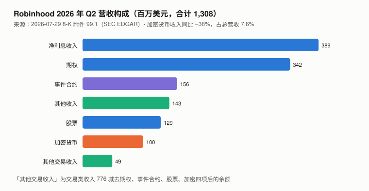
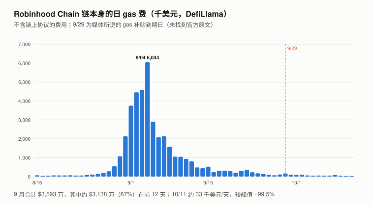
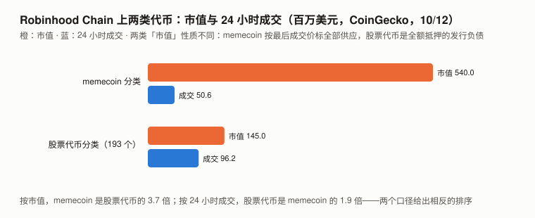

# Robinhood 完整调研与分析报告（2026 年 9 月版，首期）：HOOD 股票 · Robinhood Chain · Stock Tokens

> **编写日期**：2026 年 10 月 13 日
> **数据截止**：2026 年 9 月 30 日；链上与聚合器快照到 10/12
> **研究对象**：本报告把三个相互依存的对象放在一起：① **HOOD**（Robinhood Markets, Inc.，Nasdaq 上市的普通股）；② **Robinhood Chain**（Robinhood 运营的以太坊二层链，**没有原生代币**）；③ **Stock Tokens**（Robinhood 子公司发行的代币化股票）。
> **本期为首期报告**，本系列第十六个对象，也是**第一个非加密原生标的**（HOOD 是股票）。**本报告只分析与加密相关的部分**；HOOD 主业（期权、事件合约、净利息等）不在本系列框架内。
> **价格口径**：HOOD 用 Yahoo Finance 日线收盘（美东 16:00）；BTC 用币安 UTC 收盘（相差约 3–4 小时）；回归用 HOOD 相邻交易日之间的 BTC 累计收益（含周末），共 251 个收益观测。
>
> **接入新对象的第一步：三个默认还成立吗**：
>
> | 对象 | 流通量已知吗 | 价格可用吗 | 持有人有剩余索取权吗 |
> |---|:---:|:---:|:---:|
> | **HOOD** | ✅ 10-Q 封面：A 类 790,630,234 + B 类 108,452,039 股（7/23） | ✅ 美股主板 | ✅ **普通股**——本系列第一个持有人确定是剩余索取权人的标的 |
> | **Robinhood Chain** | 不适用（**无原生代币**，gas 用 ETH） | 不适用 | 不适用：链收入与启动合作方分成后归 Robinhood |
> | **Stock Tokens** | ✅ 链上 `totalSupply` 可读 | ✅ CoinGecko 24 小时成交约 $9,618 万（193 个代币的分类汇总） | ❌ **对标的证券或其发行人没有任何股东权利**；持有人是发行人 RHJ 一笔**有担保、有限追索债务**的债权人（见 1.2） |
>
> **本期核心发现**：
> 1. **加密在 HOOD 的收入里正在变小**：Q2 2026 营收 $13.08 亿（同比 +32%），**加密货币收入 $1.00 亿（Q2 2025 为 $1.60 亿，同比 −38%），占比从 16.2% 降到 7.6%**；
>    增长来自事件合约（$1.56 亿，一年前 $0.10 亿）、期权（$3.42 亿）、净利息（$3.89 亿）。8 月加密名义交易额 $175 亿（同比 −38%）。
> 2. **HOOD 的日收益与 BTC 的联动和与美股大盘的联动相当，统计上分不开**：单变量 R²，对 BTC 0.378、对标普 500（SPY）0.322，差值的自助区间 [−0.055, +0.166]。
>    BTC 与 SPY 同时放进回归：合计 R² 0.472，**控制 SPY 后 BTC 收益仍有增量统计关联（增加解释约 15.1% 的日方差）**——⚠️ 两个「独占」之差在代数上等于两个单变量 R² 之差，**是同一个区间，不构成额外证据**。
>    BTC 独占：前半年 0.163、后半年 0.126，**最近一季（2026 Q3）0.209**。**BTC 收益代表加密本身还是零售投机热度，分不开**——这股热度同时驱动期权和事件合约。
> 3. **Robinhood Chain 9 月的 gas 是一次脉冲，归 Robinhood 的部分更小**：链本身毛 gas 费 **$3,593 万**（DefiLlama），87% 在前 12 天，9/04 单日 $604 万；
>    扣掉以太坊 L1 成本与 Arbitrum 10% 分成后的链净收入 **$3,231 万**；**Robinhood 与启动合作方分成，累计约 $5,000 万前只留 50%**（8 月运营数据新闻稿原文）。
>    **新闻稿的「sequencer revenue」与 DefiLlama 口径的对应没有核实**：按净收入为基数，9 月归 Robinhood 约 $1,616 万；按毛费用为基数约 $1,797 万——**9 月单月约为 Q2 单季营收的 1.2%–1.4%，Q3 三个月合计约 1.6%（净收入基数）**。10 月前 11 天的运行率年化后约 $950 万，不到年化营收的 0.2%。
> 4. **9 月的脉冲与 memecoin 热潮同期**：9 月全生态费用 $3.557 亿，**Pons V2（memecoin 发射台）占 37.2%**，GMGN、fomo、Axiom 等 memecoin 交易工具合计约 16%，Uniswap V4/V3 合计 38.3%（未按资产类型拆分）。**股票代币带来多少收入，没有任何披露，无法比较。**
> 5. **Stock Tokens 的法律结构**（10-Q 与 RHJ 基础招股书原文）：发行人 **Robinhood Assets (Jersey) Limited** 的**有担保、有限追索、以全额抵押为目标**的债务（抵押可能跌破，发行人可选择不补足而强制赎回）；托管与经纪为 **Alpaca Securities LLC**；可做证券出借；分红通过「乘数」体现在钱包余额；持有人**对标的公司没有股东权利**、不得申请发行人破产；**未在美国注册**。
>    CoinGecko（10/12）股票代币分类 193 个、市值 **$1.45 亿**、24 小时成交 **$9,618 万**——**按成交，它是同链 memecoin 的 1.9 倍（成交是否全在本链未核实）；按市值，memecoin 是它的 3.7 倍**，两种「市值」性质不同。
>
> **本期核心判断**：**Robinhood 的加密业务在财务上是一个正在缩小的部分；它的新方向（链、代币化股票）9 月第一次有了可观的链上读数，但归 Robinhood 的链收入 9 月单月约为季度营收的 1.2%–1.4%（口径对应未核实），股票代币的收入没有披露。HOOD 股价与 BTC 收益存在增量统计关联，但它代表加密本身还是零售投机热度，本报告分离不出来。**
> **本报告不给 HOOD 目标价**：它是一只股票，需要完整的分业务盈利模型；本系列的框架只覆盖它的加密部分。
>
> ⚠️ **本期初稿把「加密主导 HOOD 定价」「产生收入的是 memecoin 不是股票代币」写成了结论，把链收入分成、链交易量口径、技术栈标为「未核实」——而答案就在本报告缓存的一手原文里。两位审查者指出，已改，见 10.4。**
>
> **利益冲突声明**：作者未持有 HOOD、任何 Stock Token 或 Robinhood Chain 上的代币，与 Robinhood 无雇佣、顾问或投资关系。
>
> **免责声明**：本报告不构成任何投资建议。所有分析仅供研究参考，投资决策请咨询专业顾问。

---

## 核心结论摘要（一页速览）

| 维度 | 核心判断 |
|------|----------|
| **HOOD 9/30 收盘** | **$112.50**；市值约 **$1,011 亿**（8.99 亿股 × 收盘价） |
| **9 月 / Q3 / 近一年** | **+7.34% / +12.19% / −21.43%**（BTC +6.42% / +42.64% / −26.68%；SPY −0.58% / +2.12% / +14.48%） |
| **联动** | 单变量 R²：BTC 0.378、SPY 0.322（**分不开**）；合计 0.472；控制 SPY 后 BTC 增量约 15%（与单变量之差是同一比较）；beta 对 BTC 0.99、对 SPY 3.13 |
| **Q2 2026 财务** | 营收 $13.08 亿（+32%）；**加密收入 $1.00 亿（−38%，占 7.6%）**；归属于 Robinhood 的净利润 $5.61 亿 |
| **8 月运营** | 加密名义交易额 $175 亿（−38%，**不含 Robinhood Chain 链上交易**）；股票 $3,354 亿（+68%）；平台资产 $3,837 亿 |
| **Robinhood Chain** | 9 月毛 gas 费 $3,593 万 → 链净收入 $3,231 万 → **归 Robinhood 约 $1,616–1,797 万**（50% 留存；口径对应未核实）；TVL $10.15 亿 |
| **Stock Tokens** | 193 个，市值 **$1.45 亿**、24 小时成交 $9,618 万；**有担保、有限追索、以全额抵押为目标的发行人债务** |
| **估值** | **不给目标价**；描述性：市值 ÷ 年化 Q2 营收 **19.3 倍** |

---

## 1. Robinhood 是什么

### 1.1 三个对象

| 对象 | 性质 | 与加密的关系 |
|------|------|------|
| **HOOD** | 美国零售券商的普通股 | 加密交易（App + Bitstamp）、托管、质押、钱包是其业务线之一 |
| **Robinhood Chain** | **建在 Arbitrum Dedicated Blockchains 上**的以太坊二层链（官方文档），**gas 用 ETH**，**先到先得排序、不能靠多付费插队**；**2026 年 7 月上线**（10-Q） | **链收入与启动合作方分成**：Robinhood 留存排序器收入的 50%，累计约 $5,000 万后 70%，累计约 $1.5 亿后 85%（8 月运营数据新闻稿原文） |
| **Stock Tokens** | **RHJ（泽西岛）发行的代币化债务证券**，在 Robinhood Chain 上流通，**2026 年 7 月推出**（10-Q），面向 120 多个国家的 Robinhood Wallet 用户 | 欧盟另有 2025-06 推出的 **Classic Stock Tokens**（原名 Robinhood Stock Tokens） |

### 1.2 Stock Tokens 的法律结构（10-Q、RHJ 基础招股书、官方产品页原文）

| 项目 | 内容 | 出处 |
|------|------|------|
| 发行人 | **Robinhood Assets (Jersey) Limited（RHJ）**，泽西岛私人有限公司 | 10-Q |
| 法律性质 | **「有担保、有限追索」的发行人债务**；每个系列由担保代理人代表投资者持有担保物权 | 招股书第 12 页 |
| 抵押 | **每个系列「全额抵押」**：标的股票、现金、在途资产及结算期间对经纪商等的交付 / 收款请求权；若允许证券出借，出借期间可为合格金融工具（借方须提供 ≥100% 的担保）。⚠️ **抵押物价值「目标是」不低于最低抵押水平，极端波动时可能跌破；未在期限内补足、或发行人决定不补足，会触发强制赎回**；抵押「不能完全消除」发行人信用风险 | 招股书第 10、11、40、65 页 |
| 有限追索 | **担保物变现不足时，发行人的义务以变现所得为限，分配后剩余债务消灭**；发行人其他资产与其他系列的资产都不用于弥补 | 招股书第 12、153 页 |
| 不得申请破产 | 投资者不得对发行人提起破产等程序（担保代理人仍可依担保文件执行） | 招股书第 50 页 |
| 托管 / 经纪 | **Alpaca Securities LLC**（除非最终条款另有规定） | 招股书第 8 页 |
| 分红 | **最终条款规定适用时**，净分红再投资：乘数提高每个代币对应的股份比例与显示金额，**原始代币数量不变、不发行新代币** | 招股书第 61、138–139 页；官方开发文档 |
| 赎回 | **通常卖给授权参与者（AP，可自定费用）**；直接向发行人赎回是例外路径（如全部 AP 进入相关程序 90 日未解除、或全部退出 30 日未替换、或发行人另行公告），须通过 KYC / 反洗钱，**以现金结算**；只有 AP 能直接向发行人认购 | 招股书第 10、131、134–135 页 |
| 发行人费率 | **认购 0%；自发行日起 90 天内赎回 0%，之后 0.05%**；发行人可在最终条款限度内调整；**AP 费用与其他扣减另计** | 官方产品页 |
| 持有人权利 | **「对标的证券或其发行人不享有任何法律或受益权利」**——没有股东权利，但对 RHJ 有担保债权 | 10-Q |
| 监管 / 地域 | 列支敦士登金融市场管理局批准基础招股书（不构成背书）；**未在美国注册**；美国、加拿大、英国、瑞士受限 | 10-Q |
| 已披露事件 | 推广活动中的「私人公司代币」：**OpenAI 公开表示相关代币不是其股权、未合作、未背书** | 10-Q |
| 拟议变更 | 审查方提到 9/21 有一份拟引入原子结算与临时 USDG 抵押的变更通知——**本报告未能打开原文（下载失败），未核实** | — |

> **经济价值跟随标的股价，兑付另受抵押物、托管方与交易对手风险影响。** 这是本系列见过的第三种「代币 ≠ 股东权利」结构（XIN 是网络代币、OKB 是平台币），**但它是三者中唯一有法律担保的——担保以全额抵押为目标，不是无条件保证**。

---

## 2. 阶段划分

| 阶段 | 时间 | 特征 |
|------|------|------|
| 一 | 2025-06 | 欧盟推出 Classic Stock Tokens |
| 二 | **2026-07** | **Robinhood Chain 公开主网上线**；新版 Stock Tokens 通过 Robinhood Wallet 面向 120 多个国家（Q2 财报原文：伦敦「The World is Flat」活动发布） |
| 三 | **2026-08 末 – 09 中** | **链上 memecoin 热潮**：链毛 gas 费 9/04 单日 $604 万；全生态 9 月费用 $3.557 亿 |
| 四 | 2026-09 下旬 – | 脉冲消退：10 月链 gas 费约 $3–8 万/天；**TVL 继续上升**（10/12 $10.54 亿） |

---

## 3. HOOD 当前现状

### 3.1 价格与联动

| 指标 | 数值 | 口径 |
|------|------|------|
| 9/30 收盘 | **$112.50** | Yahoo Finance 日线 |
| 8/31 / 6/30 收盘 | $104.81 / $100.28 | 同上（8/31 为当月最后交易日） |
| **9 月 / Q3 / 近一年** | **+7.34% / +12.19% / −21.43%** | 同上 |
| 2025-09 以来收盘高点 / 距高点 | $152.46（2025-10-09）/ **−26.2%** | 同上 |
| 市值（9/30） | **约 $1,011 亿** | 10-Q 封面股数 × 收盘价 |
| 年化波动率 | 71.6% | 251 个日对数收益 |

**联动分析**（251 个日对数收益，2025-09-30 → 2026-09-30）：

| 回归 | beta | R² |
|------|---:|---:|
| HOOD 对 BTC（单变量） | 0.99 | **0.378** |
| HOOD 对 SPY（单变量） | 3.13 | **0.322** |
| **HOOD 对 BTC + SPY（多元）** | BTC 0.715、SPY 1.937 | **0.472** |
| 其中 BTC 独占（控制 SPY 后增加） | — | **0.151** |
| 其中 SPY 独占（控制 BTC 后增加） | — | 0.094 |
| 两个单变量 R² 之差的 95% 自助区间（按日逐行有放回抽样 3,000 次，`random.seed(3)`，百分位法，未处理时间依赖） | — | **[−0.055, +0.166]**；自助样本中差值非正的比例约 16% |
| 前半年（2025-10 至 2026-03）BTC / SPY；BTC 独占 | — | 0.51 / 0.45；**0.163** |
| 后半年（2026-04 至 2026-09）BTC / SPY；BTC 独占 | — | 0.24 / 0.21；**0.126** |
| 分季 BTC 独占（25Q4 / 26Q1 / 26Q2 / 26Q3） | — | 0.087 / 0.247 / 0.064 / **0.209** |
| 加入滞后一日的 BTC 收益 | 滞后项系数 0.037 | 0.378（几乎不变；**数小时的收盘错配本身未直接检验**） |

> **能说的**：控制美股大盘之后，**BTC 收益与 HOOD 仍有增量统计关联**（点估计增加解释约 15% 的日方差）；单变量上 BTC 的点估计较高，但与 SPY 的差异统计上分不开。⚠️ 「BTC 独占 − SPY 独占」在代数上等于「BTC 单变量 R² − SPY 单变量 R²」，**多元回归没有为「BTC 强于 SPY」提供额外证据**。
> **不能说的**：「市场在用加密给它定价」。三条理由：① 两个单变量 R² 的差异统计上分不开；② **R² 是方差解释比例，不是定价权重**，不能和 7.6% 的收入占比直接对比；③ **BTC 可能是零售投机热度的代理**——同一股热度驱动期权、事件合约、股票交易，而这些不在 7.6% 里。
> **合计也只解释 47%**——其余 53% 是**本模型未解释**的部分（可能含遗漏的行业、利率等因子，不全是 HOOD 自身）。后半年单变量 R² 降到约 0.2，**主要是 BTC 与 SPY 的共同部分在缩小**（两者相关性 0.57 → 0.35）；BTC 独占只从 0.163 降到 0.126，**最近一季回升到 0.209**。
> 加入滞后一日 BTC 未明显改变结果；**数小时的收盘错配影响未直接检验**（需美东 16:00 对齐的小时数据）。Q3 HOOD +12.19% 远低于 BTC +42.64%，**单季偏离很大是常态**。

**同类对照**：

| | 9 月 | Q3 | 近一年 | 对 BTC beta / R² |
|---|---:|---:|---:|---:|
| **HOOD** | **+7.34%** | **+12.19%** | **−21.43%** | 0.99 / 0.378 |
| COIN（Coinbase） | −0.91% | +27.51% | −44.77% | 1.21 / 0.56 |
| BTC | +6.42% | +42.64% | −26.68% | 1.00 |
| SPY（标普 500） | −0.58% | +2.12% | +14.48% | — |

### 3.2 宏观环境

> 与 BTC 9 月版共用（美联储 9/16 加息 25bp 至 3.75–4.00%）。

---

## 4. HOOD 的加密业务（本期核心章之一）

> 图中数字（百万美元）：净利息收入 389、期权 342、事件合约 156、其他收入 143、股票 129、加密货币 100、其他交易收入 49（= 交易类收入 776 − 期权 − 事件合约 − 股票 − 加密）；合计 1,308。

### 4.1 Q2 2026（2026-07-29 8-K 附件 99.1 与 10-Q，SEC EDGAR 一手）

| 项目 | Q2 2025 | **Q2 2026** | 同比 |
|------|---:|---:|:---:|
| **总营收** | $9.89 亿 | **$13.08 亿** | **+32%** |
| 期权 | $2.65 亿 | $3.42 亿 | +29% |
| **事件合约** | $0.10 亿 | **$1.56 亿** | **十五倍** |
| 股票 | $0.66 亿 | $1.29 亿 | +95% |
| **加密货币** | **$1.60 亿** | **$1.00 亿** | **−38%** |
| 净利息收入 | $3.57 亿 | $3.89 亿 | +9% |
| 其他收入 | $0.93 亿 | $1.43 亿 | +54% |
| 合并净利润 / **归属于 Robinhood** | $3.86 亿 / $3.86 亿 | $5.73 亿 / **$5.61 亿** | — |
| 调整后 EBITDA | $5.49 亿 | $7.41 亿 | +35% |

> **加密收入占比：16.2% → 7.6%**。**按本报告的七组收入分类**（净利息、期权、事件合约、其他收入、股票、加密、其他交易收入），加密从第三降到第六。
> Q2 2026 净利润含 $1.29 亿税前调整项（Robinhood Ventures Fund I 出表收益 $1.06 亿、证券投资收益 $0.23 亿）。

### 4.2 8 月运营数据（2026-09-10 GlobeNewswire 新闻稿原文）

| 指标 | 8 月 | 环比 | 同比 |
|------|---:|:---:|:---:|
| **加密名义交易额** | **$175 亿** | +61% | **−38%** |
| 其中 Robinhood App | $74 亿 | +72% | −46% |
| 其中 Bitstamp | $101 亿 | +53% | −30% |
| 股票名义交易额 | $3,354 亿 | +1% | +68% |
| 期权合约 | 2.93 亿张 | −10% | +50% |
| 事件合约 | 47 亿张 | −23% | 十五倍 |
| 平台资产 / 有资金客户 | $3,837 亿 / 2,860 万 | +8% / +12 万 | +26% / +190 万 |

> **新闻稿原文注明：Robinhood Chain 的交易量不计入加密名义交易额。** 9 月运营数据截至本报告写作尚未发布。

---

## 5. Robinhood Chain（本期核心章之二）

> 图中数字（千美元）：纵轴 0 / 1,000 / 2,000 / 3,000 / 4,000 / 5,000 / 6,000 / 7,000；峰值 9/04 为 6,044；10/11 约 33；竖线 9/29；横轴 8/15、9/1、9/15、10/1。

### 5.1 从毛 gas 费到 Robinhood 的收入

| 层级 | 9 月 | 口径 |
|------|---:|------|
| **用户支付的毛 gas 费** | **$3,593 万** | DefiLlama `Fees` |
| 其中 9/01–9/12 | $3,138 万（87%）；峰值 9/04 $604 万 | 同上 |
| **链净收入**（扣以太坊 L1 执行与 blob 成本、Arbitrum 扩展计划 10% 分成） | **$3,231 万** | DefiLlama `Revenue`（方法说明原文） |
| 7–9 月链净收入累计 | $4,149 万（未到 $5,000 万的阶梯） | 同上 |
| **归 Robinhood（50% 留存）** | **约 $1,616 万**（净收入为基数）/ 约 $1,797 万（毛费用为基数） | × 新闻稿披露的留存比例；**基数口径未核实** |
| **÷ HOOD Q2 单季营收** | **约 1.2%–1.4%**（9 月单月）；**Q3 合计约 1.6%**（净收入基数） | — |
| 10 月前 11 天链净收入 / 年化 / 归 Robinhood | $57 万 / 约 $1,900 万 / **约 $950 万**（不到年化营收的 0.2%） | — |

> ⚠️ **DefiLlama 的 `Revenue` 与新闻稿的「sequencer revenue」是否同一口径、「累计约 $5,000 万」指链收入累计还是 Robinhood 留存累计，本报告都没有核实**——无论哪种口径，9 月都还在 50% 一档；不确定性在基数，是双向的。
> **一个月的脉冲不能外推**——10 月的运行率比 9 月低约 95%（月度口径）。
> ⚠️ **「9/29 gas 补贴到期」只有媒体说法**；日度数据在 9/29 前后没有可见的跳变，但这不足以排除局部钱包层面的补贴到期。

### 5.2 9 月全生态费用：与 memecoin 热潮同期

| 协议（9 月，DefiLlama） | 费用 | 占比 | 类型 |
|------|---:|:---:|------|
| **Pons V2** | $1.323 亿 | **37.2%** | memecoin 发射台 |
| **Uniswap V4** | $1.044 亿 | 29.4% | DEX（**未按资产拆分**） |
| Uniswap V3 | $3,154 万 | 8.9% | DEX（未拆分） |
| GMGN | $2,769 万 | 7.8% | memecoin 交易工具 |
| fomo Wallet | $1,651 万 | 4.6% | memecoin 交易应用 |
| Axiom | $697 万 | 2.0% | memecoin 交易应用 |
| **全生态合计** | **$3.557 亿** | 100% | 单日峰值 9/04 $3,150 万 |

> **能说的**：9 月的 gas 脉冲与 memecoin 热潮同期；**明确属于 memecoin 发射与交易工具的协议约占生态费用的一半**。
> **不能说的**：「产生收入的是 memecoin，不是股票代币」——Uniswap 的 38% 没有按交易对拆分；**股票代币的收入没有任何披露**，拿缺失的数据下否定结论是诉诸无知。
> ⚠️ **生态协议的费用不是 Robinhood 的收入**；归 Robinhood 的只有链本身的 gas（5.1）。

### 5.3 两类代币：市值与成交给出相反的排序

> 图中数字（百万美元）：memecoin 分类市值 540.0、成交 50.6；股票代币分类市值 145.0、成交 96.2。

| CoinGecko 分类（10/12） | 市值 | 24 小时成交 | 换手 |
|------|---:|---:|:---:|
| Robinhood Chain Meme | $5.40 亿 | $5,055 万 | 约 9% |
| **Robinhood Chain Stocks Ecosystem**（193 个） | **$1.45 亿** | **$9,618 万** | **约 66%** |

> **按市值，memecoin 是股票代币的 3.7 倍；按成交，股票代币是 memecoin 的 1.9 倍。**
> ⚠️ **两种「市值」性质不同**：memecoin 按最后成交价给全部供应标价，流动性很薄；股票代币的市值是以全额抵押为目标的发行负债。**3.7 倍没有直接的可比意义**。
> ⚠️ CoinGecko 的股票代币成交额是否全部发生在 Robinhood Chain 上，本报告未核实。

---

## 6. Stock Tokens（本期核心章之三）

### 6.1 链上规模

| 代币 | CoinGecko 市值（10/12） | 链上 `totalSupply` × 价格 | 合约（Robinhood Chain） |
|------|---:|---:|------|
| SPY | $1,851.7 万 | $1,852.0 万（23,771.3 × $779.07） | `0x117cc213…4c0c` |
| NVDA | $1,851.3 万 | $1,850.2 万（81,744.5 × $226.34） | `0xd0601ce1…9eec` |
| **SpaceX（未上市）** | $1,034 万 | $1,016 万（61,979.6 × $163.88） | `0x4a0e65a3…5eea` |
| **193 个合计** | **$1.45 亿** | — | — |

> **这是口径核对，不是独立验证**：CoinGecko 的市值本来就是 `totalSupply` × 价格，复算一致只说明聚合器没算错；差额（0.02%–1.7%，SpaceX 最大）来自时点与供应口径（CoinGecko 对 NVDA 记录的流通量与总量不同）。**`totalSupply` 是否含发行人预铸的库存，本报告未核实。**
> **前十大里有一个未上市公司（SpaceX）**：10-Q 写明这类代币「不代表、也不赋予取得被参照公司实际证券的权利」，价值基于约定的参考价——SpaceX 代币的参考价从哪来，本报告没有查到。

### 6.2 对 HOOD 意味着什么

- **规模**：$1.45 亿对 $3,837 亿平台资产来说是 **0.04%**。
- **收入路径**：官方费率是认购 0%、90 天后赎回 0.05%；**价差、出借、对冲带来的收益没有披露**——本报告没有找到 Stock Tokens 的收入数字。
- **风险**：10-Q 把它列为监管、诉讼、运营与声誉风险；OpenAI 事件说明「私人公司代币」的参照关系可以被标的公司公开否认。

---

## 7. 核心价值逻辑（只覆盖加密相关部分）

**星级编码证据等级与推论强度**：完全建立在二手转述上的论据不得给到五星；来源是一手但推论不显著的，也不给高星。

### 7.1 多头逻辑

| # | 论据 | 强度 | 说明 |
|---|------|:---:|------|
| 1 | **业务多元化：增长来自事件合约、期权、净利息，不依赖加密** | ★★★★★ | ✅ Q2 财报与 8 月运营数据原文 |
| 2 | **Robinhood Chain 有真实的链上活动与 TVL 增长** | ★★★☆☆ | ✅ DefiLlama；⚠️ **归 Robinhood 的部分 9 月约为季度营收的 1.2%–1.4%，且是脉冲** |
| 3 | 股票代币有以全额抵押为目标的法律结构与高换手 | ★★☆☆☆ | ✅ 招股书一手；⚠️ 规模占平台资产 0.04%，收入未披露 |

### 7.2 空头逻辑

| # | 论据 | 强度 | 说明 |
|---|------|:---:|------|
| 1 | **加密收入同比 −38%，加密交易额同比 −38%** | ★★★★★ | ✅ 一手 |
| 2 | **控制大盘后，BTC 收益与 HOOD 仍有增量统计关联（约 15%）**——BTC 下跌时 HOOD 倾向同向波动，幅度不只对应 7.6% 的收入 | ★★★☆☆ | ✅ 数据一手、本报告计算。⚠️ **BTC 系数有增量关联，但两个单变量 R² 的差异不显著**；BTC 代表加密本身还是零售热度，分不开 |
| 3 | **9 月链上活动的主体与 memecoin 热潮同期**，股票代币是否带来收入不可知 | ★★★☆☆ | ✅ DefiLlama、CoinGecko。⚠️ Uniswap 未拆分 |
| 4 | **Stock Tokens 的法律与声誉风险**（无股东权利、有限追索、OpenAI 事件、美国未注册） | ★★★★☆ | ✅ **10-Q 与招股书原文** |

> **同源检查**：多头 #1 与空头 #1 是同一个事实（加密在收入里变小）的两面；**多头 #2 与空头 #3 用的是同一批 DefiLlama 数据、同一次脉冲**——一边说「有真实活动」，一边说「活动主体是 memecoin」，作为证据只算一份。

---

## 8. 估值：不给目标价

**推导方法**：HOOD 市值（10-Q 封面股数 × 9/30 收盘）除以 Q2 单季数字 × 4。

| 描述性倍数（不是目标价） | 值 |
|------|---:|
| 市值 ÷ 年化 Q2 营收（$13.08 亿 × 4） | **19.3 倍** |
| 市值 ÷ 年化 Q2 调整后 EBITDA（$7.41 亿 × 4）——**不是 EV/EBITDA** | 34.1 倍 |

> **不给目标价的理由**：HOOD 是一只股票，可信的估值需要完整的分业务盈利模型、资本结构与利率敏感性——**本系列的框架只覆盖它的加密部分**。单季年化会放大季节性，上表只作量级参照。
> （初稿另列「市值 ÷ 年化净利润 56.9 倍」，混用了合并利润、归母利润与税前调整，已撤下。）

### 8.1 这套判断的弱点

1. **联动的来源没有分离**：BTC 可能只是零售投机热度的代理。
2. **DefiLlama 链净收入与新闻稿「sequencer revenue」的口径对应未核实**。
3. **Stock Tokens 的收入没有披露**；SpaceX 代币的参考价来源未查到；`totalSupply` 是否含库存未核实。
4. **9 月运营数据尚未发布**；9/21 的条款变更通知未能打开。
5. **本报告是首期**，也是本系列第一次覆盖股票；对 HOOD 主业的分析深度远不及专业股票研究。

---

## 9. 投资与风险启示

### 9.1 关键监控指标

| 指标 | 当前值 | 触发关注的阈值 | 查询方式 |
|------|---:|------|------|
| **Robinhood Chain 月毛 gas 费** | 9 月 $3,593 万；10 月运行率约 $180 万/月 | 任一月 ≥ $500 万（R9-1） | DefiLlama `summary/fees/robinhood chain` |
| **DefiLlama 链净收入累计** | $4,149 万（7–9 月） | 跨过 $5,000 万（**若与新闻稿口径对应**，留存升到 70%） | DefiLlama `Revenue` |
| **股票代币分类市值** | $1.45 亿 | ≥ $2 亿（R9-2） | CoinGecko 分类 |
| 加密收入占比 | 7.6%（Q2） | Q3 财报 | 10-Q / 8-K |
| HOOD 对 BTC 的独占解释力 | 全年约 15%；后半年 0.126（自助区间约 0.04–0.24） | **连续两个半年都低于 5%** | 本报告口径 |

### 9.2 风险提醒

1. **BTC 下跌时 HOOD 倾向同向波动**，幅度不只对应收入占比——但这份联动代表加密本身还是零售热度，分不开。
2. **链收入是脉冲，且归 Robinhood 的只有约一半**，不能按 9 月外推。
3. **Stock Tokens 是 RHJ 的有限追索债务**：持有人对标的无股东权利，兑付以抵押物为限。
4. **本报告自身**：首期，且是本系列第一次覆盖股票。

### 9.3 长期认知

**第一，持有人有没有剩余索取权，要分对象回答。** HOOD 股东有（普通股）；Stock Token 持有人没有股东权利，但有对 RHJ 的担保债权；链本身没有代币。**把三者混称「Robinhood 的加密资产」会把三种完全不同的权利结构说成一种。**

**第二，比较两个相关系数之前，先看差异是否显著；而且换一个代数上等价的统计量，不算第二条证据。** 初稿用 0.378 对 0.322 推出「市场在用加密给它定价」——差异的置信区间包含零；第一轮修正又把「独占 15% 对 9%」并列写出，**而两个独占之差恒等于两个单变量 R² 之差**。**R² 是方差解释比例，不能和收入占比放在同一个尺子上。**

**第三，毛收入、净收入、归属收入要分三层写，并写明每层的口径是否核实。** 初稿把链的毛 gas 费直接除以 HOOD 营收（2.7%）；扣掉 L1 成本、Arbitrum 分成和启动合作方的 50% 后，是约 1.2%–1.4%（基数口径未核实）。**而分成比例就写在本报告缓存的新闻稿末尾。**

---

## 10. 附录

### 10.1 关键数据速查（截至 2026-09-30，快照到 10/12）

| 类别 | 指标 | 数值 |
|------|------|---:|
| **HOOD** | 9/30 收盘 / 市值 | $112.50 / 约 $1,011 亿 |
| | 9 月 / Q3 / 近一年 | +7.34% / +12.19% / −21.43% |
| | R²（BTC / SPY / 合计） | 0.378 / 0.322 / 0.472 |
| | Q2 营收 / 加密收入 | $13.08 亿 / $1.00 亿（7.6%） |
| | 8 月加密名义交易额 | $175 亿（同比 −38%） |
| **Robinhood Chain** | 9 月毛 gas 费 / 链净收入 / 归 Robinhood | $3,593 万 / $3,231 万 / 约 $1,616 万 |
| | 9 月全生态费用 | $3.557 亿（Pons V2 37.2%） |
| | TVL（9/30） | $10.15 亿 |
| **Stock Tokens** | 数量 / 市值 / 24 小时成交（10/12） | 193 / $1.45 亿 / $9,618 万 |

### 10.2 数据来源与核实状态

| 数据 | 来源 | 核实状态 |
|------|------|:---:|
| Q2 2026 财务、股本 | **SEC EDGAR**：8-K 附件 99.1、10-Q | ✅ 一手原文 |
| Stock Tokens 法律结构 | 10-Q；**RHJ 基础招股书**（PyPDF2 抽取文字）；官方产品页 | ✅ 一手原文 |
| 8 月运营数据、链收入分成、链交易量口径 | **GlobeNewswire 新闻稿原文**（IR 网站拒绝访问，用发布渠道转载） | ✅ 一手原文 |
| Robinhood Chain 技术栈、gas、排序 | **Robinhood 官方开发文档** | ✅ 一手原文 |
| HOOD / SPY / COIN 价格 | Yahoo Finance 日线 | ✅ API 直接调用 |
| 链毛费用、净收入、生态拆分、TVL | DefiLlama API | ✅ API 一手（含方法说明） |
| 股票代币与 memecoin 分类 | CoinGecko API | ✅ API；链上 `totalSupply` 口径核对 |
| DefiLlama `Revenue` 与「sequencer revenue」的对应 | — | ❌ 未核实 |
| 9/21 条款变更通知 | — | ❌ 未能打开 |
| 9/29 gas 补贴到期 | 媒体 | ⚠️ **二手，未找到官方原文** |
| Stock Tokens 收入、SpaceX 参考价、`totalSupply` 是否含库存 | — | ❌ 未披露 / 未核实 |
| 9 月运营数据 | — | ❌ 尚未发布 |

### 10.3 来源偏向声明

| 侧 | 主要论据 | 证据等级 |
|---|------|:---:|
| **多头** | 业务多元化、链上活动、法律结构 | 财报与招股书一手；链上数据一手 |
| **空头** | 加密收入下滑、价格联动、memecoin 同期、法律风险 | 来源一手；**价格联动与 memecoin 归因的推论强度只到「相容」** |

> **来源等级 ≠ 推论等级**：初稿写「空头全部一手」，把数据来源的等级借给了推论。本期已按推论强度调整星级（空头 #2、#3 三星）。
> **传统金融机构视角**：本期引用了 **SEC** 一手文件与**美联储**政策。PONS 9 月版记录过 Bernstein 与 StoneX 对 Robinhood Chain 的评论（二手），**本报告未取得当期原文**。

### 10.4 发布前审查记录

**第 1 层 `verify_report.py`**：初稿 3 FAIL（图注缺 33、776；缺「推导」说明），补齐后 0 FAIL / 0 WARN。

**第 2 层 _bian（推理）与第 3 层 Codex（领域，读缓存与官方文件复算）——第一轮：**

| # | 意见 | 出处 | 处理 |
|---|------|:---:|------|
| 1 | **链毛费用被当成 Robinhood 收入**：新闻稿末尾有 50% / 70% / 85% 留存阶梯，DefiLlama 有 Revenue 口径 | 两者 | ✅ **原文核实**；5.1 改为毛费用 → 净收入 → 归 Robinhood 三层；2.7% 改为约 1.2% |
| 2 | **R² 0.378 vs 0.322 分不开，被读成「定价权重」** | 两者 | ✅ 补自助区间、多元回归、半年子期；结论改为「联动不弱于大盘、来源未分离」 |
| 3 | **Stock Tokens 偿付结构不完整**：有担保、有限追索、全额抵押、证券出借、不得申请破产 | Codex | ✅ **招股书原文核实**，1.2 重写 |
| 4 | 赎回条件与收费机制漏了 | Codex | ✅ 官方产品页核实，补入 |
| 5 | **「产生收入的是 memecoin」缺归因证据**；生态前五用的窗口没覆盖脉冲 | 两者 | ✅ 改用 9 月拆分；结论改为「同期，股票代币收入不可知」 |
| 6 | 「被 memecoin 占领」用的市值不可比，成交口径相反 | _bian | ✅ 两个口径并列，图重画 |
| 7 | **「链上抽查逐位一致」是循环验证**，且数字其实有差 | 两者 | ✅ 改为「口径核对」，列差额 |
| 8 | 56.9 倍混用合并利润、归母利润与税前调整 | Codex | ✅ 撤下；补归母利润 $5.61 亿 |
| 9 | Q2 2025 加密收入应用 10-Q 原值 $1.60 亿，排名限定分类口径 | Codex | ✅ 已改 |
| 10 | **链交易量口径、技术栈、分成「未核实」，答案在缓存与官方文档里** | 两者 | ✅ 全部改为引用原文 |
| 11 | 9/21 条款变更通知漏了 | Codex | ⚠️ 本报告下载失败，列为未核实 |
| 12 | 星级把来源等级当推论等级；多头 #2 与空头 #3 同源 | _bian | ✅ 空头 #2、#3 降为三星；补同源 |
| 13 | 时刻错配可量化；样本数应为 251 | 两者 | ✅ 滞后项几乎为零，已写入 |
| 14 | R9-1 「运营方近乎可回收」错（L1 成本、Arbitrum、合作方分成都不回来）；R9-2 论点与检验不同构、制造成本推导与统计量补救不成立 | 两者 | ✅ 记分卡重写 |
| 15 | 速查「10 月跌掉 99%」是单日口径 | _bian | ✅ 改为月度约 −95% |

**第二轮（复审修订稿）：**

| # | 意见 | 出处 | 处理 |
|---|------|:---:|------|
| 1 | **「独占 15% vs 9%」与单变量之差代数等价**，不构成额外证据；「不弱于」是单侧读法 | _bian | ✅ 改为「相当，分不开」；正文、长期认知补等价说明 |
| 2 | 「加密是可识别的外部因子」替未解决的问题作答；空头 #2、风险 #1 用了因果词 | 两者 | ✅ 改为「BTC 收益有增量统计关联」「同向波动」；残差改称「本模型未解释」 |
| 3 | 子期只报单变量，漏了最近一季 BTC 独占回升到 0.209；监控阈值落在噪音里 | _bian | ✅ 补半年与分季独占；阈值改为连续两个半年 |
| 4 | **「全额抵押」只引了标题句**：抵押是目标值、可跌破、可选择不补足而强制赎回、不能完全消除信用风险 | _bian | ✅ **招股书第 11、40、65 页原文核实**，1.2 补全；卷首、速查改为「以全额抵押为目标」 |
| 5 | 归 Robinhood 收入是条件估算；「保守」方向标错；季度占比混用月与季 | 两者 | ✅ 改为区间 1.2%–1.4%（9 月单月）、Q3 合计约 1.6% |
| 6 | 赎回条件、AP 费用、分红乘数、有限追索后债务消灭等条款转述不全 | Codex | ✅ 招股书原文核对后补入 |
| 7 | 滞后项不能证明数小时错配可忽略；自助区间缺方法说明 | Codex | ✅ 已改 |
| 8 | R9-2 制造者应为 AP、读数时点与回退规则未定义、库存铸造与成分扩充路径漏了；R9-1 基率是一次跨月脉冲 | 两者 | ✅ 记分卡已改 |

**第 4 层 _dalin**：待审。

---

> **配套文件**：`hood_questions_summary_202609.md`（简明速查）、`../thesis_scorecard.md`（论点滚动记分卡）。
> 本报告不构成投资建议。
