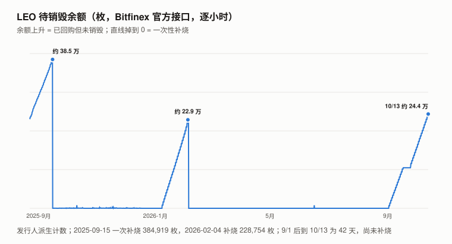
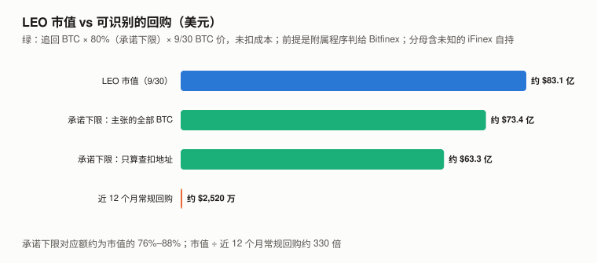
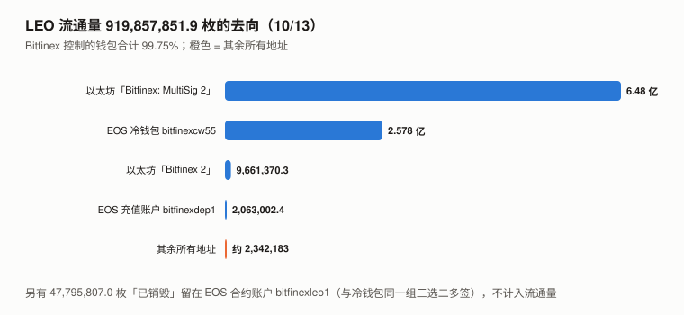

# LEO / UNUS SED LEO 完整调研与分析报告（2026 年 9 月版，首期）

> **编写日期**：2026 年 10 月 13 日
> **数据截止**：2026 年 9 月 30 日；链上、官方接口与法院案卷快照到 10/12–10/13
> **研究方法**：沿用本系列框架。价格用 **Bitfinex 现货 LEO/USD 日线 UTC 收盘**（LEO 不在币安上市）；超额收益用对数口径（ln 收益 − beta × ln BTC 收益，不扣截距）；对照组为本系列 9 个山寨（ZEC、UNI、ADA、SOL、BNB、ETH、TRX、CKB、DOT）。**一手数据**：Bitfinex 公开接口（`api-pub.bitfinex.com` 的 `leo.burn.*` 统计与 `leo/burn/hist`——LEO 透明度页面 `leo.bitfinex.com` 自己调用的就是这些接口，本报告读了它的前端代码确认）；EOS 链（公共节点 + Hyperion 历史接口）；以太坊（公共 RPC + Blockscout）；比特币（mempool.space）；美国哥伦比亚特区联邦地区法院案卷（CourtListener 的 RECAP 镜像）；白皮书原文（`bitfinex.com/wp-2019-05.pdf`）。
> **本期为 LEO 首期报告**，本系列第二十个对象。
>
> **接入新资产的第一步：三个默认还成立吗**（XIN 期教训）：
>
> | 检查 | 结果 | 依据 |
> |---|:---:|---|
> | **流通量已知吗** | ⚠️ **总量能勾稽到 0.1 枚，但「已销毁」里有 4,780 万枚仍在 Bitfinex 多签控制的账户里；持有人分布几乎不可见** | 以太坊合约 `totalSupply` 660,000,000 + EOS 合约 `bitfinexleo1` 的 `supply` 307,653,658.9 − 合约账户自己持有的 47,795,807.0 = **919,857,851.9**，与 Bitfinex 官方接口 `leo.burn.supply` 的读数**完全相等**。⚠️ 这是在确认 Bitfinex 的「流通量」**定义**，不是独立验证。**EOS 上的「销毁」是把 LEO 转进合约账户 `bitfinexleo1`，而这个账户由 `bitfinexsig1/2/5` 三选二多签控制**——与 Bitfinex 冷钱包 `bitfinexcw55` 的控制方完全相同（4.1）。**Bitfinex 控制的钱包合计持有「流通量」的 99.7%**（第 6 章） |
> | **价格是可用的测量吗** | ⚠️ **流动性极低，信息量判别不了** | Bitfinex LEO/USD 近一年日成交中位数约 **$17.1 万**，9 月约 **$9.3 万**——约为市值的十万分之一到十万分之二；一年里有 2 天单日跌超 20% 后次日反弹（订单簿被打穿的形态）。**它是很少成交的报价还是均衡价，本报告判别不了**（9.2）。对 BTC 的 R² 0.126——只说明超额收益不可归因，不说明价格水平没有信息 |
> | **代币持有人是剩余索取权人吗** | ❌ **没有股权与分红权；回购承诺的法律效力未核实** | 白皮书原文：「LEO tokens are not capital shares or other interests in iFinex and are not entitled to any dividends」。**持有人只通过回购承诺与 iFinex 的收入相连**；而官网现行白皮书开头声明「**is a marketing document and is not intended to be legally binding**」，购买条款以《Token Purchase Agreement》为准——**本报告没有读到购买协议**，承诺能否被持有人主张（尤其二级市场持有人）未核实（1.2） |
>
> **本期核心发现**：
> 1. **9/1 之后 LEO 一枚都没有销毁**：官方接口的供应量从 9/1 起停在 919,857,851.9；最后一笔销毁是 9/1 03:01 UTC 的 6,559 枚。**发行人报告的「待销毁」计数在涨**（9/30 为 151,201 枚，10/13 为 243,658 枚）——⚠️ 这是派生计数（前端标签「LEO Acquisition」），**可能包含用户付手续费收到的 LEO**，不能单独证明「市场回购在进行」；9 月计入 157,650 枚，比 8 月少 26%。这不是第一次停顿：2025-07-17 至 09-15 供应停了 59 天、2026-01-07 至 02-04 停了 27 天，都以一次性补烧结束；**本次到 10/13 为 42 天，仍短于历史最长**。原因**未识别**；它与 Bitfinex 下架 Vaulta（原 EOS）代币的提币截止日（8/31）只差一天，**时间相邻，因果未证明**（4.3）。
> 2. **常规回购的规模很小**：近 12 个月（2025-10 至 2026-09）逐笔销毁 2,695,250 枚，按月均价折算约 **$2,520 万**，约为供应的 0.29%。**白皮书承诺每月回购至少为上月合并总收入的 27%**——**若承诺被完整执行**，12 个月口径意味着 iFinex 月合并总收入不超过约 **$778 万**；反过来，**只要有可信的外部估计显示其收入更高，就说明承诺没有被完整执行**（iFinex 不公布收入，本报告两个方向都判不了）。
> 3. **最大的潜在买方——被盗 BTC 的追回——在法院的附属程序里**：白皮书承诺把 2016 年被盗 BTC 追回净额的**至少 80%** 用于回购销毁 LEO。法院 2025-04-04 的备忘录意见（本报告读完全文 20 页）判「$0 [voluntary] restitution」，**理由是事实与法律问题复杂、改为只通过第三方附属没收程序裁定——这是程序选择，不是对归属的判断**。意见第 17 页写明：**即使所有申请人都证明了优先权益，他们主张的总量也只占被盗钱包资金的「small percentage」，其余仍可由 Bitfinex 主张**；脚注列出的 16 名按时申请人合计主张约 **4,269 BTC**。Bitfinex 的专家主张可追溯的资产是 **94,643.30 + 2,818.20 + 12,267.03 = 约 109,729 BTC**，外加 BCH、BSV 各约 11.7 万枚。查扣地址的 94,643.49 BTC 到 10/13 **从未转出**；到 10/7 程序仍在进行（第 5 章）。
> 4. **一个被广泛转载的媒体数字是假的**：CoinReporter 2026-03-23 称 iFinex「Q1 净利润 $2.5 亿后立即加速销毁 1,800 万枚 LEO」。**官方接口显示 2026 年 Q1 供应只减少了 78.3 万枚**；该文无任何来源（4.4）。
>
> **本期核心判断**：**常规回购的历史规模解释不了 LEO 的市值（约 $83.1 亿，约 330 倍于近 12 个月回购；只要折现率与增长率之差在 2% 以上，常规回购的现值就不到市值的 15%）；追回回购能解释多少，取决于本报告给不出的几个量。** 按白皮书的 80% 乘以**扣除前的毛额**、9/30 的 BTC 价格（$83,623.6），追回回购约为市值的 **76%（只算查扣地址）到 88%（Bitfinex 主张的全部 BTC）**——⚠️ 承诺适用于扣除 RRT、成本与或有准备后的**净额**，**真实的承诺下限比这低**；三个资产基数是互相独立的情景，不是区间。不确定的量：① 附属程序的结果——法院意见显示**按时申请的第三方合计只主张约 4,269 BTC（对手方份额的上界很小，仅指 2025 年的按时申请人）**，但剩余部分归 Bitfinex 仍需它自己的申请获准；2026 年新申请人的主张本报告没读；② 净额扣多少；③ **市值的分母里有多少是 iFinex 自己持有的 LEO**（99.75% 在 Bitfinex 钱包里，分不开）。**价格对追回消息有反应**：2025-02-23 政府把建议改为「$0 赔偿 + 只走附属程序」后的第一个交易日，LEO 扣除 BTC 后下跌约 8.4 个百分点（约同期日波动的 5 倍），随后 4 天收回（5.4）。
> **本报告不给目标价**：持有人没有股权与分红权；回购承诺写在一份自称不具法律约束力的营销文件里，执行无法核实；追回规模取决于未决的法律程序。
>
> **免责声明**：本报告不构成任何投资建议。所有分析仅供研究参考，投资决策请咨询专业顾问。

---

## 核心结论摘要（一页速览）

| 维度 | 核心判断 |
|------|----------|
| **LEO 是什么** | Unus Sed Leo Limited（iFinex 为其设立的英属维尔京群岛发行主体）2019-05 发行的平台代币，私募募资约 $10 亿；用于 Bitfinex 手续费折扣；**iFinex 在白皮书中承诺用收入与追回资金回购并销毁** |
| **9/30 收盘** | **$9.0348**（Bitfinex LEO/USD）；按官方流通量 919,857,851.9 枚，**市值约 $83.1 亿** |
| **9 月 / Q3 / 近一年** | **−6.37% / −2.54% / −5.60%**（BTC +6.42% / +42.64% / −26.68%） |
| **beta / R² / 波动率** | **0.419 / 0.126 / 53.2%**（2025-09-30 至 2026-09-30，365 个日收益） |
| **对数超额** | 9 月 **−9.2**（对照组中位数 +13.2）；Q3 **−17.5**（对照组中位数 +2.8）；⚠️ R² 太低，beta 不可靠 |
| **成交** | Bitfinex LEO/USD 近一年日成交中位数约 **$17.1 万**，9 月约 **$9.3 万** |
| **供应** | 919,857,851.9（官方接口，9/1 起未变）；初始 10 亿；累计「销毁」80,142,148.1 |
| **12 个月回购** | 2,695,250 枚，约 **$2,520 万**（约为供应的 0.29%） |
| **9 月** | **只销毁 1 笔（6,559 枚）**；月末待销毁 151,201 枚 |
| **追回 BTC** | 查扣地址 94,643.49 BTC 未动；法院判 $0 [自愿] 赔偿、改走附属没收程序（程序选择）；Bitfinex 主张约 109,729 BTC，按时申请人合计约 4,269 BTC；**80% × 毛额（扣除前）× 9/30 BTC 价 ≈ 市值的 76%–88%**（承诺按净额计，真实下限更低） |
| **持有分布** | **Bitfinex 控制的钱包合计约 99.7%**（以太坊 MultiSig 2 一个地址就有 6.48 亿） |
| **持有人权益** | **无股权与分红权**（白皮书原文）；回购承诺写在自称不具法律约束力的营销文件里，购买协议未读 |
| **估值** | **不给目标价**（第 9 章） |

---

## 1. LEO 是什么

### 1.1 发行与链

| 项 | 内容 | 来源 |
|---|---|---|
| 发行人 | **Unus Sed Leo Limited**（英属维尔京群岛，专为发行 LEO 设立）；回购承诺方是 **iFinex Inc.**（运营 Bitfinex） | 白皮书 |
| 发行 | 2019-05，初始 10 亿枚 | 白皮书；EOS 合约 `max_supply` 1,000,000,000 |
| 以太坊 | 合约 `0x2AF5…2Ca3`，`totalSupply` **660,000,000**（10/13 读取，**从未减少**） | 以太坊 RPC |
| EOS（现名 Vaulta） | 合约账户 `bitfinexleo1`，`supply` **307,653,658.9**；该账户自己持有 **47,795,807.0** | EOS 节点 `get_currency_stats` / `get_currency_balance` |
| 两链初始分配 | 以太坊 6.6 亿、EOS 3.4 亿 | Coin Bureau（二手；与 10 亿总量、以太坊 6.6 亿的读数一致） |

### 1.2 白皮书的回购与销毁承诺（原文）

| 承诺 | 原文要点 |
|---|---|
| **常规回购** | 「On a monthly basis iFinex and its affiliates will buy back an amount of LEO from the market equal to a **minimum of 27% of the consolidated gross revenues** of iFinex from the previous month, in perpetuity until no tokens are in commercial circulation.」——**按上月合并总收入（gross revenues）的至少 27%**，不是利润；不含 Ethfinex；**「LEO tokens used to pay fees may also be used to satisfy this repurchase commitment」**（用户付手续费用掉的 LEO 也可以算进回购） |
| **Crypto Capital 追回** | 追回净额的**至少 95%** 用于回购销毁，18 个月内完成 |
| **2016 年被盗 BTC 追回** | 追回净额的**至少 80%** 用于回购销毁，18 个月内完成；净额由 iFinex「in good faith」（善意地）计算，扣除 RRT 赎回、法律、运营与追回成本、政府收费，以及「reserves for contingent costs」（或有成本准备） |
| **持有人权益** | 「LEO tokens are not capital shares or other interests in iFinex and are not entitled to any dividends.」 |

> **白皮书的效力**：官网现行版本开头写着「The information in this white paper has changed ... should not be relied upon for any purpose」，后文写明「The document is a marketing document and is not intended to be legally binding」，并说购买条款以《Token Purchase Agreement》为准。**本报告没有读到购买协议**，所以「回购承诺能否被持有人主张、对二级市场持有人是否适用」未核实。
>
> **另外两个细节决定了承诺的强度**：① 「净额」由 iFinex 自己「善意地」计算，且可以扣「或有成本准备」——**扣多少由发行人决定**；② 常规回购的基数「合并总收入」**iFinex 不公布**——外部无法核对 27% 是否被执行。

### 1.3 销毁在链上是怎么做的

本报告用 Hyperion 读了 9/1 最后一笔销毁的原始交易：**`bitfinexdep1` 把 6,559 枚 LEO 转给合约账户 `bitfinexleo1`，备注「burn」**。之后这些币就**留在合约账户的余额里**。

| 账户 | 权限（10/13 读取） |
|---|---|
| `bitfinexleo1`（LEO 合约，也是「销毁」的去处） | owner 与 active 都是 **`bitfinexsig1` / `bitfinexsig2` / `bitfinexsig5` 三选二** |
| `bitfinexcw55`（Bitfinex 冷钱包，持有 2.578 亿枚 LEO） | **同样是这三个账户三选二** |
| `bitfinexdep1`（Bitfinex 充值账户） | active 为单个公钥；owner 为同一组三选二 |

**所以 EOS 上的「已销毁」分两部分**：约 3,235 万枚已从合约的 `supply` 里注销（3.4 亿 − 3.077 亿，以初始分配的二手数字为准），**另 4,780 万枚仍是合约账户的余额**——而合约账户由 Bitfinex 的多签控制，合约代码也可以由同一组多签更新。**这 4,780 万枚不可逆地退出流通，依据的是 Bitfinex 的承诺，不是密码学。**本报告没有读合约代码，**不判断现行代码是否允许转出合约自己的余额**。

---

## 2. LEO 的发展阶段划分

| 阶段 | 时间 | 事件 |
|---|---|---|
| 一 | 2019-05 | IEO（交易所首次发行），约 $10 亿；Bitfinex 当时因 Crypto Capital 的 $8.5 亿资金被冻结而融资（白皮书背景章节） |
| 二 | 2020–2021 | 销毁最多的两年：官方供应 2020 年（从 2/19 起）减少 1,514 万、2021 年减少 3,232 万 |
| 二 | 2020-12-28 | Bitfinex 热钱包「Bitfinex 2」向「Bitfinex: MultiSig 2」转入 6.4 亿枚以太坊 LEO（2023-06-25 再转入 800 万），**此后从未转出**（Blockscout） |
| 三 | 2022–2025 | 年销毁递减：615 万 → 450 万 → 366 万 → 265 万 |
| 三 | 2022-02 | 美国政府查扣 2016 年被盗 BTC，地址余额 94,643.49 BTC |
| 四 | **2025-01** | 政府提出动议，请求把查扣的 BTC 以实物返还 Bitfinex（媒体广泛报道为「法院下令归还 $90 亿」） |
| 四 | **2025-04-04** | **法院备忘录意见：判给 Bitfinex 的赔偿为 $0，不开赔偿听证，资产归属只通过第三方附属没收程序裁定** |
| 五 | 2026 | 附属程序持续；更多第三方提交申请（2026-03）；10/7 法院要求 Bitfinex 在 10/22 前提交其反对意见的公开版本 |
| 五 | **2026-09-01** | **最后一笔销毁**；此后待销毁余额累积 |

---

## 3. LEO 当前现状

### 3.1 价格与市场

| 指标 | 数值 |
|---|---|
| 9/30 收盘 | **$9.0348**（9 月最低收盘 $8.81，最高 $9.3968；近 500 天最高收盘 $10.381 在 2026-04-28） |
| 9 月 / Q3 / 近一年 | **−6.37% / −2.54% / −5.60%** |
| BTC 同期 | +6.42% / +42.64% / −26.68% |
| 一年 beta / R² / 波动率 | **0.419 / 0.126 / 53.2%** |
| 特质（残差）标准差 | 日 2.6%；按月约 14.2、按季约 24.9 个对数点 |
| 9 月 / Q3 对数超额 | **−9.2 / −17.5**（对照组中位数 +13.2 / +2.8） |
| 10/12 收盘 | $8.89 |

> **口径**：9 月 = 8/31 收盘 → 9/30 收盘；Q3 = 6/30 → 9/30；近一年 = 2025-09-30 → 2026-09-30；对照组同口径（币安）。**LEO 用 Bitfinex 价格、对照组用币安价格，场所不同**。

### 3.2 这个价格能当测量用吗

| 检查 | 读数 |
|---|---|
| Bitfinex LEO/USD 日成交中位数（近一年 / 9 月） | **约 $17.1 万 / 约 $9.3 万** |
| 日成交 ÷ 市值 | 约十万分之一到十万分之二 |
| 单日涨跌超过 20% 的天数（一年） | **2 天**：2025-12-17 −22.4%（盘中最低 $6.44）、2026-02-05 −26.2%，**次日分别反弹约 +16%、+15%** |
| 单日涨跌超过 10% 的天数 | 5 天 |
| CoinGecko 成交最大的场所（10/13） | **CoinUp.io**（LEO/USDT，24 小时约 $157 万），**比 Bitfinex（约 $15 万）大一个数量级**；该场所的成交真实性本报告**未核实** |
| 对 BTC 的 R² | 0.126 |

**结论**：价格的流动性极低。两次「−20% 次日反弹」更像订单簿被打穿，而不是信息。**它是很少成交的报价还是均衡价，本报告判别不了**（9.2）；**本报告不对 LEO 的超额收益做归因**（R² 0.126 下 beta 不可靠）。

### 3.3 宏观环境

与 BTC 9 月版共用（美联储 9/16 加息 25bp 至 3.75–4.00%）。LEO 对 BTC 的 R² 0.126——**宏观与加密整体行情对它的解释力都很低**。

---

## 4. 供应与销毁（本期核心章之一）

### 4.1 供应勾稽

| 项 | 枚数（10/13） | 来源 |
|---|---:|---|
| 以太坊 `totalSupply` | 660,000,000.0 | 以太坊 RPC |
| + EOS 合约 `supply` | 307,653,658.9 | EOS 节点 |
| − EOS 合约账户 `bitfinexleo1` 的余额（「已销毁」但未注销） | −47,795,807.0 | EOS 节点 |
| **= 官方「流通量」** | **919,857,851.9** | Bitfinex `leo.burn.supply`，**完全相等** |
| 累计「已销毁」（10 亿 − 流通量） | 80,142,148.1 | 计算；与透明度页面一致 |

⚠️ **这是恒等式，不是独立验证**（CKB 期规则）：它确认了 Bitfinex 的「流通量」= 两链总量 − 合约账户余额。**流通量里包含 Bitfinex 自己钱包的余额**（第 6 章），所以它不是「可交易流通量」。

### 4.2 年度与月度销毁

> **推导方法**：年度 / 月度销毁 = 官方接口 `leo.burn.supply:1d:val` 的日值之差；美元 = 当月销毁枚数（`leo/burn/hist` 逐笔合计）× 当月 Bitfinex LEO/USD 日收盘均价。

| 年份 | 供应减少（枚） |
|---|---:|
| 2020（2/19 起） | 15,136,378 |
| 2021 | 32,323,094 |
| 2022 | 6,153,327 |
| 2023 | 4,503,447 |
| 2024 | 3,662,011 |
| 2025 | 2,653,501 |
| 2026（至 10/13） | 1,883,035 |

| 月份 | 销毁笔数 | 销毁（枚） | 当月均价 | 折美元 |
|---|---:|---:|---:|---:|
| 2025-08 | 0 | 0 | — | — |
| 2025-09 | 123 | 488,998 | $9.58 | $468 万 |
| 2025-10 | 172 | 188,786 | $9.48 | $179 万 |
| 2025-11 | 240 | 329,939 | $9.45 | $312 万 |
| 2025-12 | 149 | 285,886 | $8.95 | $256 万 |
| 2026-01 | 7 | 55,317 | $9.07 | $50 万 |
| 2026-02 | 22 | 430,728 | $8.46 | $364 万 |
| 2026-03 | 31 | 295,775 | $9.25 | $274 万 |
| 2026-04 | 30 | 241,400 | $10.20 | $246 万 |
| 2026-05 | 31 | 219,766 | $10.11 | $222 万 |
| 2026-06 | 29 | 226,360 | $9.61 | $217 万 |
| 2026-07 | 27 | 200,839 | $9.59 | $193 万 |
| 2026-08 | 31 | 213,895 | $9.50 | $203 万 |
| **2026-09** | **1** | **6,559** | $9.07 | **$6 万** |
| **2025-10 至 2026-09 合计** | — | **2,695,250** | — | **约 $2,520 万** |

（逐笔合计与供应差在个别月份有几千枚的出入，例如 2025-09 逐笔 488,998、供应差 497,003；本报告的年度数用供应差，月度表用逐笔。）

**供应一年（2025-09-01 → 2026-09-01）减少 3,184,248 枚，−0.345%**（含 2025-09-15 的一次补烧；与上表 12 个月逐笔合计的窗口不同）。

### 4.3 9 月的停顿

| 指标 | 读数（官方接口 `leo.burn.pending:1h:bal` 与 `leo.burn.acc:1h:bal`） |
|---|---|
| 最后一笔销毁 | 2026-09-01 03:01 UTC，6,559 枚 |
| 待销毁余额 9/2 / 9/30 / 10/13 09:00 | 6,589 / **151,201** / **243,658**（约 24.4 万） |
| 计入「待销毁」的数量（`acc`，前端标签「LEO Acquisition」）：8 月 / 9 月 | 213,896 / **157,650**（少 26%） |

⚠️ **「待销毁」是派生计数**：它逐小时满足「上一小时余额 + 当小时计入 − 当小时销毁」，残差为 0。**计入的来源本报告分不开**——白皮书允许用户付手续费用掉的 LEO 也计入回购承诺、也可以销毁。所以能说的只是：**发行人报告的计入数在增加**，不能单独证明「市场回购在进行」。`bitfinexdep1` 在 9/1 之后没有任何 LEO 转账（Hyperion）。

**此前的两次停顿都以一次性补烧结束**（按官方供应连续不变的天数）：

| 停顿 | 时长 | 补烧 |
|---|---:|---|
| 2025-07-17 至 2025-09-15 | **59 天** | 2025-09-15 一次 384,919 枚（补烧前待销毁约 38.5 万） |
| 2026-01-07 至 2026-02-04 | 27 天 | 2026-02-04 一次 228,754 枚（补烧前约 22.9 万） |
| **2026-09-01 起** | **到 10/13 为 42 天，仍短于历史最长** | **尚未补烧** |

**原因未识别。** Bitfinex 公告下架 Vaulta（原 EOS）代币，提币截止日为 **2026-08-31**（Cryptoticker 报道与 Bitfinex 公告页的搜索摘要；**本报告未打开公告原文**），公告称「Unus Sed LEO on Vaulta (API: LES)」的充提不受影响。**销毁停在第二天，时间相邻；但上两次停顿与 Vaulta 无关，所以这个相邻不足以判别**。

### 4.4 一个被转载的假数字

CoinReporter（2026-03-23）：iFinex「Q1 2026 净利润 $2.5 亿」后「立即加速销毁 1,800 万枚 LEO」。

| 检查 | 结果 |
|---|---|
| 官方接口 2026-01-01 → 2026-04-01 供应变化 | **−782,930 枚**（不是 1,800 万） |
| 2026 年最大的单笔销毁 | 228,754 枚（2/4） |
| 文章来源 | **无**——没有交易哈希、报告或文件；发布日早于 Q1 结束 |
| 口径 | 文中把承诺写成「27% of monthly profits」，**白皮书原文是 27% of consolidated gross revenues（总收入）** |

**结论：1,800 万枚的加速销毁没有发生**（官方接口与逐笔记录都没有）。「$2.5 亿利润」本报告无法核实。**它与回购额对不上**：若它是 iFinex 的利润且收入至少同额，按 27% 计的回购应 ≥ $6,750 万/季，而 2026 年 Q1 实际约 $688 万（⚠️ Q1 的回购对应的是 12–2 月的收入，时点不完全重合）——**「$2.5 亿」与「承诺被完整执行」两者至少有一个不成立**，本报告判别不了是哪一个。唯一的例外：若 $2.5 亿利润的约 90% 以上集中在 3 月（对应 4 月回购），时点错配可以让两者同时成立；按 2–3 月回购合计约 $638 万推，1–2 月收入合计须不超过约 $2,363 万。

---

## 5. 被盗 BTC 的追回：最大的潜在买方在附属程序里（本期核心章之二）

### 5.1 链上：查扣地址的 94,643 枚 BTC 一枚都没动

| 项 | 读数（mempool.space，10/13） |
|---|---|
| 地址 | `bc1qazcm763858nkj2dj986etajv6wquslv8uxwczt`（2022 年查扣地址） |
| 累计收到 | 94,643.48825813 BTC（含此后陆续收到的粉尘；法院意见记为 94,643.29837084 BTC） |
| **累计转出** | **0** |
| 最近的入账 | 2026-09-09（粉尘，约 0.000003 BTC） |

### 5.2 法院：$0 [自愿] 赔偿，改走附属没收程序

**美国哥伦比亚特区联邦地区法院，案号 1:23-cr-00239（CKK），法官 Colleen Kollar-Kotelly。** 本报告读完了 2025-04-04 的备忘录意见全文（ECF 300，20 页扫描件，逐页读取）：

| 页 | 原文要点 |
|---|---|
| 2、20 | 「**$0 restitution shall be awarded to Bitfinex**; the Court will not hold a restitution hearing; and adjudication of the disposal of the forfeited assets shall proceed **solely through a third-party forfeiture ancillary proceeding**」；理由是赔偿问题「complex legal and factual issues」，适用 MVRA（《强制受害人赔偿法》）的复杂性例外 |
| 11–12 | **政府自己把建议改成了「$0 赔偿 + 只走附属程序」**，法院同意 |
| 14–15 | 自愿赔偿的数额由法院裁量；政府与被告原本提议把「Bitfinex Hack Wallet Funds」以实物返还 Bitfinex |
| 16–17 | 申请人要求返还他们账户里的特定财产，与 Bitfinex 争的是**同一批**没收资产；申请人必须证明自己的账户在被盗账户之列；**「even if all Petitioners can demonstrate a superior legal interest, the total amount of BTC and other property claimed by all Petitioners constitutes a small percentage of the total Bitfinex Hack Wallet Funds, and this would leave the remainder of the Bitfinex Hack Wallet Funds subject to claim by Bitfinex」** |
| 18 | Bitfinex 的专家主张可追溯的没收资产：**约 94,643.30 BTC、2,818.20 BTC、12,267.03 BTC，以及约 117,376.5 BCH、117,376.6 BSV**；附属程序**不审理** 2016 年 36%「haircut」（账户统一减值）引起的合同争议；**法院无权强制 Bitfinex 进一步分配它追回的资金** |
| 18 脚注 11 | 16 名按时申请人的主张，**BTC 合计约 4,269 枚**（另有 ETH、ETC、LTC 与美元） |
| 19 | 政府称已有「more than a dozen」第三方申请人，其中包括「a former Bitfinex insider」，许多人要求向 Bitfinex 取证——程序「complex, prolonged, and burdensome」 |

**所以「$0 赔偿」是程序选择（不在量刑程序里分配，改在附属程序里裁定归属），不是对归属的判断。** 第 17 页的「small percentage」是法院对**按时申请人主张金额**的陈述（旁论），给出的是**对手方份额的上界**，不是 Bitfinex 申请会获准的判断：附属程序（21 U.S.C. §853(n)）要求申请人证明**在没收行为发生时**对该财产拥有法定权益、或权益优先于被告（第 17 页引 §853(n)(6)(A)）；**无人证明权益的部分，默认归美国政府**，所以剩余部分归 Bitfinex 还需要它自己的申请获准——政府在 ECF 262 中认为只有 Bitfinex 是「directly and proximately」受害的一方（第 11 页），这一立场对 Bitfinex 有利；而 Bitfinex 对账户的所有权与「已充分补偿用户」的前提受到申请人挑战（第 16 页）。**归属与时间都未决**：

| 之后的案卷（CourtListener RECAP 镜像） | 内容 |
|---|---|
| 2025-04/05 | iFinex 与 BFXNA（合称 Bitfinex）申请驳回部分第三方的附属申请；第三方反对 |
| 2026-03-09/12 | 又有多名第三方（Richard Roe、Company Doe 等）提交经核实的附属申请或出庭通知（**主张金额本报告没读**） |
| 2026-10-06 | Francisco Cavazos 申请补充证据（ECF 383） |
| **2026-10-07** | 法官要求 Bitfinex 在 **10/22** 前提交其反对 Richard Roe 逾期申请的公开版本，「以便对该动议作出裁定」 |

**截至 10/13，没有找到对 Bitfinex 附属申请的实体裁定。** 媒体另报美国政府把约 12,267 BTC（与第 18 页的一笔金额相同）转到 Coinbase Prime（FinanceFeeds、BeInCrypto），**本报告没有核实这笔转移与本案资产的对应关系**。

### 5.3 规模：80% × 毛额，按 9/30 价格约为市值的 76%–88%

> **推导方法**：价值 = BTC 数量 × 9/30 币安 BTC 收盘 $83,623.6；80% 是白皮书承诺的**比例下限**（「at least 80%」），但承诺适用于净额——本表用的是**扣除前的毛额**，所以是承诺下限的上估；未扣除白皮书允许扣除的成本与或有准备（扣多少由 iFinex 决定）；BCH、BSV 未计入。

| 资产基数 | 枚数 | 80%（80% × 毛额）÷ 市值 | 100% ÷ 市值 | 80% 下追回额等于市值所需的 BTC 价格 |
|---|---:|---:|---:|---:|
| 只算查扣地址 | 94,643 | **76%** | 95% | 约 $109,800 |
| 扣除按时申请人主张后 | 约 105,460 | **85%** | 106% | 约 $98,500 |
| Bitfinex 主张的全部 BTC（假设 12,267 BTC 仍以 BTC 形式存在，见 5.2 末） | 约 109,729 | **88%** | 110% | 约 $94,700 |

（参照：一年前 2025-09-30 BTC 收盘约 $114,049。）

**这个比值怎么读**：按总量看，每一美元回购都付给了某个卖出 LEO 的人——价格冲击只改变注销多少枚，不改变付给卖出者的美元总额，所以「回购美元 vs 市值」是持有人从这条渠道能拿到现金的量级参照。**它有三个成立条件**：① 法院最后的分配（时间与比例）；② 净额由 iFinex 扣除成本与「或有准备」后计算；③ **市值的分母里不能包含 iFinex 自己持有的 LEO**——发行人从自己手里回购，不向任何人付现金。第 6 章显示 99.75% 的 LEO 在 Bitfinex 钱包里、自持多少分不开：按 9/30 价格、零扣除，**iFinex 自持约 2.19 亿枚（流通量的约 24%）时，80% × 毛额的约 $63.3 亿（查扣地址情景）就等于其余全部流通市值**；另两个情景约需 1.39 亿、1.07 亿枚。这是静态等式；扣除成本后所需自持量会上升。⚠️ 三个资产基数是互相独立的情景（中间一行假设专家主张全部获支持、按时申请人的 BTC 主张全部获赔且无重叠），**不是上下界与中间估计**；且 80% × 毛额是承诺下限的**上估**——承诺按净额计。

**媒体的错误**：2025-01 的大量报道（Bitcoin.com、BeInCrypto、Brave New Coin 等）写「法院下令归还 $90 亿 BTC」——那是**政府的动议**，政府自己在 2025-02 改了建议，2025-04-04 的意见没有采纳实物返还。**多家媒体报道一致 ≠ 事实**（ADA 期规则）；**法律类事项必须查最终状态，而且要读全文**——本报告初稿只读了这份意见的首尾三页，漏掉了第 17–18 页的关键限定（11.4）。

### 5.4 事件窗：价格对三次法律事件的反应

> **方法**：LEO 对数收益减去 beta × BTC 对数收益（beta 与残差标准差用同期 2025-01 至 2025-05 估计：beta 0.079，残差日标准差 **1.66%**——比近一年的 2.6% 小）；成交为 Bitfinex LEO/USD 当日成交额 ÷ 当月日成交中位数。

| 事件 | 首个交易日 | LEO 收益 | 残差 | 约几个 σ | 成交倍数 |
|---|---|---:|---:|---:|---:|
| 2025-01-15 政府动议（实物返还） | 1/15 | +3.03% | +2.7 | 1.6 | **13 倍**；1/17 达 **约 90 倍**（$950 万，当天高低价只差约 1.8%） |
| **2025-02-23（周日）政府在 ECF 262 中把建议改为「$0 赔偿 + 只走附属程序」**（法院意见第 10–12 页） | **2/24** | **−8.81%** | **−8.4** | **约 5.1** | 4.8 倍 |
| 　其后 4 天（2/25–2/28） | | | 合计 +7.8 | | 1.0–2.5 倍 |
| 2025-04-04 法院意见照准该建议 | 4/4 | −2.82% | −2.9 | 1.7 | 1.0 倍 |

**能确认的**：**价格对追回消息有反应**——2/24 的残差约为同期日波动的 5 倍、成交放大，**排除了「市场没注意到」**；而 4/4 的反应小，与「信息在 2 月已公开」一致。**不能确认的**：2/24 的下跌在 4 天内收回，这与「市场重新评估后认为影响不大」与「薄订单簿被打穿后回弹」都相容；1/17 约 90 倍的成交只伴随 1.8% 的价格区间，**其性质（是否场内对倒）未核实**。⚠️ 2/24 与 ECF 262 的对应以法院意见记载的提交日为准，**同日是否另有其他消息，本报告没有排查**。

---|---|---:|---:|
| 2025-01-15 政府动议（实物返还） | 1/14 → 1/17 | +4.4 | +7.5 |
| 2025-04-04 法院意见（$0 赔偿、改走附属程序） | 4/3 → 4/4 | −2.8 | +0.8 |
| 同上，一周 | 4/3 → 4/11 | −1.6 | +0.3 |

**两次都没有超出日常波动的反应**（LEO 日特质标准差约 2.6）。这与「市场没注意到」「市场早已定价」「价格不是边际均衡」都相容——**不判别**。

---

## 6. 持有分布：99.7% 在 Bitfinex 的钱包里

| 地址 / 账户 | 链 | LEO | 标签 / 控制 |
|---|---|---:|---|
| `0xC61b…193C` | 以太坊 | **648,000,000.0** | Etherscan 公开标签「**Bitfinex: MultiSig 2**」；2020-12-28 收到 6.4 亿、2023-06-25 收到 800 万，**从未转出** |
| `0x742d…f44e` | 以太坊 | 9,661,370.3 | Etherscan「**Bitfinex 2**」 |
| `bitfinexcw55` | EOS | 257,791,296.9 | Bitfinex 冷钱包（三选二多签，与 LEO 合约同一组签名人） |
| `bitfinexdep1` | EOS | 2,063,002.4 | Bitfinex 充值账户 |
| **Bitfinex 合计** | | **917,515,669.3** | **占流通量 919,857,851.9 的 99.75%** |
| 其余所有地址 | | 约 2,342,183 | 以太坊上第 3 大持有人只有约 56.5 万 |

**交易所钱包 ≠ 公司自有**：这些钱包里既有 Bitfinex 用户存在交易所的 LEO（用户为了手续费折扣通常放在交易所里），也可能有 iFinex 自己的。**链上分不开，iFinex 也没有披露自有数量**——这是 XIN 期「地址集中 ≠ 锁仓」规则的另一面：**集中在交易所钱包里，也不能推出「是谁的」**。⚠️ **这个「分不开」不指向任何方向**：它不说明可交易筹码只有 0.25%，也不说明发行人控制了供给；**但它让市值的分母（是否含 iFinex 自持）成为未知**（5.3）。托管集中带来的对手方风险不论币归谁都成立。

---

## 7. 核心价值逻辑

### 7.1 多头逻辑

| # | 论据 | 强度 | 证据等级 |
|---|------|:---:|---|
| 1 | **追回 BTC 的回购承诺**：80% × 毛额按 9/30 BTC 价格约为市值的 76%–88%（真实承诺下限按净额计，更低）；按时申请的第三方只主张约 4,269 BTC；BTC 在约 $9.5 万–11 万以上时 80% × 毛额超过市值 | ★★★☆☆ | ✅ 白皮书原文、法院意见全文、链上余额；⚠️ 白皮书自称不具法律约束力；时间未定；净额由 iFinex 扣除；分母含未知的 iFinex 自持 |
| 2 | 两次历史停顿（59 天、27 天）都以一次性补烧结束；发行人报告的计入数仍在增加 | ★★☆☆☆ | ✅ 官方接口；⚠️ 计入数是派生计数、可能含手续费收到的 LEO；9 月比 8 月少 26% |
| 3 | 低 beta（0.419） | ★☆☆☆☆ | ⚠️ R² 0.126，beta 不可靠 |

### 7.2 空头逻辑

| # | 论据 | 强度 | 证据等级 |
|---|------|:---:|---|
| 1 | **常规回购解释不了市值**（约 330 倍）；追回回购能否解释取决于 BTC 价格、法院分配与 iFinex 自持 | ★★★☆☆ | ✅ 一手计算；⚠️ 未计入手续费折扣等使用价值（无法量化）。**与 #2、#3 是同一个现象和它的两种候选解释，不是三条独立证据** |
| 2 | 流动性极低：日成交约 $17 万；两次 −20% 后次日反弹 | ★★★☆☆ | ✅ Bitfinex 接口；⚠️ 是报价还是均衡价判别不了 |
| 3 | 99.75% 在 Bitfinex 钱包里（对手方风险）；「已销毁」的 4,780 万枚在 Bitfinex 多签控制的账户里 | ★★☆☆☆ | ✅ 链上 + Etherscan 标签；⚠️ 合约代码是否允许转出未读；归属方向不明 |
| 4 | **回购承诺的约束力与执行都无法核实**：写在自称不具法律约束力的营销文件里；收入不公布；净额自行计算 | ★★★☆☆ | ✅ 白皮书原文；⚠️ 购买协议未读 |
| 5 | **追回的时间**：附属程序已 18 个月、仍在处理逾期申请，申请人要求向 Bitfinex 取证 | ★★★☆☆ | ✅ 法院意见与案卷 |

> **检查两条论据是否描述同一机制的两面**（DOT 期规则）：**多头 #1 与空头 #5 引的是同一份法院意见**——按时申请人只主张小部分（对手方份额上界，多头），归属与时间未决、程序复杂冗长（空头）；两者都是三星。**多头 #2 与空头 #4 是同一机制**：发行人报告的计入数在增加，但它是否等于 27%、承诺有无约束力都无从核对。**空头 #1–#3 是一组**：#1 是现象，#2（流动性）与 #3（发行人自持未知）是它的两种候选解释。
---

## 8. 多空之间真正的分歧点

1. **附属程序什么时候结、Bitfinex 拿回多少**：按时申请人只主张约 4,269 BTC（对手方份额的上界），但剩余部分归 Bitfinex 仍需其申请获准；2026 年又有新申请人，主张金额本报告没读；结案时间无从估计。
2. **销毁会不会补上**：前两次停顿（59 天、27 天）都以补烧结束；本次的原因未识别，到 10/13 为 42 天。
3. **LEO 的价格反映的是什么**：在 99.75% 的币躺在交易所钱包里、日成交约 $17 万的条件下，价格可能主要反映 Bitfinex 用户「为折扣持有、很少交易」的行为，而不是对回购的定价——**本报告判别不了**。

---

## 9. 估值：不给目标价

### 9.1 为什么不给

- **充分条件**：持有人没有股权与分红权（白皮书原文），只通过回购与 iFinex 的收入相连——按 PONS 期规则，**估值的分子应当是回购，不是收入**；而回购的基数（iFinex 收入）不公布，承诺写在自称不具法律约束力的文件里，执行无法核实。
- **加重情节**：追回回购的规模取决于未决的法律程序与 BTC 价格；市值分母里的发行人自持未知（第 6 章）；流动性极低（3.2）。

### 9.2 反推：当前价格要成立，什么必须为真

> **推导方法**：市值 = 9/30 Bitfinex 收盘 × 官方流通量；常规回购 = 近 12 个月逐笔合计 × 月均价；追回回购 = BTC 数量 × 9/30 BTC 价 × 80%（80% × 毛额）。不推导任何价格区间。

| 比值（9/30） | 数值 |
|---|---:|
| 市值 | 约 $83.1 亿 |
| 市值 ÷ 近 12 个月常规回购（约 $2,520 万） | 约 **330 倍** |
| 追回回购 80% × 毛额（扣除前）÷ 市值 | 约 **76%–88%**（94,643 至 109,729 BTC；约 $63.3 亿–$73.4 亿） |
| **若承诺被完整执行，iFinex 月合并总收入的上限** | 约 **$778 万**（12 个月回购 $2,520 万 ÷ 12 ÷ 27%；**推断**） |

**当前价格可能的解释**（不互斥）：① 市场预期追回回购会兑现——**且**它需要的规模随 BTC 价格与发行人自持而变：零扣除、全额兑现、按 9/30 价格计，若 iFinex 自持约 **2.19 亿 / 1.39 亿 / 1.07 亿枚**（分别对应 94,643 / 约 105,460 / 约 109,729 BTC 三个情景），80% × 毛额就等于其余流通市值（静态等式，不说明持有人会以这个价格卖出）；② 未来常规回购的增长与手续费折扣的使用价值；③ 价格不是边际买卖双方的均衡，而是一个很少成交的报价。**本报告不在它们之间表态**——能判别的数据（iFinex 自持、Bitfinex 内部的 LEO 成交、购买协议）都取不到。5.4 的事件窗显示**价格对追回消息有反应**（不支持「市场没注意到」），但几天内收回，与 ① 和 ③ 都相容。

### 9.3 这套判断的弱点

1. **手续费折扣的使用价值没有量化**——它可能支撑一部分需求；
2. 法院结果本报告不做法律判断；
3. 「若承诺被完整执行」的收入上限是推断：**真正会让它失效的是计入 27% 的 LEO 没有被全部销毁**（手续费收到的 LEO 也在销毁记录里，不影响这个上限）；
4. 两链初始分配（6.6 亿 / 3.4 亿）是二手数字；
5. 合约代码是否允许转出「已销毁」余额没有读；
6. 只有一个以 USD 计价的可用价格源（Bitfinex），CoinGecko 显示的最大成交场所未核实；
7. **购买协议没读**，回购承诺对持有人的约束力未核实；
8. Crypto Capital 追回（白皮书承诺 95%）的现状没有查——这条渠道本报告既没有找到追回记录，也没有排除它。

---

## 10. 投资与风险启示

### 10.1 关键监控指标

| 指标 | 当前 | 变化信号 | 来源 |
|------|------|------|------|
| **官方供应 / 待销毁余额** | 919,857,851.9 / 243,658 | 补烧（供应一次性下降约 25 万以上） | Bitfinex `leo.burn.*` |
| **附属程序** | 未裁定 | 对 Bitfinex 申请的实体裁定 | 案号 1:23-cr-00239（D.D.C.） |
| **94,643 BTC 地址** | 0 转出 | 任何转出 | mempool.space |
| Bitfinex 钱包占比 | 99.75% | 以太坊 MultiSig 2 首次转出 | 以太坊 / EOS |
| 日成交 | 约 $9.3 万（9 月中位数） | — | Bitfinex |

### 10.2 风险提醒

1. **流动性**：日成交约 $17 万，任何规模的卖出都可能打穿订单簿（2025-12-17、2026-02-05 两次单日 −20% 以上）；
2. **发行人集中**：发行人、主要交易场所、99.75% 的托管、回购执行、净额计算是同一个主体；
3. **法律与时间**：追回在附属程序里，归属与结案时间都未决；按时申请人的主张只占小部分，但新申请人的主张未读；
4. **销毁的不可逆性依赖发行人承诺**：4,780 万枚「已销毁」在 Bitfinex 多签账户里（合约代码未读）；
5. **承诺的约束力**：白皮书自称是不具法律约束力的营销文件。

### 10.3 长期认知

**第一，「销毁」要看币去了哪里。** EOS 上的 LEO「销毁」是转进一个由发行人多签控制的合约账户——**承诺意义上的销毁，不是密码学意义上的销毁**。以太坊上的 6.6 亿枚则从未减少过一枚。

**第二，「法院下令」要读判决书全文，不读新闻，也不只读首尾页。** 2025-01 全网报道的「归还 $90 亿」是政府的动议；三个月后的判决书写的是「$0 赔偿、改走附属程序」——**而本报告初稿只读了首尾三页，把这个程序选择读成了不利信号，漏掉了第 17 页「申请人只占小部分」的限定**。读新闻会错一次，只读首尾页会错第二次。

**第三，一个承诺的下限不能当上限用。** 「至少 80%」的承诺，初稿写成了「最高约 $63.3 亿」；改正资产基数并换回下限的含义后，结论从「全额兑现也不到市值」变成了「取决于法院分配、净额扣除、BTC 价格与发行人自持」。

---

## 11. 附录

### 11.1 关键数据速查（截至 2026-09-30，快照到 10/13）

| 指标 | 数值 | 来源 |
|------|------|------|
| 9/30 收盘 | $9.0348 | Bitfinex LEO/USD |
| 9 月 / Q3 / 近一年 | −6.37% / −2.54% / −5.60% | Bitfinex |
| beta / R² / 波动率 | 0.419 / 0.126 / 53.2% | 本报告计算 |
| 官方流通量 | 919,857,851.9 | Bitfinex `leo.burn.supply` |
| 以太坊 totalSupply / EOS supply / 合约账户余额 | 660,000,000 / 307,653,658.9 / 47,795,807.0 | 两链节点 |
| 待销毁（9/30 / 10/13） | 151,201 / 243,658 | Bitfinex `leo.burn.pending`（派生计数） |
| Bitfinex 主张可追溯 BTC / 按时申请人主张 BTC | 约 109,729 / 约 4,269 | 法院意见 ECF 300 第 18 页 |
| 12 个月常规回购 | 2,695,250 枚，约 $2,520 万 | 逐笔 × 月均价 |
| 94,643 BTC 地址转出 | 0 | mempool.space |
| BTC 9/30 收盘 | $83,623.6 | 币安 |
| Bitfinex 钱包合计 | 917,515,669.3（99.75%） | 链上 + Etherscan 标签 |

### 11.2 数据来源与核实状态

| 数据 | 来源 | 状态 |
|------|------|:---:|
| 价格、成交 | Bitfinex 公开接口日线 | ✅ 一手 |
| 供应、待销毁、逐笔销毁 | Bitfinex `stats1/leo.burn.*`、`leo/burn/hist`（透明度页面前端代码里的同一组接口） | ✅ 一手（发行人自报） |
| 供应勾稽 | 以太坊 RPC、EOS 节点 | ✅ 一手；⚠️ 恒等式，确认的是定义 |
| 销毁交易与账户权限 | EOS Hyperion（两个独立节点读数相同）、`get_account` | ✅ 一手 |
| 以太坊持有人与标签 | Blockscout 持有人列表；Etherscan 公开标签 | ✅ 读数；⚠️ 标签是 Etherscan 的，不是 Bitfinex 的声明 |
| 白皮书 | `bitfinex.com/wp-2019-05.pdf` 原文 | ✅ 一手 |
| 法院意见 | ECF 300 扫描件（CourtListener 存档），**全文 20 页逐页读取** | ✅ 一手（初稿只读了首尾三页，第一轮审查后补读） |
| 法院案卷进展 | CourtListener RECAP 搜索接口的条目描述 | ✅ 条目描述；⚠️ RECAP 镜像可能不全 |
| 查扣地址余额 | mempool.space | ✅ 一手；地址余额 94,643.488 与法院意见第 18 页的 94,643.298 BTC 相差约 0.19（为此后收到的粉尘） |
| 12,267 BTC 转至 Coinbase Prime | FinanceFeeds、BeInCrypto（搜索摘要） | ⚠️ 未核实与本案资产的对应 |
| 白皮书效力声明 | 白皮书原文开头 | ✅ 一手；《Token Purchase Agreement》未读 |
| 事件窗价格（2025-01、2025-04） | Bitfinex 日线；币安 BTC | ✅ 一手 |
| Vaulta 下架与提币截止日 | 搜索摘要（Cryptoticker、Bitfinex 公告页） | ⚠️ 未打开原文 |
| 2025-01「归还 $90 亿」报道 | Bitcoin.com、BeInCrypto 等（搜索结果） | ⚠️ 二手，已被法院意见取代 |
| CoinReporter「加速销毁 1,800 万」 | 原文已打开 | ❌ 与官方接口矛盾 |
| iFinex 收入、自有持仓 | — | ❌ 不公开 |
| CoinUp.io 成交 | CoinGecko 行情 | ⚠️ 未核实 |

### 11.3 来源偏向声明

- 供应、销毁、回购的数据全部来自**发行人自己的接口**（Bitfinex），本报告用两条链的节点做了勾稽，但「回购是否等于收入的 27%」无法独立核对。
- 法律状态用的是**法院文件原文**；媒体报道只作为「被取代的说法」出现。
- **传统金融机构视角**：本期引用了**美联储**政策。**未找到 Deutsche Bank、Citi、JPMorgan 等对 LEO 或 iFinex 的研究覆盖**——LEO 不在传统机构的研究范围里，这一点本身也是信息。

### 11.4 发布前审查记录

**第 1 层 自动核查**（`tools/verify_report.py`）：0 FAIL / 0 WARN。⚠️ 「来源偏向」一项通过，部分是因为 11.3 在「未找到研究覆盖」的句子里提到了 Deutsche Bank、Citi、JPMorgan 的名字——**实际引用的传统机构只有美联储**；脚本按关键词计数，分辨不出「引用」与「声明没找到」。图表渲染检查：待销毁峰值标签原用日度 00:00 读数（37.8 万 / 18.4 万），改为补烧前的逐小时最高值（38.5 万 / 22.9 万），正文同步。

**第 2–3 层 Codex（第一轮）**：

| # | 意见 | 处理 |
|---|------|------|
| 1 | **法律叙事漏掉了同一份意见里最重要的反向证据**：「$0」是程序选择；第 17 页写明申请人主张只占小部分，其余可由 Bitfinex 主张；初稿只读了首尾三页 | ✅ **补读全文 20 页**，第 5 章重写；「$0」只作为程序事实，不再当空头证据 |
| 2 | **80% 是下限不是上限**；资产不止 94,643 BTC（另有 2,818、12,267 BTC 与 BCH、BSV） | ✅ 改为「80% × 毛额」，按三种资产基数列表（76%–88%），补 BTC 盈亏平衡价 |
| 3 | 「回购额不足市值」不是有效的估值检验 | ⚠️ 部分采纳：与 _bian 意见不同（见下），保留比值但写明三个成立条件，核心判断改为条件句 |
| 4 | $2,520 万是销毁估值，不是回购支出；单月推收入有错位 | ✅ 收入上限改用 12 个月口径（约 $778 万），并写明逆否方向 |
| 5 | 附属程序被写得像一般的赔偿竞争 | ✅ 补 §853(n) 的「法定权益」标准与法院不审理 36% 减值争议 |
| 6 | 「无分红」被扩大成「无请求权」；发行主体是 Unus Sed Leo Limited | ✅ 改为「无股权与分红权；回购承诺约束力未核实」；补白皮书「不具法律约束力」声明与发行主体 |
| 7 | 「销毁可逆」未证明 | ✅ 改为「不可逆性依赖发行人承诺（代码未读）」 |
| 8 | 待销毁余额是发行人自报的派生字段 | ✅ 改为「发行人报告的计入数在增加，可能含手续费收到的 LEO」（_bian 第 5 条同） |
| 9 | 托管集中与低 R² 被用来承担证明不了的结论 | ✅ 「价格不是测量」改为「判别不了」；R² 只用于「超额不可归因」；托管集中写明「不指向任何方向」 |
| 10 | 记分卡避开核心判断 | ✅ 改正不登记的理由（见记分卡） |
| 11 | LE9-1 的排查验证出处、验证不了回购 | ✅ 论点标签改为「流通量减少」，排查只负责防外部转入（与 _bian 意见一致） |

**第 2–3 层 Codex（第二轮，审修订稿）**：

| # | 意见 | 处理 |
|---|------|------|
| 1 | 「承诺下限」仍用错基数：承诺适用于扣除后的**净额**，76%–88% 是 80% × 毛额 | ✅ 全文改称「80% × 毛额」，注明是承诺下限的上估 |
| 2 | 「自持约 2.2 亿枚即可覆盖」是静态等式，不是充分条件；9.2 漏了常规回购增长等路径 | ✅ 改为三种情景各自的自持量（2.19 / 1.39 / 1.07 亿枚）并注明静态等式；9.2 改为「可能的解释（不互斥）」，补常规回购增长与折扣需求 |
| 3 | **法院转述从过度悲观摆到了过度乐观**：「主要的不确定性是时间」没有依据 | ✅ 改为「对手方份额上界很小，剩余部分归 Bitfinex 仍需其申请获准；归属与时间都未决」；补 §853(n)(6)(A) 标准与第 11、16 页 |
| 4 | 三种资产基数是独立情景，不是上下界与中间估计 | ✅ 注明 |
| 5 | 收入上限与 4.4 的逆否推理 | ⚠️ 部分采纳：保留 $778 万（_bian 认为 12 个月口径下估值误差约 ±10%），4.4 补写唯一的例外条件（$2.5 亿利润的 90% 以上集中在 3 月） |
| 6 | LE9-1 排查不可执行：权限层级、以太坊、净额归因、采样时刻都未定义 | ✅ 全部定义 |
| 7 | 记分卡拒登理由仍写「价格不是可用的测量」 | ✅ 改为「判别不了」 |

**第 2–3 层 _bian（第二轮，审修订稿）**：

| # | 意见 | 处理 |
|---|------|------|
| 1 | **5.4 事件窗选错了日期**（信息在 2025-02-23 政府改建议时已公开）、尺子用错（应用同期 σ）、成交额没看 | ✅ **补做 2/24 窗口**：残差 −8.4（同期 σ 1.66，约 5 倍）、成交 4.8 倍，4 天内收回；σ 改用同期；补成交倍数；删去「市场没注意到」这一解释 |
| 2 | 「一年 BTC −27%、LEO −5.6%」的旁证判别力太弱（_bian 撤回自己第一轮的建议） | ✅ 全部删除 |
| 3 | 9.2① 的「或」应为「且」 | ✅ 改写 |
| 4 | 从「申请人只占小部分」推到「主要是时间」缺前提；速查丢了「新申请人未读」 | ✅ 同 Codex #3；速查补回 |
| 5 | 承诺下限是拿毛额算的 | ✅ 同 Codex #1 |
| 6 | 12,267 BTC 的转移没有传导到 LE9-4 与 88% 那一行 | ✅ 两处都已注明 |
| 7 | 可以登记一个检验「是否读过头」的条件条目 | ✅ 新增 LE9-5 |
| 8 | LE9-1 排查不可执行（_bian 承认第一轮建议有缺陷） | ✅ 同 Codex #6 |
| 9 | 11.4 写了补 §853(n)，正文里找不到 | ✅ 已补进 5.2 |
| 10 | 10.3 漏了法院分配；330 倍应写明隐含的折现条件 | ✅ 两处都已补 |

**第二轮的分歧**：Codex 认为 $778 万的收入上限与 4.4 的二选一推断都不可靠；_bian 认为在 12 个月口径下成立，只需写明例外。**本报告采纳 _bian 的意见，并写明例外条件。**

**第 2–3 层 _bian（第一轮）**：

| # | 意见 | 处理 |
|---|------|------|
| 1 | 追回规模与第三方折扣被自己缓存的法院意见推翻（只读了首尾页） | ✅ 同 Codex #1 |
| 2 | 下限写成上限；卷首与速查丢了 BTC 价格条件；盈亏平衡价约 $9.5 万–11 万 | ✅ 同 Codex #2；卷首写明成立条件 |
| 3 | **「回购美元 vs 市值」在总量框架下是有效上界，问题是报告否认了框架、并把分母里的发行人自持当成了 0** | ✅ 5.3 改写比值的含义与三个成立条件；补「自持约 2.2 亿枚即可覆盖」 |
| 4 | 9.2 说不表态，卷首与速查却表了态；可以做事件窗 | ✅ 卷首、3.2、速查改为「判别不了」；**补做 2025-01 与 2025-04 两个事件窗**（5.4，均无显著反应） |
| 5 | 历史停顿时长写错（实为 59 天与 27 天）；「回购没停」依据派生计数器；9 月比 8 月少 26% | ✅ 全部改正；LE9-1 先验理由重写 |
| 6 | 同一机制两面星级不对称；空头 #1–#3 是一组 | ✅ 多头 #1 与空头 #5 同为三星；空头 #1–#3 注明关系 |
| 7 | $750 万方向对，改 12 个月口径、写成双向约束 | ✅ |
| 8 | 4.4 的逆否推理有两个嫌疑人、时点错配 | ✅ 改为「两者至少有一个不成立」 |
| 9 | LE9-1 排查写死了疑似已坏的路径；标签与统计量有灰区；不登记核心判断的理由不同构 | ✅ 见记分卡审查记录 |
| 10 | 0.345% 与 $2,520 万窗口不同；10.2「拿不到」与法院原文相反 | ✅ 改正 |

**Codex 与 _bian 的分歧**：Codex 认为「回购额 vs 市值」不是有效的估值检验；_bian 认为按总量框架它是有效的上界、问题在分母。**本报告采纳 _bian 的框架**（每一美元回购都付给了卖出者），但按 Codex 的意见不再把它当成否定性证据，只作为带条件的量级参照。

---

> 配套速查请阅读 `leo_questions_summary_202609.md`。
> 论点检验记录见 `../thesis_scorecard.md`。
