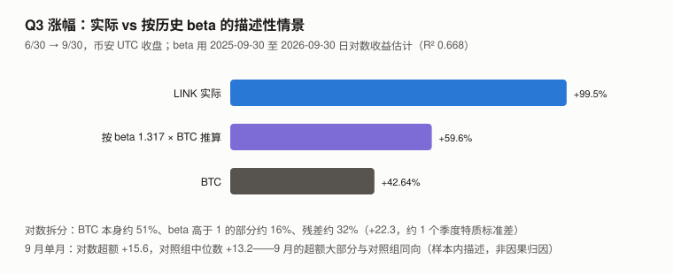
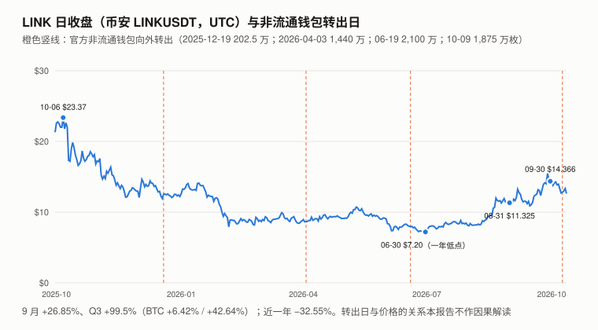
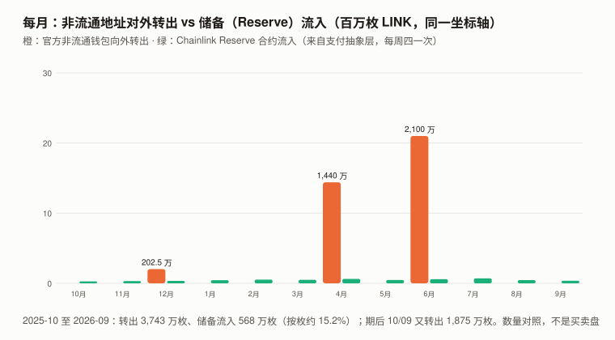

# LINK / Chainlink 完整调研与分析报告（2026 年 9 月版，首期）

> **编写日期**：2026 年 10 月 13 日
> **数据截止**：2026 年 9 月 30 日；链上快照到 10/12
> **研究方法**：沿用本系列框架。价格用 **币安 LINKUSDT 日线 UTC 收盘**；超额收益用对数口径（ln 收益 − beta × ln BTC 收益，不扣截距）。链上数据用 Blockscout 公开接口与以太坊公开 RPC 直读。
> **本期为 LINK 首期报告**，本系列第十七个资产，也是第一个**预言机 / 跨链中间件**代币。
>
> **接入新资产的第一步：三个默认还成立吗**（XIN 期教训）：
>
> | 检查 | 结果 | 依据 |
> |---|:---:|---|
> | **流通量已知吗** | ✅ **已知，且本报告独立复核到个位** | 官方供应接口 `supply.chain.link/supply` = 10 亿 − 官方列出的 33 个非流通钱包余额；**本报告用以太坊 RPC 在区块 26,180,016 逐个直读这 33 个钱包，合计与官方接口给出的余额之和到 wei（18 位小数）完全一致：233,150,029.575… 枚**；⚠️ 这只确认当前截面，历史流通量是「按冻结地址集合重建」（4.1） |
> | **价格是可用的测量吗** | ✅ 可用 | 币安等多家交易所深度成交；一年 R² 0.668 |
> | **代币持有人是剩余索取权人吗** | ❌ **没有找到赋予利润请求权的文件** | LINK 是支付与质押代币；**Chainlink Reserve（储备）是官方控制的时间锁合约**，官方原文「预计多年内不会从储备提取」——**这是收入转换与积累的储备，不是持有人的现金流请求权** |
>
> **本期核心发现**：
> 1. **Q3 +99.5%（对数 0.691）的描述性拆分**：BTC 本身（beta 取 1）约占 **51%**，beta 高于 1 的部分约 **16%**，残差约 **32%**（对数超额 +22.3 个点，约一个季度特质标准差 21.0，不显著但非零）。⚠️ 这是按样本内历史 beta 的描述，不是因果归因。**9 月**单月对数超额 +15.6，**9 个山寨对照组中位数是 +13.2**——9 月的超额大部分与对照组同向。
> 2. **非流通供应的释放是阶梯式的，不是每月线性**：本报告逐笔扫描 33 个官方非流通钱包自 2025-07 以来的全部 LINK 转账——**对外转出只发生在四天**：2025-12-19（202.5 万）、2026-04-03（1,440 万）、**06-19（2,100 万）**、**10-09（1,875 万）**。**Q3 与 9 月当月转出为零**。**2025-10-01 至 2026-09-30（12 个月）合计 3,743 万枚，约总量的 3.7%**，约为官方页面「每年总量的 7%」的一半；期后 10/09 又转出 1,875 万枚（含它的 12.4 个月为 5,618 万、总量的 5.6%）。
> 3. **转出去向**：四次合计 5,618 万里有 **4,503 万（80%）转入一个被标记为币安充值地址的地址**，每笔 2–11 分钟内被归集到热钱包 `0x28C6…1d60`（Etherscan 标签「Binance 14」、Blockscout 标签「Binance: Hot Wallet」；充值地址身份依赖 Blockscout 标签与归集行为）；**其余 1,115 万转入一个多签钱包**，之后按月向另一个多签转出约 50–61 万枚。**进入交易所 ≠ 卖出**（也可能是托管、场外或做市安排），**本报告无法区分**。
> 4. **Chainlink Reserve 9/30 持有 6,047,498 枚**（10/12 为 6,204,682），自 2025-08 启动以来观察期内除 2025-08 一笔 1 枚的小额转出外未见转出；**每周四入账一次（2025-08-07 起 63 笔全部在周四，其中 8/07 一天两笔；2025-09 至 10/08 共 58 次，即每个周四一次），每次约 $96–121 万**；9 月流入 373,791 枚、约 **$447 万**。**数量对照**：2025-10 至 2026-09 储备流入 568 万枚，同期非流通钱包对外转出 3,743 万枚——**按枚约 15%、按转账日估值约 19%**；若把期后 10/09 一笔也算进来（12.4 个月），约 10%–11%。
> 5. **一个口径坑**：DefiLlama 把储备的资金流列在 **「Chainlink Staking」** 名下（9 月 Fees $434 万），**但它的方法说明写的是「费用聚合合约收到的代币」与「转入储备的 LINK」——不是质押奖励**。按名字读会把它当成质押收益。
>
> **本期核心判断**：**储备的 LINK 流入可测、稳定（每周约 $110 万）、观察期内几乎没有转出；官方非流通地址的对外转出是阶梯式的、80% 进入被标记为币安的地址。按 2025-10 至 2026-09 的数量对照，前者约为后者的一成半到两成（含期后 10/09 一笔约一成）。转出的最终去向（出售、做市、托管）链上分辨不了，所以这是数量对照，不是买卖盘对比。** 9 月的超额大部分与对照组同向；Q3 约一半是 BTC 本身、约三分之一是不显著的残差。本报告不把价格归因于具体事件。
> **本报告不给目标价**：持有人没有现金流请求权；储备不归持有人；释放节奏由 Chainlink 方面决定，本报告只能观测、不能预测。
>
> **免责声明**：本报告不构成任何投资建议。所有分析仅供研究参考，投资决策请咨询专业顾问。

---

## 核心结论摘要（一页速览）

| 维度 | 核心判断 |
|------|----------|
| **LINK 是什么** | Chainlink 预言机、跨链（CCIP）等服务的**支付与质押代币**；总量上限 10 亿 |
| **9/30 收盘** | **$14.366**（币安）；按 9/30 流通 7.481 亿枚，**市值约 $107.5 亿**；FDV 约 $143.7 亿 |
| **9 月 / Q3 / 近一年** | **+26.85% / +99.50% / −32.55%**（BTC +6.42% / +42.64%） |
| **一年 beta / R² / 波动率** | **1.317 / 0.668 / 72.6%**（BTC 同期 45.1%） |
| **对数超额** | 9 月 **+15.6**（对照组中位数 +13.2）；Q3 **+22.3**（对照组中位数 +2.8） |
| **距历史高点** | **−72.7%**（CoinGecko 历史高点 $52.70，2021-05-09） |
| **供应** | 流通 **7.481 亿**（9/30）→ **7.668 亿**（10/09 转出后）；**Q3 无释放**；2025-10 至 2026-09 转出 3,743 万枚（期后 10/09 另 1,875 万） |
| **转出去向** | **80% 进入被标记为币安充值地址的地址**（进交易所 ≠ 卖出）；20% 进入多签 |
| **Reserve** | 9/30 **6,047,498 枚**（流通量的 0.81%）；9 月流入约 $447 万；每周四入账一次；观察期内除 1 枚外未见转出 |
| **持有人权益** | **无利润请求权**；可质押（社区池合约余额 40,875,544 枚，略超 4,087.5 万上限——说明余额 ≠ 登记质押额） |
| **估值** | **不给目标价**（第 9 章） |

---

## 1. LINK 是什么

### 1.1 代币的用途

| 用途 | 状态 | 来源 |
|------|------|------|
| **支付 Chainlink 服务** | 现行；**非 LINK 付款经「支付抽象层（Payment Abstraction）」换成 LINK**，进入储备 | ✅ 官方储备公告（2025-08-07） |
| **质押（Staking v0.2）** | 现行：社区池上限 4,087.5 万枚，**10/12 合约 LINK 余额 40,875,544 枚**（ERC-20 余额 ≠ 登记质押额，可能含直接转入；**是否满池应读合约的质押总额，本期未读**）；节点运营商池余额 1,649,647 枚 | ✅ 余额链上直读（Blockscout 合约名 `CommunityStakingPool` / `OperatorStakingPool`） |
| **质押奖励** | 由 `RewardVault` 合约发放，10/12 余额 2,682,227 枚。**v0.2 上线时（2023-12）官方参数**：社区基础奖励率 4.5%，其中 4% 分给节点运营商，**社区有效基础率 4.32%**；初期为发放型奖励（来自既有供应，不是新铸），长期拟转向用户费用。**2026 年的当前参数与 RewardVault 的补款来源本期未核实** | ✅ 官方 v0.2 说明（启动参数）；⚠️ 当前参数未核实 |
| **利润请求权** | ❌ 没有找到赋权文件 | — |

### 1.2 Chainlink Reserve（储备）

| 项 | 内容 | 来源 |
|---|---|---|
| 启动 | 2025-08-07 公告；启动时「已累积超过 $100 万的 LINK」 | ✅ 官方博客原文 |
| 资金来源 | **大型企业的链下收入 + 链上服务使用费**；质押保障的 SVR 服务费用的一半也计划经支付抽象层进入 | ✅ 官方博客原文 |
| 转换方式 | 非 LINK 付款通过 CCIP 汇集到以太坊、Automation 触发、Price Feeds 定价，**首个 DEX 为以太坊上的 Uniswap V3** | ✅ 官方博客原文 |
| 提取 | 「**预计多年内不会从储备提取**」；合约有「多日时间锁」 | ✅ 官方博客原文 |
| 合约 | `0x9A709B7B69EA42D5eeb1ceBC48674C69E1569eC6`，**Blockscout 合约名 `RBACTimelock`** | ✅ 链上 |

> **储备对持有人意味着什么**：它是一个**由 Chainlink 方面控制、承诺「多年不提」的 LINK 收入转换与积累储备**。
> 它把 LINK 移出可交易余额，**但不是持有人的现金流**——持有人对储备里的 LINK 没有任何请求权，「多年不提」是意向表述，不是合约约束（时间锁只延迟、不禁止）。
> ⚠️ **储备流入 ≠ 全部是公开市场买入**：官方原文写明储备也接收**已经以 LINK 支付的收入**，非 LINK 付款才经 Uniswap V3 兑换——**流入中有多少是新增市场买盘，本报告没有逐笔追踪兑换交易**。

---

## 2. LINK 的发展阶段划分

| 阶段 | 时间 | 特征 |
|------|------|------|
| ICO 与主网 | 2017–2019 | 2017 年 ICO 出售 3.5 亿枚；**节点运营商与生态激励 3.5 亿、公司 3 亿** |
| 预言机标准化 | 2020–2022 | DeFi 喂价成为事实标准；2021-05 历史高点 $52.70 |
| 质押与 CCIP | 2022–2024 | Staking v0.1（2022-12）、v0.2（2023-12）；CCIP 上线 |
| **机构与储备** | 2025– | **储备启动（2025-08）**；**灰度 GLNK 2025-12-02 在 NYSE Arca 上市**（该产品 2021-02 以私募设立、2022-05 起在 OTC 交易——**原有持仓不是上市后新增的买盘**）；**Bitwise CLNK 2026-01-14 上市**（管理费 0.34%）；两只 ETF 的当前 LINK 持仓与净申赎本期未取得——**需求侧覆盖不完整** |

> 初始分配比例来自官方白皮书与广泛引用的资料，**本期未重新打开 2017 年白皮书逐字核对**——它不影响本期任何测量。

---

## 3. LINK 当前现状

### 3.1 价格与市场

| 指标 | 数值 |
|------|------|
| 6/30 / 8/31 / 9/30 收盘 | **$7.201 / $11.325 / $14.366** |
| 9 月区间（收盘） | $10.887 – $15.452 |
| 9 月 / Q3 / 近一年 | **+26.85% / +99.50% / −32.55%** |
| BTC 同期 | +6.42% / +42.64% / — |
| 近一年收盘高 / 低 | **$23.37（2025-10-06）/ $7.201（2026-06-30）** |
| 一年 beta / R² | **1.317 / 0.668**（n = 365 个日对数收益） |
| 年化波动率 | **72.6%**（BTC 45.1%） |
| 特质波动（月 / 季） | 约 12.0 / 21.0 个对数点（独立日残差假设） |

**对数超额收益**（对照组为本系列 9 个山寨：ZEC / UNI / ADA / SOL / BNB / ETH / TRX / CKB / DOT）：

| | 7 月 | 8 月 | 9 月 | Q3 |
|---|---:|---:|---:|---:|
| LINK | +3.4 | +3.3 | **+15.6** | **+22.3** |
| 对照组中位数 | +1.7 | −3.3 | +13.2 | +2.8 |
| LINK − 对照组中位数 | +1.7 | +6.6 | **+2.4** | **+19.5** |

> **9 月**：+15.6 约 1.3 个月度特质标准差，**但对照组中位数也有 +13.2**（ZEC、UNI、DOT 都在 +29 以上）——**9 月 LINK 相对对照组中位数只高 2.4 个对数点**。
> **Q3**：+22.3 约 1.06 个季度特质标准差；相对对照组中位数 +19.5，是描述性差值。⚠️ **中位数不能跨月相加**：三个月的月度中位数之和是 +11.6，季度中位数是 +2.8——按前者算差值约 +10.7，**所以「相对对照组」的数字在 +10 到 +20 之间，取决于怎么聚合**。
> **按历史 beta 的描述性情景**：BTC Q3 +42.64% × beta 1.317（对数口径）对应约 **+59.6%**，实际 +99.5%。
> **Q3 的对数拆分**（总计 0.691）：BTC 本身（beta = 1）0.355，约 51%；beta 高于 1 的部分 0.113，约 16%；残差 0.223，约 32%。**R² 是日收益的方差解释比例，不是季度涨幅的归因比例**——这里只是样本内、不扣截距的描述。
> **Q3 起点是一年最低收盘（6/30 $7.201）**，距 6/19 那次 2,100 万枚的释放 11 天。**本报告不对这个时间关系作因果解读**——一次观测、无对照。

### 3.2 9 月的事件

| 日期 | 事件 | 来源等级 |
|---|---|---|
| 9/17 | Bottomline 发布 Global Pay Connect，与 Chainlink 签订**「战略合作协议」**（初稿写「成立合资」，官方原文没有合资实体） | ✅ Bottomline 官方新闻稿 |
| 约 9/22 | 与 Infosys 的战略合作 | ⚠️ 二手；Infosys 官方合作页 403，**是否限于 Finacle 平台未核实** |
| 9/28 | **CCIP 2.0**：机构可运行自己的跨链验证者（CCV），默认委员会验证者与独立 CCV 都签名后才执行；接入自动合规引擎（ACE）；第三方验证者可在基础费率之上加收验证费。**官方称 CCIP「保障的跨链代币总价值超过 $840 亿」——这是存量口径，不是成交量或收入**；原文没有提到 LINK 付款、支付抽象层或储备 | ✅ 官方博客（2026-09-28） |
| 9/28 | Swift 相关的区块链账本连接公告 | ⚠️ 官方新闻列表有条目，未打开 |
| 9/30 | **Chainlink Fulcrum**：「面向机构融资与抵押品管理的端到端方案」；**DTCC** 计划用 Chainlink 运行环境（CRE）建抵押品应用链；文中引用 **Citi** 的估计：约四分之一的机构抵押品处于闲置 | ✅ 官方博客（2026-09-30） |

> **这些事件本报告不用来解释价格**：9 月的超额大部分与对照组同向（3.1），事件与价格之间没有判别性检验。**合作 ≠ 付费**：这些公告都没有披露经储备体现的收入。

### 3.3 宏观环境

与 BTC 9 月版共用（美联储 9/16 加息 25bp 至 3.75–4.00%）。9 月 BTC +6.42%、Q3 +42.64%；LINK 的 R² 0.668 是本系列较高的一档——**它的价格大部分是加密整体的函数**。

---

## 4. 供应：阶梯式释放（本期核心章之一）

### 4.1 方法

1. 官方非流通钱包清单：`chain.link/circulating-supply` 列出 **33 个地址**（「旧钱包」与「新钱包」）；
2. 当前余额：以太坊 RPC 在区块 26,180,016 逐个调用 `balanceOf`，**合计 233,150,029,575,116,038,759,470,557 wei，与官方接口逐地址余额之和完全相等**（地址清单见 11.5）；
3. 历史：公开 RPC 不提供历史状态，**改为逐个地址拉取 2025-07 以来的全部 LINK 转账（Blockscout）**，剔除 33 个地址之间的内部划转，只看对外流动；
4. **期间没有来自清单外的非零转入**（只有零值转账），所以历史流通量 = 当前流通量 − 之后的转出。**这是「按冻结地址集合重建」**：前提是这 33 个地址在历史上一直代表非流通池，Blockscout 分页已拉全（每个地址拉到 2025-07-01 之前为止）。

### 4.2 结果：四天，四次

| 日期（UTC） | 转出（枚） | 去向 | 当日收盘 | 约合 |
|---|---:|---|---:|---:|
| 2025-12-19 | 2,025,000 | 多签 `0xD50f…78Af` | $12.54 | $2,540 万 |
| 2026-04-03 | **14,400,000** | 币安充值地址 977.5 万；多签 462.5 万 | $8.65 | $1.25 亿 |
| 2026-06-19 | **21,000,000** | 币安充值地址 1,837.5 万；多签 262.5 万 | $7.95 | $1.67 亿 |
| 2026-10-09 | **18,750,000** | 币安充值地址 1,687.5 万；多签 187.5 万 | $12.81 | $2.40 亿 |
| **合计** | **56,175,000** | **币安 4,502.5 万（80%）；多签 1,115 万（20%）** | — | **约 $5.57 亿** |

（每次大额前都有一笔 1 枚的测试转账，表中已并入。）

| 流通量（由当前值倒推） | 枚 |
|---|---:|
| 2025-10-01 | 710,674,970 |
| 2026-06-30 / 8/31 / 9/30 | **748,099,970**（Q3 不变） |
| 10/09 之后 | **766,849,970**（= 官方当前值） |

> **2025-10-01 至 2026-09-30 转出 3,743 万枚 = 总量的 3.7%**；**官方页面写的是「代币释放节奏目前为每年总量的 7%」**——日历 12 个月窗口的实测约为它的一半；把期后 10/09 一笔算进来（12.4 个月）是 5.6%。**块状释放让「年化」对窗口边界非常敏感。**
> **Q3 与 9 月当月没有释放**，所以 9 月的市值变化全部来自价格。
>
> ⚠️ **CoinGecko 的流通量历史与本报告的倒推在 2026-04 之前不一致**（例如它在 4/02 先跳到 7.481 亿、4/11 又回到 7.271 亿，4 月前比本报告低约 460 万）——**4 月之后两者吻合**。本报告以官方钱包清单为准；CoinGecko 早期的差异可能来自它当时使用的钱包清单不同，**未核实**。

### 4.3 去向：币安充值地址

- 接收地址 `0x9B1c…cDE9`：**Blockscout 标签「Binance: Deposit Address」**；
- **行为**：每一笔进来的 LINK 都在 **2–11 分钟内**以相同金额（或几笔合并后）转到 `0x28C6c06298d514Db089934071355E5743bf21d60`——**Etherscan 标签「Binance 14」、Blockscout 标签「Binance: Hot Wallet」**；这是交易所充值地址的典型归集模式。
- **两类相互支持的证据，但不完全独立**：热钱包身份有两个浏览器的标签；充值地址的身份依赖 Blockscout 标签与归集行为（这类标签本身常由归集行为生成）。

> **能说的**：**转出的 LINK 有 80% 进入了被标记为币安充值地址的地址，并被归集到币安热钱包**。
> **不能说的**：**进入交易所 ≠ 在公开市场卖出**。可能的用途包括出售、场外交易、做市借贷、交易所托管——**链上看不出来**，本报告也没有找到 Chainlink 方面对这几笔转账的说明。
>
> 多签 `0xD50f…78Af` 自 2026-01 起**约每月一次**向另一多签 `0x7A28…14a3` 转出 50 万或 60.75 万枚，后者再转往两个多签；**最终用途（节点运营商付款、质押奖励、生态拨款）本期未核实**。

---

## 5. 价值捕获：储备（本期核心章之二）

### 5.1 储备的流入

| 月份 | 流入（枚） | 次数 | 约合（当日收盘计） |
|---|---:|---:|---:|
| 2025-10 | 280,066 | 5 | $530 万 |
| 2025-11 | 322,667 | 4 | $447 万 |
| 2025-12 | 348,359 | 4 | $454 万 |
| 2026-01 | 452,104 | 5 | $567 万 |
| 2026-02 | 527,141 | 4 | $448 万 |
| 2026-03 | 494,134 | 4 | $447 万 |
| 2026-04 | 639,658 | 5 | $583 万 |
| 2026-05 | 475,930 | 4 | $463 万 |
| 2026-06 | 593,089 | 4 | $462 万 |
| 2026-07 | 706,809 | 5 | $575 万 |
| 2026-08 | 462,730 | 4 | $448 万 |
| **2026-09** | **373,791** | 4 | **$447 万** |
| 10/01–10/12 | 157,183 | 2 | $212 万 |
| **9/30 余额** | **6,047,498** | — | 约 $8,690 万 |

- **2025-09 起实质上全部来自同一个合约** `0x5680…171d`（Blockscout 名称「Reserves」，支付抽象层；其余 4 笔合计不到 1 枚，含钓鱼广告粉尘；启动前后的 2025-07/08 另有 7 个地址的转入）；**观察期内除 2025-08 一笔 1 枚的小额转出外未见转出**（其「测试」用途是推测）——10/12 合约余额 6,204,682 枚，等于累计流入减 1；
- **次数只计来自 `0x5680…171d` 的入账**（初稿的 5 月、8 月各多计了一笔粉尘）；**2025-09 至 10/08 共 58 次，恰好是这段时间的全部 58 个周四**（若从 2025-08-07 算起是 63 笔，8/07 一天两笔，全部在周四）；
- **美元流入很稳定：每次约 $96–121 万**；按季度：13 次 / $1,430 万、13 次 / $1,463 万、13 次 / $1,507 万、13 次 / $1,470 万（每次平均 $110 万、$113 万、$116 万、$113 万）。

> **一个「季度规律」其实是日历**：DefiLlama 的月度序列在 1、4、7、10 月偏高（约 $575 万），看起来像季度结算；**逐笔看，那几个月恰好有 5 个周四**——是每周四入账一次的节奏落在月份里的结果，**不是季度收入**。⚠️ **2026 Q4 有 14 个周四**（10 月 5 个、12 月 5 个），按现有节奏 Q4 合计自然会比前四季多约 $110 万——**跨季度比较要用「每次平均」，不能用季度合计**。
> **以 LINK 计的流入随价格反向波动**（价格低时买得多）——**说明储备买入大致是固定美元金额**。

### 5.2 口径坑：DefiLlama 的「Chainlink Staking」不是质押

| DefiLlama 项目 | 方法说明原文 | 9 月 |
|---|---|---:|
| Chainlink（父项目）Fees | 子项目合计 | $448 万 |
| └ **Chainlink Staking** | Fees：「费用聚合合约收到的全部代币」；Revenue：「从支付抽象层转入储备合约的全部 LINK」；HoldersRevenue：「由各类链下与链上收入资助的 LINK 回购」 | Fees **$434 万**；Revenue **$446 万** |
| └ Chainlink Requests | 「全部 LINK 付款直接归履约的预言机节点运营商」 | 约 $14 万 |

> **按名字读，会以为 $434 万是质押者的收益；按方法说明，它是进入储备的资金流**（它的 Revenue 序列 9 月 $446 万，与本报告逐笔加总的 $447 万几乎一致；Fees 序列 $434 万略低）。
> **它也不是 Chainlink 的全部收入**：企业链下收入只有**被换成 LINK 进入储备的那部分**被测到，Chainlink Labs 的其余收入不公开。
> 这是本系列第七个口径坑，性质与 ADA（L1 费 ≠ 生态合计）相近：**数据商的标签与它实际测的东西不一致**。

### 5.3 供需对照

| 窗口 | 非流通对外转出（枚 / 转账日估值） | 储备流入（枚 / 入账日估值） | 储备 ÷ 转出（按枚） | （按估值） |
|---|---:|---:|---:|---:|
| **2025-10-01 至 2026-09-30（主口径）** | 37,425,000 / 约 $3.17 亿 | 5,676,479 / 约 $5,870 万 | **约 15.2%** | **约 18.5%** |
| 2025-10-01 至 2026-10-12（含期后 10/09，12.4 个月） | 56,175,000 / 约 $5.57 亿 | 5,833,662 / 约 $6,080 万 | 约 10.4% | 约 10.9% |
| 主口径中只算进入币安的部分 | 28,150,000 | 同上 | 约 20.2% | — |

> **这是数量对照，不是买卖盘对比**：转出的最终用途链上分辨不了（4.3），储备流入也不全是市场买入（1.2）。
> **块状释放让比值对窗口边界非常敏感**：多装进或少装进一次释放，比值就差一倍——**可辩护的说法是「一成到两成」**。
> **历史规模对照**：主口径下转出的估值约为储备流入的 5.4 倍；含期后一笔约 9 倍。**这是历史估值比，不是未来需求门槛**——未来价格、释放量与实际出售比例都未知。

---

## 6. LINK 与其他资产的比较

| | LINK | UNI | OKB |
|---|---|---|---|
| 价值捕获机制 | **收入转换为 LINK 并积累于储备（不分配）** | 费用开关（协议费销毁） | gas 进金库 |
| 持有人现金流请求权 | ❌ | ❌ | ❌ |
| 9 月可测的协议层 LINK 流入 | 约 $447 万（储备） | — | — |
| 供应 | **阶梯释放中**（流通 76.7%） | — | 发行方口径固定 |
| 一年 beta / R² | **1.317 / 0.668** | — | 0.881 / 0.409 |

> UNI 的费用开关数字见本系列 UNI 报告；本表不复述，避免口径不一致。

---

## 7. 核心价值逻辑

### 7.1 多头逻辑

| # | 论据 | 强度 | 证据等级 |
|---|------|:---:|---|
| 1 | **储备是持续、可验证、几乎不转出的 LINK 流入**（每周四约 $110 万） | ★★★★☆ | ✅ 链上逐笔；⚠️ 不全是市场买入 |
| 2 | 质押社区池合约余额接近上限（4,087.6 万枚） | ★★☆☆☆ | ✅ 余额链上；⚠️ 余额 ≠ 登记质押额；只占流通的 5.3%，上限是人为设定 |
| 3 | 银行与基础设施合作（CCIP 2.0、Fulcrum / DTCC、Bottomline 等） | ★★☆☆☆ | ✅ 官方公告（CCIP 2.0、Fulcrum、Bottomline）；⚠️ 合作 ≠ 付费，付费多少不公开 |
| 4 | 9 月对数超额 +15.6、Q3 +22.3 | ★☆☆☆☆ | ✅ 计算；⚠️ 9 月大部分与对照组同向；Q3 约 1σ、不显著 |
| 5 | 两只现货 ETF（GLNK、CLNK）已上市 | ★★☆☆☆ | ✅ 发行方公告；⚠️ 持仓与净申赎本期未取得 |

### 7.2 空头逻辑

| # | 论据 | 强度 | 证据等级 |
|---|------|:---:|---|
| 1 | **非流通池阶梯转出、80% 进入被标记为币安的地址**；主口径 12 个月约 $3.17 亿等值 | ★★★☆☆ | ✅ 链上逐笔；⚠️ **进交易所 ≠ 卖出**，最终用途未决——**星级因此从四星降为三星** |
| 2 | 持有人没有现金流请求权；储备「多年不提」只是意向 | ★★★☆☆ | ✅ 官方原文 |
| 3 | 高 beta（1.317）：BTC 下跌时 LINK 跌得更多 | ★★★☆☆ | ✅ 计算 |

> **检查两条论据是否描述同一机制的两面**（DOT 期规则）：**多头 #1 与空头 #1 是同一个比值的分子和分母**——初稿还把两者之比单列为空头 #2，等于同一份测量计了两次，审查后删去；比值只作无方向的量级说明——
> 储备流入是真实的，**但它的量级要放在转出旁边读**：单独看「每周约 $110 万、几乎不转出」是强论据，**并排看是同期转出量的一成半到两成**。本报告的核心判断按并排的读法写，并只作数量对照。

---

## 8. 多空之间真正的分歧点

1. **转出进入交易所之后去了哪里**：卖出、做市、还是托管？链上分辨不了——这决定空头 #1 的强度（本期因此降为三星）。
2. **储备流入能不能增长**：近四个季度每次平均 $110–116 万，**几乎是常数**。⚠️ **「持平」不能判别「合作没有带来付费」与「Chainlink 按固定节奏、固定美元额兑换，与收入多少无关」**——一年里 LINK 在 $7 到 $23 之间波动，每次入账的美元额却几乎不变，后一种形态同样相容。**能说的只是：若合作带来了付费，它没有经由储备体现出来；储备是否随收入变化，本期无法判断。**
3. **释放节奏**：≥ 1,000 万枚的三次转出间隔 77 天、112 天；此前自 2025-07-01（扫描起点）到 2026-04-03 的 276 天里没有这种量级的转出（2025-12-19 只有 202.5 万）。**两个间隔不构成周期**（ZEC 期规则）。

---

## 9. 估值：不给目标价

### 9.1 为什么不给

- **充分条件**：持有人对储备与 Chainlink 收入都**没有请求权**——不存在一个归持有人的现金流可以折现；
- **加重情节**：Chainlink 的企业收入只有换成 LINK 的那部分可测；释放节奏由发行方决定。

### 9.2 当前价格要成立，什么必须为真（反推）

> **推导方法**：分子用 9/30 收盘 × 流通量（或 × 10 亿）；分母用 9 月逐笔储备流入（$447 万）× 12；释放美元值 = 每次转出量 × 当日收盘。**不推导任何价格区间。**

| 比值（9/30） | 数值 |
|---|---:|
| 市值 ÷ 年化储备流入（9 月 × 12） | 约 **200 倍** |
| FDV ÷ 年化储备流入 | 约 268 倍 |
| 主口径 12 个月转出估值 ÷ 储备流入估值 | 约 5.4 倍（含期后一笔约 9 倍） |

> 这些比值**不是估值**——储备流入不归持有人。它们只说明：**当前市值不是由已测得的储备流入支撑的；剩下的部分（使用增长预期、投机、流动性溢价……）本报告不归因。**

### 9.3 这套判断的弱点

1. **储备只测到 Chainlink 收入的一部分**——若 Chainlink Labs 的未公开收入很大，「一成半到两成」低估了长期的潜在流入（但它不归持有人这一点不变）；
2. 释放进交易所的去向不可见；
3. 非流通池剩余 2.33 亿枚，**它的释放节奏才是未来供应的承重墙**，本报告只有四次观测；
4. 两只 ETF 的持仓与净申赎没有取得，**需求侧不完整**。

---

## 10. 投资与风险启示

### 10.1 关键监控指标

| 指标 | 当前 | 警戒 / 变化信号 | 来源 |
|------|------|------|------|
| **非流通钱包余额** | 233,150,030（10/12） | 任何一次对外转出 | 官方供应接口 + RPC |
| **储备每次入账（美元）** | 约 $110 万（每周四） | 季度平均 ≥ $125 万（增长）；**季度平均 < $95 万（低于已观测单次最低 $96 万）或停止入账（收缩）** | 逐笔 / DefiLlama Revenue |
| 储备余额 | 6,204,682（10/12） | 任何一次转出 | RPC |
| 质押社区池 | 合约余额 40,875,544 | 跌破 4,000 万 | RPC（下期改读质押总额） |
| beta / R² | 1.317 / 0.668 | — | 本报告口径 |

### 10.2 风险提醒

1. **释放风险**：非流通池仍有 2.33 亿枚（流通量的 30%）；
2. **高 beta**：BTC 下跌 10%，按 beta LINK 约跌 13%；
3. **储备可提取**：时间锁只是延迟；「多年不提」是意向；
4. **数据商标签风险**：DefiLlama「Chainlink Staking」不是质押（5.2）。

### 10.3 长期认知

**第一，「几乎不转出」不等于「足够大」。** 储备的每一条性质都可验证——流入稳定、几乎不转出、来源单一。**但单独陈述一个流入的质量，不放在同期转出旁边，读者无法判断它的量级。** 而反过来，**把转出当成卖盘、把流入当成买盘，又会替一个链上分辨不了的问题作答**——本期初稿两步都走过头了，审查后改为数量对照。

**第二（审查后新增），自己揭穿的口径坑，要回头查自己的记分卡。** 本报告在 5.1 证明了「季度偏高」是周四的日历效应，**初稿的记分卡 L9-1 却用季度合计作统计量——而 Q4 恰好有 14 个周四**，什么都不变就可能过线。

**第三，转出进交易所是一个可观测的事实，卖出不是。** 本报告能做的最远一步是「80% 进了币安、几分钟内被归集」；再往前一步需要交易所内部数据。

**第四，数据商的标签要和方法说明对读。** 「Chainlink Staking」这个名字下面是储备资金流——**标签说的是协议的哪个模块，方法说明才说测的是什么**。

---

## 11. 附录

### 11.1 关键数据速查（截至 2026-09-30，快照到 10/12）

| 指标 | 数值 | 来源 |
|------|------|------|
| 9/30 收盘 | $14.366 | 币安 |
| 9 月 / Q3 / 近一年 | +26.85% / +99.50% / −32.55% | 币安 |
| beta / R² / 波动率 | 1.317 / 0.668 / 72.6% | 本报告计算 |
| 9/30 流通 / 市值 | 748,099,970 / 约 $107.5 亿 | 按冻结地址集合重建 |
| 10/12 流通 | 766,849,970 | 官方接口；RPC 在区块 26,180,016 复核到 wei |
| 非流通余额（10/12） | 233,150,030 | RPC 直读 33 个地址 |
| 储备余额 9/30 / 10/12 | 6,047,498 / 6,204,682 | Blockscout 逐笔 + 余额 |
| 9 月储备流入 | 373,791 枚 / 约 $447 万 | Blockscout 逐笔 |
| 质押社区池 / 运营商池 / 奖励金库 | 40,875,544 / 1,649,647 / 2,682,227 | Blockscout 余额 |

### 11.2 数据来源与核实状态

| 数据 | 来源 | 状态 |
|------|------|:---:|
| 价格 | 币安 LINKUSDT 日线 | ✅ |
| 非流通钱包清单 | `chain.link/circulating-supply` | ✅ 一手 |
| 非流通余额 | 以太坊 RPC `balanceOf` × 33 | ✅ 与官方接口到 wei 一致（当前截面） |
| 释放历史 | Blockscout 逐地址转账 | ✅ 一手链上（单一索引器） |
| 币安标签 | 热钱包：Etherscan「Binance 14」+ Blockscout；充值地址：Blockscout 标签 + 归集行为 | ✅ 两个浏览器（热钱包）；⚠️ 充值地址只一个标签来源 |
| 储备机制 | 官方博客 2025-08-07 | ✅ 一手 |
| 储备流入 | Blockscout 逐笔；DefiLlama 交叉 | ✅ 两者相差约 3% |
| 9 月事件 | CCIP 2.0、Fulcrum、Bottomline 官方原文；Infosys、Swift 未打开 | ✅ / ⚠️ |
| 质押奖励来源与年化 | — | ❌ 未核实 |
| ETF | 灰度 GLNK（GlobeNewswire 发行方新闻稿）、Bitwise CLNK（发行方新闻页） | ✅ 上市日期；❌ 持仓未取得（灰度网站 429） |

### 11.3 来源偏向声明

- 空头论据（转出、去向）全部来自链上一手数据，**但「卖出」这一步没有数据，空头 #1 已降为三星（原空头 #2 作为重复计数已删除）**；多头论据中「银行合作」一条有官方公告，但「合作 ≠ 付费」，维持两星。
- **链上数据只来自一个索引器（Blockscout）**；当前余额已用 RPC 独立复核，历史转账未用第二个索引器复核。
- **传统金融机构视角**：本期引用了**美联储**政策；Fulcrum 公告引用了 **Citi** 对闲置抵押品的估计；未找到传统金融机构对 LINK 的当期研究覆盖。

### 11.4 发布前审查记录

**第 1 层 自动核查**（`tools/verify_report.py`）：初稿 5 FAIL（缺速查与记分卡、图表标签数字与正文不一致、缺推导说明、缺传统金融来源）→ 修正后 0 FAIL。

**第 2–3 层 _bian / Codex（第一轮）**：

| # | 意见 | 出处 | 处理 |
|---|------|:---:|------|
| 1 | **把「非流通转出」写成卖盘、把「储备流入」写成买盘**；「抵消」「主导力量」替 4.3 声明分辨不了的问题作了答；储备也接收已以 LINK 支付的收入 | 两者 | ✅ 全文改为「数量对照」；1.2 补官方原文；空头 #1、#2 降为三星 |
| 2 | **「十分之一」是四个可算比值里最低的，靠把窗口延长到截止日之后吞进 10/09 一笔**；与 9.2 的 5.4 倍打架；「量级一致」（5.6% vs 7%）也靠这次延长 | 两者 | ✅ 主口径改为 2025-10 至 2026-09（15.2% / 18.5%），期后另列；核心判断改为「一成半到两成」；实测年释放改为总量 3.7% |
| 3 | **记分卡 L9-1 用季度合计，而 5.1 自己证明了季度差异是周四个数——Q4 有 14 个周四，什么都不变就可能过线** | _bian | ✅ **逐笔核实：2025-08-07 起 63 笔全部在周四（2025-09 至 10/08 为 58 次，每个周四一次）**；L9-1 改为「每次平均」 |
| 4 | 储备月表 5 月、8 月写 5 次，与正文对不上 | _bian | ✅ 粉尘多计了一笔，已改为 4 次 |
| 5 | L9-3 预测「一次」、检验「合计」，不同构；概率依据用了不达标的 12-19 一笔、漏了 276 天空档 | 两者 | ✅ 改为「任一 UTC 日 ≥ 1,000 万枚」，概率重估 |
| 6 | 「Q3 大部分是高 beta」：按对数拆，beta 高于 1 的部分只占约 16%，比残差（32%）还小；Q3 的「板块」说法被表否定；中位数不能跨月相加 | _bian；Codex | ✅ 改为三段拆分 + 聚合敏感性；删「自身部分」 |
| 7 | 「持平说明合作只是叙事」——储备持平对两种假设似然比约为 1 | _bian | ✅ 8.2 改为「若有付费，没有经由储备体现」 |
| 8 | 「市值定价的是使用增长预期」把残差当成具体原因 | _bian | ✅ 改为不归因 |
| 9 | Bottomline 不是合资（官方原文为「战略合作协议」）；CCIP 2.0、Fulcrum 有官方原文；$840 亿是存量口径 | Codex | ✅ **三篇官方原文已打开核实**，3.2 重写 |
| 10 | ETF 遗漏：GLNK 2025-12-02、Bitwise CLNK 2026-01-14 | Codex | ✅ 两份发行方公告已打开；GLNK 自 2021 年起就有持仓，不是上市后新增 |
| 11 | 余额 ≠ 质押额；v0.2 启动奖励参数官方可查 | Codex | ✅ 1.1 改写 |
| 12 | 「两条独立依据」「逐位吻合」「零流出」说过头 | 两者 | ✅ 热钱包补 Etherscan「Binance 14」；RPC 复核改为到 wei、注明区块；零流出改为「除 1 枚外未见转出」；附 33 个地址清单 |

**第二轮（复审修订稿）**：

| # | 意见 | 出处 | 处理 |
|---|------|:---:|------|
| 1 | **空头 #2「储备 ÷ 转出」是多头 #1 与空头 #1 的比值，撤回「转出 = 卖盘」后它没有方向，同一份测量计了两次** | _bian | ✅ 删去，比值只作量级说明 |
| 2 | L9-1 论点写「Q4」、检验窗口从 10/13 起，不同构；零次入账未定义 | Codex | ✅ 论点改为「冻结后至年底」；样本数 0 判 ❌ |
| 3 | L9-1 只限定了 ❌ 的读法；押的是可廉价制造的 ✅ 方向，缺判 ✅ 前的排查 | _bian | ✅ 补对称限定与排查步骤 |
| 4 | **L9-3 的 25% 与自己列的依据方向相反**（每 156 天一次 → 80 天窗口泊松约 40%；间隔法 1/3–1/2）；「80 天短于最短间隔加三天」锚点错 | 两者 | ✅ 改为 35%，间隔改以 10/09 为锚 |
| 5 | **「战绩另列」是单个资产里临时新设的类别**，系列规则未定义，且与规则 ①（已声明的缺陷照常计分）冲突 | _bian | ✅ **撤回**，L9-1、L9-3 照常计入；CC 记分卡同步撤回 |
| 6 | 「63 次」起点写错：2025-08-07 起 63 笔，2025-09 至 10/08 为 58 次 | 两者 | ✅ 已更正 |
| 7 | 监控指标丢了下行信号 | _bian | ✅ 补「季度平均 < $95 万」 |
| 8 | 「买入囤积」「只进不出」「接近上限」残留；速查第 3 句括号位置 | 两者 | ✅ 已改 |

_bian 抽查第二轮修订：通过（11.3 一处「空头 #1、#2」残留已改）；结论「可发布，不需要再审」。

**第 4 层 _dalin**：待审。

### 11.5 官方非流通地址清单（冻结于 2026-10-13，区块 26,180,016）

1. `0x98c63b7b319dfbdf3d811530f2ab9dfe4983af9d`
2. `0x75398564ce69b7498da10a11ab06fd8ff549001c`
3. `0x5560d001f977df5e49ead7ab0bdd437c4ee3a99e`
4. `0xbe6977e08d4479c0a6777539ae0e8fa27be4e9d6`
5. `0xdad22a85ef8310ef582b70e4051e543f3153e11f`
6. `0xe0362f7445e3203a496f6f8b3d51cbb413b69be2`
7. `0x5A8e77bC30948cc9A51aE4E042d96e145648BB4C`
8. `0xe0b66bFc7344a80152BfeC954942E2926A6FcA80`
9. `0xa42D0A18B834F52e41bEDdEaA2940165db3DA9a3`
10. `0x276F695b3B2C7f24E7CF5b9d24e416a7f357aDb7`
11. `0x5Eab1966D5F61E52C22D0279F06f175e36A7181E`
12. `0x959815462EeC5fFf387A2e8a6871d94323D371de`
13. `0xb9b012cad0A7C1b10CbE33a1B3F623b06fAD1c7C`
14. `0xfB682b0dE4e0093835EA21cfABb5449cA9ac9e5e`
15. `0x3264225f2Fd3bb8D5DC50587EA7506aA8638B966`
16. `0x8d34d66bDb2d1d6ACd788A2d73d68e62282332e7`
17. `0x4a87ecE3eFffCb012fbE491AA028032e07B6F6cF`
18. `0x57Ec4745258e5A4C73d1A82636dc0FE291e3eE9F`
19. `0x37398A324d35c942574650B9eD2987BC640BAD76`
20. `0xD321948212663366503E8dCCDE39cc8e71C267c0`
21. `0x55b0ba1994d68C2AB0C01C3332eC9473de296137`
22. `0xD48133C96C5FE8d41D0cbD598F65bf4548941e27`
23. `0x9c17f630DBde24eECe8fd248fAA2E51f690FF79B`
24. `0x35a5dc3FD1210Fe7173aDD3C01144Cf1693B5E45`
25. `0x0DFfD343C2D3460a7EAD2797a687304Beb394ce0`
26. `0x76287e0F7b107d1C9f8f01D5aFac314Ea8461a04`
27. `0x9BBb46637A1Df7CADec2AFcA19C2920CdDCc8Db8`
28. `0x7594Eb0ca0a7f313bEFD59AfE9e95c2201a443e4`
29. `0x8652Fb672253607c0061677bDCaFb77a324DE081`
30. `0x157235A3cc6011d9C26A010875c2550246aAbcCA`
31. `0xa71bbBd288a4e288CfDC08bb2E70DCd74Da4486D`
32. `0xEc640A90e9A30072158115B7C0253f2689ee6547`
33. `0x2a6AB3B0C96377bd20AE47E50ae426A8546A4Ae9`
