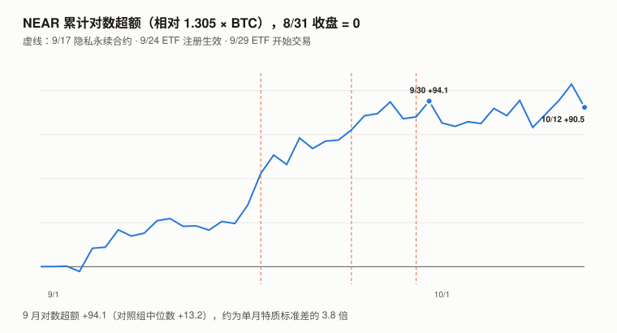
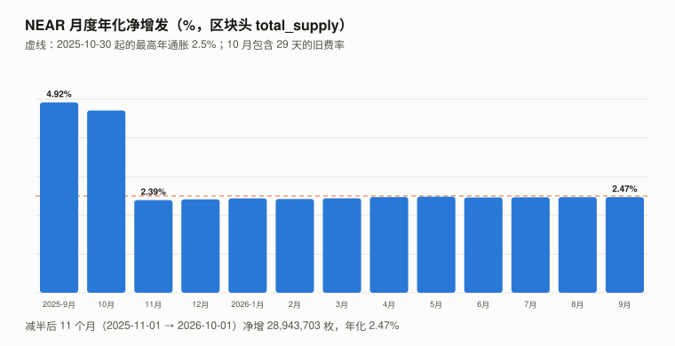
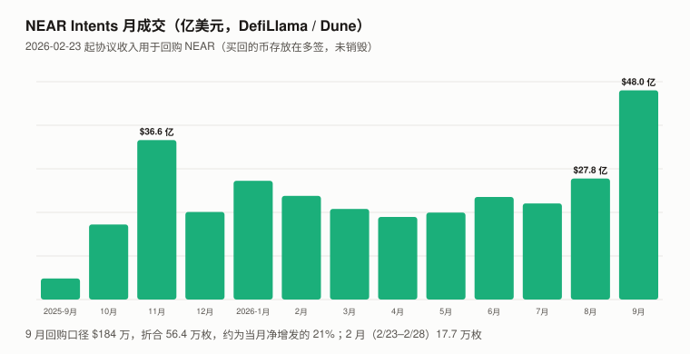

# NEAR / NEAR Protocol 完整调研与分析报告（2026 年 9 月版，首期）

> **编写日期**：2026 年 10 月 13 日
> **数据截止**：2026 年 9 月 30 日；链上快照到 10/13
> **研究方法**：沿用本系列框架。价格用**币安现货 NEARUSDT 日线 UTC 收盘**；超额收益用对数口径（ln 收益 − beta × ln BTC 收益，不扣截距）；对照组为本系列 9 个山寨（ZEC、UNI、ADA、SOL、BNB、ETH、TRX、CKB、DOT）。**一手数据**：NEAR 存档节点（`archival-rpc.mainnet.fastnear.com`，并用 `archival-rpc.mainnet.near.org` 复读同一区块）的区块头 `total_supply`、`validators`、`EXPERIMENTAL_protocol_config`、账户余额；nearcore 发布说明；SEC 文件（Bitwise NEAR ETF）；币安现货与永续接口；DefiLlama（手续费数据来自 Allium，Intents 数据来自 Dune）。
> **本期为 NEAR 首期报告**，本系列第二十一个对象。
>
> **接入新资产的第一步：三个默认还成立吗**（XIN 期教训）：
>
> | 检查 | 结果 | 依据 |
> |---|:---:|---|
> | **流通量已知吗** | ✅ **总量可直读，两条独立路径相容** | 区块头 `total_supply` 10/13 为 **1,308,809,574.8**（10/1 为 1,307,742,138.6）；CoinGecko 的流通量与总量都是约 13.088 亿（**它没有扣除任何锁定**）。供应变化 = 每个 epoch 边界的铸造 − 每个区块的手续费销毁；**按区块头推出的 9 月销毁（约 1.9 万–2.6 万枚）与 DefiLlama 按 Allium 交易数据推出的范围（2.26 万–3.24 万枚）量级相容**——两条路径的输入不同（4.2）。⚠️ 两个存档节点在 1.5 亿号区块的读数相同，**但它们可能是同一基础设施，不当作独立验证** |
> | **价格是可用的测量吗** | ✅ | 币安 9 月现货日成交中位数约 **$1.07 亿**（8 月约 $1,690 万）；一年 beta 1.305、R² 0.320、波动率 104.0% |
> | **代币持有人是剩余索取权人吗** | ❌ **没有找到赋权文件** | 手续费至少 70% 销毁（合约只拿到执行其函数所耗 gas 的 30%，其余全部销毁）；新发行全部给验证人（`protocol_reward_rate` = 0）；**2026-02-23 起 NEAR Intents 的协议收入被用于在市场上回购 NEAR**——这是一个运营项目，买回的币**存在多签账户里，没有销毁**（第 5 章），本报告没有找到任何赋予持有人权利的文件 |
>
> **本期核心发现**：
> 1. **9 月 +177.89%，本系列至今最大的单月个币异动**：对数超额 **+94.1**（对照组中位数 +13.2），约为单月特质标准差（24.6）的 3.8 倍；Q3 +199.72%、近一年 +103.16%。**涨幅分布在整个月**：9/4–9/9（未找到对应事件）、9/16–9/20（五天对数涨幅 57.7、超额 48.6，最大一小时只占约 14%）、9/24–9/30。**同期有五个可识别的事件**：9/16 Bitwise 提交 S-1/A（SEC）、9/17 基于 Hyperliquid 的「隐私永续合约」上线、9/22–9/23 Hyperliquid 上线 NEAR 现货（均为媒体报道）、9/24 Bitwise 现货 NEAR ETF 注册生效（SEC 文件）、9/29 开始交易；**同时 NEAR Intents 9 月成交约 $48.0 亿，创历史新高**。合约持仓量（按枚）9/14 → 9/22 增加 49%，资金费率基本停在默认基准值。**各因素的贡献本报告分不开**（3.2）。
> 2. **2025-10-30 的通胀减半在链上兑现了**：月度年化净增发从 **4.92%（2025-09）降到 2.39%–2.48%**（2025-11 至 2026-10）；减半后 11 个月（2025-11-01 → 2026-10-01）净增 2,894 万枚，年化 **2.47%**。协议参数 `max_inflation_rate` = 1/40；**发行按时间计、不按区块数计**（每 epoch 约 7.38 小时铸造约 2.74 万枚，折年 2.49%）——出块提速不会变成隐性增发（GRAM 期检查，4.1）。
> 3. **手续费销毁可以忽略**：9 月约 1.9 万–2.6 万枚，约为当月铸造（约 267 万枚）的 1%。
> 4. **Intents 回购口径在 9 月的入账，约为当月净增发的 21%——不减少供应**：DefiLlama（Dune 查询，与 `revenue.near.org` 同口径）的回购口径（HoldersRevenue）9 月约 **$184 万**，按日价折约 **56.4 万枚**；⚠️ 这是**收入钱包收到的 NEAR / wNEAR**，**是否构成新增的市场购买、何时执行，本报告没有逐笔核对**——21% 只是入账枚数与净增发的数量比。**买回的币存放在多签 `buybacks.multisignature.near`（10/13 余额 1,963,172 枚），没有销毁**，不减少协议净发行（9 月净增仍约 265 万枚）。对账：回购多签余额约为 2/23 以来回购口径累计（约 286 万枚）的 69%，**差约 90 万枚，去向需要逐笔流水才能定位**（4.3）。
> 5. **第一只美国现货 NEAR ETF**：Bitwise NEAR ETF（NRR）2026-09-24 注册生效，招股书写明**计划质押 100% 的 NEAR**；发行方官网显示 10/11 持有 **14,991,349 枚 NEAR**（约为总供应的 1.15%），质押比例 99%（第 6 章）。
>
> **本期核心判断**：**NEAR 9 月的上涨与可测的使用增长同时发生；按成交，价格涨得更快；按收入，本报告判断不了。** Intents 成交以美元计、主要是跨资产交易，基本不含 NEAR 自身的价格：8 月 → 9 月成交 +73%，同期 NEAR 月均价 +90%、月末价 +178%——**按月末价配成交，以过去 12 个月的任一个月为基期，多数情况下价格跑得更快**（9.2）。**收入一侧取决于 Intents 收入的计价方式**：若按成交额的美元比例收取，美元收入 +154% 就说明价格没有跑赢；若部分按 NEAR 收取，美元收入里就含有价格本身，这个比较就不成立——**本报告没有查清计价方式，收入一侧不判方向**。收入 ÷ 成交的费率从约 0.026% 升到 0.038%（10 月前 12 天 0.055%），原因也未查。**供应侧**，减半后年化净增发约 2.47%；Intents 回购口径的入账在 9 月约为净增发的 21%，但买回的币存在多签里、不减少供应。**不质押的人每年被稀释约 2.5%**（回购不改变这一点），质押者按约 42.6% 的质押率拿到约 5.9% 的毛奖励。
> **本报告不给目标价**：持有人没有请求权，回购是可撤销的运营项目；市值（9/30）÷ 年化捕获收入按收入窗口不同在约 316–984 倍之间，没有可依赖的倍数参照。⚠️ 没有请求权削弱的是收入倍数法，不排除基于质押安全需求、存储锁定（NEAR 账户须按占用字节锁定余额）与可持续回购的情景估值——本报告没有做这些。
>
> **免责声明**：本报告不构成任何投资建议。所有分析仅供研究参考，投资决策请咨询专业顾问。

---

## 核心结论摘要（一页速览）

| 维度 | 核心判断 |
|------|----------|
| **NEAR 是什么** | 分片 PoS 公链的原生代币：付 gas（至少 70% 销毁）、质押（新发行全部给验证人）；生态主线是 **NEAR Intents**（跨链意图交易）与「链抽象」 |
| **9/30 收盘** | **$5.341**（币安）；按 10/1 区块头总供应 13.077 亿枚，**市值约 $69.8 亿** |
| **9 月 / Q3 / 近一年** | **+177.89% / +199.72% / +103.16%**（BTC +6.42% / +42.64% / −26.68%） |
| **beta / R² / 波动率** | **1.305 / 0.320 / 104.0%**（2025-09-30 至 2026-09-30，365 个日收益） |
| **对数超额** | 9 月 **+94.1**（对照组中位数 +13.2）；Q3 **+63.4**（对照组中位数 +2.8） |
| **供应** | 无上限；最高年通胀 2.5%（2025-10-30 起）；减半后实测年化净增发 **2.47%** |
| **质押** | **5.570 亿枚，约 42.6%**；409 个验证人；需 9 个最大验证人才超过三分之一质押 |
| **9 月供应** | 铸造约 267 万、手续费销毁约 2 万、净增 **265 万枚**；Intents 回购口径约 56.4 万枚（收入钱包入账，存多签、未销毁，不减少净增） |
| **使用** | NEAR Intents 9 月成交 **$48.0 亿**（历史新高）；链上手续费 9 月 $11.5 万 |
| **ETF** | Bitwise NRR 9/24 生效、9/29 交易；10/11 持有 14,991,349 枚（约 1.15%），质押 99% |
| **持有人权益** | **无请求权**；回购是运营项目，买回的币存放在多签 |
| **估值** | **不给目标价**（第 9 章） |

---

## 1. NEAR 是什么

### 1.1 代币的用途与发行规则（协议参数原文，10/13 读取）

| 参数 | 值 | 含义 |
|---|---|---|
| `max_inflation_rate` | **1/40（2.5%）** | 每年最高铸造量 = 总供应的 2.5%（2025-10-30 前为 5%） |
| `protocol_reward_rate` | **0/1** | 铸造量里分给国库（`treasury.near`）的比例——**现在为 0，全部给验证人** |
| `online_min_threshold` | 90/100 | 验证人在线率低于 90% 拿不到奖励（没发出去的奖励不铸造） |
| `epoch_length` | 43,200 块 | 约 7.38 小时一个 epoch（按 9 月实测） |
| 手续费 | 合约拿到执行其函数所耗 gas 的 30%，其余全部销毁（所以销毁至少占 70%） | nearcore 文档 `Economics.md`；DefiLlama 一律按 70% 计（4.2） |

### 1.2 发行是按时间还是按区块（GRAM 期必查项）

`num_blocks_per_year` 参数写的是 31,536,000（即假设 1 秒一块），**而实际出块约 0.615 秒一块**。如果铸造按区块数计，实际通胀会被放大约 1.6 倍。**实测否定了这一点**：2026-09 两个 epoch 边界的铸造分别为 27,407.5 与 27,457.0 枚，每个 epoch 约 7.38 小时，折年约 3,255 万枚 = 总供应的 **2.49%**——正好是 2.5% 的上限乘以在线率，**发行是按时间计的**。

---

## 2. NEAR 的发展阶段划分

| 阶段 | 时间 | 事件 |
|---|---|---|
| 一 | 2020 | 主网上线；最高年通胀 5% |
| 二 | 2021–2024 | 分片（Nightshade）；链抽象与 NEAR Intents |
| 三 | **2025-08** | 第一次社区投票通过率不够（Blockworks：45% 参与者支持，门槛 66.67%） |
| 三 | **2025-10-28 至 10-30** | **nearcore 2.9.0（协议版本 81）**：最高通胀 5% → 2.5%；需 80% 质押升级才生效（发布说明原文）；实测 10/30 后铸造减半 |
| 四 | **2026-02-23** | Intents 协议收入转为回购 NEAR（DefiLlama 方法说明；NEAR 联合创始人 X 帖，**未打开**） |
| 五 | **2026-09** | 9/17 隐私永续合约；9/22–9/23 Hyperliquid 现货；**9/24 Bitwise NEAR ETF 生效**；9/29 交易 |

---

## 3. NEAR 当前现状

### 3.1 价格与市场

| 指标 | 数值 |
|---|---|
| 9/30 收盘 | **$5.341**（9 月最低收盘 $1.887 在 9/1，最高 $5.387 在 9/27；10/11 收 $5.896） |
| 9 月 / Q3 / 近一年 | **+177.89% / +199.72% / +103.16%** |
| BTC 同期 | +6.42% / +42.64% / −26.68% |
| 一年 beta / R² / 波动率 | **1.305 / 0.320 / 104.0%** |
| 特质（残差）标准差 | 日 4.49%；按月约 24.6、按季约 43.1 个对数点 |
| 9 月 / Q3 对数超额 | **+94.1 / +63.4**（对照组中位数 +13.2 / +2.8） |
| 币安现货日成交中位数 | 8 月约 $1,690 万 → **9 月约 $1.07 亿**（约 6.4 倍） |

### 3.2 9 月的上涨：五个事件，一条使用曲线，贡献分不开

| 时段 | 对数超额 | 同期事件 | 来源 |
|---|---:|---|---|
| 9/4、9/6、9/9 | +13.1、+9.8、+7.1 | 未找到对应事件 | — |
| 9/16 | +10.5 | Bitwise 提交 S-1/A（ETF 注册的修订稿） | ✅ SEC |
| **9/16–9/20** | 五天对数涨幅 **57.7**、超额 **48.6**（最大一小时 9/20 16:00 UTC +8.3，约占 14%） | **9/17 隐私永续合约上线**（基于 Hyperliquid，持仓默认不公开，资金经 NEAR Intents 从 35 条以上的链进入） | 媒体（Cryptobriefing、CoinGape 等）；**未找到官方公告** |
| 9/22–9/23 | +4.2、+0.6 | Hyperliquid 上线 NEAR 现货 | 媒体 |
| 9/24 | +5.8 | **Bitwise NEAR ETF 注册生效**（SEC「EFFECT」与 424B3 同日） | ✅ SEC |
| 9/29–9/30 | +1.0、+9.0 | 9/29 ETF 开始交易（NYSE Arca，代码 NRR） | 媒体 |
| 10/1、10/8、10/12 | −12.4、−15.3、−13.2 | — | — |

**同期可测的使用与杠杆**：

| 指标 | 读数 |
|---|---|
| NEAR Intents 月成交 | 8 月 $27.8 亿 → **9 月 $48.0 亿**（+73%；前高为 2025-11 的 $36.6 亿） |
| 币安 NEAR 永续持仓量 | 9/14 3,990 万枚（$9,200 万）→ 9/22 **5,930 万枚**（$2.53 亿）：按枚 +49%，按美元 +175% |
| 资金费率 9/17–9/24 | 绝大多数时段为 0.0100%（币安默认基准值），9/22 一个时段 0.0138%——**没有出现持续的高位** |

**结论**：价格在整个月里分段上涨，**除 9/4–9/9 外，每一段都有至少一个候选解释**。**本报告不分配贡献**——事件集中在两周内、互相重叠，日度数据判别不了。**一个弱判别**：近一年 364 个交易日里，Intents 日成交的对数变化与当日 NEAR 超额的相关系数约 **0.02**（成交领先一天约 0.00，价格领先一天约 −0.08）——**在日度上，使用与价格没有共振**；日度数据噪声大，这只是弱证据。从 8/31 起累计，9/30 为 +94.1，到 10/12 为 +90.5。

---

## 4. 供应：发行、销毁与回购（本期核心章之一）

### 4.1 月度净增发（区块头 `total_supply`）

> **推导方法**：每月 1 日 00:00 UTC 之后第一个区块的 `total_supply` 之差；年化 = 差 ÷ 天数 × 365 ÷ 月初供应。

| 区间 | 净增（枚） | 年化 |
|---|---:|---:|
| 2025-09 | 5,128,813 | **4.92%** |
| 2025-10-01 → 10-30（29 天，旧费率） | 4,909,854 | 4.85% |
| 2025-11 | 2,516,268 | **2.39%** |
| 2026-01 | 2,658,773 | 2.44% |
| 2026-04 | 2,625,709 | 2.47% |
| 2026-07 | 2,720,845 | 2.46% |
| 2026-08 | 2,731,878 | 2.47% |
| **2026-09** | **2,650,576** | **2.47%** |
| **减半后 11 个月（2025-11-01 → 2026-10-01）** | **28,943,703** | **2.47%** |

**减半后的年化净增发从 2.39% 缓慢升到 2.47%**——不是因为铸造变多，而是销毁变少（4.2）。

### 4.2 手续费销毁：两条独立路径

| 方法 | 9 月销毁（枚） | 2025-09 |
|---|---:|---:|
| ① 区块头：抽两个 epoch，测 epoch 内部 `total_supply` 的下降（epoch 内只有销毁、没有铸造） | 9/10、9/20 两个 epoch 折合每天 **664.5、578.2 枚** → 一个月约 1.9 万 | 每天 2,258.7 → 约 6.8 万 |
| ② 区块头：月净增与按 epoch 铸造之差（每 epoch 约 2.74 万 × 约 97.6 个 epoch） | 约 **2.6 万** | — |
| ③ DefiLlama（Allium 交易手续费；适配器一律按 70% 计销毁），按币安日价折成枚 | **22,646**（按 100% 计为 32,351） | 70,491 |

⚠️ **DefiLlama 的 70% 是一律套用的**：nearcore 文档写明，合约只拿到「执行其函数时消耗的 gas」的 30%，其余费用全部销毁——所以真实销毁在手续费的 70% 到 100% 之间，③ 给出的是 **2.26 万–3.24 万**。①② 同源（都来自区块头），② 是两个大数相减、对 epoch 时长很敏感。**两条路径（区块头 / Allium）量级相容**，精度不足以核对一个只占铸造约 1% 的量。**销毁约为当月铸造（约 267 万枚）的 1%**；按美元计，链上手续费 9 月 $11.5 万，一年前（2025-09）$27.5 万——**下降约 58%**。

### 4.3 Intents 回购：买回来，但没烧

| 项 | 读数 | 来源 |
|---|---|---|
| 机制 | 自 2026-02-23 起，NEAR 从 Intents 捕获的收入「used to buy back $NEAR on the open market (not burned)」 | DefiLlama 方法说明（适配器源码注明与 `revenue.near.org` 口径一致） |
| 回购账户 | `buybacks.multisignature.near`，**10/13 余额 1,963,172 枚 NEAR** | NEAR RPC `view_account` |
| 另两个收入账户 | `fefundsadmin.sputnik-dao.near`（前端收入）余额 1,885,800 枚；`1csfundsadmin.sputnik-dao.near` 余额约 271 枚 | 同上 |
| 9 月回购口径入账 | 约 **$184 万** ≈ **56.4 万枚**（按日价折算） | DefiLlama（Dune） |
| 8 月 | 约 $72 万 ≈ 40.5 万枚 | 同上 |
| 2/23–10/12 回购口径累计 | 约 286 万枚 | 同上 |
| **9 月回购口径入账 ÷ 9 月净增发** | **约 21%**（数量比） | 计算 |

**按月看**（DefiLlama，Dune；按币安日价折成枚）。⚠️ DefiLlama 统计的是**三个收入钱包收到的 NEAR / wNEAR**（`fefundsadmin`、`1csfundsadmin`、`buybacks.multisignature`，排除钱包之间的内部转账），再乘以价格换成美元；**2026-02-23 之后整笔标为「HoldersRevenue（回购）」**——这是收入钱包的入账，**不是逐笔识别的市场买单**。

| 月份 | Intents 成交 | 捕获收入 | 其中回购口径（2/23 起） | 回购口径折合 NEAR | ÷ 当月净增发 | 收入 ÷ 成交 |
|---|---:|---:|---:|---:|---:|---:|
| 2025-09 | $4.8 亿 | — | — | — | — | — |
| 2025-11 | $36.6 亿 | $77 万 | — | — | — | 0.021% |
| 2026-01 | $27.2 亿 | $36 万 | — | — | — | 0.013% |
| 2026-02 | $23.8 亿 | $66 万 | **$19.7 万（2/23–2/28）** | **17.7 万** | 7.4% | 0.028% |
| 2026-03 | $20.8 亿 | $56 万 | $56 万 | 45.1 万 | 16.9% | 0.027% |
| 2026-04 | $19.0 亿 | $26 万 | $26 万 | 19.3 万 | 7.4% | 0.014% |
| 2026-05 | $20.0 亿 | $62 万 | $62 万 | 32.4 万 | 11.9% | 0.031% |
| 2026-06 | $23.5 亿 | $62 万 | $62 万 | 29.2 万 | 11.1% | 0.026% |
| 2026-07 | $22.1 亿 | $50 万 | $50 万 | 26.7 万 | 9.8% | 0.023% |
| 2026-08 | $27.8 亿 | $72 万 | $72 万 | 40.5 万 | 14.8% | **0.026%** |
| **2026-09** | **$48.0 亿** | **$184 万** | **$184 万** | **56.4 万** | **21.3%** | **0.038%** |
| 2026-10-01 至 10-12 | $16.8 亿 | $93 万 | $93 万 | 18.6 万 | — | **0.055%** |

**对账**（10/13 余额 vs DefiLlama 累计，窗口对齐）：

| 比较 | 余额 | DefiLlama 累计 | 比例 |
|---|---:|---:|---:|
| 回购多签 vs 2/23–10/12 回购口径 | 1,963,172 | 约 286 万 | **约 69%** |
| 三个收入钱包合计（1,963,172 + 1,885,800 + 约 271）vs 2025-11–10/12 全部捕获收入 | 约 385 万 | 约 391 万 | 约 98.5% |

**回购多签比回购口径累计少约 90 万枚**；前端收入钱包有约 189 万枚，但**它们是否就是这 90 万、还是此前的其他收入，需要期初余额与逐笔流水才能定位——本报告没有做**。同样，三个钱包合计约等于累计捕获收入（98.5%）**不能证明此前没有大额流出**：期初余额或其他入金可以补足流出。

**三个要注意的地方**：
1. **买回的币没有销毁，所以不减少协议净发行**——9 月净增发仍约 265 万枚；`total_supply` 不变。**若入账确实来自市场购买，它是一股买盘**；但收入钱包入账是否等于新增的市场购买，本报告没有核实。
2. **抵消比例 = 入账枚数 ÷ 发行枚数**，与「美元入账 ÷（2.47% × 市值）」是同一个式子。**价格上涨是否会削弱它，取决于收入的计价方式**：若 Intents 按成交额的美元比例收费，币价上涨时收到的枚数会变少；若部分费用按 NEAR 收取，枚数不受价格影响、美元值随之重估。DefiLlama 按当天价格给当天入账估值，这本身不产生重估——**计价方式本报告没有查清**。本期 8 → 9 月入账枚数 +39%、月均价 ×1.9、抵消比例升到 21.3%（回购开始以来最高）。
3. **收入 ÷ 成交的费率在上升**：8 月约 0.026%、9 月 0.038%、10 月前 12 天 0.055%——原因（费率政策、正滑点等收入构成的变化）**本报告没有查**；它和计价方式一起，决定了收入一侧能不能用来度量「使用」（9.2）。

---

## 5. 持有人的位置：质押、稀释与回购

| 项 | 数值 | 来源 |
|---|---|---|
| 质押量 | **556,956,003 枚（约 42.6%）** | RPC `validators`（当前 epoch） |
| 验证人数 | 409 | 同上 |
| 最大验证人 | 约 3,204 万枚；前 10 大占质押的 37.9% | 同上 |
| 超过三分之一质押所需的最少验证人数 | **9** | 计算 |
| 质押毛奖励率（按全部铸造给验证人） | 约 2.5% ÷ 42.6% ≈ **5.9%**（未扣验证人佣金） | 计算；Bitwise 招股书称约 5% |

> **质押奖励与稀释是同一件事的两面**（DOT 期规则）：约 2.47% 的年化净增发全部发给了质押者；**不质押的人每年被稀释约 2.5%**——回购的币存在多签里、不减少供应，所以回购不改变这个数（若入账来自市场购买，它影响的是买盘，不是持有人占总供应的比例）。

---

## 6. 机构通道

| 项 | 内容 | 来源 |
|---|---|---|
| Bitwise NEAR ETF（NRR） | S-1/A 9/16；**9/24 注册生效**（EFFECT、424B3）；9/29 在 NYSE Arca 交易 | ✅ SEC |
| 持仓（10/11） | **14,991,348.85 枚 NEAR**，净资产约 $8,169 万，2,870,000 份 | ✅ 发行方官网 `nrretf.com` |
| 质押 | 招股书：「The Trust intends to stake 100% of the Trust's NEAR」；官网：10/10 质押比例 99% | ✅ 424B3 原文 + 官网 |
| 种子资金 | Bitwise 母公司 2026-07-28 以 $200 买入 8 份 | ✅ 424B3 |
| 管理费 | 0.75%（unitary management fee） | ✅ 424B3、官网 |
| 资金流 | 首日约 $3,599 万；9/29–9/30 两个交易日累计超过 $5,000 万 | ⚠️ SoSoValue（二手） |
| Grayscale NEAR Trust | 2026-01 申请转为 ETF | ⚠️ 媒体，状态未核实 |

**14,991,349 枚约为 10/13 总供应的 1.15%**；它是实物申购还是现金买入、净新增需求是多少，官网数据分不开。

---

## 7. 核心价值逻辑

### 7.1 多头逻辑

| # | 论据 | 强度 | 证据等级 |
|---|------|:---:|---|
| 1 | **Intents 使用与收入创新高**：9 月成交 $48.0 亿（+73%），美元捕获收入 $184 万（+154%） | ★★★☆☆ | ✅ DefiLlama（Dune）；⚠️ 单月；收入的计价方式与费率上升的原因未查；成交 ≠ 归持有人的价值 |
| 2 | **通胀减半已兑现**：年化净增发 4.92% → 2.47% | ★★☆☆☆ | ✅ 区块头实测；⚠️ 已过去 11 个月，不是当期的新信息 |
| 3 | 回购口径的入账在 9 月约为净增发的 21% | ★★☆☆☆ | ✅ DefiLlama + 链上余额；⚠️ 收入钱包入账 ≠ 已执行的市场回购；只有约 69% 在回购多签；不减少供应 |
| 4 | 第一只美国现货 ETF：持有约 1,499 万枚（约 1.15%），质押 99% | ★★☆☆☆ | ✅ SEC + 发行方官网；⚠️ 净新增需求分不开 |

### 7.2 空头逻辑

| # | 论据 | 强度 | 证据等级 |
|---|------|:---:|---|
| 1 | **按成交看，价格涨得比使用快**：成交 +73%，月均价 +90%、月末价 +178% | ★★★☆☆ | ✅ 计算；月末价配成交时，多数基期结论相同（9.2）；⚠️ 按月均价时接近；单月比较不说明市场错了 |
| 2 | **净发行约 2.47%，回购不减少供应** | ★★★☆☆ | ✅ 区块头 + 账户余额 |
| 3 | 链上手续费一年下降约 58%（$27.5 万 → $11.5 万） | ★★☆☆☆ | ✅ DefiLlama（Allium）；⚠️ 手续费低也可能是设计（Intents 的价值不在 gas） |
| 4 | 永续持仓上升：按枚 +49%（9/14 → 9/22），占供应从约 3.0% 到 4.5% | ★☆☆☆☆ | ✅ 币安接口；⚠️ **方向不定**——资金费率停在默认值、9 月上旬多次低于默认值或为负，与空头入场同样相容 |
| 5 | 波动率 104.0%、beta 1.305；10 月前 12 天三天单日超额 −12 以上（同期也有五天 +7.5 以上） | ★★☆☆☆ | ✅ 计算 |

> **检查两条论据是否描述同一机制的两面**（DOT 期规则）：**多头 #1 与空头 #1 是同一组数据**——使用确实创了新高（多头），但按成交，价格涨得更快（空头）；两条都是三星。收入一侧能不能反驳空头 #1，取决于收入的计价方式（未查清）。**多头 #3 与空头 #2 是同一机制**：入账在增加，供应照样增加约 2.47%。
---

## 8. 多空之间真正的分歧点

1. **9 月的价格是在为 Intents 的未来增长定价，还是事件推动的重估**：两者都和数据相容；按成交看价格跑得更快，收入一侧取决于计价方式；日度上使用与价格没有共振（3.2）。
2. **回购的币会不会被永久移出流通**：现在存在多签里，`total_supply` 不变。
3. **Intents 的收入能否持续、费率为什么上升**：9 月的 $184 万是此前月份的 2.5–3 倍，与价格异动同月；收入 ÷ 成交从 0.026% 升到 0.038%、10 月 0.055%——**若来自正滑点等随波动上升的收入，就会随异动消退**（DefiLlama 有收入分项，本报告没有拆）。

---

## 9. 估值：不给目标价

### 9.1 为什么不给

- **主要理由**：持有人没有现金流请求权，Intents 回购是可撤销的运营项目、买回的币不销毁——这削弱的是收入倍数法；**基于质押安全需求、存储锁定、可持续回购的情景估值本报告没有做**，所以「不给」是方法上的选择，不是「无法估值」。
- **加重情节**：单月收入与价格异动同月；市值（9/30）÷ 年化收入按收入窗口在约 316–984 倍之间，没有可依赖的倍数参照；收入的计价方式未查清。

### 9.2 比值与反推

> **推导方法**：市值 = 收盘或月均价 × 区块头总供应；年化捕获收入按三个窗口：9 月 × 12、回购开始以来（2/23–9/30，220 天）年化、近 12 个月实际（2025-10 至 2026-09）。不推导任何价格区间。

| 比值 | 9 月 × 12（约 $2,208 万） | 回购开始以来年化（约 $884 万） | 近 12 个月实际（约 $710 万） |
|---|---:|---:|---:|
| 市值（9/30，约 $69.8 亿）÷ 年化捕获收入 | 约 **316 倍** | 约 **790 倍** | 约 **984 倍** |
| 回购要完全「抵消」净增发所需的年收入（约 $1.73 亿）÷ 年化收入 | 约 **7.8 倍** | 约 **19.5 倍** | 约 **24.3 倍** |

⚠️ 近 12 个月一列含回购开始（2/23）之前的捕获收入，按当时政策它们进了国库、不是回购；放在「抵消所需」一行，隐含了历史收入全部适用当前回购政策的假设。⚠️ 「抵消」只是等量入账的意思——回购的币不销毁，**不会让净发行归零**。

**逐月的「市值 ÷ 年化当月收入」**（按当月均价；_bian 与本报告分别复算）：2025-11 至 2026-08 在 **174–985 倍**之间，中位数约 343 倍；9 月约 195 倍。⚠️ **按月均价时，这个比值约等于「总供应 ÷（12 × 当月收到的 NEAR 枚数）」**——价格在分子分母里近似约掉，它反映的是收到的枚数相对供应的变化，**不能当作「价格便宜」的独立证据**，除非收入按美元比例收取（计价方式未查清）。⚠️ 它用月均价，上面的三窗口表用 9/30 价格，两者不能拼成一个区间。

**基期敏感性**（_bian 复算）：以 2025-09 至 2026-08 的每个月为基期，**月末价配成交时，12 个基期里有 8 个的「价格涨幅 ÷ 成交涨幅」≥ 1.47**（价格跑得更快）；月均价配成交时在 0.12–1.54 之间（接近）。**成交一侧的方向对基期不敏感，敏感的只是「远」字**。收入一侧的基期比较取决于计价方式，本报告不引用。

### 9.3 这套判断的弱点

1. 9 月的事件归因做不到（3.2）；
2. Intents 的成交与收入来自 Dune 查询，本报告没有逐笔核对；
3. 两个存档节点可能同源；
4. 回购口径是收入钱包入账，不是逐笔识别的市场买单；回购多签只对上约 69%，差额去向未定位；
5. **Intents 收入的计价方式（按美元比例还是按 NEAR）没有查清**——它决定收入一侧能否用来度量使用；
6. 费率上升的原因没有查，DefiLlama 的收入分项没有拆；
7. ETF 资金流是二手数据（持仓是一手）；
8. 隐私永续合约没有找到官方公告。

---

## 10. 投资与风险启示

### 10.1 关键监控指标

| 指标 | 当前 | 变化信号 | 来源 |
|------|------|------|------|
| **年化净增发** | 2.47% | 低于 2.3%（回购被烧或销毁上升）或高于 2.5%（参数变化） | 区块头 |
| **Intents 月成交 / 捕获收入** | $48.0 亿 / $184 万 | 10–12 月能否保持在 $30 亿 / $100 万以上 | DefiLlama（Dune） |
| **回购账户余额** | 1,963,172 枚 | 是否转出（再分配）或销毁 | NEAR RPC |
| 质押率 | 约 42.6% | ETF 质押后上升 | RPC `validators` |
| 永续持仓量 | 10/12 5,850 万枚 | 继续上升而价格横盘 | 币安 |

### 10.2 风险提醒

1. **波动**：年化波动率 104.0%，10 月前 12 天有三天单日超额 −12 以上、五天 +7.5 以上；
2. **稀释**：不质押的人每年约 2.5%（回购不改变）；
3. **回购可撤销**：运营项目，买回的币在多签里；
4. **归因不明**：9 月的上涨没有单一可验证的原因。

### 10.3 长期认知

**第一，「回购」要看币去了哪里。** NEAR 的 Intents 回购把币放进多签，LEO 的「销毁」把币放进发行人控制的合约账户——**两者都是承诺意义上的移出流通，不是协议意义上的**。

**第二，一个分母里含价格的统计量，拿来和价格比，结论是事先决定好的。** 初稿用「捕获收入折成 NEAR +39% vs 价格 +178%」论证「价格跑赢使用」——而按枚收入 = 美元收入 ÷ 价格，价格被算了两次；收入与价格同步上涨时它也是 0%。换成美元收入、月均价，结论翻转。**比较价格与基本面之前，先检查基本面那一侧有没有除以价格——**也要检查它有没有乘以价格**：修订稿一度改用美元收入，而美元收入在收入按 NEAR 计价时同样含有价格。本币计价的流量要除以价格才对，美元计价的流量才不用；两者分不清时，那一侧就不判方向。**

**第三，减半是可测的，也确实兑现了。** 4.92% → 2.47%，链上逐月可查；而且 NEAR 的发行按时间计，不会像 GRAM 那样被出块提速悄悄放大。

---

## 11. 附录

### 11.1 关键数据速查（截至 2026-09-30，快照到 10/13）

| 指标 | 数值 | 来源 |
|------|------|------|
| 9/30 收盘 | $5.341 | 币安 |
| 9 月 / Q3 / 近一年 | +177.89% / +199.72% / +103.16% | 币安 |
| beta / R² / 波动率 | 1.305 / 0.320 / 104.0% | 本报告计算 |
| 总供应（10/1 / 10/13） | 1,307,742,138.6 / 1,308,809,574.8 | 区块头 |
| 减半后 11 个月年化净增发 | 2.47% | 区块头 |
| 9 月净增 / 销毁 | 2,650,576 / 约 1.9 万–2.6 万（区块头）；DefiLlama 推出 2.26 万–3.24 万 | 区块头 / Allium |
| 质押 | 556,956,003（约 42.6%） | RPC |
| Intents 9 月成交 / 捕获收入 | $48.0 亿 / $184 万 | DefiLlama（Dune） |
| 回购账户余额 | 1,963,172 | RPC |
| ETF | Bitwise NRR，9/24 生效 | SEC |

### 11.2 数据来源与核实状态

| 数据 | 来源 | 状态 |
|------|------|:---:|
| 价格、成交、持仓量、资金费率 | 币安现货与永续接口 | ✅ 一手 |
| 总供应、epoch 铸造与销毁 | NEAR 存档节点区块头 | ✅ 一手；⚠️ 两个端点可能同源 |
| 协议参数 | `EXPERIMENTAL_protocol_config` | ✅ 一手 |
| 质押与验证人 | RPC `validators` | ✅ 一手 |
| 通胀减半 | nearcore 2.9.0 发布说明原文 + 区块头实测 | ✅ 一手 |
| 手续费 | DefiLlama（Allium） | ✅ 接口；与区块头路径相容 |
| Intents 成交与收入 | DefiLlama（Dune，适配器源码已读） | ✅ 接口；⚠️ 未逐笔核对 |
| 回购账户余额 | NEAR RPC | ✅ 一手 |
| Bitwise ETF 生效与质押计划 | SEC EFFECT、424B3 原文 | ✅ 一手 |
| ETF 资金流 | SoSoValue（搜索摘要） | ⚠️ 二手 |
| 隐私永续合约、Hyperliquid 现货上线 | 媒体 | ⚠️ 未找到官方公告 |
| 第一次通胀投票结果 | Blockworks（搜索摘要） | ⚠️ 二手 |
| Intents 回购启动（2026-02-23） | DefiLlama 方法说明；X 帖未打开 | ⚠️ |

### 11.3 来源偏向声明

- 供应、通胀、销毁、质押、回购账户全部链上自读；多头论据 #1 的 Intents 数据来自 Dune 查询（适配器源码已读），**它的口径由 NEAR 方面的查询定义**。
- ETF 资金流、事件日期多来自加密媒体，**已在星级中折扣**。
- **传统金融机构视角**：本期引用了**美联储**政策；Bitwise 是发行方，不是独立研究。**未找到 Deutsche Bank、Citi、JPMorgan 等对 NEAR 的当期研究覆盖。**

### 11.4 发布前审查记录

**第 1 层 自动核查**（`tools/verify_report.py`）：0 FAIL / 0 WARN。⚠️ 「来源偏向」一项通过，部分是因为 11.3 在「未找到研究覆盖」的句子里提到了 Deutsche Bank、Citi、JPMorgan 的名字——**实际引用的传统机构只有美联储**。图表渲染检查通过。

**第 2–3 层 Codex（第一轮）**：

| # | 意见 | 处理 |
|---|------|------|
| 1 | **「回购 56.4 万枚、抵消 21%」没有被证明**：DefiLlama 统计的是三个收入钱包的入账，不是市场买单；漏核 `1csfundsadmin` | ✅ 改称「回购口径（收入钱包入账）」；补三个钱包的对账表（回购多签只对上约 69%） |
| 2 | **「币价越高回购越少」把因果讲反了**：适配器先记 NEAR 数量、再换美元 | ✅ 4.3 第 2 条重写：抵消比例与美元口径是同一个式子；本期数据显示相反方向 |
| 3 | 未销毁的回购不减少净发行，「剩 79% 仍是净发行」混淆了供给与买盘 | ✅ 全文改为「相当于 21% 的买盘，不减少供应」；稀释改为约 2.5% |
| 4 | 「价格 +178% vs 成交 +73%」不是有效的估值检验；费率从 2.6bp 升到 3.8bp 没有分清 | ✅ 核心判断改写（见 _bian #1）；补费率列 |
| 5 | **手续费不是统一 70/30**：合约只拿函数执行 gas 的 30%，其余全烧；「独立验证」过强 | ✅ 读 nearcore 文档与 DefiLlama 适配器确认；③ 改为 2.26 万–3.24 万的范围；措辞改为「两条路径量级相容」 |
| 6 | NE9-1 检验不了「使用高点不可持续」；排查有问题 | ✅ 删去「承接核心判断」；排查重写 |
| 7 | NE9-3 「单笔 ≥ 10 万」可被拆分绕过、例行操作会误判 | ✅ 改为累计、并排除收入钱包 / 质押池 / 包装合约 |
| 8 | NE9-2 敏感性区间与参数对不上 | ✅ 标注改正：σ 5.06% → 8.9%、σ 3.91% → 4.1% |
| 9 | **ETF 持仓不用等 10-Q**：官网已有 | ✅ 补官网持仓 14,991,349 枚、质押 99%；拒登理由改写 |
| 10 | 「无请求权所以不估值」过强；漏了存储锁定需求 | ✅ 9.1 改为方法上的选择，补存储锁定与质押需求 |

**第 2–3 层 Codex（第二轮，审修订稿）**：

| # | 意见 | 处理 |
|---|------|------|
| 1 | 「相当于 21% 的买盘」仍未被证明，只改了标签 | ✅ 全文改为「回购口径入账约为净增发的 21%（数量比）」；「减少短期库存」删除 |
| 2 | **「约三分之一在前端钱包」是推断不是对账**；98.5% 不能证明没有外流；旧窗口数字残留 | ✅ 改为「差约 90 万枚，去向需逐笔流水」；98.5% 补限定；旧数换成 2/23 起累计 |
| 3 | NE9-3 可经豁免钱包两跳绕过；质押池不等于自己的钱包；边界冲突 | ✅ 改用期末余额（含 wNEAR 与质押），消除绕行 |
| 4 | **美元收入含价格重估，「价格没跑赢」只是机械偏向换了方向**；195 倍约等于供应 ÷ 收到的枚数 | ✅ 核心判断改为「收入一侧取决于计价方式，不判方向」；逐月比值注明不是独立证据（与 _bian #1 同） |
| 5 | 三窗口与逐月比值的价格时点不同，不能拼成一个区间；近 12 个月含回购前收入 | ✅ 分开写；补注 |
| 6 | NE9-1 新排查没有识别操纵的能力 | ✅ NE9-1 翻转为押不可被制造的方向；排查只用于判 ❌ 前，写明它挡不住最便宜的方式 |
| 7 | NE9-1 不承接收入论据 | ✅ 删去「承接」；新增 NE9-4 直接检验费率 |

**第 2–3 层 _bian（第二轮，审修订稿）**：

| # | 意见 | 处理 |
|---|------|------|
| 1 | **核心判断「按美元收入，价格没跑赢」与 4.3 第 2 点互相矛盾**：它只在收入按美元比例收取时成立；_bian 承认第一轮自己默认了这个前提 | ✅ 同 Codex #4；4.3 第 2 点改回「取决于计价方式」；计价方式列为「下期优先核实」第一 |
| 2 | 9.2 引用基期敏感性写错了：成交一侧对基期不敏感（月末价配成交，12 个基期中 8 个 ≥ 1.47） | ✅ 照原表改写；空头 #1 回到三星 |
| 3 | NE9-1 排查：历史只证明不误判，证明不了能抓对倒；先验的基率把两个事件并成一个区间 | ✅ 写明误报率 0、挡不住最便宜方式；先验按「三个月任一」的基率重写 |
| 4 | NE9-3 只看一个账户 | ✅ 同 Codex #3 |
| 5 | 「三个钱包合计」其实只加了两个 | ✅ 补 `1csfundsadmin` 约 271 枚 |
| 6 | 旧说法残留（70/30、22,646、327 万、「四个事件」、195–985、9.3 编号） | ✅ 全部清理 |

**第 2–3 层 _bian（第一轮）**：

| # | 意见 | 处理 |
|---|------|------|
| 1 | **核心判断的比较自带偏向**：按枚收入 = 美元收入 ÷ 价格，价格被算了两次；换月均价、换基期结论就翻 | ✅ **核心判断重写**为「取决于使用指标」；补逐月「市值 ÷ 年化收入」（9 月约 195 倍，低于中位约 343 倍）与基期敏感性；空头 #1 降为二星 |
| 2 | **回购月度表把 2/1–2/22 的国库收入算成回购**；对账窗口错配 | ✅ 改用 HoldersRevenue，2 月只算 2/23–2/28（17.7 万枚、7.4%）；对账按窗口重做 |
| 3 | NE9-1 的排查拿历史一跑会误杀 2025-11 与 2026-09；「超出 ≤ 0」无判法；先验与基率脱节 | ✅ 排查改为「成交暴增而无行情」规则并在历史月份演示；先验 35% → 50%，先报基率 |
| 4 | NE9-3 会被例行归集、质押触发 | ✅ 同 Codex #7 |
| 5 | 「NE9-1 承接核心判断」不同构 | ✅ 删除 |
| 6 | 「价格越高抵消越少」是有条件的命题 | ✅ 同 Codex #2 |
| 7 | 9.1 说单月年化不可靠，9.2 照用 | ✅ 9.2 改报三个窗口（316 / 790 / 984 倍；抵消所需 7.8 / 19.5 / 24.3 倍） |
| 8 | 空头 #4 用一侧尾部当杠杆证据 | ✅ 降为一星、标明方向不定；「三天 −12」移到波动并补「五天 +7.5」 |
| 9 | 3.2「每一段都有候选解释」与表中「未找到」矛盾；漏 9/16 的 S-1/A；可做日度相关 | ✅ 全部补上（日度相关约 0.02） |
| 10 | 「首周流入」实为两个交易日；57.7 是涨幅不是超额；21% 的分母措辞不统一 | ✅ 改正 |

**两份审查的共同点**：都指向「回购」与「使用」两个口径——Codex 从数据源的机制（入账 ≠ 买单；70/30 不是统一的），_bian 从统计量的构造（分母含价格；月中开始却整月计入）。

---

> 配套速查请阅读 `near_questions_summary_202609.md`。
> 论点检验记录见 `../thesis_scorecard.md`。
