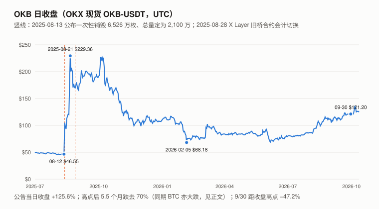
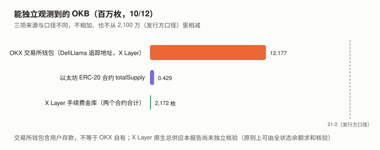
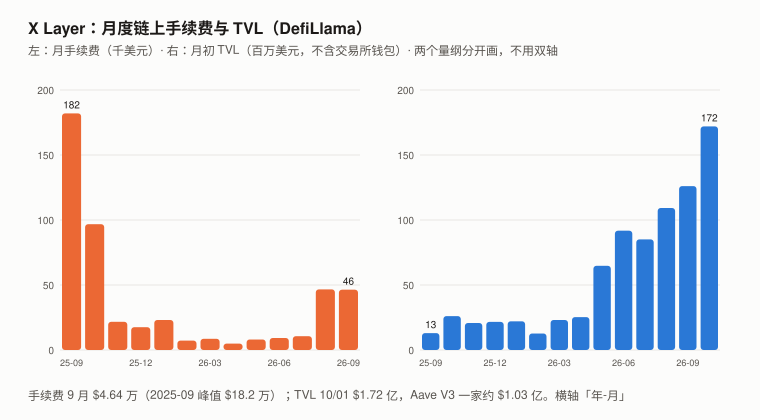

# OKB / X Layer 完整调研与分析报告（2026 年 9 月版，首期）

> **编写日期**：2026 年 10 月 13 日
> **数据截止**：2026 年 9 月 30 日；链上与聚合器快照到 10/12
> **研究方法**：沿用本系列框架。价格用 **OKX 现货 OKB-USDT 日线 UTC 收盘**（OKB 不在币安上市）；超额收益用对数口径（ln 收益 − beta × ln BTC 收益，不扣截距）。
> **本期为 OKB 首期报告**，本系列第十五个资产，也是继 BNB 之后**第二个交易所平台币**。
>
> **接入新资产的第一步：三个默认还成立吗**（XIN 期教训）：
>
> | 检查 | 结果 | 依据 |
> |---|:---:|---|
> | **流通量已知吗** | ⚠️ **只有发行方口径，本报告尚未独立核验** | CoinGecko 流通 = 总量 = 上限 = 2,100 万；以太坊 ERC-20 合约 `totalSupply` 429,065 枚；X Layer 原生总供应本报告用公开 RPC 没读出来（原则上可由全状态余额求和核验） |
> | **价格是可用的测量吗** | ✅ 可用，⚠️ 单一主场 | OKX 9 月日成交中位数约 $1,289 万；**主要成交在发行方自己的交易所** |
> | **代币持有人是剩余索取权人吗** | ❌ **没有找到赋予利润请求权的文件** | OKX 官方 FAQ：OKB **不能**抵扣交易手续费、**不影响**费率等级；人工销毁停止。⚠️ **但 OKB 仍有使用权益**：现行两项（X Layer gas、Jumpstart），另有一项提案（Exchange OS 质押），见 1.1 |
>
> **本期核心发现**：
> 1. **2025-08 之后，OKB 和 OKX 交易所的「费率」联系被切断，但「使用」联系没有全部切断。**
>    官方 FAQ 写明 OKB 不能抵扣交易手续费、不影响费率等级，人工季度销毁停止；**但 OKX 借币指南（10/09 更新）仍写「借入 OKB 参与 Jumpstart」**；
>    **2026-05 发布的 Exchange OS 白皮书（「供反馈」版本的 XIP 提案）设计：部署方须质押 OKB 才能在 X Layer 上创建交易场所、获得上币额度，质押可被罚没**——是否已上线、质押了多少，本期未核实。
> 2. **X Layer 的 gas 目前进入链上金库，未发现销毁或分给持有人的机制**：X Layer 已从 Polygon CDK 迁到 **OP Stack**（官方技术文章，旧链终止于区块 42,810,021）；
>    本报告直读两个手续费金库合约：**当前余额合计约 2,172.5 枚 OKB，提取计数器为 0**，收款人为同一地址 `0x610de914…c102`（与官方区块 API 示例中旧链的出块地址一致——有运营关联线索，当前控制者未独立核实）。
>    9 月链上手续费约 **$4.64 万**（DefiLlama），年化约 $56 万——**OKB 市值约 $25.5 亿，是年化 gas 的约 4,600–11,600 倍**（9 月单月年化 / 2026 年月均年化；近 12 个月实际口径约 8,470 倍）。
> 3. **供应**：发行方口径 **2,100 万**，一次性销毁 65,256,712.097 枚后合约去掉了增发与销毁函数（以太坊 ERC-20 侧）；
>    **DefiLlama 追踪的 OKX 交易所地址在 X Layer 上持有约 1,218 万枚 OKB（相当于发行方总量的 58%，含用户存款）**；以太坊 ERC-20 只剩 42.9 万枚。
> 4. **价格**：2025-08-12 收 $46.55，**8/13 公布销毁当日收 $105.02（+125.6%）**，8/21 收盘高点 $229.36，2026-02-05 收盘低点 $68.18；**9/30 收 $121.20，9 月 +8.12%、Q3 +53.75%**（BTC +6.42% / +42.64%）。
>
> **本期核心判断**：**OKB 是一个「发行方口径固定供应、无利润请求权、无回购承诺」的平台币，它的已确认用途是 X Layer gas（本期测得出，量级是市值的约 1/4,600 至 1/11,600）；Jumpstart 有官方 OKB 用例描述（当期活动未核实）；Exchange OS 提出了 OKB 质押需求（上线与执行未核实）。**
> **本报告不给目标价**：「市值 ÷ 费用」不能直接作为持有人现金流的估值锚（gas 不归持有人），而 Jumpstart 与 Exchange OS 质押的需求本期没有读数。
>
> ⚠️ **本期初稿把 OKB 写成「需求只剩 gas」「X Layer 是 Polygon CDK」「gas 去向为二手」——两位审查者用官方白皮书、官方指南与官方技术文档指出了三处遗漏**；本报告随后一手核实并读出了手续费金库。见 11.4。
>
> **免责声明**：本报告不构成任何投资建议。所有分析仅供研究参考，投资决策请咨询专业顾问。

---

## 核心结论摘要（一页速览）

| 维度 | 核心判断 |
|------|----------|
| **OKB 是什么** | **X Layer 原生 gas 代币 + OKX 生态的使用凭证**（Jumpstart；Exchange OS 质押为提案）。**不再提供交易手续费折扣** |
| **9/30 收盘** | **$121.20**（OKX）；按 2,100 万枚，市值约 **$25.5 亿** |
| **9 月 / Q3 / 近一年** | **+8.12% / +53.75% / −35.81%**（BTC +6.42% / +42.64% / −26.68%） |
| **一年 beta / R² / 波动率** | **0.881 / 0.409 / 62.1%** |
| **对数超额** | 9 月 +2.3、Q3 +11.7（对照组中位数 +13.2、+2.8） |
| **距收盘高点** | **−47.2%**（$229.36，2025-08-21） |
| **供应** | 发行方口径 **2,100 万**；人工销毁停止；黑洞地址仍可销毁。**X Layer 原生总供应本报告尚未独立核验** |
| **持有人权益** | **无利润请求权、无手续费折扣、无回购承诺**；gas 为已确认用途；Jumpstart 有官方用例描述；Exchange OS 质押为设计 |
| **X Layer** | OP Stack；9 月手续费 **$4.64 万**；手续费金库累计 **2,172.5 OKB 未提取**；10/01 TVL **$1.72 亿** |
| **估值** | **不给目标价**（第 9 章） |

---

## 1. OKB 是什么

### 1.1 一个平台币的用途：两项现行、一项提案

| 用途 | 状态 | 来源 |
|------|------|------|
| ~~交易手续费折扣 / 费率等级~~ | **已取消**：「OKB 不能用于抵扣交易手续费，持有 OKB 也不影响手续费折扣等级」 | ✅ OKX 官方 FAQ |
| ~~季度回购销毁~~ | **人工销毁停止**；转入黑洞地址的 OKB 仍会自动销毁；**未找到持续回购的官方承诺** | ✅ OKX 官方 FAQ |
| **Jumpstart（新币申购）** | **仍在**：「借入 OKB 来参与 Jumpstart 活动」 | ✅ OKX 借币指南（2026-10-09 更新） |
| **X Layer gas** | **仍在**：OKB 是 X Layer 原生 gas 代币 | ✅ OKX 官方 FAQ |
| **Exchange OS 质押** | **设计中 / 上线状态未核实**：「部署方须先在 X Layer 质押合约中质押 OKB，才能创建交易场所或上币」；质押可被罚没 | ✅ 白皮书 V1.0（2026-05，「供反馈」版本）；⚠️ 合约与实际质押量本期未核实 |

**2025-08 的三个动作**（OKX 官方 FAQ 日程，UTC+8）：08-13 停止向以太坊 L1 提现；08-15 一次性销毁 65,256,712.097 OKB、总量定为 2,100 万；08-18 合约去掉增发与销毁函数。

> **对持有人最重要的区分**：**「没有利润请求权」和「没有使用权益」是两回事。** OKB 一直没有前者（本报告没有找到任何赋予它的文件）；2025-08 取消的是使用权益中的一项（费率折扣），**Jumpstart 与 gas 仍在，Exchange OS 是新增设计**。
> ⚠️ 不能抵扣手续费、不赋予利润请求权，**同时符合发行方的监管利益**——这是一个可逆的安排，不是一个永久约束。

### 1.2 X Layer

| 项目 | 内容 | 来源 |
|------|------|------|
| 技术栈 | **OP Stack**（执行客户端 reth）；从 Polygon CDK（zkEVM Validium）迁移，**旧链终止于区块 42,810,021** | ✅ OKX 官方技术文章（2026-05-26） |
| gas 代币 | OKB | ✅ 官方 FAQ |
| 手续费去向 | 进入 `SequencerFeeVault`（`0x42…0011`）与 `BaseFeeVault`（`0x42…0019`），`L1FeeVault` 为 0 | ✅ 官方合约表 + **本报告链上直读** |
| 金库余额（10/12） | **1,277.6 + 895.0 = 2,172.5 OKB**，`totalProcessed` 均为 **0（计数器未记录提取，覆盖当前 OP Stack 部署期间）**；收款人均为 `0x610de9141a2c51a9a9624278aa97fbe54b27c102`（X Layer 上） | ✅ 直读 |
| 2025-08-28 的桥合约变化 | 旧 Polygon CDK 桥合约（`0x2a3dd3eb…`）预置的 2¹²⁸ wei 在区块 32,843,575 归零——**与 OP Stack 迁移不是同一事件**，原因本期未识别 | ✅ 直读 |

> **当前费用进入金库，截至快照未记录提取；未发现自动向持有人分配或销毁的机制；提取后的用途未核实**——这不排除以后被销毁，也不覆盖迁移前（Polygon CDK 时期）的手续费。
> 收款地址 `0x610de914…c102` 与 OKX 官方区块 API 示例中旧链的 `validator` / `miner` 一致，**有运营关联线索，但当前控制者与资金用途未独立核实**。

---

## 2. OKB 的发展阶段划分

| 阶段 | 时间 | 特征 | 标志性事件 |
|------|------|------|------|
| 一 | 2018–2025.07 | 交易所平台币（ERC-20） | 费率折扣、Jumpstart、季度回购销毁（本报告只取得 2025-05 起的日线） |
| 二 | **2025-08** | **一次性销毁 + 2,100 万上限 + 取消费率折扣** | **8/13 当日 +125.6%**；8/21 收盘高点 $229.36 |
| 三 | 2025-09 – 2026-02 | 退潮 | **2026-02-05 收盘低点 $68.18**（较高点 −70.3%；同期 BTC 亦大跌，见 3.1） |
| 四 | 2026-03 – 至今 | X Layer 迁至 OP Stack、Exchange OS 白皮书、TVL 增长 | TVL 从 $2,310 万（3/01）到 $1.72 亿（10/01）；9/30 收 $121.20 |

---

## 3. OKB 当前现状

### 3.1 价格与市场

> 图中数字：纵轴 $0 / $50 / $100 / $150 / $200 / $250；标注点 2025-08-12 $46.55、2025-08-21 $229.36、2026-02-05 $68.18、2026-09-30 $121.20；竖线 2025-08-13（公布一次性销毁 6,526 万枚）、2025-08-28（旧桥合约会计切换）。

| 指标 | 数值 | 口径 |
|------|------|------|
| 9/30 收盘 | **$121.20** | OKX OKB-USDT 日线，UTC |
| 8/31 / 6/30 收盘 | $112.10 / $78.83 | 同上 |
| **9 月 / Q3 / 近一年** | **+8.12% / +53.75% / −35.81%** | 同上 |
| 9 月收盘区间 | $105.20 – $123.01 | 同上 |
| 收盘高点 / 距高点 | $229.36（2025-08-21）/ **−47.2%** | 同上 |
| 9 月日成交中位数 | 约 $1,289 万 | OKX，单一交易所 |
| 市值（9/30） | 约 **$25.5 亿** | 2,100 万（发行方口径）× 收盘价 |
| 一年 beta / R² / 年化波动率 | **0.881 / 0.409 / 62.1%** | 365 天日对数收益；R² 为样本内线性解释比例 |

**对数超额收益**（对照组为本系列 9 个山寨：ZEC / UNI / ADA / SOL / BNB / ETH / TRX / CKB / DOT）：

| | 7 月 | 8 月 | **9 月** | **Q3** |
|---|---:|---:|---:|---:|
| OKB 对数超额（×100） | +2.4 | +7.0 | **+2.3** | **+11.7** |
| 对照组中位数 | +1.7 | −3.3 | +13.2 | +2.8 |
| OKB − 对照组中位数 | +0.7 | +10.4 | **−10.9** | **+8.9** |

> 特质波动的尺度：单月约 13.7 个对数点，**一个季度约 24 个点**（独立日残差假设）——**Q3 的 +11.7 约半个标准差**。相对对照组的差值是描述性的。
> **2025-09-01 → 2026-02-05 的回撤拆分**：OKB 对数收益 −90 个点，BTC −55 个点；按 beta 0.881，**约 54% 的跌幅可由 BTC 解释**。2025-08 那一段（8/21 高点前后）本报告缺 BTC 同口径数据，未拆分。

### 3.2 与 BNB 的对照（两个交易所平台币）

| | **OKB** | **BNB** |
|---|---|---|
| 9 月 / Q3 | +8.12% / +53.75% | +11.26% / +40.76% |
| beta / R² | 0.881 / 0.409 | 0.884 / 0.594 |
| 交易所手续费折扣 | **❌ 已取消** | ✅ |
| 新币申购类权益 | ✅ Jumpstart | ✅ Launchpool 等 |
| 供应减少机制 | **❌ 人工销毁停止**；黑洞销毁仍可能 | ✅ 季度 Auto-Burn（公式化，BNB 官方说明独立于币安交易所） + gas 部分销毁 |
| 自有链的 gas | ✅ X Layer（月费约 $4.6 万，**进金库，未发现销毁机制**） | ✅ BNB Chain（部分销毁） |
| 供应 | 发行方口径固定 2,100 万 | 持续减少 |

> **两者都没有对交易所利润的请求权**——BNB 的 Auto-Burn 是公式化的链上机制，**不是股东式的利润回购**（BNB 8 月版「准股权」的说法在此需要收窄，留待 BNB 下期处理）。
> **OKB 比 BNB 少的是「供应减少机制」与「费率折扣」两项。** beta 几乎相同（0.881 vs 0.884），R² 低一截。

### 3.3 宏观环境

> 与 BTC 9 月版共用（美联储 9/16 加息 25bp 至 3.75–4.00%）。**OKB 的 R² 为 0.409。**

---

## 4. 供应：2,100 万（本期核心章之一）

> 图中数字（百万枚）：OKX 交易所钱包 12.177、以太坊 ERC-20 0.429、X Layer 手续费金库 2,172 枚；虚线为发行方口径 21.0。三项口径不同，不相加。

### 4.1 本报告能核实的

| 观测 | OKB | 来源 | 核实 |
|------|---:|------|:---:|
| **以太坊 ERC-20**（合约 `0x75231F58…`）`totalSupply` | **429,064.58** | 公共 RPC 直读；Blockscout 同值，20,382 个持有地址 | ✅ 一手 |
| **OKX 交易所追踪地址（X Layer）** | **12,177,777**（10/12 直读；7/28 起 11 周在 1,195–1,222 万之间） | DefiLlama 适配器（commit `b70f0fb4dc9f`）列出的 **24 个地址**，本报告逐个直读原生余额求和；与 DefiLlama 汇总值差 354 枚 | ✅ 余额一手；⚠️ **地址归属由 DefiLlama 认定**，未独立核实 |
| X Layer 手续费金库 | 2,172.5 | 直读 | ✅ 一手 |
| X Layer 零地址 / 黑洞地址 | 95.08 / 62.00 | 直读 | ✅ 一手 |

> **约 1,218 万 ÷ 发行方总量 2,100 万 ≈ 58%**——**分母是发行方口径，不是链上可观测量**；交易所钱包含用户存款，**不等于 OKX 自有，也不直接决定「是否流通」**。

### 4.2 本报告尚未核实的：X Layer 原生总供应

本报告尝试了两条路，都没有走通：

1. **旧桥合约会计**：Polygon CDK 体系的桥合约预置一大笔原生币，「预置额 − 当前余额」即为已流出量。X Layer 旧桥合约在 2025-08-28 的区块 32,843,575 归零，**之后这条路不成立**；而 X Layer 已迁到 OP Stack，**OP Stack 没有现成的原生供应计数器**。
2. **以太坊侧**：若 OKB 是从以太坊锁仓跨过去的，锁仓的币仍计入 ERC-20 `totalSupply`——**而它只有 42.9 万——「当前 ERC-20 全额锁仓、1:1 担保全部 X Layer 原生余额」的解释不成立**（不排除少量锁仓桥或混合机制）。但 42.9 万**同时与「以太坊侧销毁、X Layer 侧 1:1 铸造的迁移」和「X Layer 侧另行发行」相容**，两者对总量的含义不同，**本期未区分**（能区分的数据——ERC-20 的转零地址事件加总——列入下期第一优先）。

> **结论**：**「2,100 万」目前只有发行方口径，本报告尚未独立核验。** 原则上，任何人对 X Layer 全状态的原生余额求和就能核验——**这是本报告的能力限制，不是资产本身不可验证**。

---

## 5. 价值捕获：已确认的用途只有 gas 测得出（本期核心章之二）

> 图中数字：左图月手续费（千美元，纵轴 0 / 50 / 100 / 150 / 200）首月 2025-09 为 182、末月 2026-09 为 46（2025-08 为 187，图外）；右图月初 TVL（百万美元，同刻度）首月 13、末月 172；横轴标签为「年-月」（25-09 至 26-10）；图注：手续费 9 月 $4.64 万，2025-09 峰值 $18.2 万。

### 5.1 gas（测得出）

| 月份 | X Layer 链上手续费（DefiLlama） |
|------|---:|
| 2024-12 至 2025-07（公告前） | 每月 $1,369–$12,756 |
| **2025-08（公告当月，峰值）** | **$187,077** |
| 2025-09 | $181,991 |
| 2025-10 | $96,808 |
| 2026-03 | $8,589 |
| 2026-04（谷底） | $4,920 |
| 2026-07 | $10,574 |
| 2026-08 | $46,599 |
| **2026-09** | **$46,362** |

> **9 月单月年化约 $56 万**；**OKB 市值约 $25.5 亿，是它的约 4,600 倍**——这是对 OKB 最有利的点值；**近 12 个月实际（$30.06 万）口径约 8,470 倍、2026 年月均年化约 11,600 倍**。⚠️ 9 月是公告事件窗口之外的最高月，**比公告前的常态（每月约 $0.1–1.3 万）高一个数量级**。这些手续费**进金库，截至快照未提取、未发现销毁机制**（1.2，一手）。
> **同一基期比较**：以 2026-03 为基期，手续费 ×5.4、TVL ×5.5；以 2026-02 为基期，×6.5 vs ×9.9；以 2026-04 为基期，×9.4 vs ×5.0——**两者是同量级增长，增长比随基期在 0.65–1.89 之间变化**，5.4 对 5.5 是端点碰巧对上；月度联动很松（8 月手续费单月 ×4.4、TVL 只涨 28%）。（初稿用「TVL 从升级前低点涨 30 倍、手续费比峰值低 75%」得出「TVL 没有转化为手续费」，两边基期不同，已撤回。）

### 5.2 Jumpstart 与 Exchange OS（测不出）

- **Jumpstart**：用户为参与新币申购持有或借入 OKB——**需求是间歇性的，规模取决于每期项目**，本期没有读数。
- **Exchange OS**：部署方须质押 OKB 才能开设交易场所，**质押门槛、罚没比例、上线状态、实际质押量**白皮书都没给（「另见协议规范」），本期没有读到合约。

### 5.3 对持有人意味着什么

| 本系列见过的价值机制 | OKB |
|------|:---:|
| 利润请求权 / 收入分成 | ❌ 未找到赋权文件 |
| 销毁或回购 | ❌ 人工销毁停止；无回购承诺；gas 进金库、未发现销毁机制 |
| 质押收益 / 增发分配 | ❌ 无增发 |
| **使用需求（锁仓 / 持有）** | ✅ gas（现行、测得出）、Jumpstart（现行描述）；Exchange OS 质押（提案） |
| **固定供应** | ✅ 发行方口径 |

> **OKB 没有任何现金流机制把价值送回持有人**；可能支撑价格的因素见第 8 章。**这与 BTC 的结构相似（固定供应、无现金流），区别在于 OKB 的供应只有发行方口径、需求来自一个公司生态的使用权益。**

---

## 6. OKB 与其他资产的比较

> **口径**：9 月 = 8/31 → 9/30，Q3 = 6/30 → 9/30；OKB 用 OKX 收盘，其余用币安收盘；beta / R² 为 365 天日对数收益。

| 资产 | 9 月 | Q3 | beta | R² | 9 月对数超额 |
|------|---:|---:|---:|---:|---:|
| **OKB** | **+8.12%** | **+53.75%** | **0.881** | **0.409** | **+2.3** |
| BNB | +11.26% | +40.76% | 0.884 | 0.594 | +5.2 |
| ETH | +8.85% | +70.86% | 1.283 | 0.823 | +0.5 |
| SOL | +14.61% | +60.34% | 1.311 | 0.755 | +5.5 |
| TRX | +1.44% | +7.01% | 0.238 | 0.193 | 0.0 |
| DOT | +45.60% | +48.78% | 1.247 | 0.412 | +29.8 |
| BTC | +6.42% | +42.64% | 1.000 | 1.000 | — |

---

## 7. 核心价值逻辑

**星级编码证据等级**：完全建立在二手转述上的论据不得给到五星。

### 7.1 多头逻辑

| # | 论据 | 强度 | 说明与证据等级 |
|---|------|:---:|------|
| 1 | **发行方口径固定供应 2,100 万、零增发** | ★★★☆☆ | ⚠️ 以太坊 ERC-20 侧去掉增发函数为一手；X Layer 原生侧本报告尚未独立核验 |
| 2 | **gas 之外还有两项官方描述的用途**（Jumpstart、Exchange OS 质押） | ★★☆☆☆ | ✅ 官方文件一手。⚠️ **Jumpstart 当期是否有 OKB 活动未核实；Exchange OS 是设计，上线与质押量未核实**——是描述，不是已兑现的需求 |
| 3 | X Layer TVL 增长，与手续费同量级增长 | ★★☆☆☆ | ✅ DefiLlama。⚠️ 集中在 Aave 一家（约 $1.03 亿，时点不同） |
| 4 | 发行方可能重新赋权（期权） | ★★☆☆☆ | ⚠️ 2025-08 的取消是单方面的，**也就可以单方面恢复**；本报告没有任何证据表明会发生 |

### 7.2 空头逻辑

| # | 论据 | 强度 | 说明与证据等级 |
|---|------|:---:|------|
| 1 | **没有交易手续费折扣** | ★★★★★ | ✅ **OKX 官方 FAQ 原文** |
| 2 | **没有协议层的价值回流**：gas 进金库、未发现销毁或分配机制；无回购承诺 | ★★★★☆ | ✅ 金库直读（一手）、FAQ（一手）。⚠️ 提取后的用途未核实 |
| 3 | **测得出的那项需求（gas）是市值的约 1/4,600 至 1/11,600** | ★★★☆☆ | ✅ DefiLlama。⚠️ 与空头 #2 同一个事实的量化，**作为证据只算一份** |
| 4 | **OKX 单点集中**：发行方、主要交易所、X Layer 排序器、追踪地址持仓的运营方是同一个；金库收款地址有运营关联线索 | ★★★☆☆ | ✅ 各项一手或聚合器。**机制**：若追踪地址中 OKX 自有比例高，自由流通盘就薄，价格易被少量卖压击穿——**自有比例本期测不出** |

**不确定性（不计入多空）**：X Layer 原生总供应本报告尚未独立核验——**它是不确定性，不是方向**。

> **同源检查**：多头 #1（固定供应）与「总供应未核验」是同一事实的两种读法；多头 #4（重新赋权期权）与空头 #1（无折扣）是同一个可逆的官方决定；空头 #4 与风险 10.2 第 2 条同源（OKX 单点）；空头 #2 与 #3 同源。

---

## 8. 多空之间真正的分歧点

> **OKB 的价格需要一个本报告找不到的锚。** 可能的支撑有四个，**它们可以同时存在、不互斥**：
> ① **使用需求**——Jumpstart（当期活动未核实）与 Exchange OS 质押（提案）的锁仓量，**本期都没有读数**；
> ② **对重新赋权的期权**——需要两项输入：「恢复权益后的合理市值」（例如 BNB 市值 × OKX 与币安的规模比——**可取得，本期没取**）和「重新赋权的概率」（**没有任何依据——这才是卡住的一步**）；
> ③ **持仓集中带来的低自由流通**——追踪地址的自有比例测不出；**它与空头 #4（「易被少量卖压击穿」）是同一个未测量的量，两边各用一次**；
> ④ **无现金流的溢价**（与 BTC 同类：固定供应、市场共识）。
> **本报告无法测出各自的权重**；下期清单的第二优先是为 ① 取数。

---

## 9. 估值：不给目标价

### 9.1 为什么不给

| 路径 | 崩在哪一步 |
|------|------|
| 收入倍数法 | **持有人没有收入**——gas 进金库，不归持有人 |
| 销毁 / 回购收益率 | **都已停止**（人工销毁）或没有承诺（回购） |
| 稀释成本（DOT 的方法） | **没有增发** |
| 使用需求（锁仓 × 周转） | **Jumpstart 与 Exchange OS 的锁仓量本期没有读数** |

> **这是「缺乏可信估值模型」，不是「OKB 没有价值」**（ZEC 期教训）。

### 9.2 情景测算：如果按本系列其他资产的「市值 ÷ 费用」比给 OKB 定价

| 参照（BNB 8 月版表 8.1） | 市值 ÷ L1 年化费用 | OKB 当前市值需要的年化 gas | 相对当前（约 $56 万） |
|------|---:|---:|---:|
| BNB | 465–699 倍 | $364 万–$547 万 | 6.5–9.8 倍 |
| ETH | 约 2,400 倍 | 约 $106 万 | 约 1.9 倍 |
| ADA | 约 17,500 倍 | 约 $15 万 | 约 0.26 倍 |

> **推导方法**：市值 $25.45 亿 ÷ 参照倍数 = 所需年化 gas。**OKB 的约 4,600 倍落在 ETH 与 ADA 之间**——这只是机械反解，展示参照物有多敏感，**不形成贵或便宜的判断**。⚠️ **BNB 的 465 倍是近 12 个月实际口径**，与之可比的 OKB 是约 8,470 倍（不是 9 月单月的 4,600 倍）；无论用哪个口径，OKB 都落在 ETH 与 ADA 之间。
> ⚠️ **而且它不能直接作为持有人现金流的估值锚**：其他资产的费用至少部分被销毁或分给质押者，**OKB 的 gas 两样都没有**；且 gas 需求是流量，代币需求还取决于周转率与锁仓。**这张表只是情景测算，不是目标价，也不是价格成立的必要条件**。（初稿只借 BNB 一个倍数——本系列最低的那个——审查指出参照物选择决定了结论，已改为并列。）

### 9.3 这套判断的弱点

1. **X Layer 原生总供应本报告尚未独立核验**。
2. **只有 gas 有读数**；Jumpstart（当期活动）、Exchange OS（上线与质押量）都是本报告的盲区。
3. **追踪地址的余额已逐个直读，但「这 24 个地址属于 OKX」由 DefiLlama 认定**；分不清用户存款与 OKX 自有。
4. **本报告只取得 2025-05 起的日线**，2025-08 那一段缺 BTC 同口径数据。
5. **本报告是 OKB 首期**，初稿有三处核心事实被审查推翻（11.4）。

---

## 10. 投资与风险启示

### 10.1 关键监控指标

| 指标 | 当前值 | 触发关注的阈值 | 查询方式 |
|------|---:|------|------|
| **X Layer 月手续费** | **$46,362**（9 月） | 任一月 ≥ $10 万（O9-1） | DefiLlama `fees/x-layer` |
| **手续费金库** | 2,172.5 OKB，未提取 | **任何提取**（`totalProcessed` > 0），及去向 | `0x42…0011`、`0x42…0019` |
| **Exchange OS 质押合约** | 未找到 | 合约上线、质押量 | X Layer 链上 |
| OKX 追踪地址 OKB | 约 1,218 万（10/12） | 固定地址集合跌破 1,050 万（O9-2） | DefiLlama `protocol/okx` |
| OKB 权益政策 | 无折扣、无回购 | 任何恢复或进一步削减的公告 | OKX 官方 FAQ / 公告 |

### 10.2 风险提醒

1. **没有现金流锚**：价格完全取决于使用需求与市场愿意付多少，**下行时没有回购托底**。2025-08 高点后 5.5 个月跌去 70%（独立事实）；另在 2025-09-01 → 2026-02-05 区间，按样本 beta，BTC 项约占 OKB 对数跌幅的 54%（不是因果识别）。
2. **OKX 单点集中**：发行方、主要交易所、X Layer 排序器、追踪地址运营方是同一个；金库收款地址有运营关联线索。
3. **供应口径风险**：总供应只有发行方口径。
4. **政策是双向可逆的**：2025-08 就是一次单方面的大幅改变。

### 10.3 长期认知

**第一，「没有利润请求权」和「没有使用权益」要分开查。** 初稿从「不能抵扣手续费」一路推到「需求只剩 gas」，**漏了 Jumpstart 与 Exchange OS**——两份官方文件都公开可查。**一条官方原文否定了一项权益，不等于否定了全部权益。**

**第二，「本报告读不出来」不等于「不可验证」。** 初稿把自己的能力限制写成了资产属性；X Layer 是 EVM 链，**全状态余额求和原则上就能核验总量**。

**第三，比较两条时间序列的增长，先对齐基期。** 初稿用「TVL 从低点涨 30 倍」对「手续费比峰值低 75%」，得出「TVL 没有转化为手续费」——**对齐到同一起点后，两者是同量级增长**——而增长比本身随基期在 0.65–1.89 之间变化。**做了基期对齐，还要做基期敏感性。**

> （初稿还有一条「2025-08 公告同时砍供应与取消权益，市场只交易了前一半」——推理审查指出它是单一事件日的事后叙事、没扣 BTC 的 beta，且「取消全部权益」的前提本身不成立，**已删除**。）

---

## 11. 附录

### 11.1 关键数据速查（截至 2026-09-30，快照到 10/12）

| 类别 | 指标 | 数值 |
|------|------|---:|
| **市场** | 9/30 收盘（OKX） | $121.20 |
| | 9 月 / Q3 / 近一年 | +8.12% / +53.75% / −35.81% |
| | 市值（9/30，按 2,100 万） | 约 $25.5 亿 |
| | beta / R² / 波动率 | 0.881 / 0.409 / 62.1% |
| | 收盘高点 / 距高点 | $229.36（2025-08-21）/ −47.2% |
| **供应** | 总量（发行方口径） | 21,000,000 |
| | 以太坊 ERC-20 `totalSupply` | 429,064.58 |
| | OKX 追踪地址（X Layer） | 约 12,177,000 |
| **X Layer** | 9 月手续费 | $46,362 |
| | 手续费金库（未提取） | 2,172.5 OKB |
| | TVL（10/01） | $1.720 亿 |
| **估值** | 市值 ÷ 年化 gas | 约 4,600 倍（9 月单月）/ 8,470 倍（近 12 个月）/ 11,600 倍（2026 均值） |

### 11.2 数据来源与核实状态

| 数据 | 来源 | 核实状态 |
|------|------|:---:|
| 2025-08 销毁、上限、合约升级、费率折扣取消 | **OKX 官方 FAQ**（x-layer-okt-okb） | ✅ 一手原文 |
| Jumpstart 用 OKB | **OKX 借币指南**（2026-10-09 更新） | ✅ 一手原文 |
| Exchange OS 质押 OKB | **X Layer Exchange OS 白皮书 V1.0**（2026-05） | ✅ 一手原文；⚠️ 上线与质押量未核实 |
| X Layer 迁至 OP Stack | **OKX 官方技术文章**（2026-05-26） | ✅ 一手原文 |
| 手续费金库余额、收款人、提取额 | X Layer 公共 RPC | ✅ 直读 |
| 以太坊 ERC-20 `totalSupply` | 以太坊公共 RPC、Blockscout | ✅ 直读，两源一致 |
| 旧桥合约余额切换 | X Layer 公共 RPC 历史状态 | ✅ 直读（区块 32,843,575） |
| OKX 追踪地址持仓 | DefiLlama 适配器地址清单 + X Layer RPC 逐个直读 | ✅ 余额一手；⚠️ 地址归属为聚合器认定 |
| X Layer 手续费、TVL、协议拆分 | DefiLlama API | ✅ API 一手 |
| 价格 / 成交额 | OKX 公开行情 API | ✅ 直接调用 |
| X Layer 原生总供应 | — | ❌ **本报告尚未独立核验** |
| Exchange OS 质押合约与质押量 | — | ❌ 未找到 |
| 2025-05 以前的价格 | — | ❌ 未取得 |

### 11.3 来源偏向声明

| 侧 | 主要论据 | 证据等级 |
|---|------|:---:|
| **多头** | 固定供应、gas 之外的两项用途描述、TVL | 用途描述为官方一手（未兑现）；供应为发行方口径 |
| **空头** | 无折扣、无价值回流、gas 量级、单点集中 | 无折扣与金库为一手；集中度为聚合器 |

> **初稿的偏向是空头**：遗漏了两项使用权益、只借最低的倍数作参照、把一个事后叙事写成长期认知——三处都被审查指出。本期已按此调整（多头 #2 新增、9.2 改为并列、长期认知删除一条）。
> **传统金融机构视角**：本期引用了**美联储**政策；未找到传统金融机构对 OKB 的当期研究覆盖。

### 11.4 发布前审查记录

**第 1 层 `verify_report.py`**：初稿 2 FAIL（图注缺 6,526 万、$18.2 万与横轴年月标签），补图注后 0 FAIL / 1 WARN。

**第 2 层 _bian（推理）与第 3 层 Codex（领域，读缓存与官方文档）——第一轮：**

| # | 意见 | 出处 | 处理 |
|---|------|:---:|------|
| 1 | **遗漏 Exchange OS**：官方白皮书设计了「质押 OKB 开设交易场所」 | Codex | ✅ **一手读白皮书核实**；补入 1.1、5.2；核心判断改写 |
| 2 | **「交易所权益全部取消」过头**：Jumpstart 仍用 OKB | Codex | ✅ **一手读借币指南核实**（10/09 更新）；区分利润请求权与使用权益 |
| 3 | **X Layer 已迁到 OP Stack**，官方文档可查；gas 进费用金库 | Codex | ✅ **一手核实迁移文章与合约表，并直读金库**：2,172.5 OKB 未提取，从「二手」升为一手 |
| 4 | 42.9 万不能证明「另行发行」；「读不出来」被升级为「不可核实」 | 两者 | ✅ 改为「迁移或另行发行，本期未区分」「本报告尚未独立核验」 |
| 5 | **TVL 与手续费基期不对称** | _bian | ✅ 对齐 2026-03 起点后两者同步；撤回「TVL 没有转化」 |
| 6 | **反解只借 BNB 一个（最低的）倍数** | 两者 | ✅ BNB / ETH / ADA 并列，并写明这个锚对 OKB 不适用 |
| 7 | **长期认知「市场只交易了前一半」是事后叙事**，没扣 beta | 两者 | ✅ 删除；补回撤拆分（约 54% 可由 BTC 解释） |
| 8 | 空头 #1 把「无折扣」与「无剩余索取权」打包成五星；「发行方承认不利事实」的类比不成立 | _bian | ✅ 拆分；删除类比，改为「符合发行方监管利益、可逆」 |
| 9 | 「58%」限定丢失、分母偷换、饼图闭合不成立 | 两者 | ✅ 改为独立观测图；全文补限定 |
| 10 | BNB 对照把 Auto-Burn 当作利润回购 | Codex | ✅ 3.2 改写 |
| 11 | 「无销毁」过头：黑洞销毁仍在；回购只是「未找到承诺」 | Codex | ✅ 已改 |
| 12 | 第 8 章 ② 没有给出失败的定价尝试 | _bian | ✅ 写明失败在「OKX 与币安规模比」这一步 |
| 13 | Q3 超额配季度尺度；R² 解释越界 | Codex | ✅ 已改 |
| 14 | O9-1 先验未用 10 月已知数据，制造成本对排序器运营方近乎可回收；O9-2 应固定地址集合 | 两者 | ✅ 记分卡重写 |
| 15 | 同源检查不全；「总供应未核验」不是方向，不该放空头表 | _bian | ✅ 移出空头表，补同源 |

**第二轮（复审修订稿）：**

| # | 意见 | 出处 | 处理 |
|---|------|:---:|------|
| 1 | 「未提取」被升级为「gas 不销毁」的永久结论 | Codex | ✅ 改为「当前进入金库、未记录提取、未发现销毁或分配机制、用途未核实」 |
| 2 | 金库收款地址与官方示例中的旧链出块地址一致，不是「未知」；也不能断言就是 OKX | Codex | ✅ 写为「运营关联线索，控制者未独立核实」；O9-1 的可回收成本改为条件句 |
| 3 | 摘要把 Jumpstart、Exchange OS 升级成已兑现需求 | Codex | ✅ 卷首、速览、多头 #2 改为「官方描述 / 设计，未兑现」，多头 #2 降为两星 |
| 4 | 回撤拆分的区间在下游被套到「高点后 70%」上 | Codex | ✅ 两者分开写，注明不是因果识别 |
| 5 | 「按这个锚不算异常」仍是估值判断 | Codex | ✅ 删除；改为「机械反解，不形成贵贱判断」 |
| 6 | 「锁仓模式被排除」过头 | Codex | ✅ 改为「当前 ERC-20 全额担保的解释不成立」 |
| 7 | O9-1「10 月基本落空」超出数据；O9-2 门槛 11 与查询方式 | Codex | ✅ 记分卡已改 |
| 8 | **Exchange OS 是提案（「Released for feedback」），却被写成现行用途**；收款方 = OKX 在一处未查、另一处当证据 | _bian | ✅ 改为「两项现行 + 一项提案」；收款方改为「运营关联线索，未核实」 |
| 9 | **「4,600 倍」是单月年化**，与 BNB 465 倍（近 12 个月口径）不可比 | _bian | ✅ 全文改为区间 4,600–11,600 倍，注明可比口径为约 8,470 倍 |
| 10 | 「2025-09 峰值」错（2025-08 为 $187,077 更高）；表格截掉了公告前的低常态；10 月是 11 天不是 12 天 | _bian | ✅ 已改；O9-1 基率与运行率同步更正 |
| 11 | 「手续费与 TVL 大致同步」依赖基期（比值 0.65–1.89） | _bian（自认第一轮遗漏） | ✅ 改为「同量级增长」并给出敏感性 |
| 12 | 5.3 抢答了第 8 章；第 8 章清单不互斥、漏了「无现金流溢价」；② 卡住的一步写错 | _bian | ✅ 第 8 章补 ④、写明可并存；② 改为「卡在重新赋权概率」 |
| 13 | O9-2 合格但无信息量，会抬高正确率 | _bian（分歧） | ✅ 保留，标为「观测项，不计正确率」 |

---

> **配套文件**：`okb_questions_summary_202609.md`（简明速查）、`../thesis_scorecard.md`（论点滚动记分卡）。
> 本报告不构成投资建议。
