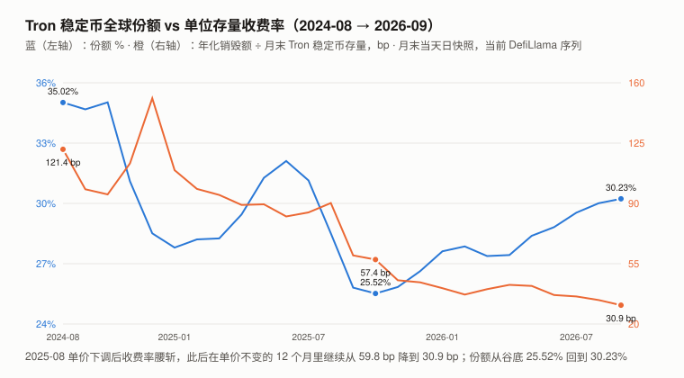
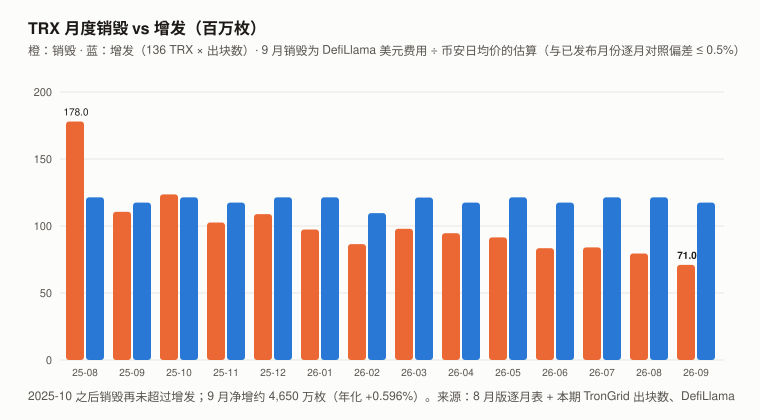
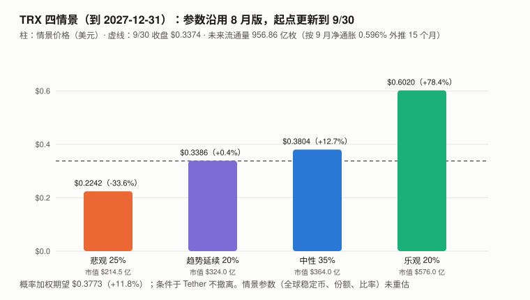

# TRX / Tron 完整调研与分析报告（2026 年 9 月版兼 Q3 回顾）

> **编写日期**：2026 年 10 月 13 日
> **数据截止**：2026 年 9 月 30 日（9 月完整月度数据已闭合）；链上参数与提案快照到 10/13
> **研究方法**：沿用 8 月首期框架（第 10 章「市值 ÷ 稳定币存量」锚与四情景）。价格统一改用**币安日线 UTC 收盘**（8 月版用的是 CoinGecko 00:00 时点价，见 12.4）；**超额收益用对数口径**（ln 收益 − beta × ln BTC 收益）。
> ⚠️ **本期一处必须先声明的数据限制**：Tronscan 官方 API 在本期取数期间**持续限流（HTTP 429）**，8 月版的主数据源取不到。
> 本期改用两条可复现的替代路径：**增发 = 136 TRX × TronGrid 节点上数出的实际出块数**（用同法复算 8 月，与 8 月版发布值**逐位一致**）；
> **销毁 = DefiLlama 日度美元费用 ÷ 币安日均价**（DefiLlama 的 Tron 费用适配器取的就是 Tronscan 的销毁量；与 8 月版发布的 4 个月份逐月对照，**偏差 −0.5% 至 +0.1%**）。
>
> **本期核心发现**：
> 1. **净通胀继续上升：9 月销毁约 7,096 万枚、增发 1.1746 亿枚，净增约 4,650 万枚，年化 +0.596%**（8 月 +0.519%）。
>    这是 2025-10 以来**连续第 11 个净增月**；9 月销毁是本报告数据窗口内的**最低月**。
> 2. **单位存量收费率 30.9 bp**（年化销毁额 ÷ Tron 稳定币存量），**12 个月前是 59.8 bp**——能量单价这 12 个月一次没改，**单价之外的因素（烧币支付占比、总需求、存量增长、TRX 美元价格）合起来压低了它**；截至 Q2 的官方分项支持「支付方式迁移」，**Q3 的分项尚未发布，本期拆不开**。
> 3. **业务继续上行**：Tron 美元锚定稳定币月末 **$940.6 亿**（DefiLlama，新高），全球份额 **30.23%**；能量租赁平台（CatFee + TRONSAVE）9 月收入 **$512 万**（8 月 $466 万，+9.9%）。
> 4. **现货 ETF 9/08 生效**：SEC EDGAR 一手记录显示 Canary Staked TRX ETF（代码 TRXS）**9/08 收到 EFFECT 通知、同日递交正式招股书（424B3），9/09 Cboe 出具上市认证**。招股书写明「正常情况下至少 90% 的 TRX 质押」。⚠️ **实际开始交易的日期与规模，本期未核实**。
> ⚠️ **第 1、2 条与净通胀背后主要是同一个观测——9 月日均销毁比 8 月低 7.8%**（增发不变）：它同时表现为「净通胀上升」和「收费率下降」，**作为证据只算一份**。
> 5. **价格几乎没动：9 月 +1.44%、Q3 +7.01%（BTC +6.42% / +42.64%）**，十个资产里 9 月涨幅最低；**但按 beta 0.238 预期，它只该涨约 1.5%——9 月对数超额约 0**。
>    「落后」来自对照组 9 月的行情（对数超额中位数 +14.9），不是 TRX 自身的异常。
>
> **本期核心判断**：**8 月版的主线——「网络越来越有用、代币越来越收不到钱，而市场没有为后者定价」——在 9 月原样延续。**
> 业务新高、收费率新低、净通胀新高、「市值 ÷ 稳定币存量」比率仍在 0.341（8 月版 0.341）。**本期唯一的新变量是 ETF 生效，它的规模本期没有读数。**
>
> **免责声明**：本报告不构成任何投资建议。所有分析仅供研究参考，投资决策请咨询专业顾问。

---

## 核心结论摘要（一页速览）

| 维度 | 核心判断 |
|------|----------|
| **9/30 收盘** | **$0.3374**（币安）；市值约 **$320.4 亿**（全球第 8）；距 ATH $0.431288 为 **−21.77%** |
| **9 月 / Q3 / 近一年** | **+1.44% / +7.01% / +1.14%**（BTC +6.42% / +42.64% / −26.68%） |
| **一年 beta / R² / 波动率** | **0.238 / 0.193 / 24.4%**——仍是本系列最低的 beta 与波动率 |
| **9 月对数超额** | **约 0**（与 beta 预期吻合）；对照组中位数 +14.9 |
| **净供应（9 月）** | 销毁 **70,956,696**（估算）、增发 **117,458,032**、**净 +46,501,336，年化 +0.596%** |
| **单位存量收费率** | **30.9 bp**（2025-09 为 59.8 bp，能量单价 12 个月未变） |
| **业务** | Tron 美元锚定稳定币 **$940.6 亿**（月末，新高）；全球份额 **30.23%**；USDT 占全球 USDT 约 50.3% |
| **估值锚** | **市值 ÷ 稳定币存量 = 0.341**（8 月版 0.341） |
| **ETF** | **TRXS 9/08 生效**（EDGAR 一手）；至少 90% 质押；交易起始与规模未核实 |
| **治理** | 能量单价 **100 sun 不变**；#107 之后**无新提案**；两项降费讨论（tips #915、#938）尚未上链 |
| **情景期望（到 2027-12-31）** | 参数沿用 8 月版、起点更新：**$0.3773（+11.8%）**，条件于 Tether 不撤离 |

---

## 1. Tron 是什么（与 8 月版相同，从略）

**稳定币的清算网络。** DPoS，27 个超级代表（SR）出块；资源模型双轨——**质押换来的能量免费，资源不够才销毁 TRX**。
**TRX 的收益来自增发（协议名义每区块 136 枚，其中 128 枚为投票奖励预算），手续费被销毁、不分给任何人。**
能量单价、增发额都由 27 个 SR 投票决定（8 月版第 4、8 章）。

---

## 2. TRX 的发展阶段划分

阶段一至四与 8 月版相同（ICO 与生态搬运 / USDT 的意外胜利 / 份额巅峰与费率上调 / 份额流失与降价防守）。

### 阶段五：低费率新常态（2025-09 – 至今）

- 稳定币存量与份额**双双回升**（份额谷底 25.52% → 9 月末 30.23%）
- 链上销毁**持续下滑**：单月 1.78 亿枚（2025-08）→ **约 7,096 万枚（2026-09）**
- **净供应 2025-10 之后再未回到通缩**
- **2026-09-08 现货质押 ETF（TRXS）生效**——本期新增的事件

---

## 3. TRX 当前现状

### 3.0 论点校验：8 月版登记的 6 条（均未到期）

| # | 论点 | 证伪条件（摘要） | 9 月读数 | 判定 |
|---|------|------|------|------|
| T8-1 | 烧币支付占能量的比重会继续下滑 | 2026-12 烧币占比 ≥ 10.0% 则错 | **官方 Q3 复盘尚未发布**（Q2 那期是 7/16 发的 tips #910）；代理指标（销毁量 ÷ 单价）9 月 23.65 十亿单位/日，**比 8 月低 7.8%** | ⏳ |
| T8-2 | TRX 将维持净通胀 | 2026-09 至 2027-02 任意两个月净额为负则错 | **9 月 +46,501,336**（正） | ⏳ |
| T8-3 | 12 个月内不会再下调能量单价 | 2027-09-06 前 `ENERGY_FEE` < 100 sun 则错 | **100 sun**（10/13，`getchainparameters`） | ⏳ |
| T8-4 | ⚑「市值 ÷ 稳定币存量」会开始反映收费率下滑（45%） | 2027-03-31 比率 ≥ 0.319 则错 | **0.341**（9/30） | ⏳ |
| T8-5 | 低 beta 会持续 | 2027-09-06 时 365 天 beta > 0.50 则错 | **0.238**（截至 9/30） | ⏳ |
| T8-6 | ⚑ 中性情景假设不会被证伪（40%） | 2027-03-31 份额 < 28.0% 或比率 < 0.30 则错 | **份额 30.23%、比率 0.341** | ⏳ |

> **T8-1 的代理指标**有 8 月版声明过的系统性高估（带宽与固定费用被折算成「虚拟能量」，2026-06 高估 38.8%），**而且它是「日均销毁 ÷ 常数」，分不开烧币占比下降与总需求下降——不能用来判断 T8-1 的方向**。
> ⚠️ **8 月版记分卡承诺「下期必须找到能量分项的第二个来源，或者承认这一整块结论是单源的」——本期没有找到第二来源，该结论仍是单源的。**
>
> **T8-6 的取点约定（本期写死，见记分卡）**：月末取 DefiLlama 稳定币序列中**日期标签为该月最后一天**的日快照。
> **与 8 月版份额表逐行比对（25 个月）**：23 个月吻合（两个月差 0.01pp，属四舍五入）；**2026-07、2026-08 两行不符，偏差同向**——份额都高约 0.23pp、Tron 侧都高约 1%（2026-08 的全球值 $3,088.8 亿对应 9/05–06 的点）。
> **原因在「8 月版取点混用」与「DefiLlama 修订了近 1–2 个月的数据」之间，本期分不开**（缓存里没有 9 月初的原始快照）。收费率列另有若干月份不同（如 2025-07 87.9 vs 84.8 bp），**原因未查**；基准月 2025-09 吻合。

> **本期新登记两条论点（T9-1 校准对照：12 月 TRX/BTC 比价、T9-2 净通胀继续上升），拒绝登记一条，见 `../thesis_scorecard.md`。**

### 3.1 价格与市场

| 指标 | 数值 | 口径 |
|------|------|------|
| 9/30 收盘 | **$0.3374** | 币安 TRXUSDT 日线，UTC |
| 8/31 / 6/30 收盘 | $0.3326 / $0.3153 | 同上 |
| **9 月 / Q3 / 近一年** | **+1.44% / +7.01% / +1.14%** | 同上 |
| 9 月收盘区间 | $0.3223 – $0.3447 | 同上 |
| 市值（9/30） | **约 $320.4 亿** | 供应约 949.76 亿枚 × 收盘价（第 5 章） |
| ATH / 距 ATH | $0.431288（2024-12-03）/ **−21.77%** | CoinGecko |
| 一年 beta / R² / 年化波动率 | **0.238 / 0.193 / 24.4%** | 365 天日对数收益，本报告计算 |

**对数超额收益**（ln 收益 − beta × ln BTC 收益，×100；同口径币安收盘、各自 365 天 beta；对照组为本系列另外 8 个山寨：ZEC / UNI / ADA / SOL / BNB / ETH / CKB / DOT）：

| | 7 月 | 8 月 | **9 月** | **Q3** |
|---|---:|---:|---:|---:|
| TRX 对数超额 | +1.7 | −3.3 | **0.0** | −1.7 |
| 对照组中位数 | +1.9 | −3.8 | +14.9 | +3.0 |
| **TRX − 对照组中位数** | −0.2 | +0.5 | **−15.0** | **−4.7** |

> **读法**：TRX 9 月收益接近样本 beta 模型的预测（对数超额约 0，事后用截至 9 月的样本计算）。**对照组 8 个里有 5 个对数超额 ≥ +13**（ADA、CKB、DOT、ZEC、UNI）——**这是 9 月山寨的一个共同因子，不是个别资产的特质行情**（中位数不受 UNI、ZEC 的幅度影响）。
> **9 月中小市值山寨普涨，而 ETH（+0.5）、BNB（+5.2）、SOL（+5.5）与 TRX 基本没有参与**——这是一个月的形态，**估计不出 TRX 对这类行情的暴露系数**。相对对照组的差值是描述性的。
> R² 0.193 表示 BTC 只解释它约 19% 的日波动；按平方根时间缩放，单月特质波动（对数）约 6.3 个点——**这不等于它没有自身事件**。

### 3.2 业务规模

| 指标 | 数值 | 来源 |
|------|------|------|
| Tron 上美元锚定稳定币（9/30 日快照） | **$940.6 亿** | DefiLlama stablecoins，`peggedUSD` 口径 |
| 全球美元锚定稳定币（同点） | $3,112.0 亿 | 同上 |
| **Tron 全球份额** | **30.23%**（8 月末同口径 30.01%） | 本报告计算 |
| Tron 上 USDT（9/30 点） | 约 $925.3 亿，占 Tron 稳定币约 98.4%、占全球 USDT 约 50.3% | DefiLlama |
| 链上 TVL | $56.44 亿（10/01；9/01 为 $51.86 亿） | DefiLlama |
| 能量租赁收入（CatFee + TRONSAVE，9 月） | **$512.0 万**（$426.6 万 + $85.4 万；8 月 $465.8 万） | DefiLlama |

> ⚠️ **口径说明**：月末取**日期标签为该月最后一天**的日快照（与 8 月版一致）。DefiLlama 把采集时间归到当日零点，**标签不保证实际观测时刻**，这是一个时点误差。统计范围为美元锚定稳定币（`peggedUSD`），不含非美元锚定币。

### 3.3 宏观环境

> 与 BTC 9 月版共用（美联储 9/16 加息 25bp 至 3.75–4.00%）。**TRX 的 R² 只有 0.193，宏观通过 BTC 的传导在它身上很弱**——8 月版的判断不变。

---

## 4. 9 月的销毁：单价没动，收费率又降了一截（本期核心章之一）

> 8 月版第 4 章证明：销毁下降有三个来源——**能量单价（治理）、烧币支付占比（用户迁移）、总需求（在涨）**。
> **2025-08-29 之后单价再没动过**，所以此后的一切变化都来自后两项。本章只更新数字。

### 4.1 销毁的测量（替代路径）

| 月份 | 8 月版发布值（Tronscan） | 本期替代路径（DefiLlama ÷ 币安日均价） | 偏差 |
|------|---:|---:|---:|
| 2025-09 | 110,613,012 | 110,730,963 | +0.11% |
| 2026-06 | 83,395,455 | 82,984,692 | −0.49% |
| 2026-07 | 84,031,885 | 83,938,176 | −0.11% |
| 2026-08 | 79,523,696 | 79,519,966 | −0.005% |
| **2026-09** | — | **70,956,696** | — |

> **推导方法**：DefiLlama 的 Tron 适配器提交 Tronscan 的 `total_trx_burn`，由 DefiLlama 价格服务按时间戳取 `coingecko:tron` 价格折成美元；本报告用币安的（前一日收盘 + 当日收盘）/ 2 作代理价除回去——**估算误差就是两种价格之比**。9 月 30 天日度序列完整、无缺口。
> **四个已发布月份的偏差在 −0.49% 至 +0.11% 之间**——这是**历史月度经验偏差**，不是误差上界；按 ±0.5% 记，对年化净通胀的影响约 ±0.005pp，相对 9 月 +0.077pp 的变化，方向稳健。

### 4.2 9 月读数

| 指标 | 8 月 | **9 月** | 变化 |
|------|---:|---:|---:|
| 销毁（TRX） | 79,523,696 | **约 70,956,696** | −10.8% |
| 日均销毁 | 2,565,280 | **2,365,223** | −7.8% |
| 销毁额（美元，DefiLlama） | $2,652.1 万 | **$2,385.3 万** | −10.1% |
| 代理「烧币支付能量」（十亿单位/日） | 25.65 | **23.65** | −7.8% |
| 能量单价 | 100 sun | **100 sun** | 0 |

> **单价不变、日均销毁再降 7.8%**——与 8 月版「烧币支付占比持续下滑、不需要任何治理事件」的机制一致。
> ⚠️ 这个代理指标**分不开「烧币占比下降」与「总需求下降」**——官方能量分项只在季度复盘里给，Q3 那期还没发布。**本期只能说「销毁在降」，不能说「需求在涨」或「需求在降」。**

### 4.3 单位存量收费率

> 图中数字：左轴 24% / 27% / 30% / 33% / 36%，右轴 20 / 55 / 90 / 125 / 160 bp；标注点 2024-08 为 35.02%、121.4 bp，2025-10 为 25.52%、57.4 bp，2026-09 为 30.23%、30.9 bp。

**全部用当前 DefiLlama 序列、月末当天日快照重算**（与 8 月版份额表 23 个月吻合，2026-07、2026-08 两行不同；收费率有若干月份不同，见 3.0）：

| 月份 | 份额 | 收费率 | 月份 | 份额 | 收费率 |
|---|:---:|:---:|---|:---:|:---:|
| 2024-08 | 35.02% | 121.4 bp | 2025-09 | 25.81% | 59.8 bp |
| 2024-12 | 28.51% | 151.0 bp | 2025-10 | **25.52%** | 57.4 bp |
| 2025-04 | 29.45% | 89.1 bp | 2026-01 | 27.62% | 40.8 bp |
| 2025-06 | 32.11% | 82.4 bp | 2026-04 | 27.43% | 42.7 bp |
| 2025-07 | 31.14% | 84.8 bp | 2026-07 | 29.54% | 36.0 bp |
| **2025-08** | 28.51% | **90.2 bp** | 2026-08 | 30.01% | 33.9 bp |
| | | | **2026-09** | **30.23%** | **30.9 bp** |

> **能量单价 2025-08-29 之后没改过，收费率从 59.8 bp（2025-09）降到 30.9 bp（2026-09），再降 48.3%**——这一段与治理无关。
> **份额同期从 25.81% 回到 30.23%**。**承载的稳定币在增加，每美元存量对应的销毁额在减少**——8 月版的主线，9 月再加一个数据点。⚠️ 存量不是用户数；美元计的销毁额还含 TRX 价格的影响，**单价以外各因素的贡献本期没有分解**。

---

## 5. 净供应：净通胀继续上升（本期核心章之二）

> 图中数字（百万枚）：纵轴 0 / 50 / 100 / 150 / 200；标注 2025-08 销毁 178.0、2026-09 销毁 71.0；横轴标签为「年-月」（25-08 至 26-09，即 2025 年 8 月至 2026 年 9 月）。

### 5.1 增发：数出块，不用 Tronscan

**每区块固定增发 136 TRX**（出块 8 + 投票 128，链参数 `getWitnessPayPerBlock` = 8,000,000 sun、`getWitness127PayPerBlock` = 128,000,000 sun，10/13 一手读取）。
增发 = 136 × 当月实际出块数（漏块没有奖励）。

| 月份 | 月末区块（UTC 23:59:59 前最后一块） | 出块数 | 增发 |
|------|---:|---:|---:|
| 7 月末 | 84,957,211 | — | — |
| 8 月 | 85,849,746 | 892,535 | **121,384,760**（与 8 月版发布值**逐位一致**） |
| **9 月** | **86,713,408** | **863,662**（相对连续 3 秒出块的 864,000 少 338 个时隙，含维护期跳槽，不全是漏块） | **117,458,032** |

### 5.2 9 月净供应

| 项目 | TRX | 年化（÷ 约 949.30 亿月初供应） |
|------|---:|:---:|
| 销毁 | 约 70,956,696 | **0.909%** |
| 增发 | 117,458,032 | **1.505%** |
| **净** | **约 +46,501,336** | **+0.596%** |

**月度年化净通胀（8 月版逐月表 + 本期）**：

| 2025-09 | 2025-10 | 2025-11 | 2025-12 | 2026-01 | 2026-02 | 2026-03 | 2026-04 | 2026-05 | 2026-06 | 2026-07 | 2026-08 | **2026-09** |
|---:|---:|---:|---:|---:|---:|---:|---:|---:|---:|---:|---:|---:|
| +0.088% | −0.027% | +0.191% | +0.155% | +0.298% | +0.318% | +0.291% | +0.294% | +0.371% | +0.437% | +0.463% | +0.519% | **+0.596%** |

> **2025-10 之后连续 11 个月为正；9 月是数据窗口内最高。**
> **上界仍在**：增发端每区块 136 TRX 不变，销毁归零时年化净通胀上限约 1.505%——**9 月走完了这段距离的约 40%**（8 月版：约三分之一）。

**供应量**：8 月版锚点（2025-08-31 为 94,660,949,604）加逐月净额，**9/30 约 949.76 亿枚**；CoinGecko 10/13 读数 94,993,899,134，与「9/30 锚点 + 10 月前 12 天净增约 2,100 万」一致。

### 5.3 净流什么时候转正（按 9 月数字重算）

| 路径 | 需要发生什么 | 8 月版 |
|------|------|------|
| 靠量 | 烧币支付的能量需增加 **+65.5%** | +52.6% |
| 靠价 | 能量单价需从 100 回到 **约 166 sun** | 153 sun |
| 靠减发 | 每区块增发需从 136 降到 **约 82 TRX**（−39.6%） | 89.1 TRX |

> **三条路径都比一个月前更远。** 8 月版提出的第四条——「免费能量池已贴住 1,800 亿/日上限，增量需求将被迫回到销毁」——**9 月的销毁继续下降，没有看到这个机制起作用的迹象**（链参数 `getTotalEnergyLimit` 仍为 180,000,000,000）。

### 5.4 对持有人的实际处境

| 持有人类型 | 年化名义收益 | 实际份额变化 |
|------|:---:|:---:|
| 质押并投票（128/136 × 年化增发 ÷ 438.68 亿票） | **+3.066%**（未扣 SR 佣金） | **+2.455%** |
| **不质押** | 0 | **−0.592%** |

> 8 月版：+3.048% / +2.516% / −0.517%。**不质押者的稀释从 0.517% 升到 0.592%。** 总票数从 441.27 亿降到 438.68 亿（10/13，`listwitnesses` 445 个候选人加总）。

---

## 6. ETF：9/08 生效（本期核心章之三）

**以下全部来自 SEC EDGAR（CIK 0002064768）一手记录：**

| 日期 | 文件 | 含义 |
|------|------|------|
| 2025-04-18 | S-1 | 首次提交 |
| 2026-08-19 | S-1/A（第 4 次修订） | 8 月版写作时的最新状态 |
| **2026-09-08** | **EFFECT** | **SEC 宣布注册声明生效** |
| 2026-09-08 | 424B3 | 正式招股书 |
| 2026-09-08 | 8-A12B / 8-A12B/A | 在交易所注册证券 |
| **2026-09-09** | **CERT** | **Cboe BZX 认证批准上市** |

**招股书（424B3）条款摘要**：

| 项目 | 内容 |
|------|------|
| 代码 / 交易所 | **TRXS**，Cboe BZX |
| 管理费 | 信托 TRX 持仓的 **1.10%/年** |
| 质押 | 发起人**预计**正常情况下**至少 90%** 的信托 TRX 被质押 |
| 质押收益 | 质押费用**上限 20%**、当时预计为 20%——即信托预计保留约 80% 的质押奖励 |
| 托管 | BitGo Bank & Trust, N.A. |
| 上市 | 「以发行通知为条件」上市——**招股书没有给出日期**；CERT 正文本期未打开 |

> **8 月版写「提交 17 个月、四次修订、仍未生效」——两天后（9/08）就生效了。** 这不是 8 月版的错（9/06 写作时 EDGAR 确实没有 EFFECT），但**8 月版空头 #6「ETF 未生效」本期撤下**。
>
> **ETF 对 TRX 的机制含义**：
> ① **净买入**——规模本期**没有读数**（交易起始日与资产规模均未核实）；
> ② **至少 90% 质押**——若规模可观，它会**提高质押率、增加投票权集中度**，并按 5.4 的机制分到增发；
> ③ **ETF 持有人的实际份额增长约为直接质押的 1/5 到 1/3**：名义 = 质押比例（90%–100%）× 保留比例 80% × 3.066% − 管理费 1.10% = 1.11%–1.35%；扣掉 0.596% 净通胀后实际份额约 **+0.51% 至 +0.75%/年**，直接质押约 +2.455%。其他费用另计。
>
> ⚠️ **「ETF 带来资金流入」本期仍然没有任何数量证据**——生效 ≠ 交易 ≠ 流入。

**Tron Inc.（Nasdaq: TRON）**：本期未更新其持仓与 10-Q 数据（8 月版 7.1–7.2 的关联方结构不变）。

---

## 7. 治理：9 月没有新提案

| 项目 | 状态（10/13） |
|------|------|
| 能量单价 `ENERGY_FEE` | **100 sun**（2025-08-29 起未变） |
| 免费能量上限 `getTotalEnergyLimit` | 180,000,000,000 |
| 最新链上提案 | **#107**（2026-08-25 创建，25 席赞成） |
| 链上提案总数 | **107**（TronGrid `listproposals`） |
| tips 仓库待议 | **#915** 降低账户权限更新费（7/23）、**#938** 降低多签费（10/06）、#937 分步关闭 Bancor 交易（9/22）——**均未上链** |

> **两项降费讨论都指向「继续降低用户成本」**——若上链，方向是进一步降低销毁。**它们涉及的是权限、多签的固定费用，不是能量单价**，量级应远小于 #104。
> **待核**：提案 #104 的原始批准地址有 **27 个**（8 月版写赞成 25 席）。⚠️ 协议的有效票只计当时在任的 SR，**批准地址可能包含非当届 SR**——有效票数要用当时的 SR 名单核对，**本期不能判 8 月版错**。**更正 8 月版**：链上提案总数为 **107**（ID 1–107 连续），不是 68（见 12.4）。

---

## 8. TRX 与其他资产的比较

> **口径**：9 月 = 8/31 → 9/30，Q3 = 6/30 → 9/30，币安 UTC 收盘；beta / R² 为 365 天日对数收益；对数超额 = ln 收益 − beta × ln BTC 收益（×100）。

| 资产 | 9 月 | Q3 | beta | R² | 年化波动率 | 9 月对数超额 |
|------|---:|---:|---:|---:|---:|---:|
| **TRX** | **+1.44%** | **+7.01%** | **0.238** | 0.193 | **24.4%** | **0.0** |
| BNB | +11.26% | +40.76% | 0.884 | 0.594 | 51.6% | +5.2 |
| ETH | +8.85% | +70.86% | 1.283 | 0.823 | 63.7% | +0.5 |
| SOL | +14.61% | +60.34% | 1.311 | 0.755 | 68.0% | +5.5 |
| ADA | +24.67% | +70.78% | 1.419 | 0.649 | 79.3% | +13.2 |
| DOT | +45.60% | +48.78% | 1.247 | 0.412 | 87.6% | +29.8 |
| UNI | +69.76% | +219.73% | 1.403 | 0.401 | 99.8% | +44.2 |
| BTC | +6.42% | +42.64% | 1.000 | 1.000 | — | — |

> **TRX 的 beta 与波动率仍是本系列最低**；9 月、Q3 涨幅也是最低。**8 月版「低波动不是免费的」在 Q3 整季得到最清楚的体现：BTC +42.64%，TRX +7.01%。**

---

## 9. 核心价值逻辑

**星级编码证据等级**：完全建立在二手转述上的论据不得给到五星。

### 9.1 多头逻辑

| # | 论据 | 强度 | 说明与证据等级 |
|---|------|:---:|------|
| 1 | **业务量创新高、份额回升** | ★★★★★ | ✅ Tron 美元锚定稳定币 $940.6 亿、份额 30.23%（DefiLlama 一手，月末当天日快照） |
| 2 | **风险特征显著优于同类** | ★★★★★ | ✅ beta 0.238、波动率 24.4%，本报告计算 |
| 3 | **现货 ETF 已生效** | ★★☆☆☆ | ✅ **EDGAR 一手**（EFFECT 原文；424B3、CERT 提交记录）。⚠️ **交易起始与规模未核实**；生效不带数量信息，对比率的影响方向不确定，给两星 |
| 4 | SEC 未注册证券指控已带偏见驳回 | ★★★★☆ | ✅ 8 月版一手。⚠️ 和解待法官批准，本期仍未核实 |
| 5 | 能量租赁市场继续扩张（$512 万/月） | ★★★☆☆ | ✅ DefiLlama。**它对网络是好事、对代币销毁是坏事**——这条既是多头（生态）也是空头 #3 的原因 |
| 6 | 免费能量池贴住上限、增量需求将回到销毁 | ★★☆☆☆ | ⚠️ **从三星降为两星**：9 月销毁继续下降，**没有看到该机制起作用** |

### 9.2 空头逻辑

| # | 论据 | 强度 | 说明与证据等级 |
|---|------|:---:|------|
| 1 | **净通胀继续上升：+0.596%，连续 11 个月为正** | ★★★★★ | ✅ 增发一手（出块数 × 136，复算 8 月逐位一致）；销毁为替代路径估算（已核月份历史偏差约 ±0.5%，不是误差上界） |
| 2 | 不质押者每年被稀释 0.592% | ★★★★☆ | ✅ 恒等式，输入一手 |
| 3 | **单位存量收费率在单价不变的 12 个月里又降 48.3%** | ★★★★★ | ✅ 本报告用当前序列重算。**不需要任何治理事件就在继续** |
| 4 | 单一稳定币发行方依赖约 98.4% | ★★★★☆ | ✅ DefiLlama |
| 5 | 收入还可以被 27 个节点投票再砍一次 | ★★★☆☆ | ✅ 治理接口一手；**#915、#938 两项降费讨论在进行**（固定费用，量级小） |
| 6 | 最大上市公司持仓方与创始人家族有人事重叠 | ★★★★☆ | ✅ 8 月版 10-Q 原文，本期未更新 |
| — | （撤下）ETF 提交 17 个月未生效 | **撤下** | **9/08 已生效**（第 6 章） |

> **多空同源检查**：多头 #5（能量租赁扩张）与空头 #3（收费率下滑）**与「支付方式从烧币迁移到租能量」的解释相容**——截至 Q2 有官方分项支持，Q3 未确认。
> **空头内部同源**：**空头 #1（净通胀）、#2（稀释）、#3（收费率）背后主要是同一个观测——销毁在降**（增发不变）；#3 的分母又正是多头 #1 的稳定币存量。**作为后果分开说，作为证据只算一份**；而这一份恰好是本期唯一用替代路径估算的输入。
> 多头 #3（ETF 质押 ≥ 90%）与空头 #2（不质押者被稀释）**方向一致**：ETF 若有规模，会把更多供应转入「被稀释的反面」。

---

## 10. 估值：锚不变，起点更新

### 10.1 市值 ÷ 稳定币存量

| 时点 | 市值 | Tron 稳定币 | **比率** |
|------|---:|---:|:---:|
| 8 月版（2026-08，取点混用） | $318.1 亿 | $934.2 亿 | 0.341 |
| 8/31（按约定取点） | 约 $315.7 亿 | $922.3 亿 | **0.342** |
| **9/30** | **约 $320.4 亿** | **$940.6 亿** | **0.341** |

> **8 月版的 25 个月历史区间（0.226–0.417，中位 0.337，25 分位 0.319）**——本期没有重算**——它的输入与当前序列大多数月份吻合，但近两个月与收费率列有差异（见 3.0）；**无论是否重算，T8-4 已登记的 0.319 阈值都冻结不变**。
> **比率仍在中位附近。** 8 月版的两种读法（「市场不按销毁定价」vs「还没重定价」）**本期没有新信息可以区分**——收费率又降了 9%，比率没动，**与读法①相容，但这本身不判别**（读法②下比率同样可以暂时不动）。

### 10.2 四情景（到 2027-12-31）：参数沿用 8 月版

> 图中数字：纵轴 $0.0 / $0.2 / $0.4 / $0.6；虚线 9/30 收盘 $0.3374；未来流通量 956.86 亿枚。

**推导方法**：市值 = 全球稳定币 × Tron 份额 × 比率（三项参数与 8 月版完全相同，**本期未重估**）；
价格 = 市值 ÷ 未来流通量；未来流通量 = 949.76 亿 × (1 + 0.596%)^(15/12) = **956.86 亿枚**（8 月版用 0.519%、955.94 亿）。

| 情景 | 概率 | 市值 | **价格** | 相对 9/30 收盘 |
|------|:---:|---:|---:|:---:|
| 悲观 | 25% | $214.5 亿 | **$0.2242** | −33.6% |
| 趋势延续 | 20% | $324.0 亿 | **$0.3386** | +0.4% |
| 中性 | 35% | $364.0 亿 | **$0.3804** | +12.7% |
| 乐观 | 20% | $576.0 亿 | **$0.6020** | +78.4% |

**期望价 $0.3773，相对 9/30 收盘 +11.8%**（8 月版 $0.3776、+12.7%）——**条件于 Tether 不撤离、情景参数未重估**。

> ⚠️ **这是条件期望**：条件于 Tether 维持在 Tron 的现有发行结构（8 月版 10.7 第 4 条）。
> **期望价变动的全部来源**：起点价格从 $0.335078 变为 $0.3374（−0.7pp），净通胀从 0.519% 升到 0.596%（分母 +0.1%）。**情景参数没动，所以这不是一次重估，只是一次重算。**
> ⚠️ **本期没有重估情景参数的理由**：一个月的数据不足以改变「全球稳定币规模、份额、比率」三个 16 个月尺度的假设；**承重墙仍是比率**（8 月版 10.6：区间两端摆幅 65.3pp）。

### 10.3 这套推导的弱点

1. **比率是市场行为的观测，不是估值理论**——收费率降了 48% 而比率不动，本报告仍然解释不了。
2. **情景参数一个月没更新**，全部承袭 8 月版，包括其中二手的机构稳定币预测。
3. **销毁本期是替代路径估算**（±0.5%），Tronscan 恢复后应复核。
4. **ETF 的规模效应没有进入模型**——它可能改变比率，方向不确定。
5. **月末取点有时点误差**；8 月版 2026-07、2026-08 两行与当前序列不符（同向约 +0.23pp），**取点混用与近期修订分不开**。

---

## 11. 投资与风险启示

### 11.1 关键监控指标

| 指标 | 当前值 | 触发关注的阈值 | 查询方式 |
|------|---:|------|------|
| **烧币支付占能量的比重** | 10.0%（2026-06，官方；Q3 未发布） | 跌破 8% | tips 仓库季度复盘 |
| 月度净供应 | **+46,501,336**（9 月） | 转负 | 出块数 × 136 − 销毁 |
| 单位存量收费率 | **30.9 bp** | 跌破 25 bp | 年化销毁额 ÷ 月末稳定币存量 |
| 市值 ÷ 稳定币存量 | **0.341** | 跌破 0.30 | 本报告口径 |
| **TRXS ETF** | 9/08 生效 | **出现交易与资产规模数据** | EDGAR、发行方网站 |
| 能量单价 / 新提案 | 100 sun / 最新 #107 | 任何变动；#915、#938 上链 | `getchainparameters` / `listproposals` |
| Tron 稳定币全球份额 | **30.23%** | 跌破 27% | DefiLlama |

### 11.2 风险提醒

1. **代币经济在继续变差**：净通胀 +0.596%、收费率 30.9 bp；**若烧币占比继续下滑，两者不需要任何治理事件就会继续**（条件预测，Q3 分项未发布）。
2. **单一发行方依赖**：USDT 约 98.4%。
3. **ETF 生效的两面**：有规模则是净买入；**也会提高质押与投票集中度**。
4. **数据源风险（本期新增）**：Tronscan 本期取不到；能量分项仍是单源。
5. **本报告自身**：TRX 第二期；8 月版六条论点尚无一条到期。

### 11.3 长期认知

**第一，替代路径必须先在已知值上过一遍。** Tronscan 取不到时，本期的两条替代路径（数出块、除回价格）**先拿 8 月版已发布的月份复算，逐位一致或偏差 ≤ 0.5% 之后才用于 9 月**。
**没有在已知值上验证过的替代数据源，只是另一个未知数。**

**第二，把差异归因给数据源之前，先用旧值去新序列里找时间戳，并且逐行查完，不抽样。** 本期初稿自己换了取点日，却把差异诊断成「数据源回溯修订」；第一轮修正又用 7 个抽样值断言「只有一行对不上」——第二轮逐行比对发现是两行。
**两次都是「下诊断」早于「查完」。**判错线离当前值只有 2pp 的论点（T8-6），取点日、读取时间、分子口径都要在登记时写死并存档原始数据。

**第三，「跑输」先扣 BTC，再看是谁在涨。** TRX 9 月对 BTC 的对数超额约 0，比对照组中位数少 15.0 个点——**9 月是中小市值山寨普涨（8 个里 5 个 ≥ +13），ETH、BNB、SOL 也基本没参与**。
归因时用中位数要小心：它不受离群值幅度影响，**要看有多少个、哪一类资产一起动**；而一个月的形态估计不出暴露系数。

---

## 12. 附录

### 12.1 关键数据速查（截至 2026-09-30，链上快照到 10/13）

| 类别 | 指标 | 数值 |
|------|------|---:|
| **市场** | 9/30 收盘（币安） | $0.3374 |
| | 9 月 / Q3 / 近一年 | +1.44% / +7.01% / +1.14% |
| | 市值（9/30） | 约 $320.4 亿 |
| | beta / R² / 波动率 | 0.238 / 0.193 / 24.4% |
| **供应** | 9 月销毁（估算） / 增发 | 70,956,696 / 117,458,032 |
| | 9 月净增 / 年化 | +46,501,336 / +0.596% |
| | 供应量（9/30） | 约 949.76 亿枚 |
| **业务** | Tron 稳定币 / 份额 | $940.6 亿 / 30.23% |
| | 单位存量收费率 | 30.9 bp |
| | 能量租赁收入（9 月） | $512.0 万 |
| **质押** | 总票数 / 能量质押 / 带宽质押 | 438.68 亿 / 187.26 亿 / 266.85 亿 |
| **ETF** | TRXS | 9/08 生效 |
| **估值** | 市值 ÷ 稳定币存量 | 0.341 |
| | 情景期望 | $0.3773（+11.8%） |

### 12.2 数据来源与核实状态

| 数据 | 来源 | 核实状态 |
|------|------|:---:|
| 链参数（能量单价、增发、能量上限） | TronGrid `getchainparameters` | ✅ 一手 |
| 提案 | TronGrid `listproposals` | ✅ 一手，107 条全量 |
| 出块数 → 增发 | TronGrid `getblockbynum`（月末二分定位） | ✅ 一手；**8 月复算与发布值逐位一致** |
| 销毁 | DefiLlama Tron 费用 ÷ 币安日均价 | ⚠️ **替代路径估算**；与 4 个已发布月份偏差 −0.49% 至 +0.11% |
| 能量 / 带宽质押、总票数 | TronGrid `getaccountresource`、`listwitnesses` | ✅ 一手（10/13 时点） |
| 稳定币存量与份额 | DefiLlama stablecoins（月末当天日快照） | ✅ API 一手；⚠️ 日快照的实际采集时刻不确定 |
| 能量租赁收入 | DefiLlama（CatFee 用 dailyFees，TRONSAVE 用 dailyRevenue） | ✅ API 一手 |
| ETF 状态与招股书条款 | SEC EDGAR（CIK 0002064768） | ✅ **一手原文** |
| ETF 交易起始与规模 | — | ❌ **未核实** |
| 价格 | 币安日线 | ✅ 直接调用 |
| Tronscan turnover / 官方能量分项 | Tronscan API / tips 季度复盘 | ❌ **本期 API 限流取不到；Q3 复盘未发布** |
| Tron Inc. 持仓 | — | ⚠️ 本期未更新 |

### 12.3 来源偏向声明

| 侧 | 主要论据 | 证据等级 |
|---|------|:---:|
| **多头** | 业务新高、低波动、ETF 生效 | ✅ 一手（ETF 规模未知） |
| **空头** | 净通胀、收费率下滑、单一发行方 | ✅ 一手；⚠️ 销毁为替代路径 |

> **本期两侧证据等级大体对称**。**不对称在于数据源和计数**：空头 #1–#3 共用同一个估算输入（销毁）——它与已核月份的历史偏差（约 ±0.5%，不是上界）远小于它所支持的变化（9 月 −10.8%），**方向稳健，但三条空头只能算一份证据**。
> **传统金融机构视角**：本期引用了 **SEC** 一手文件（ETF）与**美联储**政策；未找到传统金融机构对 TRX 的当期研究覆盖。

### 12.4 本版对 8 月版的更正

| # | 8 月版 | 更正 | 依据 |
|---|------|------|------|
| 1 | 8 月涨幅 **+3.14%**（8/1→8/31，CoinGecko） | **+1.99%**（7/31→8/31 币安收盘）。两处差异：CoinGecko 00:00 时点价约等于前一日收盘（窗口相当于 7/31→8/30），且换了价格源 | 币安 klines；本系列各资产 9 月版同一更正 |
| 2 | 8.1「历史提案总数 **68**」 | **107**（ID 1–107 连续） | TronGrid `listproposals` |
| — | 4.1 / 8.1「提案 #104 赞成 25 席」 | **待核，不更正**：原始批准地址 27 个，但有效票只计当时在任的 SR | 同上；需当时 SR 名单 |
| 3 | 6.1 份额表 2026-07（29.77%）、2026-08（$934.2 亿、30.24%）两行 | **与当前序列不符**：按月末当天日快照应为 29.54% 与 $922.3 亿、30.01%；偏差同向（份额约 +0.23pp、Tron 侧约 +1%），更早 23 个月吻合。**原因在取点混用（2026-08 全球值对应 9/05–06 的点）与近期修订之间，本期分不开——不判 8 月版算错** | DefiLlama stablecoins 当前序列 |
| 4 | 7.3「ETF 至今未生效」 | **9/08 生效**（8 月版写作于 9/06，当时属实；本期更新，不是更正） | EDGAR |

### 12.5 发布前审查记录

**第 1 层 `verify_report.py`**：初稿 1 FAIL（销毁图横轴「年-月」标签被识别为数字），补图注后 0 FAIL / 1 WARN（来源偏向，各资产共有）。

**第 2 层 _bian（推理）与第 3 层 Codex（领域，读缓存与 java-tron / DefiLlama 源码复算）——第一轮：**

| # | 意见 | 出处 | 处理 |
|---|------|:---:|------|
| 1 | **「DefiLlama 回溯修订」是误诊**：8 月版历史大多数月份与当前序列月末当天点吻合；差异主要来自本期自己把取点改成「次月 1 日」 | _bian（Codex 同指归因证据不足） | ✅ **改回月末当天日快照，全序列重算**；删去全序列「回溯修订」的说法 |
| 2 | **ETF 份额增长「约为直接质押的一半」算错**，且漏了 90% 质押、80% 保留两项条款 | 两者 | ✅ 重算为 +0.51% 至 +0.75%/年，约直接质押的 1/5 到 1/3，列出算式 |
| 3 | **#104 的 27 个批准地址不能推出「全部 27 席赞成」**：有效票只计当届 SR | Codex | ✅ 撤回该更正，改列「待核」；「总数 107」成立 |
| 4 | 卷首「降幅全部来自支付方式与存量增长」与 4.2 自相矛盾；8 月承诺的能量分项第二来源没有交代 | 两者 | ✅ 卷首改为「Q3 拆不开」；T8-1 删「看方向」；补一句对 8 月承诺的交代 |
| 5 | **同一个观测（销毁下降）被当成多条独立证据** | _bian | ✅ 卷首与 9.2 标出同源；12.3 改写 |
| 6 | **「跑输」归因错**：是山寨共同因子（8 个里 5 个 ≥ +13），不是几个资产的特质行情；TRX 对它暴露接近零 | 两者 | ✅ 3.1 与长期认知第三条重写 |
| 7 | 替代路径的价格口径：适配器按时间戳取 CoinGecko 价，误差是两种价格之比；±0.5% 是经验偏差不是上界 | Codex | ✅ 已改 |
| 8 | 稳定币口径应标「美元锚定」；USDT 与总额取点要同日 | Codex | ✅ 已改（统一 9/30 日快照） |
| 9 | ETF 条款把预期写成保证 | Codex | ✅ 改为「条款摘要」，保留「预计」「上限」「以发行通知为条件」 |
| 10 | 「136/块」是协议名义增发；338 个缺口含维护期跳槽 | Codex | ✅ 已改 |
| 11 | 低 beta 被解释成「不参与特质行情」 | Codex | ✅ 改为「本月收益接近样本 beta 模型预测」，R² 与残差分开解释 |
| 12 | T9-1 名不副实（实为 BTC 宏观暴露），基率起点应为登记日已知的 10/12 | _bian | ✅ 改名、从 10/12 重算为 17%–20%（取 18%），标为校准对照 |
| 13 | T9-2：持平灰区；门槛 11 未满足须声明可制造方向；与 T8-2 相关 | 两者 | ✅ 改为「≤ 基准判错」、完整精度基准；声明「只能被廉价制造成 ❌，对作者不利」；声明相关性 |
| 14 | 多头 #3（ETF）三星偏高 | _bian（分歧） | ✅ 采纳，降为两星 |

**第二轮（复审第一轮修订稿）：**

| # | 意见 | 出处 | 处理 |
|---|------|:---:|------|
| 1 | **「只有 2026-08 一行对不上」是抽样结论**：逐行比对 25 个月，2026-07 也不符，偏差同向；收费率列多处不同 | 两者（_bian 承认第一轮的抽样是源头） | ✅ 改为「23 个月吻合、两行同向不符，取点混用与近期修订分不开」；「近期修订」恢复为对手假设；更正表不再判 8 月版算错 |
| 2 | **「暴露接近零」从单月推不出**；ETH、BNB、SOL 同样没参与，是中小市值山寨普涨 | 两者 | ✅ 改为一个月的形态，不估暴露系数 |
| 3 | T8-6 取点约定只写死了日期，没写读取时间、存档与分子口径；长期认知第二条教训归错 | _bian | ✅ 记分卡补约定；长期认知第二条改为「下诊断早于查完」 |
| 4 | **门槛 8 不是「形式上满足」，是未满足**；T9-1 的 ⚑ 会被读成合规的反向登记 | 两者 | ✅ 记为「本期未满足（例外）」；去掉 T9-1 的 ⚑；门槛表注明校准对照不计门槛 8 |
| 5 | T9-2 临界复核的分支未封闭（Tronscan 不可用时怎么办） | Codex | ✅ 写死：同法重算两个月；Tronscan 到期 30 天内仍不可用则用替代路径，差 < 0.005pp 判 ⊘（落点按替代路径读数写明） |
| 6 | 「±0.5%」简写易被读成误差上界；正文仍称支付迁移与收费率是确定的同一机制 | Codex | ✅ 统一为「已核月份历史偏差约 ±0.5%」；机制改为「与支付方式迁移相容，Q3 未确认」 |

**第 4 层 _dalin**：待审。

---

> **配套文件**：`trx_questions_summary_202609.md`（简明速查）、`../thesis_scorecard.md`（论点滚动记分卡）。
> 本报告不构成投资建议。
